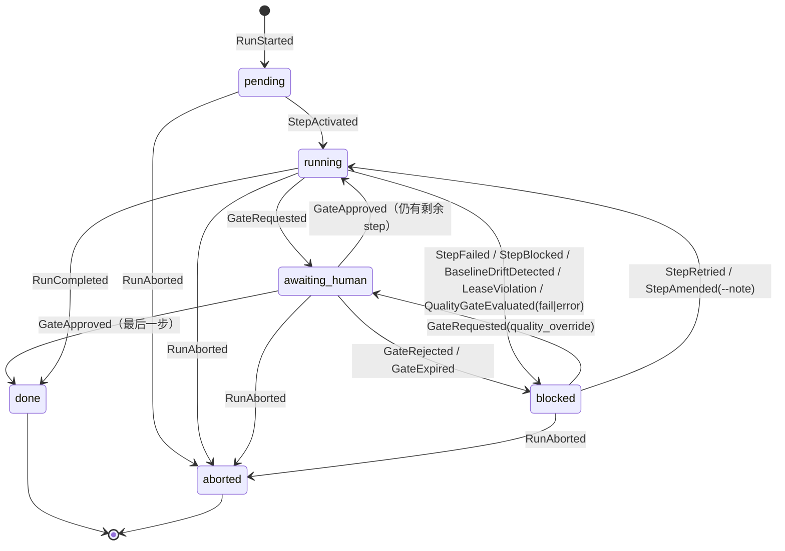
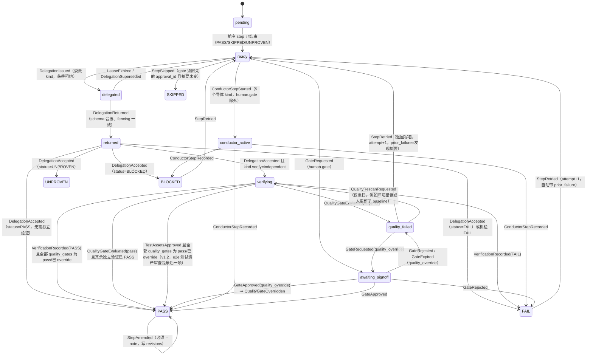
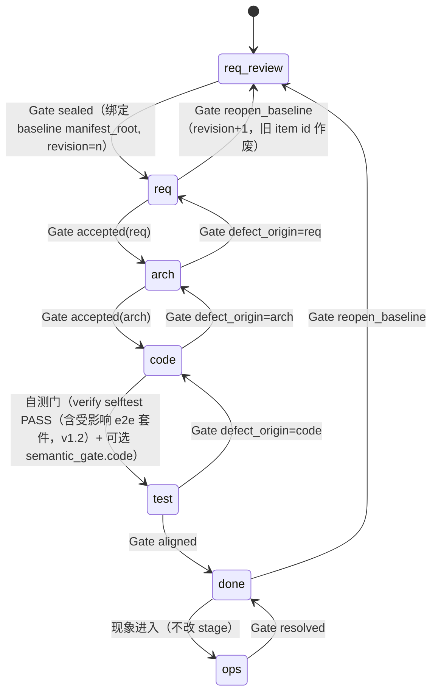
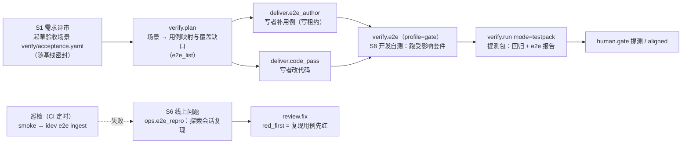
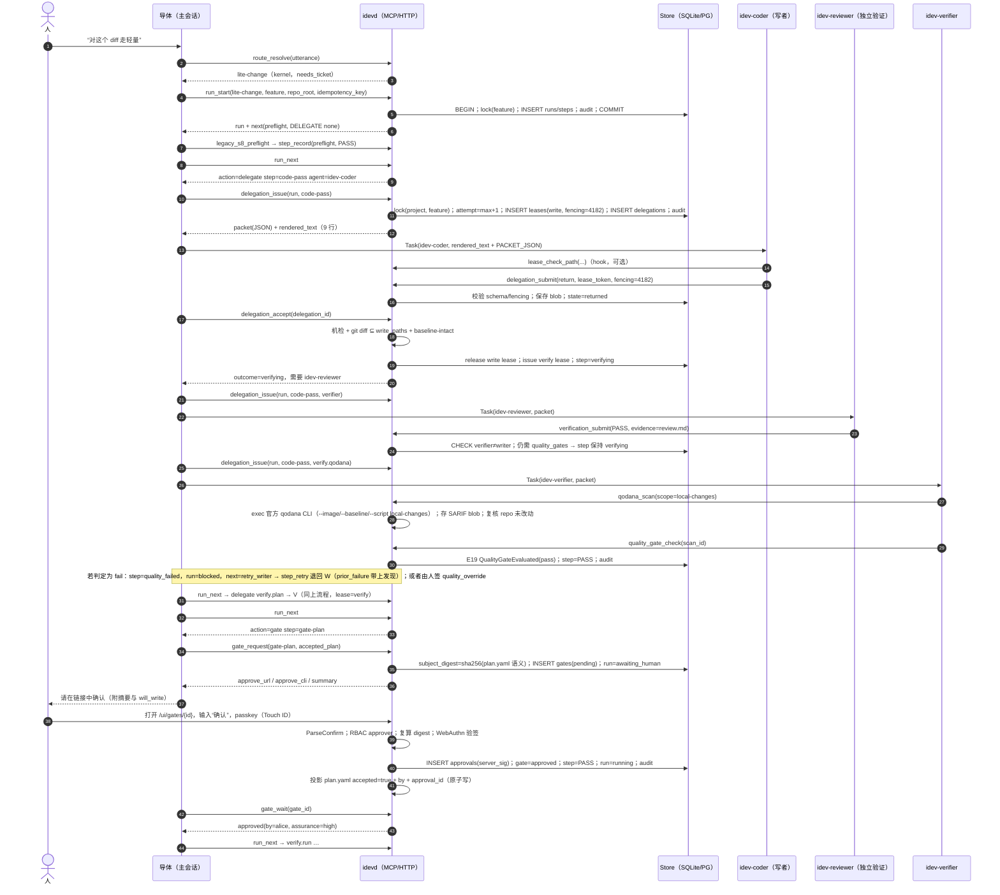
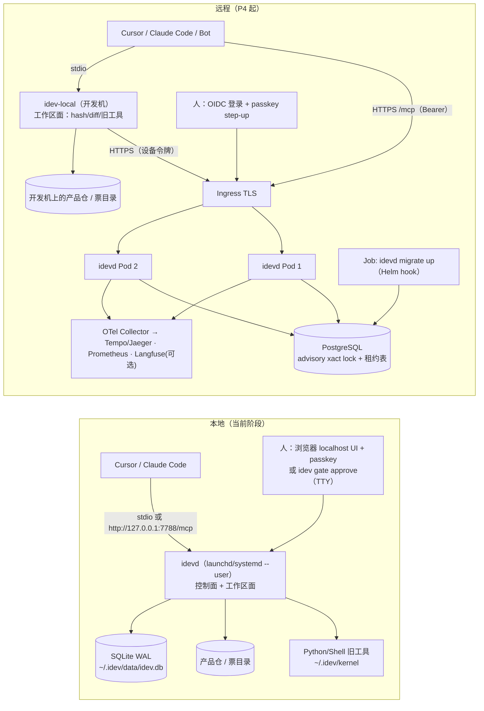

# idev 重构设计（实施版）：Go 核心服务 idevd + MCP + Markdown 资产

> 版本：v1.2（2026-10-17，Asia/Shanghai）。v1.1 备份为 `idev-refactor-design.v1.1.md`，v1.0 备份为 `idev-refactor-design.v1.md`。
> v1.2 变更：接入 TesterArmy 开源 e2e 框架（github.com/tester-army/e2e，npm `e2e` 0.21.2）作为第二类质量门。§6.6 泛化为可插拔的质量门框架（新增 §6.6.0：适配器契约、公共 schema `quality-common`、服务端复算判定、只能人签放行），Qodana 内容保留为 qodana 适配器、语义不变；新增 §6.7 e2e 行为质量门（定位、S1–S8/提测/S6/巡检生命周期、角色、防作弊、确定性与成本、执行与判定、MCP 工具 `e2e_list`/`e2e_run`/`e2e_gate_check`/`e2e_report`/`e2e_explore_session` 的 schema 与示例、JoyPaaS 控制台示例项目与试点）。联动修改 §0、§1.2、§1.3、§2.2、§2.3（I-8 泛化，新增 I-9、I-10）、§3.2、§4、§5.2–§5.5（新增事件 E22–E27）、§6.3–§6.5（新增 kind `verify.e2e`、`deliver.e2e_author`、`ops.e2e_repro`）、§7.2（迁移 00002）、§7.3、§9.2、§9.4、§9.6（新 gate 类型 `test_assets_accept`、`flaky_quarantine`）、§10.3、§10.4、§14、§15、§16、§17.3、§20.3、§20.7（CI 作业与产品仓模板）、§21、§22、§23.1、§24（Q9–Q17）、§25–§28（WBS、验收、R15–R22）、§29。托管的 TesterArmy 服务只作为可选项，默认关闭。
> e2e 事实核对（2026-10-17）：来源是 `tester-army/e2e` 仓（HEAD `ff3bf39`）的 README、docs 与源码、npm 包版本、随包文档与 `report-v1.schema.json`、本机安装的 CLI `--help`；并在 box 上用 Node v24.22.0 实跑了 `tsc`、`e2e list`、纯定位器的 `e2e run` 和 `e2e mcp` 的 `tools/list`（详见 §6.7 开头）。需要模型的行为没有实跑，正文标了“待验”。
> v1.1 变更：在 verify 流程中加入 Qodana 质量门（新增 §6.6，联动修改 §0、§1.3、§2.3、§3.2、§4、§5、§6.3–§6.5、§7.2、§9、§10、§14–§18、§20–§28）；把 Q7 的核实结论（`Q7-verified-2026-10-16.md`，来源 cursor.com/docs 的 subagents 与 hooks 页面）并入 §6.2、§18.1 和 R3，§24 的 Q7 标为已解决。
> 输入：`/workspace/idev-review/idev-architecture-review.md`（下称“评审”）。本稿写作时又以只读方式复核了用户本机 `~/go/src/github.com/idev`（HEAD `bc7e9c3`，2026-10-15 17:37 +08:00）：`scripts/lib/workflow_spec.py`、`scripts/lib/kind_agents.py`、`scripts/workflow.py`（`cmd_start`/`cmd_record`）、`scripts/delegation.py`（`write`）、`workflows/lite-change.yaml`、`SKILL.md` 决策树、`references/agents.md` 委派包格式、`references/chat-confirm-signoff.md`、`deliver/references/deliver-schema.md`、`agents/idev-coder.md` 与 `agents/idev-verifier.md` 的回报格式。没有改动该仓库。
> 本机工具链：`go version` 输出 go1.25.4 darwin/arm64，`python3 --version` 输出 3.9.6。
> 依赖版本核对（2026-10-15）：Go 版本来自 go.dev/doc/devel/release；Go 模块版本来自 `proxy.golang.org/<module>/@latest`；GitHub Actions 与工具版本来自 GitHub Releases API；MCP Go SDK 的 API 名称来自 v1.8.0 源码（`mcp/transport.go`、`mcp/streamable.go`、`auth/auth.go`）；Cursor 与 Claude Code 的配置格式来自 cursor.com/docs 与 code.claude.com/docs。所有出现的版本号都核对过。凡是没有核实的地方，正文都标了“待验”。

---

## 0. 一页结论

| 决策点 | 选择 | 一句话理由 | 否决的方案 |
|---|---|---|---|
| 语言/版本 | Go，`go.mod` 写 `go 1.26.0`，加 `toolchain go1.27.2`；CI 同时跑 1.26.x 和 1.27.x | 1.27.2（2026-10-08）是当前最新稳定版；按“支持最近两个大版本”的政策，1.26 和 1.27 都还在支持期 | 停在 1.25（1.27 发布后已经停止支持，本机 1.25.4 靠 `GOTOOLCHAIN=auto` 自动拉新工具链）；把下限定为 1.27（会无谓排除 1.26） |
| 进程形态 | 两个二进制：`idevd`（服务：serve / mcp / migrate / admin）和 `idev`（人与导体用的 CLI，包含旧命令的兼容子命令） | 服务和人工签字面分开；`gate approve` 只放在 `idev` 和 Web UI 里，**不对 agent 的 MCP 面暴露** | 单个 multi-call 二进制（签字入口和 agent 入口难以隔离） |
| MCP SDK | `github.com/modelcontextprotocol/go-sdk` **v1.8.0** | 官方 SDK；支持 MCP 2026-07-28 并向下兼容 2025-11-25、2025-06-18 等版本；自带 `StdioTransport`、`NewStreamableHTTPHandler`（`Stateless`）、`auth.RequireBearerToken`、`NewInMemoryTransports` | `github.com/mark3labs/mcp-go` v1.3.0（成熟，但不是官方实现；鉴权和协议跟进要看社区节奏） |
| 应用 API | 标准库 `net/http`（Go 1.22+ 方法与通配路由）+ OpenAPI 3.1，契约直接 `$ref` 同一套 JSON Schema；**第一版不做 gRPC** | JSON Schema 是唯一的契约源，MCP inputSchema 本身就是 JSON Schema；客户端是 LLM、CLI 和 Web，不需要 gRPC | `connectrpc.com/connect/v2` v2.0.1（2.0.0 在 2026-10-07 才发布；引入 proto 后会出现第二套契约源；以后需要服务间流式调用时再加）、grpc-go v1.84.0、chi/gin/echo（标准库已经够用）、huma v2（code-first 与 schema-first 冲突） |
| 存储 | 本地：SQLite（`modernc.org/sqlite` v1.60.1，纯 Go，`CGO_ENABLED=0`）；远程：PostgreSQL（`github.com/jackc/pgx/v5` v5.11.0）；大对象存内容寻址的 blob（本地放文件系统，远程先放 DB，以后可迁到对象存储） | 单二进制、可交叉编译；同一个 `ports.Store` 接口，两个 adapter 共用一套一致性测试 | `mattn/go-sqlite3`（需要 cgo，交叉编译麻烦）；继续以 YAML 文件为真源（没有事务，评审 §3.2 的覆盖问题会一直存在） |
| 迁移与查询 | `github.com/pressly/goose/v3` v3.29.0（嵌入 `embed.FS`）+ `sqlc` v1.31.1（Postgres 支持为 Stable，SQLite 为 Beta） | goose 可以嵌入 Go 代码，同时支持 sqlite3 和 postgres 两种方言；sqlc 生成类型安全的查询代码 | golang-migrate v4.20.1（不支持 Go 写的迁移）、Atlas v1.3.0（声明式迁移更强，但运行和许可面更复杂）、ORM（gorm/ent，审计和锁语义不透明） |
| 锁/租约 | **PostgreSQL**：事务级 advisory lock `pg_advisory_xact_lock` 串行化同一 feature 的状态迁移，加上 `leases` 表、单调 fencing token 和部分唯一索引；**SQLite**：`_txlock=immediate` 加同一张 `leases` 表，外加进程级 flock | 锁和状态迁移在**同一个数据库事务**里，没有双写问题；不需要多运维一个集群 | etcd v3.7.2（多一个 3 节点集群，租约和状态不在同一事务里，fencing 仍然要回 DB 校验）；Redis Redlock（正确性有争议）；会话级 advisory lock（与 PgBouncer 事务池不兼容） |
| JSON Schema | Draft 2020-12；校验用 `github.com/santhosh-tekuri/jsonschema/v6` v6.0.3；Go 类型用 `github.com/atombender/go-jsonschema` v0.24.1 从 schema 生成 | schema-first：MCP、HTTP、旧 YAML 投影共用同一套 schema | 先写 Go struct 再反推 schema（会让 Go 代码变成契约真源） |
| 人签 | 白名单身份 + 整句确认语法（修复 `is_human`/`is_confirm`）+ **带外批准**（本地：`idev gate approve` 本机令牌，assurance=low；passkey/WebAuthn，assurance=high；远程：OIDC 加 passkey step-up）+ 服务端 ed25519 对批准记录的 JCS 规范化 JSON 签名 | agent 的 MCP 令牌在 RBAC 和 domain 不变式两层都**不可能**拿到 `gate:approve` | 继续只靠聊天里的确认用语（agent 能自己写）；用 MCP elicitation 作为身份凭据（回答经由 agent 客户端传回，无法证明是人） |
| 基线密封 | SHA-256 清单：每个文件同时记 raw 摘要和语义摘要，`manifest_root` 对排序后的行做 SHA-256；批准记录绑定 `manifest_root`；每次 stage 检查和每次委派验收都重新计算 | 让“密封”从布尔值变成内容指纹（评审 §3.3） | 只比 `sealed: true`（现状）；git commit SHA（票目录里常有未提交的修改，粒度太粗） |
| 审计 | 只追加的 `audit_events`，带哈希链 `hash=sha256(prev_hash‖JCS(event))`，定期由服务端签检查点；DB 触发器拒绝 UPDATE/DELETE | 可离线验证，篡改可检出 | 只写文本日志（不可验证） |
| 配置 | 只有一个 `IDEV_ROOT`（默认 `~/.idev`）；`$IDEV_ROOT/config/idevd.yaml`，严格解码（未知键报错）；优先级 flag > `IDEV_*` 环境变量 > 文件 > 默认值；YAML 库用 `go.yaml.in/yaml/v3` v3.0.5 | 和现有 YAML 生态一致；解决评审 §3.5 和 §3.10 里 `kernel_root()` 有 4 份实现、12 处硬编码的问题 | viper（键名大小写不敏感、依赖重）、koanf v2.3.8（合并语义隐式）、TOML |
| 可观测性 | OpenTelemetry Go v1.47.0（trace 和 metrics）、`log/slog` JSON 日志、`go.opentelemetry.io/contrib/bridges/otelslog` v0.21.0；trace_id 由 run_id 确定性派生 | run→step→delegation→tool 形成一棵 span 树，可以跨多天、跨进程关联 | 让导体“自觉”去写 trace（现状） |
| 测试 | 标准库 testing、`go-cmp` v0.7.0、`pgregory.net/rapid` v1.3.0（性质测试）、原生 fuzz、`testscript`（`rogpeppe/go-internal` v1.16.0）做旧 CLI 的 golden 对拍、testcontainers-go v0.44.0（Postgres）、golangci-lint v2.14.0、govulncheck（`golang.org/x/vuln` v1.9.0） | 在 Python 和 Go 两套实现之间做行为对拍，作为迁移的安全网 | 继续把 bash 大脚本当作测试主体 |
| 打包部署 | GoReleaser v2.18.3 出单二进制（darwin 和 linux 的 amd64、arm64）；本地用 launchd 或 systemd --user；远程用 `gcr.io/distroless/static-debian13:nonroot` 镜像加 K8s，Helm chart 可选 | 纯 Go，没有 cgo；本地和远程是同一个二进制 | 远程只跑 stdio（无法多用户共享） |
| 质量门（静态） | verify 流程内的 **Qodana 质量门**（§6.6）：只读的 idev-verifier 通过 MCP `qodana_scan` 让 idevd 调用**官方 `qodana` CLI**，按产品语言选 linter（如 `qodana-go`、`qodana-jvm`），做增量扫描并带 baseline，阈值写在 `qodana.yaml` 的 `failureConditions`；SARIF 作为证据；判定由服务端作出并写成事件；失败时退回写者；人工放行只能走人签 `quality_override` gate | 静态分析结论变成可复算的证据，并且 agent 无法自己放行 | 接入第三方 Qodana MCP server（Node 供应链，阈值语义与官方不一致，允许 agent 改 baseline）；让 agent 自报“lint 通过” |
| 质量门（行为） | **可插拔质量门框架**（§6.6.0）的第二个适配器 **e2e**（§6.7）：TesterArmy 开源 e2e 框架（npm `e2e` 0.21.2 + `@e2e-dev/web` 0.15.2，Apache-2.0）。用例放在产品仓 `e2e/`，定位器断言与 `agent.act/assert/waitFor/extract` 混写；idevd 以只读缓存快照执行已安装的 CLI，从 `report.json` 复算判定（flaky、必需验收场景、测试资产审查）；验收场景在 S1 写成 `acceptance.yaml` 并随基线密封；S6 用代理的 `e2e explore` / `e2e mcp` 复现；巡检由 CI 定时跑 smoke 后上报。模型自带（内网 OpenAI 兼容网关），遥测关闭 | 让 UI/流程行为也变成可复算的证据；测试资产、缓存和配置的改动不能由同一次交付自证 | 托管 TesterArmy 服务作默认（数据出网，判定不经 idevd）；把 `e2e mcp` 直接配给 agent（凭据进客户端、无审计）；让 verifier 自己跑 CLI（凭据在 env 里） |
| 迁移 | strangler fig：P0 止血 → P1 契约与骨架 → P2 本地 idevd → P3 客户端接入与人签切换 → P4 远程化 → P5 收尾，**核心约 16 周**（v1.0 为 11 周；v1.1 Qodana 质量门 +3.5d；v1.2 e2e 质量门与 JoyPaaS 试点 +20.5d），P5 另需 2–4 周 | 每一阶段都能用 `IDEV_ENGINE=python|shadow|go` 回滚 | 一次性重写（golden 没有就位之前风险不可控） |

---

## 1. 背景、目标与非目标

### 1.1 现状（摘自评审并经复核）
- idev 是“一个 skill 当导体，五个 agent 当执行者”的人机共驾交付编排器。场景 S1–S8 由 `SKILL.md` 决策树路由；S8 命中 `workflows/<id>.yaml` 配方（内核共 14 份）后，由 `scripts/workflow.py start/next/record` 逐步推进。
- 代码规模：约 12,006 行 Python（`scripts/*.py` 与 `scripts/lib/*.py`）、约 7,318 行 `scripts/*.sh`（其中 `agent-smoke.sh` 2,855 行、`selfcheck.sh` 1,644 行）、约 8,309 行 Markdown；仓里没有 Go 代码。
- 契约即代码：`workflow_spec.KINDS` 共 29 个 kind（24 个委派，5 个由导体执行：`preflight.inputs`、`human.gate`、`shell.confirmed`、`ui.clean_pass_loop`、`ui.product_batch`），另有 `FORBIDDEN={auto.seal, auto.accepted, skip.signoff, multi.module.load}`、`RUN_STATUS={pending, running, blocked, done, aborted}`、`STEP_STATUS={PASS, FAIL, UNPROVEN, SKIPPED, BLOCKED}`。
- 人签有四类：`sealed`、`accepted`、`aligned`、`resolved`，另有破坏性的 `reopen_baseline` 和 `defect_origin`（`chat-confirm-signoff.md`）。阶段机为 `req-review → req → arch → code → test → done`，`ops` 是旁路（`deliver-schema.md`）。
- 委派包有固定的 9 行文本格式（`references/agents.md`）。回报是自由文本，以 `STATUS:/EVIDENCE:/SCOPE:/READ:/CHANGED:/REVERT:/ASSUMED:/FACTS:/SUGGEST:…` 等行开头，由 `delegation.py` 用正则解析，落盘到 `<票目录>/workflow/delegations/<step>-<attempt>.yaml`。
- 评审确认的硬伤：§3.1 `is_human('idev-coder')` 和 `is_human('Claude')` 返回 True，`is_confirm('确认不了')` 和 `is_confirm('同意吗')` 也返回 True；§3.2 写 `run.yaml` 时没有锁也不是原子写，`delegation.py write` 在 `attempt` 缺省为 1 时会**静默覆盖**旧记录；§3.3 `sealed` 只是布尔值；§3.5 有 4 份 `kernel_root()`；§3.7 回报靠正则解析；§3.8 工具边界只靠 prompt 约束；§3.9 没有单测也没有 CI；§3.11 没有 run_id 和 span。

### 1.2 目标（按优先级）
1. **稳定**：所有状态迁移都在事务里完成，可以幂等重放、不会静默覆盖；人签无法由 agent 伪造；基线有内容指纹。
2. **可远程部署、多人协作**：同一个二进制，本地用 SQLite 单机运行，远程用 PostgreSQL 多副本运行；多用户、RBAC、OIDC。
3. **渐进迁移**：现有 CLI 契约（输出前缀 `NEXT/OPEN/DELEGATE/OK/FAIL/BLOCKED/HINT/STOP`、退出码 0/1/2）在切换前保持字节级一致（golden）。
4. **可观测、可审计**：run→step→delegation 的 span 树；哈希链审计。
5. **验证与 QA 可信**（v1.2）：静态（Qodana）和行为（e2e）两类质量门都由服务端复算判定；验收场景从 S1 起就是密封的需求，一路贯穿开发自测、提测、线上复现和巡检。

### 1.3 非目标
- 不把 prompt、skill、agent 定义改写成代码。它们仍是 Markdown，只是改由服务端做版本管理、发布并给出摘要（§12）。
- 不替代人的判断。延续内核“只计数、不打分”的原则，不引入质量分数门禁。§6.6 的 Qodana 质量门不违反这一条：它的门槛是“新问题数 ≤ 阈值”，也就是计数上限，不是分数；而且人可以通过签名的 `quality_override` gate 放行。
- 不在 P0–P3 迁移 `ui-*`、`req-ground`、`hypothesis` 等提效工具的内部逻辑，只把它们包成 MCP 工具（§16.4）。
- 不做跨地域部署（这也是锁方案选 Postgres 而不选 etcd 的前提之一，见 §8）。
- e2e 质量门（§6.7）同样只计数：失败数、flaky 数、缺失的必需场景数。agent 的 `assert` 结论只是证据，不形成分数；不用托管的 TesterArmy 服务（默认关闭）；不替代单测、集成测试和 Qodana；P0–P4 不做移动端（`@e2e-dev/mobile`）。

---

## 2. 目标架构

### 2.1 角色与边界
- **导体（conductor）**：主会话里的 agent（Cursor、Claude Code 或 Bot）。它和人对话、认场景、调 MCP 工具，**不直接写状态文件，也不写签字字段**。
- **执行者（subagent）**：deliver、verify、ops、selftest 四类角色（§15）。写者必须持有写租约；验证者在产品代码上只读，只写票目录里的验证产物。
- **idevd 控制面**：run、step、delegation 状态机，租约与锁，人签验证，基线清单，审计，资产发布。
- **工作区面（workspace plane）**：需要接触文件的能力，包括计算基线摘要、`git diff`、定位票目录，以及执行旧 Python/Shell 工具。本地模式下它嵌在 idevd 进程里；远程模式下由开发机上的 `idevd mcp --stdio --workspace-only`（MCP 服务名 `idev-local`）提供，结果再带上设备令牌报给远程控制面（§8.5、§19）。

### 2.2 架构图

```mermaid
flowchart TB
  H(["人 Human"])
  subgraph CLIENTS["客户端（MCP Host）"]
    C["导体 Conductor<br/>主会话 + 薄 SKILL.md"]
    SA["Subagents<br/>idev-deliver / idev-coder（写者）<br/>idev-verifier / idev-reviewer（独立验证）<br/>idev-ops / idev-selftest"]
  end
  H <-- 对话 --> C
  H -- "带外批准：idev gate approve / Web UI + passkey" --> HTTP
  C -- "Task 委派（packet JSON）" --> SA
  C -- "MCP tools/call" --> MCP
  SA -- "MCP（lease token）" --> MCP

  subgraph IDEVD["idevd（单一 Go 二进制）"]
    MCP["adapters/mcp<br/>go-sdk v1.8.0<br/>stdio / Streamable HTTP"]
    HTTP["adapters/httpapi<br/>net/http + OpenAPI 3.1<br/>gate 批准 UI（WebAuthn）"]
    subgraph APP["internal/app 用例（事务边界）"]
      RS[RunService] ; DS[DelegationService] ; GS[GateService]
      BS[BaselineService] ; LS[LeaseService] ; AS[AssetService] ; TS[TraceService] ; AU[AuditService] ; QG["QualityGateService<br/>adapters: qodana · e2e"]
    end
    subgraph DOM["internal/domain（零 IO）"]
      SM["Run / Step / Delegation / Gate 状态机"]
      SP["SignoffPolicy<br/>白名单身份 + 整句确认语法"]
      BL["Baseline 清单与 manifest_root"]
      LE["Lease：单写者 + write_paths + fencing"]
      KR["KindRegistry（registry/kinds.yaml 生成）"]
    end
    subgraph PORTS["internal/ports"]
      P1[Store] ; P2[BlobStore] ; P3[Workspace] ; P4[LegacyExec] ; P5[Signer] ; P6[Authn/Authz] ; P7[Clock/IDGen]
    end
    subgraph ADP["internal/adapters"]
      SQ["store/sqlite<br/>modernc + sqlc + goose"]
      PG["store/postgres<br/>pgx v5 + advisory xact lock"]
      WS["workspace/local<br/>hash · git diff · ticket locate"]
      LX["legacy/pyexec<br/>包装 scripts/*.py|*.sh"]
      AN["authn: localtoken / oidc / webauthn"]
      OT["telemetry: OTel + slog"]
      QQ["quality/qodana<br/>官方 qodana CLI"]
      QE["quality/e2e<br/>e2e CLI（产品仓 Node 项目）"]
    end
    MCP & HTTP --> APP --> DOM
    APP --> PORTS
    SQ & PG & WS & LX & AN & OT & QQ & QE -. implements .-> PORTS
  end

  SQ --> DB1[("SQLite<br/>$IDEV_ROOT/data/idev.db")]
  PG --> DB2[("PostgreSQL")]
  WS --> FS[("产品仓 / 票目录 / .idev")]
  LX --> PY["现有 Python / Shell 工具<br/>（strangler 迁移中）"]
  AS --> ASSET[("资产包<br/>SKILL.md · agents/*.md · workflows/*.yaml · schemas<br/>版本 + 摘要")]
  OT --> OBS[("OTLP Collector / Prometheus / Langfuse（可选）")]
  QE --> E2E["产品仓 e2e/ 项目<br/>Node 24 · e2e 0.21.2 · Chromium"]
  E2E --> ENV[("JoyPaaS 测试环境（HTTPS）")]
  E2E --> LLM[("内网模型网关（act / judge）")]
```



### 2.3 关键设计不变式（代码和测试都必须守住）
1. **I-1 单写者**：同一个 feature 任一时刻最多只有一个 `purpose=write` 的有效租约，由 DB 部分唯一索引兜底（§8）。
2. **I-2 独立验证**：如果 kind 在 `registry/kinds.yaml` 里声明了 `verify: independent`，该 step 的 PASS 必须同时有写者的回报和**另一个 agent** 的验证结论，并且 `verifier != writer`（§6.4）。
3. **I-3 人签带外**：`gate:approve` 权限只授予 `kind=human` 的 principal，而且请求必须来自人工认证通道（local-token 交互式 CLI、WebAuthn 或 OIDC 会话）。MCP 面上不存在批准工具（§10）。
4. **I-4 内容指纹**：任何 `sealed`、`accepted`、`aligned`、`resolved` 批准都必须绑定 `subject_digest`。验收时重新计算摘要，结果不一致就 `baseline-drift`，run 进入 blocked（§11）。
5. **I-5 不覆盖**：delegation 的 `(run_id, step_id, attempt)` 唯一，attempt 由服务端分配；所有写入都只追加或做 CAS（§13）。
6. **I-6 只追加审计**：每次状态迁移都在同一事务里写一条 `audit_events`（§14）。
7. **I-7 一处登记**：新增 kind 只改 `registry/kinds.yaml`。Go 常量、JSON Schema 的 enum、Python 兼容表和 `workflow-schema.md` 散文表都由生成器产出，CI 校验生成物是最新的。
8. **I-8 质量门不能被 agent 放行**：如果 kind 声明了 `quality_gates`，step 要变成 PASS，对列出的**每个**适配器（`qodana`、`e2e`；对该产品不适用的除外），该 step 最近一次 `quality_gate_runs` 的结果必须是 pass，或者有一条人签 `quality_override` 的批准记录。判定只由服务端根据工具的退出码和原始报告（SARIF、`report.json`）复算作出（§6.6.0）。
9. **I-9 测试资产不自证**（v1.2）：同一次交付改动了受保护的 e2e 测试资产（配置、用例、回放缓存）时，在 reviewer 审查或人签 `test_assets_accept` 通过之前，step 不能 PASS；verifier 不能写用例和缓存，e2e 只能由 idevd 用只读缓存快照执行（§6.7.4）。
10. **I-10 证据可复算**（v1.2）：所有质量门证据都由 idevd 对文件字节复算 sha256 并存 blob；工具自报的摘要只作交叉校验，不一致即 error（§6.6.0）。

---

## 3. 仓库与 Go 模块布局

### 3.1 放置策略
- **同一仓库（monorepo）**，`go.mod` 放在仓库根。L0 Markdown 资产（`SKILL.md`、`agents/`、`conventions/`、`deliver/`、`docs/`、`ops/`、`verify/`、`references/`、`workflows/`）在 P0–P4 期间**位置不动**。原因是 `~/.cursor/skills/idev` 是指向本仓的 symlink，移动文件会让所有交叉引用一起失效。Go 新增的目录名（`cmd/ internal/ pkg/ api/ registry/ deploy/ test/`）和现有目录不冲突。
- 模块路径：仓库目前位于 `GOPATH/src/github.com/idev`，下文先以 `github.com/idev` 代称。正式托管后用 `go mod edit -module <host>/<org>/idev` 改一次即可，因为 `internal/` 下的代码不会被外部 import。

### 3.2 目录树

```text
idev/
├── go.mod                      # go 1.26.0；toolchain go1.27.2；tool 指令登记 sqlc/goose/golangci-lint/go-jsonschema
├── cmd/
│   ├── idevd/                  # 服务端：serve | mcp (--stdio|--http) | migrate | keys | admin | export | import
│   └── idev/                   # 人/导体 CLI：run|step|delegation|gate|baseline|lease|trace|assets|audit|doctor
│                               #   + 兼容子命令：idev workflow {start,next,status,record}、idev delegation write …
├── internal/
│   ├── domain/                 # 纯逻辑，零 IO，只依赖标准库
│   │   ├── kind/               # KindRegistry（由 registry/kinds.yaml 生成 zz_generated.go）
│   │   ├── recipe/             # 配方解析校验（对应 workflow_spec.check_recipe）
│   │   ├── run/                # Run/Step 状态机（表驱动）
│   │   ├── delegation/         # Delegation 状态机、attempt 规则、回报机检（对应 delegation.run_checks）
│   │   ├── gate/               # Gate 状态机、gate_type、assurance 策略
│   │   ├── signoff/            # 身份白名单、确认语法（修复 is_human/is_confirm）
│   │   ├── baseline/           # 清单、语义规范化、manifest_root
│   │   ├── lease/              # 租约、write_paths 匹配、fencing
│   │   ├── qualitygate/        # 质量门框架与判定纯函数：qodana（阈值、baseline 状态计数）、e2e（退出码/错误码映射、flaky、必需场景、测试资产审查）（§6.6.0、§6.7.6）
│   │   ├── principal/          # Principal、Role、Permission
│   │   └── audit/              # 审计事件、哈希链
│   ├── app/                    # 用例：一用例 = 一事务；编排 domain + ports
│   │   ├── runsvc/ delegsvc/ gatesvc/ baselinesvc/ leasesvc/ assetsvc/ tracesvc/ auditsvc/ legacysvc/
│   ├── ports/                  # 接口：Store(Tx), BlobStore, Workspace, LegacyExec, Signer, Authenticator, Authorizer, Clock, IDGen, Telemetry, GateAdapter
│   └── adapters/
│       ├── store/sqlite/       # modernc.org/sqlite + sqlc（engine: sqlite）+ migrations/*.sql（goose，embed）
│       ├── store/postgres/     # pgx/v5 + sqlc（engine: postgresql）+ migrations/*.sql
│       ├── store/storetest/    # 两个 adapter 共用的一致性测试套件
│       ├── blob/{fs,db}/       # 内容寻址 sha256 blob
│       ├── workspace/local/    # 文件哈希、git diff、票目录定位（doc_home/product_sink 的无副作用移植）
│       ├── legacy/pyexec/      # 子进程执行 scripts/*.py|*.sh，统一 JSON 结果，超时/输出上限
│       ├── quality/qodana/     # 包装官方 qodana CLI：argv allowlist、SARIF 解析、退出码映射（§6.6）
│       ├── quality/e2e/        # 包装产品仓已安装的 e2e CLI：版本核对、argv allowlist、缓存快照、report.json 解析、证据 sha256、e2e mcp 代理（§6.7）
│       ├── mcp/                # go-sdk server；工具注册；schema 绑定；lease token 中间件
│       ├── httpapi/            # REST + OpenAPI；/ui/gates 批准页；/metrics；/healthz /readyz
│       ├── authn/{localtoken,oidc,webauthn}/
│       ├── authz/              # RBAC 策略评估
│       ├── signer/ed25519/
│       ├── telemetry/          # OTel provider、确定性 trace_id、slog handler
│       ├── config/             # IDEV_ROOT 解析、yaml 严格解码、env 覆盖
│       └── yamlcodec/          # 旧 run.yaml / delegations/*.yaml / trace v2 的导入导出（兼容投影）
├── pkg/                        # 仅放“允许外部 import”的稳定包
│   ├── canonical/              # RFC 8785 JCS + sha256 清单工具（供离线验证器、Python 侧复用其 CLI）
│   ├── client/                 # Go HTTP 客户端（cmd/idev 使用；未来 Bot 也可用）
│   └── schemas/                # go:embed api/schemas 的 JSON Schema + 校验封装
├── api/
│   ├── schemas/                # 契约真源（Draft 2020-12）：common, delegation-packet, delegation-return, run, gate, approval, baseline-manifest, trace-round, recipe, kinds, quality-common, acceptance-scenarios, tools/*
│   └── openapi/idevd.v1.yaml   # OpenAPI 3.1，components 用 $ref 指向 api/schemas
├── registry/kinds.yaml         # 唯一 kind 表（§6.5）
├── deploy/{launchd,systemd,docker,k8s,helm/idevd}/
├── test/
│   ├── golden/legacy/*.txtar   # Python 旧 CLI 录制的对拍用例（testscript）
│   ├── e2e/                    # idev 自身的 lite-change 全流程（假 subagent）；与 e2e 质量门无关
│   ├── e2e-fixture/            # e2e 适配器的夹具：精确钉住版本的 e2e 项目 + 静态页 + 纯定位器用例（不需要模型）
│   └── fixtures/tickets/       # 票目录样本（含 baseline.yaml/req.yaml/arch.yaml/verify/plan.yaml）
├── scripts/                    # 迁移期：Python/Shell 原样保留；入口加 IDEV_ENGINE 分流 shim
└── （现有）SKILL.md agents/ conventions/ deliver/ docs/ ops/ verify/ references/ workflows/ handoffs/ state/
```

### 3.3 依赖方向（由 lint 强制）
- `domain` 只能 import 标准库和 `domain/*`。`app` 只能 import `domain`、`ports` 和 `pkg/canonical`。`adapters/*` 实现 `ports`。`cmd/*` 只负责装配（wire）。
- 强制手段：golangci-lint v2 的 `depguard` 规则（见 §20.6）。另有一条 `go list -deps` 脚本断言 `internal/domain/...` 的依赖闭包里不出现 `database/sql`、`net/http`、`os/exec`。
- `pkg/` 的门槛：只有确实需要被仓外 import 的包才放这里，例如离线验证签名和清单的工具、Go 客户端。其余一律放 `internal/`，避免过早承诺公开 API。

---

## 4. 技术栈与版本清单（2026-10-15 核实；e2e 相关 2026-10-17 核实）

| 用途 | 模块 / 工具 | 版本 | 核实来源 |
|---|---|---|---|
| Go 工具链 | go | 1.27.2（2026-10-08）；下限 1.26 | go.dev/doc/devel/release |
| MCP | github.com/modelcontextprotocol/go-sdk | v1.8.0 | GitHub Releases、proxy.golang.org；pkg.go.dev 标注其最低 Go 版本为 1.25.0 |
| SQLite 驱动 | modernc.org/sqlite | v1.60.1 | proxy.golang.org；DSN 参数 `_pragma`、`_txlock` 见 pkg.go.dev |
| Postgres 驱动 | github.com/jackc/pgx/v5 | v5.11.0 | proxy.golang.org |
| 迁移 | github.com/pressly/goose/v3 | v3.29.0 | proxy.golang.org、GitHub README（支持 sqlite3 和 postgres） |
| 查询代码生成 | sqlc | v1.31.1 | GitHub Releases；docs.sqlc.dev：PostgreSQL 为 Stable，SQLite 为 Beta |
| JSON Schema 校验 | github.com/santhosh-tekuri/jsonschema/v6 | v6.0.3 | proxy.golang.org |
| JSON Schema 生成 Go 类型 | github.com/atombender/go-jsonschema | v0.24.1 | proxy.golang.org（go.mod 中的 module 名） |
| MCP 工具 schema（SDK 内部） | github.com/google/jsonschema-go | v0.4.3 | go-sdk v1.8.0 的依赖 |
| 规范化 JSON | github.com/gowebpki/jcs（RFC 8785） | v1.0.2 | proxy.golang.org |
| 签名 | crypto/ed25519（标准库） | — | — |
| ID | github.com/oklog/ulid/v2 | v2.1.2 | proxy.golang.org |
| YAML | go.yaml.in/yaml/v3 | v3.0.5 | proxy.golang.org（YAML 组织维护的后继模块；`gopkg.in/yaml.v3` 最后一版 v3.0.1 发布于 2022-05） |
| CLI | github.com/spf13/cobra | v1.10.2 | proxy.golang.org |
| OIDC | github.com/coreos/go-oidc/v3 | v3.21.0 | proxy.golang.org |
| WebAuthn | github.com/go-webauthn/webauthn | v0.18.2 | proxy.golang.org |
| 本机密钥链（可选） | github.com/zalando/go-keyring | v0.2.8 | proxy.golang.org |
| 文件锁 | github.com/gofrs/flock | v0.13.1 | proxy.golang.org |
| OTel API/SDK | go.opentelemetry.io/otel、…/sdk、…/exporters/otlp/otlptrace/otlptracegrpc | v1.47.0 | proxy.golang.org |
| Prometheus 导出 | go.opentelemetry.io/otel/exporters/prometheus | v0.69.0 | proxy.golang.org |
| slog 桥 | go.opentelemetry.io/contrib/bridges/otelslog | v0.21.0 | proxy.golang.org |
| 测试 | github.com/google/go-cmp v0.7.0；pgregory.net/rapid v1.3.0；github.com/rogpeppe/go-internal（testscript）v1.16.0；github.com/testcontainers/testcontainers-go/modules/postgres v0.44.0 | — | proxy.golang.org |
| Lint / 安全 | golangci-lint v2.14.0；golang.org/x/vuln（govulncheck）v1.9.0 | — | GitHub Releases、proxy.golang.org |
| 发布 | GoReleaser v2.18.3 | — | GitHub Releases |
| 质量门 | Qodana CLI（`qodana`，JetBrains/qodana-cli）v2026.2.2；linter 镜像 `jetbrains/qodana-go:2026.2`（按产品语言替换）；GitHub Action `JetBrains/qodana-action` v2026.2.2 | — | GitHub Releases API（2026-10-16）、Docker Hub tags、jetbrains.com/help/qodana（§6.6） |
| e2e 框架（v1.2） | npm `e2e`（SDK、runner、CLI，bin `e2e`） | 0.21.2 | npm registry；GitHub `tester-army/e2e` HEAD `ff3bf39`（2026-10-16）；Apache-2.0；README：1.0 之前 minor 版本间 API 和配置可能变 |
| e2e Web 引擎 | `@e2e-dev/web`（Playwright 引擎，bin `e2e-web`；依赖 `playwright-core` 1.64.0） | 0.15.2 | npm registry；box 实装后 `npx e2e-web install chromium` 下载 Chrome Headless Shell 156.0.8078.4 |
| e2e 其他包 | `@e2e-dev/github`（PR 评论 reporter）0.4.2；`@e2e-dev/mobile` 0.12.3（P0–P4 不用）；`@e2e-dev/decision` 0.2.4（未用） | — | npm registry |
| e2e 的模型接口 | `ai`（peer `^7`，实装 7.0.143）；`@ai-sdk/openai-compatible` 3.0.71；`zod` 4.6.7（`agent.extract` 的 Standard Schema） | — | npm registry；box 实装 |
| e2e 运行时 | Node `^22.22.3 \|\| >=24.8.0`（box 实测 v24.22.0；Node 20 不可用）；TypeScript 7.0.2、`@types/node` 24.19.2（只用于 `tsc` 类型检查） | — | 包的 `engines` 字段；box 实测 |
| e2e CI | actions/setup-node v7.1.0；actions/upload-artifact v7.0.2 | — | GitHub Releases API（2026-10-17） |
| 基础镜像 | gcr.io/distroless/static-debian13:nonroot | 标签存在 | gcr.io tags/list |
| CI Actions | actions/checkout v7.0.1；actions/setup-go v7.0.0；golangci/golangci-lint-action v9.3.0；goreleaser/goreleaser-action v7.3.0；docker/build-push-action v7.4.0；docker/setup-buildx-action v4.4.1；sqlc-dev/setup-sqlc v5.0.0；actions/setup-python v7.0.0 | — | GitHub Releases API |

> 备选库（核实过，未选用）：mark3labs/mcp-go v1.3.0；connectrpc.com/connect v1.21.1 与 v2.0.1；grpc-go v1.84.0；go-chi/chi/v5 v5.5.0；danielgtaylor/huma/v2 v2.39.1；golang-migrate/migrate/v4 v4.20.1；ariga/atlas v1.3.0；go.etcd.io/etcd/client/v3 v3.7.2；mattn/go-sqlite3 v1.14.52；knadh/koanf/v2 v2.3.8；goccy/go-yaml v1.19.2。
> 升级策略：Renovate 或 dependabot 每周提一次 PR；`go-sdk` 的 `MCPGODEBUG` 兼容开关会在 v1.9.0 移除（见其 v1.8.0 release note），升级前要跑 MCP 契约测试（§20.3）。
> e2e 的升级策略：产品仓 `e2e/package.json` 写精确版本、锁文件入库；`quality.e2e.versions` 与之同步；升级 PR 必须跑 `e2e-adapter` 作业（§20.7）和一次 `flake_probe`，并由人签 `test_assets_accept`（配置清单变化，§6.7.4）。

---

## 5. 状态机设计

状态机写在 `internal/domain/{run,gate,delegation}` 里，做成**表驱动**的纯函数：`Apply(state, event, ctx) → (newState, effects[], error)`。`effects` 是声明式的副作用，例如 `AcquireLease`、`EmitAudit`、`ProjectYAML`、`StartSpan`，由 app 层在同一事务中执行。不引入第三方 FSM 库：转移表本身就是要评审的契约，写成 Go 数据比 DSL 更透明。

### 5.1 Run 状态

| 状态 | 含义 | 旧 `run.yaml.status` 投影 |
|---|---|---|
| `pending` | 已创建、参数已绑定，尚未激活第一步 | pending |
| `running` | 至少有一个 step 处于可推进状态 | running |
| `awaiting_human` | 当前 step 是 human.gate，正在等签 | running（旧版没有这个状态） |
| `blocked` | 存在 FAIL/BLOCKED/quality_failed 的 step，或者检测到 baseline-drift / lease 冲突 | blocked |
| `done` | 所有 step 都已结束，且没有处于 STOP 集合（FAIL/BLOCKED）的 step | done |
| `aborted` | 被人或 maintainer 中止 | aborted |



### 5.2 Step 状态（结果值与旧 `STEP_STATUS` 一一对应）



> `quality_failed`（v1.1 新增）属于 STOP 集合。它投影到旧 `run.yaml` 时写成 `status: FAIL`，`note` 记为 `quality-gate`。
> v1.2：`QualityGateEvaluated` 带 `tool`（`qodana` | `e2e`），每个适配器各自进入 `quality_failed` 的规则不变。e2e 判定为 `pending_review`（只差测试资产审查，§6.7.6）时 step **停在 verifying**，不进入 quality_failed；I-9 保证这时不会 PASS。

### 5.3 事件表（Run + Step + Delegation + Gate 合并）

| # | 事件 | 前置状态 → 后置状态 | 守卫（全部满足才迁移） | 允许的发起者 | 副作用（同一事务） |
|---|---|---|---|---|---|
| E1 | `RunStarted` | ∅ → run.pending | 配方通过 `recipe.Check`；绑定后的必填参数齐全；**(feature, workflow_id) 下没有 live run**（部分唯一索引）；`needs_ticket` 为真时票目录可定位；配方的 `product` 参数恰好点名一个产品 | conductor、maintainer | 固定资产包版本（`bundle_version`/`recipe_digest`）；审计；投影 `run.yaml` |
| E2 | `StepActivated` | step.pending → ready | 前序 step 都处于 DONE 集合（PASS/SKIPPED/UNPROVEN） | 系统 | 输出 `next` 视图（NEXT/OPEN/DELEGATE） |
| E3 | `DelegationIssued` | step.ready → delegated | `kind.executor != conductor`；agent 等于 `kind.agent`（对应 `delegation.py` 的 `BLOCKED kind … delegates to …`）；能获得写或验证租约；attempt>1 时自动填入 `prior_failure`；`kind.agent ∈ BOOST_AGENTS` 时必须给出 `idev_root`；kind=`ops.classify` 时必须给出 `artifact` | conductor | 生成 packet（JSON 加 9 行文本）；签发 lease token；开 span |
| E4 | `DelegationReturned` | delegated → returned | 调用方持有该 delegation 的 lease token；`fencing_token` 等于当前值；回报通过 `delegation-return` schema；`signoff_writes` 为空 | 执行者 agent | 保存原始回报 blob；审计 |
| E5 | `DelegationAccepted` | returned → PASS/FAIL/UNPROVEN/BLOCKED/verifying | 机检全部执行（§6.3）；写者满足 `CHANGED ⊆ lease.write_paths`，且 `git diff --name-only <revert.base>` ⊆ `write_paths`；基线摘要未漂移 | conductor | 释放写租约；需要独立验证时签发 verify 租约；`no-signoff-write` 失败时 run 进入 blocked，并输出 STOP |
| E6 | `VerificationRecorded` | verifying → PASS/FAIL | `verifier.agent != writer.agent`；verifier 的租约 `purpose=verify`；验证产物路径 ⊆ 票目录；**要迁到 PASS，还需要该 kind 的全部 `quality_gates` 最近一次判定为 pass 或已 override（I-8）**，否则停在 verifying | 验证者 agent | 审计；metrics |
| E7 | `ConductorStepRecorded` | conductor_active → PASS/FAIL/BLOCKED | kind 属于导体集合且不是 human.gate；`shell.confirmed` 必须附带 command 原文和 exit | conductor | — |
| E8 | `GateRequested` | ready → awaiting_signoff；run → awaiting_human | step.with 带 `will_write`（或 label 含“将代写”，旧规则）；能算出 `subject_digest` | conductor | 生成 gate 记录、批准 URL 和挑战值 |
| E9 | `GateApproved` | awaiting_signoff → PASS | 签字人是 human principal，并持有该 gate_type 和该 risk_tier 所需的权限；认证方式达到策略要求的 assurance；quote 通过 `signoff.ParseConfirm`；`subject_digest` 等于提交时的现算值；gate 未过期 | **仅限人**（HTTP UI 或 `idev gate approve`） | 写 `approvals`（服务端签名）；把 signoff 字段投影进票 YAML；审计 |
| E10 | `GateRejected` | awaiting_signoff → FAIL | 同 E9 的身份要求 | 仅限人 | 审计；run 进入 blocked |
| E11 | `GateExpired` | awaiting_signoff → ready | 当前时间超过 expires_at（默认 72h） | 系统 | 审计 |
| E12 | `StepSkipped` | ready → SKIPPED | 普通 step：conductor 加 note；human.gate：必须引用一个**已有的** approval_id，且该批准记录的 subject_digest 等于现算值（对应旧规则 `--evidence of the earlier signoff`） | conductor | — |
| E13 | `StepRetried` | FAIL/BLOCKED/quality_failed → ready；run blocked → running | 必须带 note；没有其他 STOP 状态的 step | conductor | 下一次 delegation 的 attempt 加 1；如果是从 `quality_failed` 重试，就**退回写者**：`prior_failure` 自动取最近一次 `quality_gate_runs` 的前 20 条发现（rule_id、level、path:line、message），并把 SARIF 的绝对路径追加进新 packet 的 `must_read` |
| E14 | `StepAmended` | 终态 → 终态 | 必须带 note（对应旧规则 `changing it needs --note`）；**human.gate 不能 amend 成 PASS**，只能走新的 gate | conductor、maintainer | 写 `revisions` |
| E15 | `LeaseExpired` | delegated → ready | DB 时间 `now() > expires_at` 且没有续租 | 系统 sweeper | 把 delegation 标记为 expired；之后的迟到回报会因 fencing 不匹配被拒 |
| E16 | `BaselineDriftDetected` | 任意非终态 → run.blocked | 现算的 `manifest_root` 不等于密封时的值，且没有 reopen gate | 系统 | 审计；输出 `BLOCKED baseline-drift` |
| E17 | `RunCompleted` | run.running → done | 所有 step 都已结束且没有 STOP | 系统 | 关闭 run span；投影 |
| E18 | `RunAborted` | 非终态 → aborted | 带 note；发起者为人或 maintainer（conductor 只能 abort 自己 start 的 run，且 run 中没有 PASS 的 gate） | 人、maintainer、conductor（受限） | 释放所有租约 |
| E19 | `QualityGateEvaluated` | verifying → verifying（pass，还在等其他验证）/ PASS（pass，且其余验证已 PASS）/ quality_failed（fail 或 error）；fail/error 时 run → blocked | scan 由本 step 的 `verify.qodana` 委派产生，调用方持有 verify 租约且 fencing 一致；`scan.head` 与写者交回时的 HEAD 相同，工作区 diff 没变；SARIF blob 的 sha256 一致；`config_sha256` 和 `baseline_sha256` 与写者 attempt 开始时相同（不同就判 fail，reason=`config_changed`/`baseline_changed`）；`repo_clean_after=true`；判定由服务端根据退出码和 SARIF 复算作出（§6.6.2） | 系统（由 `quality_gate_check` 触发） | 写 `quality_gate_runs`；审计 `quality_gate.evaluated`；metrics；fail/error 时输出 `BLOCKED quality-gate …`，并给出 `next.action=retry_writer`（或 error 时给 `rescan`）。**v1.2**：事件带 `tool`；`tool=e2e` 时由 `verify.e2e` 委派产生的 e2e 执行记录触发（`e2e_gate_check`），守卫换成 §6.7.6 的判定顺序（分片与报告有效 → 证据完整 → 退出码 → 计数与 flaky 策略 → 模型 → 复现预期 → 测试资产审查），`outcome=pending_review` 时停在 verifying |
| E20 | `QualityGateOverridden` | awaiting_signoff（gate_type=quality_override）→ PASS（其余验证已 PASS）或 verifying；run → running | 满足 E9 的全部守卫；`gate.params.gate_run_id` 指向该 step 最近一次 fail/error 的判定；`subject_digest = sha256(SARIF ‖ qodana.yaml ‖ baseline)` 与现算值相同；quote 带“放行” | **仅限人** | 写 approvals（服务端签名）；审计 `quality_gate.overridden`；被放行的那次 `quality_gate_runs` 本身不改动（只追加），通过 gate 关联。**v1.2**：`tool=e2e` 时 `subject_digest = sha256(report.json ‖ 配置清单摘要 ‖ 用例清单摘要 ‖ 缓存清单摘要)` |
| E21 | `QualityRescanRequested` | quality_failed → verifying | 必须带 note；写者的产物没变；签发新的 `verify.qodana`（v1.2：或 `verify.e2e`，按 `tool`）委派（attempt 加 1） | conductor | 审计 |
| E22 | `TestAssetsChanged`（v1.2） | verifying → verifying | 系统在 E5 或 E19(e2e) 时发现受保护 e2e 资产（config/tests/cache）的摘要与写者 attempt 开始时不同；写 `test_asset_changes`（前后清单摘要、改动文件、lint 信号）| 系统 | 按 §6.7.4 的审查策略：P2 且无 lint 信号 → 委派 `review.report`（reviewer 审）；否则开 `test_assets_accept` gate；审计 `e2e.test_assets_changed` |
| E23 | `TestAssetsApproved`（v1.2） | verifying → verifying / PASS（其余验证与门已全部通过） | reviewer 审查通过（`test_asset_reviews`，审查人不是写者），或 `test_assets_accept` 经 E9 批准；`subject_digest` 等于现算的三份清单摘要 | reviewer（P2）/ **仅限人**（P0/P1 或有 lint 信号） | 写 `test_asset_reviews`；审计 |
| E24 | `E2EFlakeDetected`（v1.2） | 不改 step 状态 | `report.json` 中有 `status=flaky` 的用例，或 `flake_probe` 的多次结果不一致 | 系统 | 写 `e2e_flake_events`；metrics；按 flaky 策略影响 E19 的判定（P0/P1 fail，P2 warn） |
| E25 | `FlakeQuarantined`（v1.2） | 不改 step 状态 | `flaky_quarantine` gate 经 E9 批准；被隔离的用例必须有 `E2EFlakeDetected` 记录；不能是本 step 的必需验收场景（P0/P1） | **仅限人** | 写 `e2e_quarantine`（`expires_at` 默认 14 天）；之后的 `e2e_run` 用 `--grep-invert` 排除；审计 |
| E26 | `FlakeQuarantineReleased`（v1.2） | 不改 step 状态 | 到期，或连续 N 次（默认 10）绿，或人工解除 | 系统 / 人 | 只追加一条释放记录；审计 |
| E27 | `E2EInspectionRecorded`（v1.2） | 不改任何 step 状态 | CI 用 service principal `ci` 调 `idev e2e ingest`；report 的 schemaVersion 有效；证据 sha256 由 idevd 复算 | ci | 写 `inspection_runs`（`executed_by=ci`）；失败时按配置开 S6 线索（不自动建票）；metrics |

### 5.4 Feature 阶段机（deliver 生命周期，由 gate 驱动）



规则全部来自 `deliver-schema.md`：只能前进一格，或回退到 defect_origin；`defect_origin=req-review` 只能经由 reopen 实现；回退之后，origin 之后的所有 accepted 和 aligned 都失效，写入 `revisions`，不删除证据。domain 层的 `feature.Transition(stage, gateType, origin)` 把这几条做成纯函数，并对“所有合法路径”写 rapid 性质测试（§20.1）。

### 5.5 S1–S8 与 run 的映射
- **S8**：配方 run，现状不变。
- **S1、S2、S3**：服务端提供隐式内置配方 `s1-req-review`、`s2-<stage>`、`s3-verify`，由 `deliver.advance`/`verify.*` 加 `human.gate` 组成。这样阶段推进也走同一套状态机、租约和审计，`check-feature` 变成 gate 的前置守卫。
- **S4–S7**：分析、回填、线上问题、交出口这几类场景基本是只读的。它们记为 `track=S4..S7` 的轻量 run（只有 trace 轮次和可选的 delegation），以便统一观测；不强制配方。
- **e2e 贯穿各场景**（v1.2）：S1 起草验收场景、`verify.plan` 映射、S8 自测、提测、S6 复现、巡检的具体做法见 §6.7.2。
- 认场景（自然语言 → S#）仍由导体按 `SKILL.md` 判断。服务端只提供确定性的部分：`route_resolve` 工具负责别名最长匹配、在产品仓 `.idev/workflows` 和内核之间选优先，以及“必须恰好点名一个产品”的校验（对应 `SKILL.md` 里的“配方命中”规则）。

---

## 6. 委派（delegation）设计

### 6.1 从 9 行文本到结构化 packet
packet 以 JSON 为真源（schema 见 §9.2）。服务端在返回 JSON 的同时，**渲染出与现在完全一致的 9 行文本**（`references/agents.md` 的固定格式），并在文本末尾加一行 `PACKET_JSON: <blob 路径或内联 JSON>`。这样导体可以把文本原样贴进 Task 委派，旧的 agent 定义无需改动也能工作；新的 agent 定义则读取 JSON（P3 切换）。

| 9 行字段 | packet JSON 路径 | 来源 |
|---|---|---|
| 票目录 | `ticket_dir` | `workspace.LocateTicket(repo, feature, key=task)`（移植自 `doc_home.homes()`，**无副作用**） |
| 仓根 | `repo_root` | run 参数 |
| feature / stage / risk_tier | `feature.{key,stage,risk_tier}` | features 表（从 deliver.yaml 同步） |
| 本步 | `step.{id,kind,label,with}` | run 快照 |
| attempt | `attempt`、`prior_failure` | 服务端分配；`prior_failure` 自动取上一次 attempt 回报里的 `conclusion` 和失败的机检项 |
| 必读 | `must_read[]` | `kinds.yaml` 里的 page，解析为资产包内的绝对路径 |
| IDEV_ROOT | `idev_root` | `$IDEV_ROOT/kernel`（旧含义下的“内核根”，见 §17.2） |
| artifact | `artifact` | `with.artifact` 或 run 参数；kind=`ops.classify` 时必填 |
| 禁止 | `forbidden[]` | 固定集合加 kind 自定义的项 |
| 回报 | `return_contract` | 指向 `delegation-return` schema 和 agent 专属的必填字段 |
| （新增） | `lease{id,token,fencing_token,purpose,write_paths,expires_at}`、`baseline{revision,manifest_root}`、`assets{bundle_version,bundle_digest}`、`trace{traceparent}`、`deadline` | 服务端 |

### 6.2 回报：JSON 优先，正则兜底
- 新协议（**主路径**）：subagent 调用 MCP 工具 `delegation_submit`，参数是 `delegation-return` 对象加 lease token。**Q7 已核实（2026-10-16，cursor.com/docs/agent/subagents FAQ 原文：“Subagents inherit all tools from the parent, including MCP tools from configured servers.”）**：Cursor 本地 subagent 继承父会话的全部工具，包括已配置 MCP server 提供的工具。所以在本地 Cursor 上，`delegation_submit` 由 subagent 直接调用是主路径。Claude Code 用 subagent frontmatter 的 `mcpServers: [idev]` 共享父会话的连接（§18.2）。`verify.qodana` 的 `qodana_scan` 和 `quality_gate_check` 也走同一条路径（§6.6）。
- 退路（**只在两种情况下使用**）：(a) Cursor **Cloud subagent**：它跑在云端 VM 上，MCP 来自 cursor.com/agents 上的团队配置，而不是本地会话的配置，所以未必连得上本地的 idevd；(b) 异常情况，例如 MCP 连接中断、工具调用被 hook 拒绝。这时 subagent 在回报末尾输出一个 ```` ```json idev-return ```` 代码块，由导体调用 `delegation_submit_on_behalf`。服务端把 `submitted_via=conductor` 记入审计，回报仍要通过 schema 和 fencing 校验。`idev_delegations_total{submitted_via}` 可以用来监控退路的使用比例。
- 旧协议：只有自由文本时，`legacy/pyexec` 调用原来的 `delegation.py` 解析器（或它的 Go 移植 `delegation.ParseLegacy`），得到同一个结构，并带上 `parsed_from=legacy-regex` 和 WARN。P3 结束后，正则路径只用于读取历史记录。

### 6.3 机检（移植 `delegation.run_checks`，名称保持不变）
| check | 规则 | 失败责任方 |
|---|---|---|
| `brief-complete` | packet 通过 schema 校验（服务端生成的 packet 天然满足；手工补发的要重新校验） | conductor |
| `report-parsed` | 回报通过 schema 校验 | agent |
| `evidence-present` | `status=PASS` 时 `evidence[]` 不能为空，且路径可以解析（解析不了给 WARN） | agent |
| `no-signoff-write` | `signoff_writes` 必须为空；**另外**，服务端对 lease 前后的票 YAML 做 diff，签字字段（`sealed/accepted/aligned/resolved/reopen_baseline/semantic_gate.*.passed`）被改动就 FAIL 并输出 STOP | agent |
| `scope-covers-changed` | `changed ⊆ scope`，以文件为粒度，symbol 只用于展示 | agent |
| `read-covers-changed` | `changed ⊆ read` | agent |
| `revert-present` | `changed` 不为空时必须给 `revert.base_ref`，且这个 ref 能被 `git rev-parse` 解析 | agent |
| `red-first` | kind=`review.fix` 时必须给 `red_first`，并附日志路径 | agent |
| `assumed-declared` | 必须有 `assumed` 字段；“无”要显式写出 | agent |
| `facts-first` | agent 属于 FACTS_AGENTS 时，`facts[]` 里至少有一项 `source ∈ {codegraph, source, command, git}`，并且有 `ref` | agent |
| `s0-declared` | agent=`idev-coder` 时，`change_kind`、`canon_trigger`、`table_hit` 必须齐全 | agent |
| **`lease-paths`（新）** | `changed` 和 `git diff --name-only` 的结果都必须 ⊆ `lease.write_paths` | agent |
| **`baseline-intact`（新）** | 现算的 `manifest_root` 必须等于 packet 里的 `baseline.manifest_root` | agent / 系统 |
| **`quality-gate-consistent`（v1.1 新）** | kind=`verify.qodana`：`quality_gate.gate_run_id` 必须存在且属于本 delegation；`sarif_sha256` 与 blob 一致；`evidence[]` 里有 `kind=sarif`；`status` 与判定结果对应（pass→PASS，fail→FAIL，error→BLOCKED 且 blocked_reason=env，skipped→UNPROVEN）；`changed` 必须是 `[]`（只读）。**v1.2** kind=`verify.e2e`：`quality_gate.tool=e2e`，`gate_run_id`、`e2e_run_ids` 都属于本 delegation；`report_sha256` 与 blob 一致；`evidence[]` 里有 `kind=e2e_report`；`status` 对应关系同上，另加 `pending_review→UNPROVEN`；`changed` 只能在 `<ticket>/verify/e2e/**` 下 | agent |
| **`red-first`（v1.2 新）** | kind=`ops.e2e_repro` 且回报声称“已复现”时：必须引用一条 `profile=repro` 的 e2e 执行记录，且其判定 `expect=fail` 成立（目标用例 failed，失败原因不是环境类错误码）；修复后的 `verify.e2e` 必须包含同一用例并通过 | agent |

退出码语义保持兼容：旧的 `idev delegation write` 兼容子命令在 BLOCKED 和 STOP 时退出 2，在有 FAIL 时退出 1，其余情况退出 0（对应 `delegation.py:605-617`）。

### 6.4 单写者与独立验证
- `registry/kinds.yaml` 为每个 kind 声明 `lease: write|verify|none` 和 `verify: none|independent`。
- 默认 `verify: independent` 的 kind：`deliver.code_pass`、`review.fix`、`frontend.lint_fix`、`ui.playbook_sync`、`git.replace_check`，它们由 `idev-reviewer` 或 `idev-verifier` 二次确认。`deliver.advance` 的结论本来就要靠人签，所以设为 `none`，人签就是它的独立验证。
- `verify` 租约的 `write_paths` 只能是 `<ticket_dir>/**` 下的验证产物（`review.md`、`verify/plan.yaml`、`verify/report.md` 等），**不能包含产品代码**。domain 层的 `lease.ValidateVerifyPaths()` 会拒绝其他路径。
- **质量门**：kind 可以声明 `quality_gates: [qodana]`。step 进入 verifying 后，导体除了委派 verifier/reviewer 二审，还要委派一次 `verify.qodana`（idev-verifier，verify 租约）。所有验证和质量门都通过，step 才能 PASS。详见 §6.6。
- **e2e 门**（v1.2）：声明了 `quality_gates: [qodana, e2e]` 的 kind，在产品登记了 e2e 项目时，还要委派一次 `verify.e2e`（idev-verifier，verify 租约，只写 `<ticket>/verify/e2e/**`）。e2e 用例和缓存只能由写者在 write 租约下改（`deliver.e2e_author` 或写者自身 kind），改了就要过测试资产审查（I-9，§6.7.4）。
- 在客户端侧做预防（尽力而为，**不作为安全边界**）：Cursor 的 `.cursor/hooks.json` 用 `preToolUse` 匹配 `Write`、`Shell`；Claude Code 用 `PreToolUse` hook，调用 `idev lease check-path --file <path>`，越界时退出 2，以 deny 拦截（hook 机制已核实，见 §18）。真正的保证来自服务端的 E5 检测（`lease-paths` 加 `git diff`），检测到越界就拒绝回报，并给出 `revert.base_ref`。

### 6.5 唯一 kind 表 `registry/kinds.yaml`（节选）

```yaml
schema_version: 1
agents:
  idev-deliver:  { role: deliver,  facts: false, boost: false, readonly_breaks: "写票 YAML、规格与产线文档" }
  idev-coder:    { role: deliver,  facts: true,  boost: true,  s0: true, readonly_breaks: "改代码、跑构建与 git commit" }
  idev-reviewer: { role: verify,   facts: true,  boost: false, readonly_breaks: "写 review.md" }
  idev-verifier: { role: verify,   facts: true,  boost: true,  readonly_breaks: "写 plan.yaml、report.md,启停本地服务" }
  idev-ops:      { role: ops,      facts: true,  boost: true,  readonly_breaks: "写 ops.yaml、假设台账与 lessons" }
  idev-selftest: { role: selftest, facts: true,  boost: false, readonly_breaks: "写临时目录与自检报告" }
forbidden: [auto.seal, auto.accepted, skip.signoff, multi.module.load]
kinds:
  preflight.inputs:   { page: scripts/s8-preflight.sh, executor: conductor, lease: none,  command_key: null }
  route.s4:           { page: conventions/SKILL.md,   agent: idev-ops,      lease: verify, verify: none }
  deliver.advance:    { page: deliver/SKILL.md,       agent: idev-deliver,  lease: write,  verify: none }
  deliver.code_pass:  { page: deliver/SKILL.md,       agent: idev-coder,    lease: write,  verify: independent, verifier: idev-reviewer, quality_gates: [qodana, e2e] }
  review.report:      { page: conventions/coding.md,  agent: idev-reviewer, lease: verify, verify: none }
  review.fix:         { page: conventions/coding.md,  agent: idev-coder,    lease: write,  verify: independent, verifier: idev-reviewer, quality_gates: [qodana, e2e] }
  verify.plan:        { page: verify/SKILL.md,        agent: idev-verifier, lease: verify, verify: none, requires_with: [mode] }
  verify.run:         { page: verify/SKILL.md,        agent: idev-verifier, lease: verify, verify: none, requires_with: [mode] }
  verify.qodana:      { page: verify/SKILL.md,        agent: idev-verifier, lease: verify, verify: none, role: quality_gate, write_paths: ["<ticket>/verify/qodana/**"] }   # v1.1 新增（§6.6）
  verify.e2e:         { page: verify/SKILL.md,        agent: idev-verifier, lease: verify, verify: none, role: quality_gate, write_paths: ["<ticket>/verify/e2e/**"], requires_with: [profile] }   # v1.2 新增（§6.7）
  deliver.e2e_author: { page: deliver/SKILL.md,       agent: idev-coder,    lease: write,  verify: independent, verifier: idev-reviewer, quality_gates: [e2e], requires: [acceptance] }   # v1.2 新增：按验收场景写/改 e2e 用例
  ops.e2e_repro:      { page: ops/SKILL.md,           agent: idev-ops,      lease: verify, verify: none, requires: [artifact], write_paths: ["<ticket>/verify/e2e/**"] }   # v1.2 新增：S6 用 explore/会话复现，产出复现用例草稿（交写者落库）
  ops.classify:       { page: ops/SKILL.md,           agent: idev-ops,      lease: verify, requires: [artifact] }
  human.gate:         { page: references/chat-confirm-signoff.md, executor: conductor, lease: none, gate: true }
  shell.confirmed:    { page: "-", executor: conductor, lease: none }
  localdev.start:     { page: "workflow-defaults.yaml commands.start", agent: idev-verifier, lease: verify, command_key: start }
  java.build:         { page: "-", agent: idev-coder, lease: write, verify: none }
  git.commit_push:    { page: references/workflow-repo-commit.md, agent: idev-coder, lease: write, requires_gate_before: true }
  # frontend.lint_fix 同样带 quality_gates: [qodana, e2e]（节选未列出；v1.2 加 e2e，产品未登记 e2e 项目时不适用）
  # …其余 kind 全量登记（v1.0 共 29 个，v1.1 新增 verify.qodana 后为 30 个，v1.2 新增 verify.e2e、deliver.e2e_author、ops.e2e_repro 后为 33 个）；生成器产出：
  #   internal/domain/kind/zz_generated.go
  #   api/schemas/kinds.schema.json（kind 与 agent 的 enum）
  #   scripts/lib/_generated_kinds.py（KINDS/KIND_AGENTS/KIND_COMMANDS 兼容表，供迁移期的 Python 使用）
  #   references/workflow-schema.md 中 <!-- kinds:begin -->…<!-- kinds:end --> 之间的散文表
```

### 6.6 质量门框架（v1.2 泛化）与 Qodana 适配器

> v1.2 把 §6.6 从“Qodana 质量门”泛化为**可插拔的质量门框架**：§6.6.0 是框架本身（适配器契约、公共 schema、判定与放行规则）；§6.6.1–§6.6.7 是 **qodana 适配器**，内容沿用 v1.1，没有改动语义；第二个适配器 **e2e**（UI/流程行为门）见 §6.7。

#### 6.6.0 质量门框架：适配器契约、公共证据与判定

**两类门，互补而不互替**

| 适配器 | 回答的问题 | 判定依据（服务端复算） | 证据 | 执行 kind | 被钉住的输入（写者 attempt 开始时记录） | 详见 |
|---|---|---|---|---|---|---|
| `qodana` | 代码里有没有**新的静态问题** | 退出码 + SARIF 的 `baselineState` 计数 | SARIF、HTML 报告 | `verify.qodana` | `qodana.yaml`、baseline | §6.6.1–§6.6.7 |
| `e2e` | 用户在控制台上**能不能把这件事做成** | 退出码 + `report.json` 的 `run.status`/`summary`/`results[].status` + 必需验收场景覆盖 + flaky 策略 + 测试资产审查状态 | `report.json`、`junit.xml`、`summary.md`、`trace.md`、失败截图、视频、`screen-at-failure.txt`、可选 `ai-trace.json` | `verify.e2e` | e2e 配置清单（`e2e.config.ts`、`package.json`、锁文件、`idev-map.yaml`）、用例清单（`tests/**`）、回放缓存清单（`.e2e/cache/**`） | §6.7 |

**框架不变式**（qodana 已满足；e2e 按同样规则实现）

1. **执行与判定分离**：`qodana_scan` / `e2e_run` 只产出执行记录，**不判定**；`quality_gate_check` / `e2e_gate_check` 才判定，并在同一事务里写 E19 `QualityGateEvaluated`（带 `tool` 属性）和 `quality_gate_runs`。
2. **判定只在服务端**：依据是退出码和工具原始报告的复算，agent 的回报只作引用（机检 `quality-gate-consistent` 核对 ID 与摘要）。
3. **证据带 sha256**：idevd 对每个证据文件的字节自己算 sha256、存 blob；工具自报的摘要（例如 e2e `report.json` 里 artifact 的 `sha256`）只写入 `producer_sha256` 做交叉校验，不一致判 `error`（`evidence_mismatch`）。
4. **输入钉住**：写者 attempt 开始时记录各适配器声明的“受保护输入”的摘要；判定时复算，不一致按适配器规则处理（qodana：`config_changed`/`baseline_changed` 判 fail；e2e：转入测试资产审查，见 §6.7.4）。
5. **只有人能放行**：任何适配器的 fail/error 都只能经人签 `quality_override`（quote 含“放行”）放行；v1.2 新增的 `test_assets_accept`（quote 含“测试变更”）和 `flaky_quarantine`（quote 含“隔离”）同样只在 CLI/HTTP 上，MCP 不暴露（§16.5）。
6. **只追加**：执行记录、判定、证据、隔离记录全部只追加（§7.2）。
7. **只计数，不打分**：门槛是计数（新问题数、失败数、flaky 数、缺失的必需场景数），不是分数。

**适配器接口**（Go，示意；`internal/ports/qualitygate.go` + `internal/domain/qualitygate`）

```go
// ports：适配器只做“生成命令”和“收集产物”，不做判定
type GateAdapter interface {
    Tool() string                                             // "qodana" | "e2e"
    Protected(repo RepoRef) ([]PathPattern, error)            // 受保护输入（写者 attempt 开始时记摘要）
    Plan(ctx context.Context, req PlanRequest) (ExecPlan, error) // argv（allowlist）、env 键、输出目录、超时
    Collect(ctx context.Context, rec ExecRecord) (Collected, error) // 解析原始报告、复算 sha256、存 blob、出计数
}

// domain（零 IO）：判定是纯函数，表驱动测试覆盖每条 reason
func Evaluate(tool string, pol Policy, in Inputs) Verdict // → outcome、reasons[]、next.action
```

**公共契约 `api/schemas/quality-common.schema.json`**（新增；各适配器的结果 schema 用 `allOf` 引用 `verdictEnvelope`。v1.1 的 `idev.quality-gate-result/1` 结构上已经满足外壳，CI 用 §6.6.6 的示例做回归校验，所以 qodana 的 schema **一个字节都不用改**）

```json
{
  "$schema": "https://json-schema.org/draft/2020-12/schema",
  "$id": "urn:idev:schema:quality-common:1",
  "title": "质量门框架公共契约（所有 gate adapter 共用；v1.2 新增）",
  "$defs": {
    "gateTool":  { "enum": ["qodana", "e2e"] },
    "outcome":   { "enum": ["pass", "fail", "error", "skipped"] },
    "stepState": { "enum": ["verifying", "PASS", "quality_failed"] },
    "executedBy": { "enum": ["idevd", "agent", "ci"] },
    "event": {
      "type": "object", "additionalProperties": false,
      "required": ["name", "audit_id"],
      "properties": {
        "name":     { "const": "QualityGateEvaluated" },
        "audit_id": { "$ref": "urn:idev:schema:common:1#/$defs/ulid" }
      }
    },
    "next": {
      "type": "object", "additionalProperties": false,
      "required": ["action"],
      "properties": {
        "action": { "enum": ["continue", "retry_writer", "rescan", "request_override", "request_test_review"] },
        "hint":   { "type": "string" },
        "legacy_lines": { "type": "array", "items": { "type": "string" } }
      }
    },
    "override": {
      "type": "object", "additionalProperties": false,
      "required": ["allowed", "gate_type"],
      "properties": {
        "allowed":            { "type": "boolean" },
        "gate_type":          { "const": "quality_override" },
        "required_assurance": { "enum": ["low", "high"] }
      }
    },
    "evidence": {
      "description": "一件证据：路径相对仓根；sha256 由 idevd 对文件字节复算（工具自报的摘要只放 producer_sha256 作交叉校验）",
      "type": "object", "additionalProperties": false,
      "required": ["kind", "path", "sha256", "size", "media_type"],
      "properties": {
        "kind": { "enum": ["sarif", "e2e_report", "junit", "summary_md", "trace_md", "screenshot", "video",
                           "screen_text", "ai_trace", "explore_finding", "log", "other"] },
        "path":            { "$ref": "urn:idev:schema:common:1#/$defs/relPath" },
        "sha256":          { "$ref": "urn:idev:schema:common:1#/$defs/sha256" },
        "producer_sha256": { "$ref": "urn:idev:schema:common:1#/$defs/sha256" },
        "size":            { "type": "integer", "minimum": 0 },
        "media_type":      { "type": "string", "minLength": 3 },
        "redaction":       { "enum": ["complete", "incomplete", "not_applicable"] },
        "test_id":         { "type": "string", "minLength": 1 },
        "attempt":         { "type": "integer", "minimum": 1 }
      }
    },
    "verdictEnvelope": {
      "description": "所有 *_gate_check 输出共有的外壳。各 adapter 的结果 schema 用 allOf 引用它；qodana 的 idev.quality-gate-result/1 结构上已满足（CI 用 §6.6.6 的示例校验）",
      "type": "object",
      "required": ["schema", "gate_run_id", "tool", "outcome", "reasons", "step_state", "event", "next", "stop"],
      "properties": {
        "schema":      { "type": "string", "pattern": "^idev\\.[a-z0-9-]+/[0-9]+$" },
        "gate_run_id": { "$ref": "urn:idev:schema:common:1#/$defs/ulid" },
        "tool":        { "$ref": "#/$defs/gateTool" },
        "outcome":     { "$ref": "#/$defs/outcome" },
        "reasons":     { "type": "array", "uniqueItems": true, "items": { "type": "string", "pattern": "^[a-z][a-z0-9_]*$" } },
        "step_state":  { "$ref": "#/$defs/stepState" },
        "event":       { "$ref": "#/$defs/event" },
        "next":        { "$ref": "#/$defs/next" },
        "override":    { "$ref": "#/$defs/override" },
        "stop":        { "type": "boolean" }
      },
      "allOf": [
        { "if": { "properties": { "outcome": { "enum": ["fail", "error"] } } },
          "then": { "properties": { "step_state": { "const": "quality_failed" }, "stop": { "const": true }, "reasons": { "minItems": 1 } } } }
      ]
    }
  }
}
```

**与状态机的关系**：kind 的 `quality_gates` 可以同时列多个适配器（例如 `[qodana, e2e]`）。某个产品没有在 `quality.<tool>` 里登记（例如还没有 e2e 项目），该适配器对这个产品就**不适用**：导体不委派对应的 verify kind，I-8 也不要求它；`run show` 里显示为 `n/a`，不显示为 pass。I-8 对**每个**列出的适配器分别要求“最近一次判定为 pass 或已 override”；E19、E20、E21 带上 `tool`，语义不变（§5.3）。e2e 额外有测试资产审查（E22/E23）和 flaky 隔离（E24/E25），见 §6.7.4。

以下 §6.6.1–§6.6.7 为 **qodana 适配器**（v1.1 原文）。

> 事实核对（2026-10-16）：下文出现的 Qodana CLI 选项、`qodana.yaml` 键、退出码、linter 名称与许可等级、Docker 镜像标签，均以 jetbrains.com/help/qodana 的这些页面为准：Configuration reference（`qodana-yaml.html`）、Quality gate（`quality-gate.html`）、Starting the analysis 的退出码表（`inspect-your-code.html`）、Incremental analysis、Overview of linters（`linters.html`）、Go（`qodana-go.html`）。少数选项只出现在官方 qodana-cli 的 README（github.com/JetBrains/qodana-cli）里、官网页面没有列出，用到时逐个注明：`--image`、`--timeout`、`--timeout-exit-code`，以及 allowlist 拒绝的 `--commit`、`--full-history`。版本号来自 GitHub Releases API（qodana-cli v2026.2.2，2026-09-24；JetBrains/qodana-action v2026.2.2，2026-09-29）和 Docker Hub tags（`jetbrains/qodana-go:2026.2`）。没有核实的地方都标了“待验”。

#### 6.6.1 定位与规则
- **质量门属于独立验证**。写者 kind 在 `registry/kinds.yaml` 里声明 `quality_gates: [qodana]` 后（默认是 `deliver.code_pass`、`review.fix`、`frontend.lint_fix`），step 进入 `verifying` 时，除了 reviewer 二审，还要多一次 Qodana 门判定。**两项都通过**，step 才能变成 PASS（不变式 I-8，见 §2.3）。
- **执行者是只读的 verify 角色**：`idev-verifier` 承接 kind `verify.qodana`，持 `purpose=verify` 租约，对产品代码只读，只能写 `<ticket_dir>/verify/qodana/**`。它只决定何时扫、按什么范围扫。真正跑扫描的推荐是 idevd 的工作区面（§6.6.2 方式 A）。
- **只计数，不打分**：门槛是 Qodana `failureConditions` 里的问题数上限，不是质量分，与 §1.3、§21.2 的原则一致。
- **判定只由服务端给出**：`quality_gate_check` 根据 CLI 退出码和对 SARIF 的复算得出 `pass|fail|error|skipped`，不采信 agent 的自述。判定结果在同一事务里写成事件 `QualityGateEvaluated`（§5.3 E19），同时写审计 `quality_gate.evaluated`。
- **失败就阻断，并退回写者**：判定为 fail 或 error 时，step 从 `verifying` 进入 `quality_failed`，run 进入 blocked，输出 `BLOCKED quality-gate …`。默认的下一步是 `StepRetried`，退回 deliver 写者（idev-coder / idev-deliver）：服务端分配新 attempt，`prior_failure` 自动带上发现摘要，SARIF 的绝对路径追加进新 packet 的 `must_read`（§5.3 E13）。
- **人工放行只有一条路**：人签 `quality_override` gate（§10：带外批准、quote 里必须有“放行”、服务端 ed25519 签名）。MCP 上没有任何放行工具。agent 也不能靠修改阈值、baseline 或 `qodana.yaml` 绕过质量门（§6.6.5）。

#### 6.6.2 执行方式

| 方式 | 执行者 | 适用场景 | 证据可信度 |
|---|---|---|---|
| **A. MCP 工具 `qodana_scan`（默认，推荐）** | idevd 工作区面（本地在 idevd 进程内，远程是开发机上的 `idev-local`）按 allowlist 逐个传参，调用**官方 `qodana` CLI** | 本地、远程 | `executed_by=idevd`：argv、退出码、耗时和 SARIF 摘要都由服务端记录 |
| B. verifier 用 Bash 自己跑 CLI，再把 SARIF 交给 `quality_gate_check` | idev-verifier | 没装 idevd 工作区面时，或排障时 | `executed_by=agent`：服务端只能复算 SARIF，无法证明参数没被篡改。P0 风险等级的票不接受这种方式（策略 `quality.require_idevd_exec_for: [P0]`） |
| C. 第三方 Qodana MCP server | — | 不采用，原因见 §6.6.7 | — |

方式 A 的命令由 idevd 生成：参数来自 `idevd.yaml` 的 `quality.qodana`（§17.3）加上产品仓根目录的 `qodana.yaml`，执行约束沿用 §16.4 的 `legacy/pyexec`（不经过 shell、`exec.Command` 逐个传参、超时、输出上限、`Setpgid`）。Docker 模式的 argv 示意（`<…>` 由服务端填入）：

```text
qodana scan
  --image jetbrains/qodana-go:2026.2
  --project-dir <repo_root>
  --config qodana.yaml
  --results-dir <ticket_dir>/verify/qodana/<scan_id>
  --cache-dir <IDEV_ROOT>/cache/qodana/<project_id>
  --baseline .qodana/qodana.baseline.json
  --script local-changes
  --timeout 1800000
  --timeout-exit-code 124
```

- **linter 按产品语言选择**：Go 用 `qodana-go`（镜像 `jetbrains/qodana-go:<ver>`），JVM 用 `qodana-jvm` 或社区版 `qodana-jvm-community`，Python 用 `qodana-python` 或 `qodana-python-community`，JS/TS 用 `qodana-js`，.NET 用 `qodana-dotnet` 或 `qodana-cdnet`，C/C++ 用 `qodana-cpp` 或 `qodana-clang`。完整列表以 `linters.html` 和 `qodana scan --help` 为准。`qodana.yaml` 的 `linter` 键和 `--linter` 选项写**名称**；Docker 镜像标签由 `--image` 固定。按 README，`--image` 会隐含 `--within-docker=true`，并把 linter 设为镜像内置的那一个。
- **native 模式**（不用 Docker）：`--linter qodana-go --within-docker false`，或者在 `qodana.yaml` 里写 `withinDocker: false`。官方 native 模式支持 `qodana-jvm`、`qodana-jvm-community`、`qodana-php`、`qodana-js`、`qodana-dotnet`、`qodana-go`、`qodana-python`、`qodana-python-community`。Docker 模式要求本机装有并运行 Docker 或 Podman（Incremental analysis 页原文）。
- **扫描范围（scope）**：
  - `local-changes`（默认）：官方 run scenario，“只分析未提交的改动”。写者交回结果时，改动通常还没 commit，因为 `git.commit_push` 是单独的一个 kind，而且要先过人签。
  - `changed`：写者改动已经提交时，改用 `--diff-start=<revert.base_ref> --diff-end=<HEAD>`。
  - `full`：用来生成或更新 baseline，或者在 linter 不支持增量时使用。官方说明 Qodana Community for .NET 和 Qodana Community for C/C++ 不支持增量分析。
  - 增量分析时，Qodana 会在缩小的范围上执行**两次**，配置阶段也跑两次。小项目增量的收益有限（官方 Analysis performance 一节），所以 scope 允许在 `idevd.yaml` 里按项目配置。`local-changes` 是否覆盖未跟踪的新文件，要在 P2 用夹具实测（待验）。
- **只读保证**：
  - `--results-dir` 落在票目录里，这是 verify 租约允许写的位置；`--cache-dir` 放在 `$IDEV_ROOT` 下，不进产品仓。
  - allowlist **拒绝**这些选项：`--apply-fixes`、`--cleanup`（会改代码）；`--commit`、`--full-history`（README 说明它们会重置 git）；`--show-report`（会起端口）；`--fail-threshold`（阈值只能来自 `qodana.yaml`，见 §6.6.5）。
  - 扫描前后，idevd 各取一次 `workspace_diff`（HEAD 加 `git status --porcelain`）。如果扫描后产品仓多出改动，就判为 `error`（reason=`repo_modified`），并按 `lease-paths` 违规处理。
- **令牌**：Ultimate 和 Ultimate Plus 级别的 linter（`qodana-go`、`qodana-jvm`、`qodana-python`、`qodana-js` 等）需要 `QODANA_TOKEN`，即 Qodana Cloud 的项目令牌。Community 级别的 linter 只有在查看 Cloud 报告时才需要它。idevd 从 `quality.qodana.token_file` 读取令牌，只注入子进程的环境变量，不写进 argv、日志和审计。官方示例写的是 `-e QODANA_TOKEN="<token>"`，这样值会出现在 argv 里。CLI 能否从宿主环境自动转发这个变量，P2 要实测（待验）；如果不行，就退回官方写法，并在 R12 里记下 argv 短暂可见的风险。
- **退出码映射**（官方退出码表）：
  - `0`：没有超过阈值；继续复算 SARIF。
  - `255`：超过质量门阈值，判 fail。
  - `137`：Qodana 或 Docker 内存不足，判 error（`scan_error`）。
  - `7`：EAP 许可过期，判 error（`license_missing`）。
  - `124`：超时，这个值来自 `--timeout-exit-code`（README），判 error（`timeout`）。
  - 其他退出码一律判 error。
  - 如果退出码是 0，但 SARIF 复算出的数超过 `qodana.yaml` 的阈值，按 fail 处理，并给出 WARN `qodana-exit-mismatch`。

#### 6.6.3 baseline 与阈值
- **baseline 文件**：`.qodana/qodana.baseline.json`，放在产品仓，提交进 git。它的**内容是 SARIF**，也就是某次全量扫描输出的 `qodana.sarif.json`。官方 `-b, --baseline` 要求的是“已有的 SARIF 报告的路径”，文件名可以自定。用 baseline 运行时，输出的 SARIF 会给每个问题标出 baseline 状态（new、unchanged、absent）。
- **阈值的计算口径**（官方原文）：baseline 模式下，阈值按“新问题数 + absent 问题数”计算，unchanged 的问题忽略。idevd 不传 `--baseline-include-absent`，判定以 CLI 退出码为准。SARIF 复算只用于交叉校验和生成回报摘要（`counts.new`、`counts.unchanged`、`counts.absent`）。
- **阈值的来源**：只认产品仓 `qodana.yaml` 的 `failureConditions.severityThresholds`（`any`、`critical`、`high`、`moderate`、`low`、`info`），超过任何一项就失败。官方页面也写了 `failThreshold`（对所有 linter 有效），但 SchemaStore 的 qodana-1.0 schema 已把它标为 deprecated，所以本设计统一用 `failureConditions`。
- **谁能改 baseline**：只有人。命令是 `idev qodana baseline update --feature F`，只在 CLI 上提供，不在 MCP 上。它先做一次 `full` 扫描，再把 SARIF 写入 `.qodana/qodana.baseline.json`。写入要持有写租约，并由人批准一个 `step_confirm` gate。gate 的 subject 是新 baseline 的 sha256，摘要里给出 baseline 新增和移除的规则统计。
- **许可**：按 `qodana-go.html` 的功能表，Qodana for Go 的 Baseline 和 Quality gate 都属于 Ultimate / Ultimate Plus 功能。

#### 6.6.4 示例 `qodana.yaml`（产品仓根目录，Go 项目）

```yaml
version: "1.0"
linter: qodana-go            # 写 linter 名称；镜像标签由 idevd.yaml 的 quality.qodana.image 通过 --image 固定
withinDocker: true           # false = native 模式（qodana-go 支持）
profile:
  name: qodana.recommended
  inspections:
    - group: ALL
      ignore:
        - "vendor/**"
        - "test/fixtures/**"
        - "**/zz_generated*.go"
bootstrap: go mod download   # 在分析前执行；见 §6.6.5 的安全约束
failureConditions:
  severityThresholds:
    any: 0                   # 配合 baseline：新问题（+absent）超过 0 即失败
    critical: 0
    high: 0
```

JVM 项目只需把 `linter` 换成 `qodana-jvm`（Ultimate）或 `qodana-jvm-community`（Community），并按需加上 `projectJDK`。`qodana.yaml` 里**不得**放令牌（官方建议）。

#### 6.6.5 防绕过
- **配置与 baseline 摘要**：
  - 写者 attempt 开始时，服务端记下 `config_sha256`（`qodana.yaml`）和 `baseline_sha256`（`.qodana/qodana.baseline.json`）。
  - 门判定时重新计算这两个摘要。只要有一个变了，就判 fail，reason 记为 `config_changed` 或 `baseline_changed`，**不论扫描结果如何**。这样写者就没法顺手放宽阈值或改 baseline。
  - 合法的修改路径：baseline 走 §6.6.3 的人签流程；`qodana.yaml` 走 `quality_override`，或者由人另开一个变更。
- **SARIF 摘要**：SARIF 由 idevd 存成 blob，记下 sha256。verifier 回报里的 `quality_gate.sarif_sha256` 必须与 blob 一致（机检 `quality-gate-consistent`，§6.3）。
- **`bootstrap` 的风险**：`bootstrap` 会在分析前执行任意命令。Docker 模式下命令在容器里跑；native 模式下直接在宿主上跑。所以 `quality.qodana.allow_native_bootstrap` 默认是 false：native 模式下，如果 `qodana.yaml` 里有 `bootstrap`，就判 error。
- **override 的约束**：
  - `quality_override` gate 的 subject 是 `artifact_set`，digest 取 `sha256(SARIF ‖ qodana.yaml ‖ baseline)`。
  - quote 必须带“放行”。
  - assurance 要求见 §10.4：P0 和 P1 是 high（passkey），P2 是 low。
  - 批准后写事件 `QualityGateOverridden`（E20），并把 approval_id 关联到对应的 `quality_gate_runs`。

#### 6.6.6 MCP 工具定义

工具清单（另见 §16.2）：

| 工具 | 调用方 | 作用 | 注解 |
|---|---|---|---|
| `qodana_scan` | idev-verifier（持 verify 租约） | 在工作区面执行官方 CLI，保存 SARIF blob，返回执行记录与计数。**不做判定** | 非 RO（写票目录产物与 `quality_scans`）；同一 `idempotency_key` 幂等 |
| `quality_gate_check` | idev-verifier 或导体 | 对一次 scan 做门判定，并在同一事务里写入 E19 事件与 `quality_gate_runs` | idempotent（按 `scan_id` 唯一） |
| `qodana_findings` | 任意（写者在重试时读取） | 分页读取某次 scan 的发现（rule_id、level、baseline_state、path:line、message） | RO |

> 这里叫 `quality_gate_check`，不叫 `gate_check`，是为了和人签用的 `gate_*` 工具族（§16.2）区分。质量门的放行仍然是一个人签 gate（`quality_override`），但 MCP 上没有对应的批准工具（§16.5）。

**`api/schemas/tools/qodana_scan.input.schema.json`**

```json
{
  "$schema": "https://json-schema.org/draft/2020-12/schema",
  "$id": "urn:idev:schema:tool-qodana-scan-input:1",
  "title": "MCP 工具 qodana_scan 的输入（不接受任意 CLI 参数）",
  "type": "object",
  "additionalProperties": false,
  "required": ["delegation_id", "lease_token", "fencing_token", "target_delegation_id", "scope"],
  "properties": {
    "delegation_id":        { "$ref": "urn:idev:schema:common:1#/$defs/ulid", "description": "verifier 自己的 verify.qodana 委派" },
    "lease_token":          { "type": "string", "pattern": "^idv_l_[A-Za-z0-9_-]{43}$" },
    "fencing_token":        { "type": "integer", "minimum": 1 },
    "target_delegation_id": { "$ref": "urn:idev:schema:common:1#/$defs/ulid", "description": "被验证的写者委派" },
    "scope":   { "enum": ["local-changes", "changed", "full"] },
    "linter":  { "enum": ["qodana-go", "qodana-jvm", "qodana-jvm-community", "qodana-jvm-android", "qodana-android",
                          "qodana-php", "qodana-js", "qodana-python", "qodana-python-community", "qodana-dotnet",
                          "qodana-cdnet", "qodana-cpp", "qodana-clang", "qodana-ruby", "qodana-rust"],
                 "description": "缺省取 qodana.yaml 的 linter；与之不一致时返回 schema_invalid" },
    "mode":    { "enum": ["docker", "native"], "description": "缺省取 idevd.yaml quality.qodana.mode" },
    "idempotency_key": { "type": "string", "minLength": 1, "maxLength": 64 }
  }
}
```

**`api/schemas/tools/qodana_scan.output.schema.json`**

```json
{
  "$schema": "https://json-schema.org/draft/2020-12/schema",
  "$id": "urn:idev:schema:tool-qodana-scan-output:1",
  "title": "MCP 工具 qodana_scan 的输出（执行记录，不含门判定）",
  "type": "object",
  "additionalProperties": false,
  "required": ["schema", "scan_id", "status", "executed_by", "linter", "argv", "exit_code", "duration_ms", "inputs", "sarif", "counts"],
  "properties": {
    "schema":      { "const": "idev.qodana-scan/1" },
    "scan_id":     { "$ref": "urn:idev:schema:common:1#/$defs/ulid" },
    "status":      { "enum": ["completed", "threshold_exceeded", "error", "timeout"] },
    "executed_by": { "enum": ["idevd", "agent"] },
    "linter":      { "type": "string" },
    "image":       { "type": "string" },
    "cli_version": { "type": "string" },
    "argv":        { "type": "array", "items": { "type": "string" }, "description": "实际 argv，令牌已脱敏" },
    "exit_code":   { "type": "integer" },
    "duration_ms": { "type": "integer", "minimum": 0 },
    "inputs": {
      "type": "object", "additionalProperties": false,
      "required": ["scope", "head", "config_sha256", "repo_clean_after"],
      "properties": {
        "scope":            { "enum": ["local-changes", "changed", "full"] },
        "base_ref":         { "type": "string" },
        "head":             { "type": "string", "minLength": 4 },
        "config_sha256":    { "$ref": "urn:idev:schema:common:1#/$defs/sha256" },
        "baseline_sha256":  { "$ref": "urn:idev:schema:common:1#/$defs/sha256" },
        "repo_clean_after": { "type": "boolean", "description": "扫描后产品仓无新增改动" }
      }
    },
    "sarif": {
      "type": "object", "additionalProperties": false,
      "required": ["path", "sha256"],
      "properties": {
        "path":   { "$ref": "urn:idev:schema:common:1#/$defs/relPath" },
        "sha256": { "$ref": "urn:idev:schema:common:1#/$defs/sha256" },
        "size":   { "type": "integer", "minimum": 0 }
      }
    },
    "report_dir": { "$ref": "urn:idev:schema:common:1#/$defs/relPath" },
    "counts": {
      "type": "object", "additionalProperties": false,
      "required": ["total", "new", "unchanged", "absent"],
      "properties": {
        "total":     { "type": "integer", "minimum": 0 },
        "new":       { "type": "integer", "minimum": 0 },
        "unchanged": { "type": "integer", "minimum": 0 },
        "absent":    { "type": "integer", "minimum": 0 },
        "by_level": {
          "type": "object", "additionalProperties": false,
          "properties": {
            "error":   { "type": "integer", "minimum": 0 },
            "warning": { "type": "integer", "minimum": 0 },
            "note":    { "type": "integer", "minimum": 0 },
            "none":    { "type": "integer", "minimum": 0 }
          }
        }
      }
    },
    "findings_preview": {
      "type": "array", "maxItems": 20,
      "items": {
        "type": "object", "additionalProperties": false,
        "required": ["rule_id", "level", "path"],
        "properties": {
          "rule_id":        { "type": "string" },
          "level":          { "enum": ["error", "warning", "note", "none"] },
          "baseline_state": { "enum": ["new", "unchanged", "absent"] },
          "path":           { "$ref": "urn:idev:schema:common:1#/$defs/relPath" },
          "line":           { "type": "integer", "minimum": 1 },
          "message":        { "type": "string", "maxLength": 500 }
        }
      }
    }
  }
}
```

> `counts.by_level` 和 `findings_preview[].level` 用的是 SARIF 2.1.0 标准字段 `result.level`，`baseline_state` 对应 SARIF 的 `result.baselineState`。Qodana 自己的严重级别（critical/high/…）在 SARIF 里放在哪个 property，要在 P2 用真实输出确认（待验）；确认之后再加 `by_severity`（minor 版本递增）。

**`api/schemas/tools/quality_gate_check.input.schema.json`**

```json
{
  "$schema": "https://json-schema.org/draft/2020-12/schema",
  "$id": "urn:idev:schema:tool-quality-gate-check-input:1",
  "title": "MCP 工具 quality_gate_check 的输入",
  "type": "object",
  "additionalProperties": false,
  "required": ["scan_id"],
  "properties": {
    "scan_id":       { "$ref": "urn:idev:schema:common:1#/$defs/ulid" },
    "delegation_id": { "$ref": "urn:idev:schema:common:1#/$defs/ulid", "description": "verifier 调用时必填（与 lease_token 一起）；导体调用时省略" },
    "lease_token":   { "type": "string", "pattern": "^idv_l_[A-Za-z0-9_-]{43}$" },
    "sarif_path":    { "$ref": "urn:idev:schema:common:1#/$defs/relPath", "description": "仅方式 B：agent 自跑 CLI 产出的 SARIF（相对仓根，须位于票目录 verify/qodana/ 下）" }
  },
  "dependentRequired": { "delegation_id": ["lease_token"], "lease_token": ["delegation_id"] }
}
```

**`api/schemas/tools/quality_gate_check.output.schema.json`**

```json
{
  "$schema": "https://json-schema.org/draft/2020-12/schema",
  "$id": "urn:idev:schema:tool-quality-gate-check-output:1",
  "title": "MCP 工具 quality_gate_check 的输出（服务端判定，已记事件）",
  "type": "object",
  "additionalProperties": false,
  "required": ["schema", "gate_run_id", "scan_id", "tool", "outcome", "reasons", "thresholds", "counts", "step_state", "event", "next", "stop"],
  "properties": {
    "schema":      { "const": "idev.quality-gate-result/1" },
    "gate_run_id": { "$ref": "urn:idev:schema:common:1#/$defs/ulid" },
    "scan_id":     { "$ref": "urn:idev:schema:common:1#/$defs/ulid" },
    "tool":        { "const": "qodana" },
    "outcome":     { "enum": ["pass", "fail", "error", "skipped"] },
    "reasons": {
      "type": "array", "uniqueItems": true,
      "items": { "enum": ["threshold_exceeded", "exit_mismatch", "config_changed", "baseline_changed",
                          "repo_modified", "license_missing", "scan_error", "timeout", "linter_unsupported"] }
    },
    "thresholds": {
      "type": "object", "additionalProperties": false,
      "description": "解析自 qodana.yaml failureConditions.severityThresholds",
      "properties": {
        "any":      { "type": "integer", "minimum": 0 },
        "critical": { "type": "integer", "minimum": 0 },
        "high":     { "type": "integer", "minimum": 0 },
        "moderate": { "type": "integer", "minimum": 0 },
        "low":      { "type": "integer", "minimum": 0 },
        "info":     { "type": "integer", "minimum": 0 }
      }
    },
    "counts": {
      "type": "object", "additionalProperties": false,
      "required": ["new", "unchanged", "absent"],
      "properties": {
        "new":       { "type": "integer", "minimum": 0 },
        "unchanged": { "type": "integer", "minimum": 0 },
        "absent":    { "type": "integer", "minimum": 0 }
      }
    },
    "sarif_sha256": { "$ref": "urn:idev:schema:common:1#/$defs/sha256" },
    "step_state":   { "enum": ["verifying", "PASS", "quality_failed"] },
    "event": {
      "type": "object", "additionalProperties": false,
      "required": ["name", "audit_id"],
      "properties": {
        "name":     { "const": "QualityGateEvaluated" },
        "audit_id": { "$ref": "urn:idev:schema:common:1#/$defs/ulid" }
      }
    },
    "next": {
      "type": "object", "additionalProperties": false,
      "required": ["action"],
      "properties": {
        "action": { "enum": ["continue", "retry_writer", "rescan", "request_override"] },
        "hint":   { "type": "string" },
        "legacy_lines": { "type": "array", "items": { "type": "string" } }
      }
    },
    "override": {
      "type": "object", "additionalProperties": false,
      "required": ["allowed", "gate_type"],
      "properties": {
        "allowed":            { "type": "boolean" },
        "gate_type":          { "const": "quality_override" },
        "required_assurance": { "enum": ["low", "high"] }
      }
    },
    "stop": { "type": "boolean" }
  },
  "allOf": [
    { "if": { "properties": { "outcome": { "enum": ["fail", "error"] } } },
      "then": { "properties": { "step_state": { "const": "quality_failed" }, "stop": { "const": true }, "reasons": { "minItems": 1 } } } }
  ]
}
```

**示例：`qodana_scan` 输入（valid）**

```json
{
  "delegation_id": "01JAB4Q2R6S8T0V2W4X6Y8Z0A2",
  "lease_token": "idv_l_cXVhbGl0eWdhdGV2ZXJpZnlsZWFzZXRva2VuMDEyMzQ",
  "fencing_token": 4190,
  "target_delegation_id": "01JA9Z3K8Q7N2V5T4R6Y1W0X9D",
  "scope": "local-changes",
  "linter": "qodana-go",
  "mode": "docker",
  "idempotency_key": "01JAB4Q2R6S8T0V2W4X6Y8Z0A3"
}
```

**示例：`qodana_scan` 输出（valid，超过阈值）**

```json
{
  "schema": "idev.qodana-scan/1",
  "scan_id": "01JAB4R0C2D4E6F8G0H2J4K6M8",
  "status": "threshold_exceeded",
  "executed_by": "idevd",
  "linter": "qodana-go",
  "image": "jetbrains/qodana-go:2026.2",
  "cli_version": "2026.2.2",
  "argv": ["qodana", "scan", "--image", "jetbrains/qodana-go:2026.2", "--project-dir", "/Users/alice/src/shop",
           "--config", "qodana.yaml", "--results-dir", "/Users/alice/src/shop/docs/task/user-export/verify/qodana/01JAB4R0C2D4E6F8G0H2J4K6M8",
           "--cache-dir", "/Users/alice/.idev/cache/qodana/01JA00000000000000000000P1",
           "--baseline", ".qodana/qodana.baseline.json", "--script", "local-changes",
           "--timeout", "1800000", "--timeout-exit-code", "124"],
  "exit_code": 255,
  "duration_ms": 214380,
  "inputs": {
    "scope": "local-changes",
    "base_ref": "a1b2c3d",
    "head": "a1b2c3d",
    "config_sha256": "sha256:4e07408562bedb8b60ce05c1decfe3ad16b72230967de01f640b7e4729b49fce",
    "baseline_sha256": "sha256:ef2d127de37b942baad06145e54b0c619a1f22327b2ebbcfbec78f5564afe39d",
    "repo_clean_after": true
  },
  "sarif": {
    "path": "docs/task/user-export/verify/qodana/01JAB4R0C2D4E6F8G0H2J4K6M8/qodana.sarif.json",
    "sha256": "sha256:9b74c9897bac770ffc029102a200c5de0e6a8d4f5c1b2a3e4d5c6b7a8f9e0d1c",
    "size": 48211
  },
  "report_dir": "docs/task/user-export/verify/qodana/01JAB4R0C2D4E6F8G0H2J4K6M8/report",
  "counts": { "total": 37, "new": 2, "unchanged": 35, "absent": 0, "by_level": { "error": 1, "warning": 36, "note": 0, "none": 0 } },
  "findings_preview": [
    { "rule_id": "GoUnhandledErrorResult", "level": "warning", "baseline_state": "new",
      "path": "src/export/csv.go", "line": 57, "message": "Unhandled error" },
    { "rule_id": "GoNilness", "level": "error", "baseline_state": "new",
      "path": "src/export/csv.go", "line": 73, "message": "Potential nil dereference" }
  ]
}
```

> 示例中的 `rule_id` 只用来演示格式。真实的 inspection ID 以 SARIF 输出和 Inspectopedia 为准。

**示例：`quality_gate_check` 输出（valid，fail → 退回写者）**

```json
{
  "schema": "idev.quality-gate-result/1",
  "gate_run_id": "01JAB4S6T8V0W2X4Y6Z8A0B2C4",
  "scan_id": "01JAB4R0C2D4E6F8G0H2J4K6M8",
  "tool": "qodana",
  "outcome": "fail",
  "reasons": ["threshold_exceeded"],
  "thresholds": { "any": 0, "critical": 0, "high": 0 },
  "counts": { "new": 2, "unchanged": 35, "absent": 0 },
  "sarif_sha256": "sha256:9b74c9897bac770ffc029102a200c5de0e6a8d4f5c1b2a3e4d5c6b7a8f9e0d1c",
  "step_state": "quality_failed",
  "event": { "name": "QualityGateEvaluated", "audit_id": "01JAB4S6T8V0W2X4Y6Z8A0B2C5" },
  "next": {
    "action": "retry_writer",
    "hint": "2 个新问题；step_retry 退回 idev-coder，prior_failure 与 must_read 已自动附带发现与 SARIF",
    "legacy_lines": ["BLOCKED quality-gate code-pass: 2 new problems (threshold any=0)", "HINT step retry code-pass --note \"fix qodana findings\""]
  },
  "override": { "allowed": true, "gate_type": "quality_override", "required_assurance": "high" },
  "stop": true
}
```

**示例：verifier 的 `delegation-return`（kind=`verify.qodana`；SARIF 作为证据，并引用门判定）**

```json
{
  "schema": "idev.delegation-return/1",
  "delegation_id": "01JAB4Q2R6S8T0V2W4X6Y8Z0A2",
  "lease_token": "idv_l_cXVhbGl0eWdhdGV2ZXJpZnlsZWFzZXRva2VuMDEyMzQ",
  "fencing_token": 4190,
  "agent": "idev-verifier",
  "status": "FAIL",
  "evidence": [
    { "path": "docs/task/user-export/verify/qodana/01JAB4R0C2D4E6F8G0H2J4K6M8/qodana.sarif.json", "kind": "sarif",
      "sha256": "sha256:9b74c9897bac770ffc029102a200c5de0e6a8d4f5c1b2a3e4d5c6b7a8f9e0d1c" }
  ],
  "scope":   ["src/export/csv.go", "src/export/csv_test.go"],
  "read":    ["src/export/csv.go", "src/export/csv_test.go", "qodana.yaml"],
  "changed": [],
  "assumed": [],
  "facts":   [{ "source": "command", "ref": "qodana_scan 01JAB4R0C2D4E6F8G0H2J4K6M8 exit=255" }],
  "quality_gate": {
    "tool": "qodana",
    "scan_id": "01JAB4R0C2D4E6F8G0H2J4K6M8",
    "gate_run_id": "01JAB4S6T8V0W2X4Y6Z8A0B2C4",
    "outcome": "fail",
    "sarif_sha256": "sha256:9b74c9897bac770ffc029102a200c5de0e6a8d4f5c1b2a3e4d5c6b7a8f9e0d1c"
  },
  "signoff_writes": [],
  "conclusion": "Qodana 质量门 FAIL：2 个新问题（csv.go:57、csv.go:73），已由服务端记 QualityGateEvaluated(fail)"
}
```

#### 6.6.7 为什么不直接接入现成的 Qodana MCP server
- 截至 2026-10-16，没有找到 JetBrains **官方**的 Qodana MCP server。JetBrains 官方提供的是 IntelliJ IDEA 2025.2 起内置的 IDE MCP Server（jetbrains.com/help/idea/mcp-server.html）。它暴露的是 IDE 操作，包括改文件、执行终端命令，不是 Qodana 的扫描与质量门，也不适合交给只读的 verifier。
- 第三方实现有一个：**Objective-Arts/lens 的 `mcp-servers/qodana`**（https://github.com/Objective-Arts/lens/tree/main/mcp-servers/qodana）。它是 TypeScript/Node 写的，package 为 `@objective-arts/mcp-server-qodana` 0.1.0，提供 `qodana_scan`、`qodana_results`、`qodana_problems`、`qodana_baseline`、`qodana_status`、`qodana_detect` 以及几个 Cloud 工具。不采用它的原因：
  1. 它会多出一个 Node 运行时和一条供应链（只发布在 GitHub Packages 上，仓库 license 标为 NOASSERTION）。这和 §19 单个 Go 二进制、§22.3 供应链的约束冲突。
  2. 它的 `failThreshold` 参数写成 `any|critical|high|…`，这是严重级别的语义，和官方 `--fail-threshold <number>` / `failureConditions` 的计数语义不一致，判定口径对不上。
  3. 它允许由 agent 创建 baseline，等于让 agent 自己放宽质量门，违反 §6.6.5。
  4. 它的判定和证据不经过 idevd，没有租约、fencing、事件和审计。
- **结论**：由 idevd **自己包装官方 `qodana` CLI**（`internal/adapters/quality/qodana`），对外暴露 §6.6.6 的三个工具，契约来自 `api/schemas`。第三方 server 只作为 CLI 用法的参考。以后如果 JetBrains 发布官方 Qodana MCP server，再按“判定仍在服务端”的原则评估，只把它当作执行端点使用。


### 6.7 e2e 行为质量门（TesterArmy 开源 e2e 框架适配器，v1.2 新增）

> 事实核对（2026-10-17，Asia/Shanghai）：下文的命令、选项、配置键、包名、API 和退出码以这些来源为准：GitHub `tester-army/e2e`（HEAD `ff3bf39`，2026-10-16 提交）的 README、`docs/*.mdx` 与源码（例如 `packages/e2e/src/internal/urls.ts`）；npm 上的包版本；随包发布的 `node_modules/e2e/docs` 与 `node_modules/e2e/schema/report-v1.schema.json`；本机安装的 CLI 的 `--help`。另外在 box（Linux，Node v24.22.0，`e2e` 0.21.2，`@e2e-dev/web` 0.15.2，`npx e2e-web install chromium` 装好 Chrome Headless Shell 156.0.8078.4）上**实际跑过**：`tsc` 与 `e2e list` 校验 §6.7.8 的示例；`e2e run` 对一个回环地址的静态夹具页跑纯定位器用例（确认了退出码 0/1/2、`CI=1` 时 retries=1、`report.json` 的字段与 artifact 的 `sha256`/`redaction`、`junit.xml`、`summary.md`、`--output` 越出项目根报 `INVALID_CONFIG` 并退出 2、`--cache-dir` 可以是项目外的绝对路径）；用 MCP `initialize` + `tools/list` 探测 `e2e mcp`（确认只有 `open_session`、`tools`、`call`、`close_session` 四个工具）。**没有跑过**需要模型的部分（`agent.act/assert/waitFor/extract`、`e2e explore`、缓存录制与回放）：这些行为来自文档和源码，P2 用内网模型实测（待验）。项目 README 写明当前在 1.0 之前，minor 版本之间 API 和配置都可能变，所以本节所有版本号都**精确钉住**。

#### 6.7.1 定位与边界
- **它是什么**：Apache-2.0 的 e2e 测试框架，测试用 TypeScript 写，可以把**精确定位器**（`screen.getByRole/getByLabel/getByTestId` 加 `expect(...).toBeVisible/toHaveText/toContainText/toHaveCount`）和**自然语言步骤**（`agent.act`、`agent.assert`、`agent.waitFor`、`agent.extract`）混在一个用例里。`agent.act` 走过的路径在后续检查通过后写入 `.e2e/cache/` 下的 JSON，下次直接回放，不再调模型。模型由使用方自带（AI SDK provider）。运行时要求 Node `^22.22.3 || >=24.8.0`，CLI 不支持 Bun、Deno。
- **在 idev 里的位置**：第二个质量门适配器 `e2e`，和 `qodana` 并列（§6.6.0）。Qodana 看代码，e2e 看行为；两者都过，写者的 step 才能 PASS。
- **试点产品**：JoyPaaS 控制台，即 Kafka、Elasticsearch、ZooKeeper、etcd 的 Web 管理台（§6.7.9）。
- **托管的 TesterArmy 服务只是可选项，默认关闭**：托管服务在 TesterArmy 云上用自然语言跑测试，被测页面的截图、DOM、凭据和测试数据都会离开内网。JoyPaaS 控制台属于内网管理面，**默认不用**（`quality.e2e.hosted_testerarmy.enabled: false`，打开需要 Q16 拍板）。同理，`e2e login` 的订阅登录和 `e2e feedback` 也会把数据发往外部，门禁和 CI 里都不用。
- **不做的事**：不替代单测、集成测试和 Qodana；不把 agent 的判定当分数；会改数据的用例不在 production 上跑（巡检只跑只读 smoke，§6.7.2）；P0–P4 不用 `@e2e-dev/mobile`（控制台只有 Web）。

#### 6.7.2 生命周期：S1–S8、提测、S6 与巡检



| 场景 / 时机 | 做什么 | 执行者与 kind | 产物 | 门禁 |
|---|---|---|---|---|
| **S1 需求评审**（req-review → req） | 把验收标准写成**验收场景**：每条一个自然语言目标、期望结果、必须用定位器断言的事实（`exact_checks`）、角色、环境、是否破坏性。可选：在测试环境用 `e2e_explore_session action=explore` 做一次只读摸底，确认控制台上的叫法 | idev-deliver（`deliver.advance`）起草；摸底由 idev-verifier 执行 | `<ticket>/verify/acceptance.yaml`（schema 见下文），列入 `seal_extra`，**随基线一起密封**（I-4） | 不是质量门；`sealed` 人签覆盖它 |
| **verify.plan**（arch → code 之前） | 用 `e2e_list` 列出 e2e 项目里带 `acc:<ID>` 标签的用例，与 `acceptance.yaml` 对齐，得到“场景 → 用例”映射和缺口；缺口变成 `deliver.e2e_author` 任务；`verify/plan.yaml` 增加 `e2e:` 段（必需场景、profile、环境、预计模型调用数） | idev-verifier（`verify.plan`） | `verify/plan.yaml` 的 `e2e` 段 | `accepted_plan` 人签时摘要里展示覆盖率 |
| **写用例** | 写者在写租约下新增或修改 spec，在本地用读写缓存跑通（顺带录制缓存） | idev-coder（`deliver.e2e_author`，新增 kind） | `e2e/tests/**`、`e2e/.e2e/cache/**`（如果缓存入库） | 本身带 `quality_gates: [e2e]`，并触发测试资产审查（§6.7.4） |
| **S8 开发自测**（lite-change 的 `verify.run mode=selftest` 之后） | 对写者的改动跑**受影响套件**：`idev-map.yaml` 把源码路径映射到标签，加上本 feature 的必需验收场景和 `smoke`。前端改动优先用 `app.command` 在本机起控制台、连测试环境后端；后端改动用已部署的测试环境 | idev-verifier（`verify.e2e`，profile=`gate`） | `<ticket>/verify/e2e/<e2e_run_id>/` | **是**：`deliver.code_pass`、`review.fix`、`frontend.lint_fix` 的 `quality_gates` 加上 `e2e`（只对在 `quality.e2e.projects` 里登记了 e2e 项目的产品生效） |
| **提测**（code → test） | 在测试环境跑回归（标签 `regression` + 全部必需场景），P0/P1 默认 `--strict-cache`。提测包目录 `verify/testpack/` 收 `summary.md`、`junit.xml`、`report.json` 的 sha256、失败用例的视频与 `trace.md` | idev-verifier（`verify.run mode=testpack` 委派 `verify.e2e`，profile=`testpack`） | 提测包 | **是**：提测用的 `human.gate`（quote 关键字“提测”）的 `subject_digest` 覆盖 e2e `report.json` 的 sha256；提测时 e2e 门未通过，gate 无法发起（除非有 `quality_override`） |
| **S6 线上问题** | 在 test/staging 上复现：自主探索（`e2e explore`）或交互会话（idevd 代理的 `e2e mcp`）。确认复现后，由写者把复现路径写成回归用例；`review.fix` 的 `red_first` 要求这条用例在修复前**失败**（profile=`repro`，期望 fail），修复后通过 | idev-ops（`ops.e2e_repro`，新增 kind）；写者 idev-coder | `<ticket>/ops/repro/<id>/`：findings、视频、截图、`report.json`（都带 sha256） | 复现本身不是门禁；修复走 `review.fix` 的 e2e 门 |
| **巡检** | CI 定时任务（不是 idevd 常驻调度）对 test/staging 跑 `--tag smoke`；结果用 `idev e2e ingest` 上报为 `executed_by=ci` 的巡检记录。失败时写 outbox `e2e.inspection.failed`，通知值班并建议开 S6 票；flaky 统计进入隔离策略。production 只允许 `destructive: false` 且打了 `readonly` 标签的用例，并且需要 Q15 拍板 | CI service principal | `inspection_runs` 表、通知 | 不是门禁（不改 step 状态） |

**`api/schemas/acceptance-scenarios.schema.json`**（新增）

```json
{
  "$schema": "https://json-schema.org/draft/2020-12/schema",
  "$id": "urn:idev:schema:acceptance-scenarios:1",
  "title": "票目录 verify/acceptance.yaml：S1 起草的验收场景（自然语言目标；随基线密封）",
  "type": "object",
  "additionalProperties": false,
  "required": ["schema", "feature", "product", "scenarios"],
  "properties": {
    "schema":  { "const": "idev.acceptance-scenarios/1" },
    "feature": { "type": "string", "minLength": 1 },
    "product": { "type": "string", "minLength": 1 },
    "scenarios": {
      "type": "array", "minItems": 1,
      "items": {
        "type": "object", "additionalProperties": false,
        "required": ["id", "title", "priority", "persona", "environments", "goal", "expected", "destructive"],
        "properties": {
          "id":            { "type": "string", "pattern": "^[A-Z][A-Z0-9-]{1,63}$", "description": "spec 用标签 acc:<id> 认领" },
          "title":         { "type": "string", "minLength": 1, "maxLength": 120 },
          "priority":      { "$ref": "urn:idev:schema:common:1#/$defs/riskTier" },
          "persona":       { "type": "string", "pattern": "^[a-z0-9][a-z0-9-]{0,62}$", "description": "对应 e2e.config.ts credentials 的名字" },
          "environments":  { "type": "array", "minItems": 1, "uniqueItems": true, "items": { "enum": ["local", "test", "staging", "production"] } },
          "preconditions": { "type": "array", "items": { "type": "string", "minLength": 1 } },
          "goal":          { "type": "string", "minLength": 4, "maxLength": 1000 },
          "expected":      { "type": "array", "minItems": 1, "items": { "type": "string", "minLength": 1 } },
          "exact_checks":  { "type": "array", "items": { "type": "string", "minLength": 1 }, "description": "必须用定位器断言（expect）而不是 agent.assert 的事实" },
          "cleanup":       { "type": "string" },
          "tags":          { "type": "array", "uniqueItems": true, "items": { "type": "string", "pattern": "^[a-z0-9][a-z0-9._-]{0,63}$" } },
          "destructive":   { "type": "boolean", "description": "会删除/扩缩容/改配置的场景；true 时不得出现在 production" }
        },
        "allOf": [
          { "if": { "properties": { "destructive": { "const": true } } },
            "then": { "properties": { "environments": { "items": { "enum": ["local", "test", "staging"] } } } } }
        ]
      }
    }
  }
}
```

**示例：`<ticket>/verify/acceptance.yaml`（valid；示例数据）**

```yaml
schema: idev.acceptance-scenarios/1
feature: kafka-topic-create
product: joypaas-console
scenarios:
  - id: KAFKA-TOPIC-CREATE
    title: 在指定集群创建 Topic
    priority: P1
    persona: console-admin
    environments: [local, test]
    preconditions:
      - 测试集群 e2e-kafka-01 存在且健康
    goal: 在集群 e2e-kafka-01 上创建一个 3 分区、2 副本的 Topic
    expected:
      - Topic 列表出现新 Topic，分区数为 3
      - Topic 详情里分区数为 3、副本数为 2
    exact_checks:
      - Topic 列表中存在以该 Topic 名称过滤出的行
      - "详情抽取结果严格等于 {partitions: 3, replicas: 2}"
    cleanup: 用管理 API 删除本用例创建的 Topic
    tags: [kafka, smoke]
    destructive: false
  - id: KAFKA-TOPIC-DELETE
    title: 删除 Topic 需要二次确认
    priority: P1
    persona: console-admin
    environments: [test]
    goal: 删除一个由前置步骤创建的 Topic，确认弹窗出现且取消后 Topic 仍在
    expected:
      - 点击删除后出现确认弹窗
      - 取消后 Topic 仍在列表中
    tags: [kafka]
    destructive: true
```

- 用例用标签 `acc:<ID>` 认领场景，例如 `describe(..., { tags: ['kafka', 'smoke', 'acc:KAFKA-TOPIC-CREATE'] })`。`e2e list` 已实测接受这种带冒号的标签。
- 场景属于需求的一部分：改场景就是改需求，要走 `reopen_baseline`，写者不能在交付中途改。

#### 6.7.3 角色与权限

| 角色 | kind | 租约 | 能做 | 不能做 |
|---|---|---|---|---|
| 写者 idev-coder | `deliver.e2e_author`（新增）、`deliver.code_pass`、`review.fix` | write | 在 `write_paths` 内写 spec（`e2e/tests/**`、`e2e/support/**`）；本地以读写缓存跑 `e2e run` 录制缓存 | 改动受保护的 e2e 配置清单（`e2e.config.ts`、`package.json`、锁文件、`idev-map.yaml`）不被禁止，但一定触发人签 `test_assets_accept`（§6.7.4）；不能改 `acceptance.yaml`（已密封） |
| 验证者 idev-verifier | `verify.e2e`（新增）、`verify.plan`、`verify.run` | verify | 调 `e2e_list`、`e2e_run`、`e2e_gate_check`、`e2e_report`；只写 `<ticket>/verify/e2e/**` | **不能改用例、缓存、配置**：verify 租约本来就不含产品路径（§6.4）；e2e 由 idevd 执行，缓存用只读快照，跑完核对产品仓和快照都没变（§6.7.4 第 3 条） |
| 二审 idev-reviewer | 写者 kind 的独立二审 + 测试资产审查 | verify | 审查本次交付对用例和缓存的 diff，写 `review-tests.md`，以 `verification_submit(scope=test_assets)` 提交（E23） | 同上 |
| 运维 idev-ops | `ops.e2e_repro`（新增） | verify | 在 test/staging 上开探索会话；只写 `<ticket>/ops/repro/**` | 不能开 production 会话；不能写用例 |
| judge 模型 | — | — | `agents.<name>.judge`：`agent.assert`、`agent.waitFor`、`agent.extract` 和 act 结束检查用的模型（`judge` 缺省等于 `model`）；只看指令、当前屏幕和 agent `context`，看不到前面的步骤 | 策略 `quality.e2e.require_separate_judge`（P0/P1 默认 true）要求 judge 与 act 用**不同的模型**；idevd 从 `report.json` 每个 step 的 `model` 字段核对（assert 类 step 记录的是否就是 judge 模型，P2 实测，待验） |
| 人 | — | — | 批准 `quality_override`、`test_assets_accept`、`flaky_quarantine` | — |

`idev-selftest` 仍是内核与环境自检（Q1），不承接 e2e。

#### 6.7.4 防作弊

**受保护的测试资产**（`quality.e2e.projects[].protected`，默认值如下；路径相对产品仓根）：
- **配置清单** `config`：`e2e/e2e.config.ts`、`e2e/package.json`、`e2e/pnpm-lock.yaml` 或 `e2e/package-lock.json`、`e2e/idev-map.yaml`、`e2e/tsconfig.json`；
- **用例清单** `tests`：`e2e/tests/**`、`e2e/support/**`；
- **缓存清单** `cache`：`e2e/.e2e/cache/**`（只有选择缓存入库时才存在，Q9）。

1. **摘要钉住**：写者 attempt 开始时，服务端用 §11.2 的 raw 摘要算法分别记下三份清单根 `config_sha256`、`tests_digest`、`cache_manifest_root`。
2. **同一次交付改了测试资产就要审查**（E22 → E23）：E5 时如果 `changed ∩ protected ≠ ∅`，服务端写一条 `test_asset_changes(status=pending)`，附机检摘要；在审查通过之前，e2e 门即使跑通也只能停在 `verifying`（`next.action=request_test_review`），step 不能 PASS（不变式 I-9）。审查要求（`config/policy.yaml`，可以收紧，Q13）：

| 变更 | P0 | P1 | P2 |
|---|---|---|---|
| 只新增用例（不改不删已有用例） | reviewer | reviewer | reviewer |
| 修改或删除已有用例、改 `support/**` | 人签 `test_assets_accept` | 人签 | reviewer |
| 缓存变化（新增、删除、改写条目） | reviewer（结构检查 + 抽查） | reviewer | 机检即可 |
| 配置清单变化 | 人签 | 人签 | 人签 |

   机检摘要只给信号，不自动判定：`expect(`、`agent.assert`、`agent.waitFor` 的数量变化；新增的 `skip`（`test.skip` 或 `describe` 的 `skip` 选项）和 `.only`；`retries`、`timeout`、`maxSteps`、`maxModelCalls` 是否调大；`context`、`agentContext`、`system` 是否改动（官方文档说明 agent `context` 每次模型调用都会读到，**包括 judge**，所以里面不能写判定标准）；有没有删掉 `acc:` 标签；`judge` 有没有被删掉或改成与 `model` 相同；缓存条目的增删数、单个条目是否超过 1 MiB（超过即无效条目）、有没有出现已登记的机密值。
3. **验证者改不了用例和缓存**：e2e 由 idevd 执行，不是 verifier 自己跑。缓存用快照：idevd 把被验证 HEAD 上的缓存目录复制到 `$IDEV_ROOT/cache/e2e/<e2e_run_id>/snapshot/`，核对快照的清单根等于 E5 记下的值，再用 `--cache-dir <快照绝对路径>` 运行（实测项目外的绝对路径可用）。门禁运行一律设 `CI=1`，官方规则下缓存默认只读；strict 档再加 `--strict-cache`，按 `--help` 原文“never writes the cache”。跑完复算快照清单根（`cache_unchanged_after`）和 `git status --porcelain`（`repo_clean_after`），任何一项不符都判 `error`（`cache_modified` 或 `repo_modified`）。
4. **选择由服务端决定**：选哪些用例由 idevd 根据 `idev-map.yaml`、必需验收场景和 profile 计算，agent 只能选 `selection.mode`。运行前先 `e2e list --reporter json`，确认每个必需场景都至少有一条用例被选中，否则判 `fail`（`required_missing`）；绝不传 `--pass-with-no-tests`，空选择判 `error`（`selection_empty`）；必需场景的用例被跳过判 `fail`（`required_skipped`）。`.only` 在 `CI` 下会报 `ONLY_IN_CI`（官方规则）并以退出码 2 结束，判 `error`（`runner_config_invalid`）。
5. **flaky 不能静默通过**：e2e 的退出码 0 包含“flaky”（重试后通过）。服务端读 `run.summary.flaky` 和 `results[].status`，按策略 `quality.e2e.flaky_policy` 处理：`fail` 判 `fail`（`flaky_detected`），`warn` 只在 hint 里提示并计数。默认 P0/P1 为 `fail`、P2 为 `warn`（Q12）。
6. **隔离要人签**：反复 flaky 的用例可以隔离，但隔离等于暂时撤掉一项检查，所以要人签 `flaky_quarantine`（quote 含“隔离”），有到期时间（默认 14 天），只追加记录到 `e2e_quarantine`。门禁运行用 `--grep-invert '<锚定的标题正则>'` 排除被隔离的用例（`--help` 说明 grep 匹配的是 describe 标题和用例标题以空格连接后的字符串；正则由 idevd 根据 `titlePath` 转义生成），同时在不计入门禁的 `quarantine` 通道里继续跑，连续 N 次通过后自动解除（E25）。**不用标签做隔离**，因为改标签就是改用例。
7. **模型受控**：`report.json` 里每个 step 的 `model`（provider、model）必须在 `quality.e2e.models.allowed` 里，否则判 `error`（`model_not_allowed`）；P0/P1 要求 judge 与 act 不同（`judge_not_separate`，判 `error`，因为这是配置问题，不是写者的代码问题）。
8. **页面内容不是指令**：被测页面可能含有诱导 agent 的文字（提示注入）。缓解：`system` 写明只做指令要求的操作，遇到破坏性确认框就停下（§6.7.8 示例）；测试账号用最小权限；破坏性场景只在 local/test/staging；凭据按名字填写，不进模型上下文（官方：密码是 `Secret` 句柄，按名字填入，报告里脱敏；填过密码之后不再给模型发截图）。

#### 6.7.5 确定性与成本

**缓存回放**
- 记录条件（官方）：只有当后续检查验证了这一步，`agent.act` 的路径才会写入缓存。能起验证作用的是定位器断言、`agent.assert`、`agent.waitFor`；`agent.extract` 不算。
- 缓存键（官方）：用例、target、指令、`params`、agent 名与 `context`、engine、`projectId`、app `identity`。**模型不在键里**：换模型不会让缓存失效，所以换模型后要跑一次 `flake_probe`（`--no-cache --repeat-each`）。`unique()` 包住每次运行都不同的值，回放时代入新值。
- 每个 step 的 `cache.mode` 取值：`self-finalized`（回放自己走完）、`agent-concluded`（回放后交给 agent 收尾）、`missed`（没用上缓存）；`reason` 解释原因（如 `no-entry`、`target-not-found`、`viewport-changed`）。idevd 按 step 计数写入 `cache_stats`，作为成本和稳定性指标。
- 各 profile 的缓存策略：

| profile | 用途 | 环境 | 缓存 | 重试 | 选择 | 预算（默认） | 门禁 |
|---|---|---|---|---|---|---|---|
| `gate` | S8 开发自测、写者 kind 的 e2e 门 | local（`app.command`）或 test | 只读快照；不加 `--strict-cache`（允许交给 agent 收尾，计数） | 取配置（示例为 1） | 受影响标签 + 必需场景 + `smoke` | `--max-duration 900000`、`--max-failures 5` | 是 |
| `testpack` | 提测回归 | test | 只读快照；P0/P1 加 `--strict-cache`（Q9） | 取配置 | `regression` + 全部必需场景；可按 `--shard i/n` 拆分 | `--max-duration 2700000` | 是 |
| `repro` | S6 复现用例先红 | test / staging | `--no-cache` | `--retries 0` | 指定文件（`file:line`） | `--max-duration 600000` | 期望 fail |
| `flake_probe` | 新增或修改的用例、换模型之后 | local / test | `--no-cache` | `--retries 0`、`--repeat-each 3` | 本次改动的用例 | `--max-duration 1200000` | 任何一次失败即 `flaky_detected` |
| `inspection` | 巡检（CI） | test / staging（production 需 Q15） | 只读（`CI=1`） | 取配置 | `smoke`（production 另加 `readonly`） | `--max-duration 600000` | 否 |

**预算**：e2e **没有**名为 `budgets` 的配置键。预算是每个 agent 上的键：`maxSteps`（默认 25，范围 1–100）、`maxModelCalls`（默认 25，范围 1–100）、`judgmentTimeout`（默认 30000 ms）、`maxInputTokens`（默认 64000）、`maxObservationBytes`（默认 262144）；单次调用的选项只能调低，不能调高。`agent.assert` 和 `agent.extract` 各自最多 2 次模型调用。运行级的硬上限是 `maxDuration`/`--max-duration` 和 `--max-failures`。超出步数预算的步骤以 `STEP_BUDGET_EXHAUSTED` 失败（退出码 1），idevd 记 reason `budget_exhausted`。**没有找到按 token 中止运行的开关**（待验），所以 token 和费用只做事后核对：`report.json` 的 `run.usage.modelTokens` 和 step 级 `model.estimatedCostUsd`（内网模型多半没有价格，按 token 计）超过 `quality.e2e.budgets` 时给 WARN 并计入指标，不改判定。

**模型选择**（自带模型，Q10）：
- act 用快、便宜、支持工具调用和图像输入的模型；judge 用另一个更强的模型（P0/P1 必须不同）。
- 默认走**内网 OpenAI 兼容网关**：`createOpenAICompatible({ name, baseURL, apiKey, supportsStructuredOutputs })`。地址、密钥、模型名都由 idevd 经环境变量注入，配置里只读 `process.env`。网关是否支持工具调用、图像输入和结构化输出，P2 实测（待验）；不支持结构化输出时把 `supportsStructuredOutputs` 设为 false。
- agent 之间不继承配置；`model` 没有默认值，也不会回退到 `default`。

**重试、flake 与并行**：
- 重试次数钉在配置里（被保护）；`CI=1` 时官方缺省是 1。flaky 的定义（官方）：失败后重试通过。新增或修改的用例先过 `flake_probe` 才能进门禁套件（P0/P1；P2 可选）。
- `workers`：`CI` 下官方缺省为 1，示例配置写 2；跨机器用 `--shard i/n`（serial 组不会被拆开）。分片的 `report.json` 由 idevd 分别入库，`e2e_gate_check` 一次收齐全部分片再判定（缺片判 `shard_incomplete`）；e2e 自己能否合并分片报告没有核实（待验），不依赖它。
- 用例之间的数据隔离：`unique()`、`test.extend` 夹具里的 setup/teardown、`describe` 的 `serial` 选项（必须按顺序执行的流程）。

**环境与测试数据**：
- **非回环地址必须是 https**：源码 `packages/e2e/src/internal/urls.ts` 只允许 `localhost`、`*.localhost`、`127.x`、`::1` 用 http，其他报 `INVALID_APP_URL`。所以 JoyPaaS 测试环境的控制台必须是 https。`web()` 的选项里**没有找到**忽略证书错误的开关（待验），内部 CA 签发的证书要装进 runner 的系统信任库，Chromium 能否认到要实测（待验）。退路是用 `kubectl port-forward` 或 `ssh -L` 映射到 `http://127.0.0.1:<port>`，但 SSO 回跳地址可能不认（待验）。
- **环境白名单**：`quality.e2e.environments` 为每个环境登记 URL、凭据文件和允许的 profile；MCP 的 `environment` 枚举里没有 production；destructive 场景不能出现在 production（schema 已约束）。
- **专用测试集群**：每类中间件一套 e2e 专用集群（例如 `e2e-kafka-01`、`e2e-es-01`、`e2e-zk-01`、`e2e-etcd-01`），资源一律带 `e2e-` 前缀；用例的夹具负责清理；另有清扫任务删除超过 24 小时的 `e2e-*` 资源（调用 JoyPaaS 管理 API，接口待验）。缺种子数据时 setup 报 `SEED_DATA_MISSING`（退出码 2），判 `error`，不算用例失败。
- e2e **不读 `.env` 文件**（官方说明，需要时用 `process.loadEnvFile`）；idevd 显式注入全部环境变量。

**凭据与外发**：
- 测试账号：`credentials` 里的账号可以被环境变量覆盖：`E2E_USER_<NAME>_USERNAME`、`E2E_USER_<NAME>_PASSWORD`；机密用 `E2E_SECRET_<NAME>`。idevd 从 `*_file` 读取后**只注入子进程环境**，不进 argv、日志和审计；`env_keys` 只记变量名。
- 会话：`test.setup(..., { sessions: [...] })` 加 `session.save(name)` 保存登录态（cookie、localStorage、IndexedDB），加密存放，只在当次运行内有效（官方）。
- **视频不脱敏**：实测失败用例的 `video.webm` 在 `report.json` 里标 `redaction: "incomplete"`。所以视频只在 `retain-on-failure` 时保留，按敏感证据处理（只存 blob，保留期限见 `quality.e2e.retention`）。`ai-trace.json` 含完整的模型输入输出，默认不开（`--ai-trace` 只在排障时由人打开）。
- **遥测默认开启**：官方文档说明 CLI 默认向 `eu.i.posthog.com` 发送匿名遥测；idevd 和 CI 一律注入 `E2E_TELEMETRY_DISABLED=1` 与 `DO_NOT_TRACK=1`，runner 的出网白名单只放模型网关和测试环境（是否还有其他出网，P2 用出网监控核实，待验）。

#### 6.7.6 执行方式与判定

| 方式 | 执行者 | 适用场景 | 证据可信度 |
|---|---|---|---|
| **A. MCP 工具 `e2e_run`（默认）** | idevd 工作区面（本地在 idevd 进程内；远程是开发机上的 `idev-local`）按 profile 生成 argv，执行产品仓 e2e 项目里**已安装的** CLI | 本地、远程 | `executed_by=idevd` |
| B. CI 作业跑完后 `idev e2e ingest` 上报 | CI service principal | 巡检；远程模式下没有开发机时的提测回归 | `executed_by=ci`：服务端能复算报告和证据摘要，但 argv 只能信 CI 日志。P0 的门禁不接受（`quality.require_idevd_exec_for: [P0]` 同样适用于 e2e） |
| C. verifier 自己用 Bash 跑 | — | **不接受**：e2e 会读环境变量里的凭据，交给 agent 的 shell 等于把凭据交给 agent | — |

**命令**（`<…>` 由服务端填入；不经过 shell，`exec.Command` 逐个传参，`Setpgid`，超时后连同子进程组一起杀掉）：

```text
<repo>/e2e/node_modules/.bin/e2e run
  --config e2e.config.ts
  --target console
  --tag acc:KAFKA-TOPIC-CREATE,kafka,smoke --tag-mode any
  --grep-invert '<被隔离用例的锚定标题正则>'        # 有隔离项时才加，可重复
  --cache-dir <IDEV_ROOT>/cache/e2e/<e2e_run_id>/snapshot
  --strict-cache                                    # 仅 strict 档（testpack 的 P0/P1）
  --output .e2e/idev/<e2e_run_id>
  --reporter list,junit,markdown
  --trace=retain-on-failure --video=retain-on-failure
  --max-failures 5 --max-duration 900000
# 环境：CI=1 E2E_TELEMETRY_DISABLED=1 DO_NOT_TRACK=1 + 环境白名单里的 URL、E2E_USER_*、模型网关变量
```

- **不用 `npx`**：`npx` 在本地找不到包时会去下载。idevd 直接执行 `node_modules/.bin/e2e`，执行前读取 `node_modules/{e2e,@e2e-dev/web}/package.json` 与 `node --version`，与 `quality.e2e.versions` 不一致就判 `error`（`version_mismatch`）。依赖和浏览器由开发者或 CI 预先安装（`npm ci`；浏览器 `npx @e2e-dev/web install chromium --with-deps` 或 `pnpm exec e2e-web install chromium --with-deps`），idevd 不在门禁里安装任何东西。
- **`--output` 必须在 e2e 项目根内**（实测越界报 `INVALID_CONFIG`，退出码 2），所以先写到 `e2e/.e2e/idev/<e2e_run_id>/`，跑完由 idevd 整体移到 `<ticket>/verify/e2e/<e2e_run_id>/`，逐个文件算 sha256 存 blob。产品仓 `.gitignore` 建议写 `e2e/.e2e/*`，入库缓存时再加 `!e2e/.e2e/cache/`。
- **`--trace` 和 `--video` 写成 `=` 形式**：这两个选项的值是可选的，空格分隔时会把后面的参数吞掉（官方 CLI 参考的提示）。“trace”在 e2e 里指每个用例的 Markdown 页面 `trace.md`，不是 Playwright 的 trace zip。
- **allowlist 拒绝**：`--headed`、`-w/--watch`、`-u/--update-snapshots`（会改基准截图）、`--last-failed`（只在人手动排障时用）、`--pass-with-no-tests`、`--agent`（agent 只能来自被保护的配置）、`--ai-trace`（只在人用 CLI 排障时打开）、任意位置参数（文件只能来自 `selection.files`）。`--retries`、`--no-cache`、`--repeat-each` 只出现在 `repro`、`flake_probe` 两个 profile 里，值由服务端决定。
- **前置检查**：先跑 `e2e list --reporter json`（同一组选择参数），得到 `pairs[]`（`id`、`file`、`titlePath`、`tags`、`target`、`disposition` 等）；必需场景没有被选中的用例就不必再跑，直接判 `fail`（`required_missing`）。

**退出码与错误码映射**（退出码含义取自 `e2e run --help`，错误码取自官方 `reference/errors`；错误码从 `report.json` 的 `run.errors[]` 和失败 step 的 `error` 中读取）

| 退出码 | e2e 含义 | idevd 判定 |
|---|---|---|
| 0 | 选中的用例都通过、flaky 或被跳过 | 继续复算：flaky 按策略处理；必需场景全部 passed 才算 pass |
| 1 | 有用例失败或超时 | `fail`（`tests_failed`）；失败 step 里有 `STEP_BUDGET_EXHAUSTED` 时追加 `budget_exhausted` |
| 2 | CLI、配置或 agent 策略错误 | `REPLAY_STALE` → `fail`（`replay_stale`，退回写者重录缓存，缓存变化再走审查）；`AUTH_CREDENTIAL_INVALID`/`AUTH_CREDENTIAL_UNAVAILABLE` → `error`（`credential_unavailable`）；`SEED_DATA_MISSING` → `error`（`seed_data_missing`）；`TEST_SETUP_FAILED` → `error`（`setup_failed`）；`NO_TESTS` → `error`（`selection_empty`）；`INVALID_CONFIG`、`ONLY_IN_CI` 等 → `error`（`runner_config_invalid`） |
| 3 | 引擎、应用进程、模型供应商或产物故障 | `ENVIRONMENT_UNAVAILABLE`、`APP_UNREACHABLE` → `error`（`environment_unavailable`）；`MODEL_PROVIDER_FAILED` → `error`（`model_unavailable`）；其余（如 `ENGINE_FAILURE`）→ `error`（`runner_error`） |
| 4 | runner 内部错误 | `error`（`runner_error`） |
| 130 | 被 Ctrl-C 或 CI 信号中断 | `error`（`interrupted`） |
| — | idevd 的硬超时（`quality.e2e.timeout`）杀掉进程组 | `error`（`timeout`） |

**判定顺序**（`internal/domain/qualitygate` 的纯函数；任何一步给出 error/fail 都保留后面能算的计数，便于给写者完整反馈）：
1. 分片齐全；每个 `report.json` blob 的 sha256 与执行记录一致；报告能通过 e2e 随包发布的 `report-v1.schema.json`；进程退出码等于 `run.exitCode`。否则 `error`（`shard_incomplete`/`report_invalid`）。
2. 完整性：`repo_clean_after`、`cache_unchanged_after` 为真；`config_sha256` 等于写者 attempt 开始时的值，或者对应的测试资产变更已获批准；artifact 的 `producer_sha256` 与 idevd 复算一致；版本钉住。否则 `error`。
3. 退出码映射（上表）。
4. 计数：`failed + timed-out > 0` → `fail`；`flaky > 0` 且策略为 fail → `fail`；必需场景缺失或被跳过 → `fail`；`selected = 0` → `error`。
5. 模型：不在白名单 → `error`（`model_not_allowed`）；策略要求 judge 独立而报告显示 judge 与 act 相同 → `error`（`judge_not_separate`）。
6. `profile=repro` 期望 fail：指定的复现用例全部以断言失败（`ASSERTION_FAILED`、`LOCATOR_NOT_FOUND` 等用例级失败，而不是退出码 2/3 的环境错误）才算 `pass`，即“复现成功”。
7. 测试资产：有待审查的变更时，pass 的结果停在 `verifying`，`next.action=request_test_review`。

`next.action`：fail → `retry_writer`（`prior_failure` 自动带上失败用例的 `titlePath`、错误码、消息前 500 字、`trace.md` 路径；失败用例的 `trace.md` 与 `screen-at-failure.txt` 追加进新 packet 的 `must_read`）；error → `rescan`（修环境后重跑）；待审查 → `request_test_review`；任何 fail/error 都可以 `request_override`（人签 `quality_override`）。

#### 6.7.7 MCP 工具定义

| 工具 | 调用方 | 作用 | 注解 |
|---|---|---|---|
| `e2e_list` | idev-verifier、导体 | 包装 `e2e list --reporter json`：返回 `pairs[]` 与“验收场景 → 用例”覆盖（`covered{ID:[test_id]}`、`missing[]`）。不启动应用和浏览器 | RO |
| `e2e_run` | idev-verifier（verify 租约）；idev-ops 只能用 `profile=repro` | 在工作区面执行 e2e CLI，移交证据、存 blob，返回执行记录。**不做判定** | 非 RO；同一 `idempotency_key` 幂等 |
| `e2e_gate_check` | idev-verifier、导体 | 对一组 `e2e_run_id`（全部分片）判定，同一事务写 E19 与 `quality_gate_runs`（`tool=e2e`） | idempotent（按 run 集合唯一） |
| `e2e_report` | 任意（写者重试时读） | 分页读取已存证报告的派生视图：摘要、失败、单个用例的 step、证据清单、探索 findings | RO |
| `e2e_explore_session` | idev-ops、idev-verifier（verify 租约） | `explore`：包装 `e2e explore`；`open`/`call`/`close`：idevd 以 MCP client 身份拉起 `e2e mcp --max-sessions 1` 子进程，把 `open_session`/`call`/`close_session` 代理出来，逐次审计；关闭时收取视频和截图 | 非 RO；不幂等 |

- **为什么代理 `e2e mcp`，而不是把它直接配给 agent**：e2e mcp 的 `type_secret` 需要配置里的凭据，直接配给客户端就得把测试账号放进客户端的 MCP env；而且直接连接时 idevd 看不到每次操作，无法审计，也无法限制环境。代理时凭据只在 idevd 拉起的子进程环境里，`call` 的工具名过 allowlist（`observe`、`locate`、`screenshot`、动作类 `tap`/`type`/`select`/`check`/`scroll`/`navigate`/`back`/`type_secret` 等，以及 `start_recording`/`stop_recording`；`navigate` 的 URL 必须与该环境的控制台同源；项目工具只允许 `defineTool(..., { mutates: false })` 的）。go-sdk 作为 MCP client 拉起子进程用的 transport（`CommandTransport`）名称以 v1.8.0 源码为准（待验）。
- 官方说明：e2e mcp 只走 stdio，不需要模型；会话不写测试结果，也不写缓存；产物写在 `<output>/results/mcp/`，视频在 `<output>/videos/<session>/`；空闲 30 分钟或总计 4 小时后关闭会话；`start_recording` 录的视频**不打码**；填过机密之后 `screenshot` 返回 `PIXEL_TAINTED`。
- `e2e explore` 的预算（`--help` 原文）：`--max-steps` 1–12（默认 8），`--timeout` 180000–900000 ms（默认 600000）；探索不读写缓存、不重试；findings 分 `issue` 和 `warning`，严重度 1–5，带 expected、actual、reproduction；有 issue 时退出码为 1（官方 explore 文档）；记录写在 `report.json` 的 `run.explore`。
- 复现与摸底不是门禁：`e2e_explore_session` 的输出只是证据，不写 E19。

**`api/schemas/tools/e2e_run.input.schema.json`**

```json
{
  "$schema": "https://json-schema.org/draft/2020-12/schema",
  "$id": "urn:idev:schema:tool-e2e-run-input:1",
  "title": "MCP 工具 e2e_run 的输入（不接受任意 CLI 参数；argv 由 idevd 按 profile 生成）",
  "type": "object",
  "additionalProperties": false,
  "required": ["delegation_id", "lease_token", "fencing_token", "profile", "environment", "selection"],
  "properties": {
    "delegation_id":        { "$ref": "urn:idev:schema:common:1#/$defs/ulid", "description": "调用方自己的委派（verify.e2e / verify.run / ops.e2e_repro）" },
    "lease_token":          { "type": "string", "pattern": "^idv_l_[A-Za-z0-9_-]{43}$" },
    "fencing_token":        { "type": "integer", "minimum": 1 },
    "target_delegation_id": { "$ref": "urn:idev:schema:common:1#/$defs/ulid", "description": "被验证的写者委派；profile=gate/flake_probe 时必填" },
    "profile":     { "enum": ["gate", "testpack", "repro", "flake_probe"], "description": "inspection 只由 CI/调度器经 idev e2e ingest 上报，不在 MCP 上" },
    "environment": { "enum": ["local", "test", "staging"], "description": "production 不出现在 MCP 枚举里" },
    "target":      { "type": "string", "pattern": "^[a-z0-9][a-z0-9-]{0,62}$", "description": "e2e.config.ts 里的 target 名；缺省取 quality.e2e.default_target" },
    "selection": {
      "type": "object", "additionalProperties": false,
      "required": ["mode"],
      "properties": {
        "mode":           { "enum": ["affected", "acceptance", "tags", "files"] },
        "acceptance_ids": { "type": "array", "uniqueItems": true, "maxItems": 50,
                            "items": { "type": "string", "pattern": "^[A-Z][A-Z0-9-]{1,63}$" } },
        "tags":           { "type": "array", "uniqueItems": true, "maxItems": 20,
                            "items": { "type": "string", "pattern": "^[a-z0-9][a-z0-9:._-]{0,63}$" } },
        "files":          { "type": "array", "maxItems": 50,
                            "items": { "type": "string", "pattern": "^tests/[A-Za-z0-9._/-]+\\.e2e\\.ts(:[1-9][0-9]*)?$" } }
      },
      "allOf": [
        { "if": { "properties": { "mode": { "const": "acceptance" } } }, "then": { "required": ["acceptance_ids"] } },
        { "if": { "properties": { "mode": { "const": "tags" } } },       "then": { "required": ["tags"] } },
        { "if": { "properties": { "mode": { "const": "files" } } },      "then": { "required": ["files"] } }
      ]
    },
    "shard": {
      "type": "object", "additionalProperties": false, "required": ["index", "total"],
      "properties": { "index": { "type": "integer", "minimum": 1 }, "total": { "type": "integer", "minimum": 1, "maximum": 16 } }
    },
    "repeat_each":     { "type": "integer", "minimum": 2, "maximum": 5, "description": "仅 profile=flake_probe；与 --no-cache --retries 0 一起使用" },
    "idempotency_key": { "type": "string", "minLength": 1, "maxLength": 64 }
  },
  "allOf": [
    { "if": { "properties": { "profile": { "enum": ["gate", "flake_probe"] } } }, "then": { "required": ["target_delegation_id"] } },
    { "if": { "required": ["repeat_each"] }, "then": { "properties": { "profile": { "const": "flake_probe" } } } }
  ]
}
```

**`api/schemas/tools/e2e_run.output.schema.json`**

```json
{
  "$schema": "https://json-schema.org/draft/2020-12/schema",
  "$id": "urn:idev:schema:tool-e2e-run-output:1",
  "title": "MCP 工具 e2e_run 的输出（执行记录，不含门判定）",
  "type": "object",
  "additionalProperties": false,
  "required": ["schema", "e2e_run_id", "status", "executed_by", "runner", "argv", "env_keys", "exit_code",
               "duration_ms", "inputs", "report", "summary", "cache_stats", "usage", "models", "evidence"],
  "properties": {
    "schema":      { "const": "idev.e2e-run/1" },
    "e2e_run_id":  { "$ref": "urn:idev:schema:common:1#/$defs/ulid" },
    "status":      { "enum": ["completed", "tests_failed", "config_error", "infra_error", "internal_error", "interrupted", "timeout"],
                     "description": "由退出码映射：0→completed，1→tests_failed，2→config_error，3→infra_error，4→internal_error，130→interrupted；idevd 自己的硬超时→timeout" },
    "executed_by": { "$ref": "urn:idev:schema:quality-common:1#/$defs/executedBy" },
    "runner": {
      "type": "object", "additionalProperties": false,
      "required": ["e2e_version", "engine_package", "engine_version", "node_version"],
      "properties": {
        "e2e_version":    { "type": "string", "pattern": "^[0-9]+\\.[0-9]+\\.[0-9]+" },
        "engine_package": { "enum": ["@e2e-dev/web", "@e2e-dev/mobile"] },
        "engine_version": { "type": "string", "pattern": "^[0-9]+\\.[0-9]+\\.[0-9]+" },
        "node_version":   { "type": "string", "pattern": "^v[0-9]+\\.[0-9]+\\.[0-9]+$" },
        "browser":        { "type": "string" }
      }
    },
    "argv":        { "type": "array", "minItems": 2, "items": { "type": "string" }, "description": "实际 argv；不含任何机密（机密只走 env）" },
    "env_keys":    { "type": "array", "uniqueItems": true, "items": { "type": "string", "pattern": "^[A-Z][A-Z0-9_]*$" }, "description": "注入子进程的环境变量名（只记名字，不记值）" },
    "exit_code":   { "type": "integer" },
    "duration_ms": { "type": "integer", "minimum": 0 },
    "inputs": {
      "type": "object", "additionalProperties": false,
      "required": ["profile", "environment", "target", "head", "config_sha256", "tests_digest", "cache_manifest_root",
                   "cache_mode", "selection", "repo_clean_after", "cache_unchanged_after"],
      "properties": {
        "profile":     { "enum": ["gate", "testpack", "repro", "flake_probe", "inspection"] },
        "environment": { "enum": ["local", "test", "staging", "production"] },
        "target":      { "type": "string" },
        "head":        { "type": "string", "minLength": 4 },
        "base_ref":    { "type": "string", "minLength": 4 },
        "config_sha256":       { "$ref": "urn:idev:schema:common:1#/$defs/sha256", "description": "e2e 项目的非测试文件清单根（e2e.config.ts、package.json、锁文件、idev-map.yaml）" },
        "tests_digest":        { "$ref": "urn:idev:schema:common:1#/$defs/sha256", "description": "tests/** 与 support/** 的清单根" },
        "cache_manifest_root": { "$ref": "urn:idev:schema:common:1#/$defs/sha256", "description": "回放缓存快照的清单根" },
        "cache_mode":  { "enum": ["read-only", "strict", "off"] },
        "selection": {
          "type": "object", "additionalProperties": false,
          "required": ["required_acceptance_ids", "tags", "excluded_quarantined"],
          "properties": {
            "required_acceptance_ids": { "type": "array", "items": { "type": "string", "pattern": "^[A-Z][A-Z0-9-]{1,63}$" } },
            "tags":                    { "type": "array", "items": { "type": "string" } },
            "files":                   { "type": "array", "items": { "type": "string" } },
            "excluded_quarantined":    { "type": "integer", "minimum": 0 },
            "listed_pairs":            { "type": "integer", "minimum": 0, "description": "执行前 e2e list --reporter json 给出的 (test, target) 对数" }
          }
        },
        "repo_clean_after":      { "type": "boolean" },
        "cache_unchanged_after": { "type": "boolean" }
      }
    },
    "report": {
      "type": "object", "additionalProperties": false,
      "required": ["path", "sha256", "schema_version", "run_status", "exit_code"],
      "properties": {
        "path":           { "$ref": "urn:idev:schema:common:1#/$defs/relPath" },
        "sha256":         { "$ref": "urn:idev:schema:common:1#/$defs/sha256" },
        "schema_version": { "const": "report-1" },
        "spec_version":   { "type": "string" },
        "run_status":     { "enum": ["passed", "failed", "blocked", "error", "interrupted"] },
        "exit_code":      { "type": "integer", "description": "report.json 里的 run.exitCode；与进程退出码不一致时判 error（report_invalid）" },
        "config_digest":  { "type": "string", "pattern": "^[0-9a-f]{64}$", "description": "run.project.configDigest（e2e 自报，仅作交叉校验）" }
      }
    },
    "summary": {
      "type": "object", "additionalProperties": false,
      "required": ["discovered", "selected", "executed", "passed", "failed", "interrupted", "flaky", "skipped"],
      "properties": {
        "discovered":  { "type": "integer", "minimum": 0 },
        "selected":    { "type": "integer", "minimum": 0 },
        "executed":    { "type": "integer", "minimum": 0 },
        "passed":      { "type": "integer", "minimum": 0 },
        "failed":      { "type": "integer", "minimum": 0 },
        "interrupted": { "type": "integer", "minimum": 0 },
        "flaky":       { "type": "integer", "minimum": 0 },
        "skipped":     { "type": "integer", "minimum": 0 }
      }
    },
    "cache_stats": {
      "type": "object", "additionalProperties": false,
      "required": ["agent_steps", "self_finalized", "agent_concluded", "missed"],
      "description": "由 results[].attempts[].steps[].cache.mode 计数",
      "properties": {
        "agent_steps":     { "type": "integer", "minimum": 0 },
        "self_finalized":  { "type": "integer", "minimum": 0 },
        "agent_concluded": { "type": "integer", "minimum": 0 },
        "missed":          { "type": "integer", "minimum": 0 },
        "replay_stale":    { "type": "integer", "minimum": 0 }
      }
    },
    "usage": {
      "type": "object", "additionalProperties": false,
      "required": ["model_tokens"],
      "properties": {
        "model_tokens":        { "type": "integer", "minimum": 0 },
        "model_cached_tokens": { "type": "integer", "minimum": 0 },
        "model_calls":         { "type": "integer", "minimum": 0 },
        "estimated_cost_usd":  { "type": "number", "minimum": 0 },
        "artifact_bytes":      { "type": "integer", "minimum": 0 }
      }
    },
    "models": {
      "type": "array",
      "items": {
        "type": "object", "additionalProperties": false,
        "required": ["provider", "model", "used_for", "steps"],
        "properties": {
          "provider": { "type": "string" },
          "model":    { "type": "string" },
          "used_for": { "enum": ["act", "judge", "extract", "explore"] },
          "steps":    { "type": "integer", "minimum": 0 }
        }
      }
    },
    "failures_preview": {
      "type": "array", "maxItems": 20,
      "items": {
        "type": "object", "additionalProperties": false,
        "required": ["test_id", "title_path", "status"],
        "properties": {
          "test_id":    { "type": "string" },
          "title_path": { "type": "array", "minItems": 1, "items": { "type": "string" } },
          "file":       { "type": "string" },
          "status":     { "enum": ["failed", "flaky", "timed-out", "interrupted", "skipped"] },
          "error_code": { "type": "string", "pattern": "^[A-Z][A-Z0-9_]*$" },
          "message":    { "type": "string", "maxLength": 500 },
          "acceptance_ids": { "type": "array", "items": { "type": "string" } },
          "trace_md":   { "$ref": "urn:idev:schema:common:1#/$defs/relPath" }
        }
      }
    },
    "evidence": { "type": "array", "items": { "$ref": "urn:idev:schema:quality-common:1#/$defs/evidence" } }
  }
}
```

**`api/schemas/tools/e2e_gate_check.input.schema.json`**

```json
{
  "$schema": "https://json-schema.org/draft/2020-12/schema",
  "$id": "urn:idev:schema:tool-e2e-gate-check-input:1",
  "title": "MCP 工具 e2e_gate_check 的输入",
  "type": "object",
  "additionalProperties": false,
  "required": ["e2e_run_ids"],
  "properties": {
    "e2e_run_ids":   { "type": "array", "minItems": 1, "maxItems": 16, "uniqueItems": true,
                       "items": { "$ref": "urn:idev:schema:common:1#/$defs/ulid" },
                       "description": "同一次判定的全部分片（--shard i/n）；分片必须齐全，否则 error（shard_incomplete）" },
    "delegation_id": { "$ref": "urn:idev:schema:common:1#/$defs/ulid", "description": "verifier 调用时必填（与 lease_token 一起）；导体调用时省略" },
    "lease_token":   { "type": "string", "pattern": "^idv_l_[A-Za-z0-9_-]{43}$" }
  },
  "dependentRequired": { "delegation_id": ["lease_token"], "lease_token": ["delegation_id"] }
}
```

**`api/schemas/tools/e2e_gate_check.output.schema.json`**（`allOf` 引用公共外壳，`unevaluatedProperties: false` 收紧）

```json
{
  "$schema": "https://json-schema.org/draft/2020-12/schema",
  "$id": "urn:idev:schema:tool-e2e-gate-check-output:1",
  "title": "MCP 工具 e2e_gate_check 的输出（服务端判定，已记 E19）",
  "allOf": [ { "$ref": "urn:idev:schema:quality-common:1#/$defs/verdictEnvelope" } ],
  "type": "object",
  "required": ["e2e_run_ids", "report_sha256", "policy", "counts", "test_assets"],
  "properties": {
    "schema":      { "const": "idev.e2e-gate-result/1" },
    "gate_run_id": true,
    "tool":        { "const": "e2e" },
    "outcome":     true,
    "reasons": {
      "type": "array", "uniqueItems": true,
      "items": { "enum": ["tests_failed", "flaky_detected", "required_missing", "required_skipped", "selection_empty",
                          "budget_exhausted", "replay_stale", "config_changed", "tests_changed", "cache_changed",
                          "cache_modified", "repo_modified", "evidence_mismatch", "report_invalid", "shard_incomplete",
                          "runner_config_invalid", "credential_unavailable", "environment_unavailable", "seed_data_missing",
                          "setup_failed", "model_unavailable", "model_not_allowed", "judge_not_separate",
                          "version_mismatch", "interrupted", "runner_error", "timeout"] }
    },
    "step_state":  true,
    "event":       true,
    "next":        true,
    "override":    true,
    "stop":        true,
    "e2e_run_ids": { "type": "array", "minItems": 1, "items": { "$ref": "urn:idev:schema:common:1#/$defs/ulid" } },
    "report_sha256": { "type": "array", "minItems": 1, "items": { "$ref": "urn:idev:schema:common:1#/$defs/sha256" } },
    "policy": {
      "type": "object", "additionalProperties": false,
      "required": ["profile", "flaky", "cache_mode", "require_separate_judge"],
      "properties": {
        "profile":                { "enum": ["gate", "testpack", "repro", "flake_probe"] },
        "flaky":                  { "enum": ["fail", "warn"] },
        "cache_mode":             { "enum": ["read-only", "strict", "off"] },
        "require_separate_judge": { "type": "boolean" },
        "expect":                 { "enum": ["pass", "fail"], "description": "profile=repro 时为 fail：修复前的复现用例必须失败" }
      }
    },
    "counts": {
      "type": "object", "additionalProperties": false,
      "required": ["selected", "executed", "passed", "failed", "flaky", "skipped", "required_missing", "quarantined_excluded"],
      "properties": {
        "selected":             { "type": "integer", "minimum": 0 },
        "executed":             { "type": "integer", "minimum": 0 },
        "passed":               { "type": "integer", "minimum": 0 },
        "failed":               { "type": "integer", "minimum": 0 },
        "flaky":                { "type": "integer", "minimum": 0 },
        "skipped":              { "type": "integer", "minimum": 0 },
        "required_missing":     { "type": "integer", "minimum": 0 },
        "quarantined_excluded": { "type": "integer", "minimum": 0 }
      }
    },
    "test_assets": {
      "type": "object", "additionalProperties": false,
      "required": ["changed", "review_status"],
      "properties": {
        "changed":         { "type": "array", "uniqueItems": true, "items": { "enum": ["tests", "cache", "config"] } },
        "change_id":       { "$ref": "urn:idev:schema:common:1#/$defs/ulid" },
        "review_status":   { "enum": ["not_required", "pending", "approved_review", "approved_gate"] },
        "required_review": { "enum": ["reviewer", "human_gate"] }
      }
    }
  },
  "unevaluatedProperties": false
}
```

**`api/schemas/tools/e2e_report.input.schema.json`**

```json
{
  "$schema": "https://json-schema.org/draft/2020-12/schema",
  "$id": "urn:idev:schema:tool-e2e-report-input:1",
  "title": "MCP 工具 e2e_report 的输入（只读）",
  "type": "object",
  "additionalProperties": false,
  "required": ["e2e_run_id", "view"],
  "properties": {
    "e2e_run_id": { "$ref": "urn:idev:schema:common:1#/$defs/ulid" },
    "view":       { "enum": ["summary", "failures", "test", "evidence", "explore"] },
    "test_id":    { "type": "string", "minLength": 1 },
    "cursor":     { "type": "string", "maxLength": 128 },
    "limit":      { "type": "integer", "minimum": 1, "maximum": 100 }
  },
  "allOf": [ { "if": { "properties": { "view": { "const": "test" } } }, "then": { "required": ["test_id"] } } ]
}
```

**`api/schemas/tools/e2e_report.output.schema.json`**

```json
{
  "$schema": "https://json-schema.org/draft/2020-12/schema",
  "$id": "urn:idev:schema:tool-e2e-report-output:1",
  "title": "MCP 工具 e2e_report 的输出（从已存证的 report.json 派生；只读）",
  "type": "object",
  "additionalProperties": false,
  "required": ["schema", "e2e_run_id", "view", "report_sha256", "items"],
  "properties": {
    "schema":        { "const": "idev.e2e-report-view/1" },
    "e2e_run_id":    { "$ref": "urn:idev:schema:common:1#/$defs/ulid" },
    "view":          { "enum": ["summary", "failures", "test", "evidence", "explore"] },
    "report_sha256": { "$ref": "urn:idev:schema:common:1#/$defs/sha256" },
    "summary_md":    { "type": "string", "maxLength": 20000, "description": "view=summary：summary.md 原文（已脱敏）" },
    "items": {
      "type": "array", "maxItems": 100,
      "items": {
        "type": "object", "additionalProperties": false,
        "required": ["test_id", "title_path", "status"],
        "properties": {
          "test_id":        { "type": "string" },
          "title_path":     { "type": "array", "minItems": 1, "items": { "type": "string" } },
          "file":           { "type": "string" },
          "status":         { "enum": ["passed", "flaky", "failed", "timed-out", "interrupted", "skipped", "finding"] },
          "attempts":       { "type": "integer", "minimum": 0 },
          "tags":           { "type": "array", "items": { "type": "string" } },
          "acceptance_ids": { "type": "array", "items": { "type": "string" } },
          "error_code":     { "type": "string" },
          "message":        { "type": "string", "maxLength": 2000 },
          "steps": {
            "type": "array", "maxItems": 200,
            "items": {
              "type": "object", "additionalProperties": false,
              "required": ["index", "api", "status"],
              "properties": {
                "index":      { "type": "integer", "minimum": 0 },
                "api":        { "type": "string" },
                "label":      { "type": "string", "maxLength": 500 },
                "status":     { "enum": ["passed", "failed", "blocked", "timed-out", "cancelled"] },
                "cache_mode": { "enum": ["self-finalized", "agent-concluded", "missed"] },
                "model":      { "type": "string" }
              }
            }
          },
          "evidence": { "type": "array", "items": { "$ref": "urn:idev:schema:quality-common:1#/$defs/evidence" } }
        }
      }
    },
    "next_cursor": { "type": "string" }
  }
}
```

**`api/schemas/tools/e2e_explore_session.input.schema.json`**

```json
{
  "$schema": "https://json-schema.org/draft/2020-12/schema",
  "$id": "urn:idev:schema:tool-e2e-explore-session-input:1",
  "title": "MCP 工具 e2e_explore_session 的输入（S6 复现 / S1 摸底；idevd 代理 e2e explore 与 e2e mcp）",
  "type": "object",
  "required": ["delegation_id", "lease_token", "fencing_token", "action"],
  "properties": {
    "delegation_id": { "$ref": "urn:idev:schema:common:1#/$defs/ulid" },
    "lease_token":   { "type": "string", "pattern": "^idv_l_[A-Za-z0-9_-]{43}$" },
    "fencing_token": { "type": "integer", "minimum": 1 },
    "action":        { "enum": ["explore", "open", "call", "close"] }
  },
  "oneOf": [
    {
      "title": "explore：自主探索（包装 e2e explore；一次性，结束即出报告）",
      "properties": {
        "delegation_id": true, "lease_token": true, "fencing_token": true,
        "action":      { "const": "explore" },
        "environment": { "enum": ["local", "test", "staging"] },
        "target":      { "type": "string", "pattern": "^[a-z0-9][a-z0-9-]{0,62}$" },
        "goal":        { "type": "string", "minLength": 4, "maxLength": 2000 },
        "session":     { "type": "string", "pattern": "^[a-z0-9][a-z0-9-]{0,62}$", "description": "登录态：先跑保存该 session 的 setup 再探索（--session）" },
        "max_steps":   { "type": "integer", "minimum": 1, "maximum": 12 },
        "timeout_ms":  { "type": "integer", "minimum": 180000, "maximum": 900000 },
        "record_video": { "type": "boolean" }
      },
      "required": ["environment", "goal"],
      "additionalProperties": false
    },
    {
      "title": "open：开一个交互会话（idevd 作为 MCP client 调 e2e mcp 的 open_session）",
      "properties": {
        "delegation_id": true, "lease_token": true, "fencing_token": true,
        "action":      { "const": "open" },
        "environment": { "enum": ["local", "test", "staging"] },
        "target":      { "type": "string", "pattern": "^[a-z0-9][a-z0-9-]{0,62}$" }
      },
      "required": ["environment"],
      "additionalProperties": false
    },
    {
      "title": "call：在会话里调用一个 e2e 工具（转发为 e2e mcp 的 call；工具名受 idevd allowlist 约束）",
      "properties": {
        "delegation_id": true, "lease_token": true, "fencing_token": true,
        "action":     { "const": "call" },
        "session_id": { "type": "string", "pattern": "^[A-Za-z0-9_-]{1,64}$" },
        "tool":       { "type": "string", "pattern": "^[a-z][a-z0-9_]{0,63}$" },
        "args":       { "type": "object" }
      },
      "required": ["session_id", "tool"],
      "additionalProperties": false
    },
    {
      "title": "close：关闭会话并收证（视频、截图、results/mcp 下的产物）",
      "properties": {
        "delegation_id": true, "lease_token": true, "fencing_token": true,
        "action":     { "const": "close" },
        "session_id": { "type": "string", "pattern": "^[A-Za-z0-9_-]{1,64}$" }
      },
      "required": ["session_id"],
      "additionalProperties": false
    }
  ]
}
```

**`api/schemas/tools/e2e_explore_session.output.schema.json`**

```json
{
  "$schema": "https://json-schema.org/draft/2020-12/schema",
  "$id": "urn:idev:schema:tool-e2e-explore-session-output:1",
  "title": "MCP 工具 e2e_explore_session 的输出（证据记录；不是质量门判定）",
  "type": "object",
  "additionalProperties": false,
  "required": ["schema", "action", "status", "audit_id"],
  "properties": {
    "schema":     { "const": "idev.e2e-explore/1" },
    "action":     { "enum": ["explore", "open", "call", "close"] },
    "status":     { "enum": ["open", "ok", "tool_error", "closed", "finished", "step-limit", "time", "stuck", "aborted", "blocked"] },
    "session_id": { "type": "string" },
    "e2e_run_id": { "$ref": "urn:idev:schema:common:1#/$defs/ulid", "description": "action=explore：对应的执行记录（profile=explore，不参与门禁）" },
    "tools":      { "type": "array", "items": { "type": "string" }, "description": "action=open：本会话可用工具名（经 idevd allowlist 过滤）" },
    "result": {
      "type": "object", "additionalProperties": false,
      "required": ["is_error"],
      "properties": {
        "is_error": { "type": "boolean" },
        "text":     { "type": "string", "maxLength": 8000 }
      }
    },
    "findings": {
      "type": "array", "maxItems": 50,
      "items": {
        "type": "object", "additionalProperties": false,
        "required": ["kind", "severity", "title", "expected", "actual", "reproduction"],
        "properties": {
          "kind":         { "enum": ["issue", "warning"] },
          "severity":     { "type": "integer", "minimum": 1, "maximum": 5 },
          "title":        { "type": "string", "minLength": 1, "maxLength": 200 },
          "expected":     { "type": "string", "maxLength": 2000 },
          "actual":       { "type": "string", "maxLength": 2000 },
          "reproduction": { "type": "array", "maxItems": 20, "items": { "type": "string", "maxLength": 500 } },
          "path":         { "type": "string", "maxLength": 2048 },
          "screenshot":   { "$ref": "urn:idev:schema:quality-common:1#/$defs/evidence" }
        }
      }
    },
    "evidence": { "type": "array", "items": { "$ref": "urn:idev:schema:quality-common:1#/$defs/evidence" } },
    "audit_id": { "$ref": "urn:idev:schema:common:1#/$defs/ulid" }
  }
}
```

**示例：`e2e_run` 输入（valid）**

```json
{
  "delegation_id": "01JACM9S346Q3D25VT4F5V37E3",
  "lease_token": "idv_l_ZTJlZ2F0ZXZlcmlmeWxlYXNldG9rZW4wMTIzNDU2Nzg",
  "fencing_token": 5120,
  "target_delegation_id": "01JACS3E28JT97KB6CQ643DZVM",
  "profile": "gate",
  "environment": "test",
  "target": "console",
  "selection": { "mode": "affected", "acceptance_ids": ["KAFKA-TOPIC-CREATE"] },
  "idempotency_key": "01JACRE95B9EE0ZBGJ09TQM83X"
}
```

**示例：`e2e_run` 输出（valid，有失败和 flaky）**

```json
{
  "schema": "idev.e2e-run/1",
  "e2e_run_id": "01JACXXQKFBF5KZNWJ47TAN9ZT",
  "status": "tests_failed",
  "executed_by": "idevd",
  "runner": { "e2e_version": "0.21.2", "engine_package": "@e2e-dev/web", "engine_version": "0.15.2",
              "node_version": "v24.22.0", "browser": "chromium-headless-shell 156.0.8078.4" },
  "argv": ["/Users/alice/src/joypaas-console/e2e/node_modules/.bin/e2e", "run",
           "--config", "e2e.config.ts", "--target", "console",
           "--tag", "acc:KAFKA-TOPIC-CREATE,kafka,smoke", "--tag-mode", "any",
           "--cache-dir", "/Users/alice/.idev/cache/e2e/01JACXXQKFBF5KZNWJ47TAN9ZT/snapshot",
           "--output", ".e2e/idev/01JACXXQKFBF5KZNWJ47TAN9ZT",
           "--reporter", "list,junit,markdown",
           "--trace=retain-on-failure", "--video=retain-on-failure",
           "--max-failures", "5", "--max-duration", "900000"],
  "env_keys": ["CI", "E2E_TELEMETRY_DISABLED", "DO_NOT_TRACK", "JOYPAAS_CONSOLE_URL", "JOYPAAS_E2E_ENVIRONMENT",
               "E2E_USER_CONSOLE_ADMIN_USERNAME", "E2E_USER_CONSOLE_ADMIN_PASSWORD",
               "IDEV_E2E_LLM_BASE_URL", "IDEV_E2E_LLM_API_KEY", "IDEV_E2E_ACT_MODEL", "IDEV_E2E_JUDGE_MODEL"],
  "exit_code": 1,
  "duration_ms": 412870,
  "inputs": {
    "profile": "gate",
    "environment": "test",
    "target": "console",
    "head": "7c41d0e",
    "base_ref": "3f9a2b1",
    "config_sha256": "sha256:e67d23e7820c49a8051dac2831f38290f5e72f66c8db5079eeb60d82f14894c0",
    "tests_digest": "sha256:59830ebc3a4184110566bf1a290d08473dfdcbd492ce498b14cd1a5e2fa2e441",
    "cache_manifest_root": "sha256:5e1ecee06a7fc06f305ae5c12acfe7a7f67b8ece7af76932ed3afab00c3c6921",
    "cache_mode": "read-only",
    "selection": { "required_acceptance_ids": ["KAFKA-TOPIC-CREATE"], "tags": ["acc:KAFKA-TOPIC-CREATE", "kafka", "smoke"],
                   "excluded_quarantined": 0, "listed_pairs": 6 },
    "repo_clean_after": true,
    "cache_unchanged_after": true
  },
  "report": {
    "path": "docs/task/kafka-topic-create/verify/e2e/01JACXXQKFBF5KZNWJ47TAN9ZT/report.json",
    "sha256": "sha256:845e91831319e89c4d656bdb80c278ac09a7230d61e5dfd2e1b1fbb436ac8917",
    "schema_version": "report-1",
    "spec_version": "0.1",
    "run_status": "failed",
    "exit_code": 1,
    "config_digest": "36485cb9f6bbd8ad30021b5e353e2855bd556934a384e0b207fa135f9bd73f02"
  },
  "summary": { "discovered": 14, "selected": 6, "executed": 6, "passed": 4, "failed": 1, "interrupted": 0, "flaky": 1, "skipped": 0 },
  "cache_stats": { "agent_steps": 22, "self_finalized": 17, "agent_concluded": 3, "missed": 2, "replay_stale": 0 },
  "usage": { "model_tokens": 186204, "model_cached_tokens": 40112, "model_calls": 31, "artifact_bytes": 9811231 },
  "models": [
    { "provider": "joypaas-llm.chat", "model": "act-model", "used_for": "act", "steps": 5 },
    { "provider": "joypaas-llm.chat", "model": "judge-model", "used_for": "judge", "steps": 9 }
  ],
  "failures_preview": [
    { "test_id": "tests/kafka/create-topic.e2e.ts:kafka console › topic › 创建 3 分区 2 副本的 Topic",
      "title_path": ["kafka console › topic", "创建 3 分区 2 副本的 Topic"],
      "file": "tests/kafka/create-topic.e2e.ts",
      "status": "failed",
      "error_code": "ASSERTION_FAILED",
      "message": "expect.toEqual failed: expected {partitions:3,replicas:2}, received {partitions:3,replicas:1}",
      "acceptance_ids": ["KAFKA-TOPIC-CREATE"],
      "trace_md": "docs/task/kafka-topic-create/verify/e2e/01JACXXQKFBF5KZNWJ47TAN9ZT/results/kafka-create-topic-3c1e/trace.md" },
    { "test_id": "tests/es/index-list.e2e.ts:es console › 索引列表可分页",
      "title_path": ["es console", "索引列表可分页"],
      "file": "tests/es/index-list.e2e.ts",
      "status": "flaky",
      "message": "第 1 次 attempt STEP_TIMEOUT，重试通过" }
  ],
  "evidence": [
    { "kind": "e2e_report", "path": "docs/task/kafka-topic-create/verify/e2e/01JACXXQKFBF5KZNWJ47TAN9ZT/report.json",
      "sha256": "sha256:845e91831319e89c4d656bdb80c278ac09a7230d61e5dfd2e1b1fbb436ac8917", "size": 214433,
      "media_type": "application/json", "redaction": "complete" },
    { "kind": "junit", "path": "docs/task/kafka-topic-create/verify/e2e/01JACXXQKFBF5KZNWJ47TAN9ZT/junit.xml",
      "sha256": "sha256:018bb207e5cea3036e36872e61a3a9d432d23b4a199661e7494f0f0607e57951", "size": 3921,
      "media_type": "application/xml", "redaction": "not_applicable" },
    { "kind": "summary_md", "path": "docs/task/kafka-topic-create/verify/e2e/01JACXXQKFBF5KZNWJ47TAN9ZT/summary.md",
      "sha256": "sha256:761b7ad8ad439b2855fcbb611331c646ef0870b0631247bba3f3025cb6df5a53", "size": 2210,
      "media_type": "text/markdown", "redaction": "complete" },
    { "kind": "trace_md", "path": "docs/task/kafka-topic-create/verify/e2e/01JACXXQKFBF5KZNWJ47TAN9ZT/results/kafka-create-topic-3c1e/trace.md",
      "sha256": "sha256:eafe895eb8119e6e5d06463590b2ef81b3651c157d5c8e18f1889186c7fd0ac0", "size": 18802,
      "media_type": "text/markdown", "redaction": "complete",
      "test_id": "tests/kafka/create-topic.e2e.ts:kafka console › topic › 创建 3 分区 2 副本的 Topic" },
    { "kind": "screenshot", "path": "docs/task/kafka-topic-create/verify/e2e/01JACXXQKFBF5KZNWJ47TAN9ZT/results/kafka-create-topic-3c1e/attempt-2/screenshots/001-failure.png",
      "sha256": "sha256:8f8cbb7dcf46e0bc7d53265749a6c17d116093a6ba95e442764060c76fd4a86c",
      "producer_sha256": "sha256:8f8cbb7dcf46e0bc7d53265749a6c17d116093a6ba95e442764060c76fd4a86c",
      "size": 88213, "media_type": "image/png", "redaction": "complete", "attempt": 2,
      "test_id": "tests/kafka/create-topic.e2e.ts:kafka console › topic › 创建 3 分区 2 副本的 Topic" },
    { "kind": "screen_text", "path": "docs/task/kafka-topic-create/verify/e2e/01JACXXQKFBF5KZNWJ47TAN9ZT/results/kafka-create-topic-3c1e/attempt-2/screen-at-failure.txt",
      "sha256": "sha256:4cd6c2914887dd4a68e4c9ffbed8b077f048cf795d6cfa0b801d43e0ea5a1560",
      "producer_sha256": "sha256:4cd6c2914887dd4a68e4c9ffbed8b077f048cf795d6cfa0b801d43e0ea5a1560",
      "size": 5120, "media_type": "text/plain", "redaction": "complete", "attempt": 2 },
    { "kind": "video", "path": "docs/task/kafka-topic-create/verify/e2e/01JACXXQKFBF5KZNWJ47TAN9ZT/results/kafka-create-topic-3c1e/attempt-2/video/video.webm",
      "sha256": "sha256:0cab1c9617404faf2b24e221e189ca5945813e14d3f766345b09ca13bbe28ffc",
      "producer_sha256": "sha256:0cab1c9617404faf2b24e221e189ca5945813e14d3f766345b09ca13bbe28ffc",
      "size": 4410022, "media_type": "video/webm", "redaction": "incomplete", "attempt": 2 }
  ]
}
```

> 示例里的路径、模型名、计数和摘要都是示意。截图和视频的 `producer_sha256` 对应 `report.json` 里 artifact 的 `sha256`（e2e 报告里是不带前缀的 64 位十六进制，idevd 入库时补 `sha256:` 前缀）；实测 `screen-at-failure.txt`、截图、视频都带这个字段，`trace.md` 不在 artifact 列表里，所以没有 `producer_sha256`。

**示例：`e2e_gate_check` 输入（valid）**

```json
{
  "e2e_run_ids": ["01JACXXQKFBF5KZNWJ47TAN9ZT"],
  "delegation_id": "01JACM9S346Q3D25VT4F5V37E3",
  "lease_token": "idv_l_ZTJlZ2F0ZXZlcmlmeWxlYXNldG9rZW4wMTIzNDU2Nzg"
}
```

**示例：`e2e_gate_check` 输出（valid，fail → 退回写者）**

```json
{
  "schema": "idev.e2e-gate-result/1",
  "gate_run_id": "01JAC24MNPZX45HY43KWJRP1XP",
  "tool": "e2e",
  "outcome": "fail",
  "reasons": ["tests_failed", "flaky_detected"],
  "step_state": "quality_failed",
  "event": { "name": "QualityGateEvaluated", "audit_id": "01JACA7Z3DJ8FSSZ5AWSH8VHTP" },
  "next": {
    "action": "retry_writer",
    "hint": "1 个失败（KAFKA-TOPIC-CREATE：副本数 1≠2）、1 个 flaky（P1 策略=fail）；step_retry 退回 idev-coder，prior_failure 带失败用例、错误码与 trace.md 路径",
    "legacy_lines": ["BLOCKED quality-gate code-pass: e2e 1 failed, 1 flaky (policy fail)", "HINT step retry code-pass --note \"fix e2e failures\""]
  },
  "override": { "allowed": true, "gate_type": "quality_override", "required_assurance": "high" },
  "stop": true,
  "e2e_run_ids": ["01JACXXQKFBF5KZNWJ47TAN9ZT"],
  "report_sha256": ["sha256:845e91831319e89c4d656bdb80c278ac09a7230d61e5dfd2e1b1fbb436ac8917"],
  "policy": { "profile": "gate", "flaky": "fail", "cache_mode": "read-only", "require_separate_judge": true, "expect": "pass" },
  "counts": { "selected": 6, "executed": 6, "passed": 4, "failed": 1, "flaky": 1, "skipped": 0, "required_missing": 0, "quarantined_excluded": 0 },
  "test_assets": { "changed": [], "review_status": "not_required" }
}
```

**示例：`e2e_gate_check` 输出（valid，用例全过但测试资产待审查）**

```json
{
  "schema": "idev.e2e-gate-result/1",
  "gate_run_id": "01JACX9YP981068VCD1GDJFMGT",
  "tool": "e2e",
  "outcome": "pass",
  "reasons": [],
  "step_state": "verifying",
  "event": { "name": "QualityGateEvaluated", "audit_id": "01JAC83PXT891WB09B9Y73MY63" },
  "next": {
    "action": "request_test_review",
    "hint": "用例全部通过，但本次交付改了既有用例（tests）和回放缓存（cache）：P1 需要人签 test_assets_accept 后 step 才能 PASS",
    "legacy_lines": ["HINT gate request code-pass test_assets_accept"]
  },
  "stop": false,
  "e2e_run_ids": ["01JACXXQKFBF5KZNWJ47TAN9ZT"],
  "report_sha256": ["sha256:845e91831319e89c4d656bdb80c278ac09a7230d61e5dfd2e1b1fbb436ac8917"],
  "policy": { "profile": "gate", "flaky": "fail", "cache_mode": "read-only", "require_separate_judge": true },
  "counts": { "selected": 6, "executed": 6, "passed": 6, "failed": 0, "flaky": 0, "skipped": 0, "required_missing": 0, "quarantined_excluded": 0 },
  "test_assets": { "changed": ["tests", "cache"], "change_id": "01JACSSSS6YS3C4DWA7N36096Q",
                   "review_status": "pending", "required_review": "human_gate" }
}
```

**示例：`e2e_report` 输入（valid）**

```json
{ "e2e_run_id": "01JACXXQKFBF5KZNWJ47TAN9ZT", "view": "failures", "limit": 20 }
```

**示例：`e2e_report` 输出（valid）**

```json
{
  "schema": "idev.e2e-report-view/1",
  "e2e_run_id": "01JACXXQKFBF5KZNWJ47TAN9ZT",
  "view": "failures",
  "report_sha256": "sha256:845e91831319e89c4d656bdb80c278ac09a7230d61e5dfd2e1b1fbb436ac8917",
  "items": [
    {
      "test_id": "tests/kafka/create-topic.e2e.ts:kafka console › topic › 创建 3 分区 2 副本的 Topic",
      "title_path": ["kafka console › topic", "创建 3 分区 2 副本的 Topic"],
      "file": "tests/kafka/create-topic.e2e.ts",
      "status": "failed",
      "attempts": 2,
      "tags": ["kafka", "smoke", "acc:KAFKA-TOPIC-CREATE"],
      "acceptance_ids": ["KAFKA-TOPIC-CREATE"],
      "error_code": "ASSERTION_FAILED",
      "message": "expect.toEqual failed: expected {partitions:3,replicas:2}, received {partitions:3,replicas:1}",
      "steps": [
        { "index": 1, "api": "agent.act", "label": "打开集群 {cluster} 的 Topic 管理页", "status": "passed", "cache_mode": "self-finalized" },
        { "index": 3, "api": "agent.act", "label": "创建名为 {topic}、分区数 {partitions}、副本数 {replicas} 的 Topic 并提交", "status": "passed", "cache_mode": "agent-concluded", "model": "act-model" },
        { "index": 5, "api": "agent.assert", "label": "Topic 列表里 <name> 这一行的分区数是 3", "status": "passed", "model": "judge-model" },
        { "index": 7, "api": "agent.extract", "label": "Topic 详情里的分区数和副本数", "status": "passed", "model": "judge-model" },
        { "index": 8, "api": "expect.toEqual", "status": "failed" }
      ],
      "evidence": [
        { "kind": "video", "path": "docs/task/kafka-topic-create/verify/e2e/01JACXXQKFBF5KZNWJ47TAN9ZT/results/kafka-create-topic-3c1e/attempt-2/video/video.webm",
          "sha256": "sha256:0cab1c9617404faf2b24e221e189ca5945813e14d3f766345b09ca13bbe28ffc", "size": 4410022,
          "media_type": "video/webm", "redaction": "incomplete", "attempt": 2 }
      ]
    }
  ]
}
```

**示例：`e2e_explore_session` 输入（valid，explore）**

```json
{
  "delegation_id": "01JAC14DR9GPQY77ZXYYK596NG",
  "lease_token": "idv_l_b3BzZTJlcmVwcm9sZWFzZXRva2VuMDEyMzQ1Njc4OWF",
  "fencing_token": 5133,
  "action": "explore",
  "environment": "staging",
  "target": "console",
  "goal": "在集群 e2e-kafka-01 上新建 3 分区 2 副本的 Topic，核对详情页副本数；不要删除任何资源",
  "session": "console-admin",
  "max_steps": 8,
  "timeout_ms": 600000,
  "record_video": true
}
```

**示例：`e2e_explore_session` 输入（valid，call）**

```json
{
  "delegation_id": "01JAC14DR9GPQY77ZXYYK596NG",
  "lease_token": "idv_l_b3BzZTJlcmVwcm9sZWFzZXRva2VuMDEyMzQ1Njc4OWF",
  "fencing_token": 5133,
  "action": "call",
  "session_id": "s1",
  "tool": "screenshot",
  "args": {}
}
```

**示例：`e2e_explore_session` 输出（valid，explore 结束）**

```json
{
  "schema": "idev.e2e-explore/1",
  "action": "explore",
  "status": "finished",
  "e2e_run_id": "01JACYA1DQ91K5GQAPENECFSEC",
  "findings": [
    {
      "kind": "issue",
      "severity": 2,
      "title": "创建 Topic 时副本数输入 2，详情页显示 1",
      "expected": "详情页副本数为 2",
      "actual": "详情页副本数为 1；列表页未显示副本数",
      "reproduction": ["进入 集群详情 > Topic 管理", "点击 创建 Topic，填 分区数 3、副本数 2，提交", "打开新 Topic 的详情页"],
      "path": "/clusters/e2e-kafka-01/topics/e2e-1760680000000-7k2q",
      "screenshot": { "kind": "screenshot", "path": "docs/task/kafka-replica-bug/ops/repro/01JACYA1DQ91K5GQAPENECFSEC/results/explore/finding-1.png",
                      "sha256": "sha256:819073906c084405a73d049cac9eba793e1dfb14ededcf6fa715bc6b274708d6", "size": 91022,
                      "media_type": "image/png", "redaction": "complete" }
    }
  ],
  "evidence": [
    { "kind": "e2e_report", "path": "docs/task/kafka-replica-bug/ops/repro/01JACYA1DQ91K5GQAPENECFSEC/report.json",
      "sha256": "sha256:b19edd07aa4a4ebcc3c182e9cf49efbd8c319205e1c0b679d6da3380846f8cdc", "size": 48113,
      "media_type": "application/json", "redaction": "complete" },
    { "kind": "video", "path": "docs/task/kafka-replica-bug/ops/repro/01JACYA1DQ91K5GQAPENECFSEC/results/explore/video.webm",
      "sha256": "sha256:e0b7df22ef9880185160caf9ff6ffdbb3212dd589280e23b041c8ac6a136c37e", "size": 6120331,
      "media_type": "video/webm", "redaction": "incomplete" }
  ],
  "audit_id": "01JACZP11HYGCPWPQ5E6EYCNDY"
}
```

**示例：verifier 的 `delegation-return`（kind=`verify.e2e`；schema 改动见 §9.4）**

```json
{
  "schema": "idev.delegation-return/1",
  "delegation_id": "01JACM9S346Q3D25VT4F5V37E3",
  "lease_token": "idv_l_ZTJlZ2F0ZXZlcmlmeWxlYXNldG9rZW4wMTIzNDU2Nzg",
  "fencing_token": 5120,
  "agent": "idev-verifier",
  "status": "FAIL",
  "evidence": [
    { "path": "docs/task/kafka-topic-create/verify/e2e/01JACXXQKFBF5KZNWJ47TAN9ZT/report.json", "kind": "e2e_report",
      "sha256": "sha256:845e91831319e89c4d656bdb80c278ac09a7230d61e5dfd2e1b1fbb436ac8917" },
    { "path": "docs/task/kafka-topic-create/verify/e2e/01JACXXQKFBF5KZNWJ47TAN9ZT/junit.xml", "kind": "junit",
      "sha256": "sha256:018bb207e5cea3036e36872e61a3a9d432d23b4a199661e7494f0f0607e57951" },
    { "path": "docs/task/kafka-topic-create/verify/e2e/01JACXXQKFBF5KZNWJ47TAN9ZT/results/kafka-create-topic-3c1e/attempt-2/video/video.webm", "kind": "video",
      "sha256": "sha256:0cab1c9617404faf2b24e221e189ca5945813e14d3f766345b09ca13bbe28ffc" }
  ],
  "scope":   ["e2e/tests/kafka/create-topic.e2e.ts", "src/views/kafka/TopicCreate.vue"],
  "read":    ["e2e/tests/kafka/create-topic.e2e.ts", "e2e/e2e.config.ts", "src/views/kafka/TopicCreate.vue"],
  "changed": [],
  "assumed": [],
  "facts":   [{ "source": "command", "ref": "e2e_run 01JACXXQKFBF5KZNWJ47TAN9ZT exit=1" }],
  "quality_gate": {
    "tool": "e2e",
    "e2e_run_ids": ["01JACXXQKFBF5KZNWJ47TAN9ZT"],
    "gate_run_id": "01JAC24MNPZX45HY43KWJRP1XP",
    "outcome": "fail",
    "report_sha256": "sha256:845e91831319e89c4d656bdb80c278ac09a7230d61e5dfd2e1b1fbb436ac8917"
  },
  "signoff_writes": [],
  "conclusion": "e2e 质量门 FAIL：KAFKA-TOPIC-CREATE 副本数 1≠2；es 索引分页 flaky（P1 策略=fail）。服务端已记 QualityGateEvaluated(fail)"
}
```

#### 6.7.8 示例：JoyPaaS 控制台的 e2e 项目（**示例，EXAMPLE**）

> 以下文件都是示例：菜单文案、URL、环境变量名、集群名和清理 API 都是示意，接入时以真实页面和环境为准。它们在 box 上用 Node v24.22.0 安装了 `package.json` 里的精确版本后，通过了 `tsc -p .` 和 `e2e list`（列出 2 个用例，标签 `acc:KAFKA-TOPIC-CREATE` 被接受）；因为没有可用的模型和控制台，**没有实际运行**。

```text
joypaas-console/                     # 产品仓
├── src/ …                           # 控制台前端
└── e2e/                             # e2e 项目根（quality.e2e.projects[].dir）
    ├── package.json                 # 精确版本，锁文件入库
    ├── tsconfig.json
    ├── e2e.config.ts                # 受保护（配置清单）
    ├── idev-map.yaml                # 受保护（配置清单）：源码路径 → 标签
    ├── tests/
    │   ├── auth.setup.e2e.ts        # 登录并保存会话 console-admin
    │   ├── kafka/create-topic.e2e.ts
    │   ├── es/ …  zookeeper/ …  etcd/ …
    │   └── support/joypaas-api.ts   # 测试数据准备与清理
    └── .e2e/cache/                  # 回放缓存（是否入库见 Q9）
```

**`e2e/package.json`**

```json
{
  "name": "joypaas-console-e2e",
  "private": true,
  "type": "module",
  "engines": { "node": "^22.22.3 || >=24.8.0" },
  "scripts": {
    "typecheck": "tsc -p .",
    "e2e:list": "e2e list",
    "e2e": "e2e run"
  },
  "devDependencies": {
    "@ai-sdk/openai-compatible": "3.0.71",
    "@e2e-dev/web": "0.15.2",
    "@types/node": "24.19.2",
    "ai": "7.0.143",
    "e2e": "0.21.2",
    "typescript": "7.0.2",
    "zod": "4.6.7"
  }
}
```

**`e2e/tsconfig.json`**

```json
{ "compilerOptions": { "target": "ES2023", "module": "NodeNext", "moduleResolution": "NodeNext", "strict": true, "noEmit": true, "skipLibCheck": true, "allowImportingTsExtensions": true, "types": ["node"] }, "include": ["e2e.config.ts", "tests/**/*.ts"] }
```

**`e2e/e2e.config.ts`**（`satisfies E2EConfig`；未知键会报 `INVALID_CONFIG`）

```ts
// 示例（EXAMPLE）：JoyPaaS 控制台 e2e 配置。路径、菜单文案、环境变量名均为示意，接入时以真实环境为准。
import type { E2EConfig } from 'e2e';
import { web } from '@e2e-dev/web';
import { createOpenAICompatible } from '@ai-sdk/openai-compatible';

// 模型自带（BYO）：内网 OpenAI 兼容网关。地址与模型名由 idevd 通过环境变量注入，不写进仓库。
const llm = createOpenAICompatible({
  name: 'joypaas-llm',
  baseURL: process.env.IDEV_E2E_LLM_BASE_URL ?? 'http://127.0.0.1:11434/v1',
  ...(process.env.IDEV_E2E_LLM_API_KEY === undefined ? {} : { apiKey: process.env.IDEV_E2E_LLM_API_KEY }),
  supportsStructuredOutputs: true,
});

// 所有模型调用都会读到的产品词汇（≤16 KiB）。只写“控制台怎么叫这些东西”，不写判定标准。
const vocabulary = [
  'JoyPaaS 控制台管理 Kafka、Elasticsearch、ZooKeeper、etcd 集群。',
  'Kafka 的 Topic 在“集群详情 > Topic 管理”下；新建按钮叫“创建 Topic”。',
  '分区数、副本数是创建 Topic 表单里的两个数字输入框。',
].join('\n');

export default {
  projectId: 'joypaas-console',
  tests: ['tests/**/*.e2e.ts'],
  timeout: 180_000,
  actionTimeout: 15_000,
  assertionTimeout: 10_000,
  retries: 1,
  workers: 2,
  maxDuration: 1_200_000,
  failOnSkippedFailure: true,
  reporters: ['list', 'junit', 'markdown'],
  output: '.e2e',
  trace: 'retain-on-failure',
  video: 'retain-on-failure',
  // 本地默认 read-write；idevd 的门禁运行一律另加 CI=1 与 --cache-dir（只读快照），见 §6.7.6
  cache: { dir: '.e2e/cache' },
  targets: [
    {
      name: 'console',
      engine: web({ browser: 'chromium', viewport: { width: 1440, height: 900 }, locale: 'zh-CN', timezoneId: 'Asia/Shanghai' }),
      app: {
        // 非回环地址必须是 https；测试环境地址由 idevd 按 environment 注入
        url: process.env.JOYPAAS_CONSOLE_URL ?? 'https://console.joypaas.test',
        identity: 'joypaas-console',
        // 参与缓存与会话身份摘要：按环境分开录制与回放；由 idevd 注入，缺省 test
        environment: (process.env.JOYPAAS_E2E_ENVIRONMENT ?? 'test') as 'test' | 'staging' | 'production',
      },
    },
  ],
  agents: {
    default: {
      model: llm.chatModel(process.env.IDEV_E2E_ACT_MODEL ?? 'act-model'),
      judge: llm.chatModel(process.env.IDEV_E2E_JUDGE_MODEL ?? 'judge-model'),
      context: vocabulary,
      system: '你是谨慎的平台运维人员。只做指令要求的操作；遇到删除、扩缩容等破坏性确认框时停止并报告。',
      maxSteps: 20,
      maxModelCalls: 20,
      judgmentTimeout: 45_000,
      maxInputTokens: 64_000,
    },
  },
  credentials: {
    // 用户名与口令都由环境注入：E2E_USER_CONSOLE_ADMIN_USERNAME / E2E_USER_CONSOLE_ADMIN_PASSWORD 优先于这里
    'console-admin': {
      username: process.env.JOYPAAS_E2E_USERNAME ?? 'e2e-bot',
      password: () => process.env.JOYPAAS_E2E_PASSWORD ?? '',
    },
  },
} satisfies E2EConfig;
```

- 配置里**没有** `budgets` 键；预算写在 agent 上（`maxSteps`、`maxModelCalls`、`judgmentTimeout`、`maxInputTokens`）。
- `cache` 只写了目录。本地开发时官方缺省是 read-write（写者顺带录制缓存）；idevd 门禁运行设 `CI=1`，缺省变成 read-only，再用 `--cache-dir` 指向只读快照。
- `app.environment` 是 e2e 自己的标签（`test`、`staging`、`production`）。官方说明它只给报告里的 target 打标签，并参与缓存和会话的身份摘要，**从不拦截运行**；而且非本地主机缺省是 `production`，所以必须显式写。访问控制在 idevd 的环境白名单里。因为它参与缓存身份，在 test 上录的缓存不会在 staging 上回放，idevd 按环境分别维护缓存快照。
- 前端本地自测可以给 target 加 `app.command`（`executable`、`args`、`env`、`startupTimeout`、`readyUrl` 等），由 e2e 拉起 dev server，URL 用回环地址；`CI` 下 `reuseExisting` 会被忽略（官方）。

**`e2e/tests/auth.setup.e2e.ts`**

```ts
// 示例（EXAMPLE）：登录一次，保存会话 console-admin。登录页文案为示意。
import { test } from '@e2e-dev/web';
import { credentials, expect } from 'e2e';

test.setup('以 console-admin 登录', { sessions: ['console-admin'] }, async ({ app, screen, session }) => {
  const admin = credentials.user('console-admin');
  await app.open('/login');
  await screen.getByLabel('用户名').fill(admin.username);
  await screen.getByLabel('密码').fill(admin.password);
  await screen.getByRole('button', '登录').tap();
  await expect(screen.getByRole('navigation')).toContainText('Kafka');
  await session.save('console-admin');
});
```

**`e2e/tests/support/joypaas-api.ts`**（占位，管理 API 待验）

```ts
// 示例（EXAMPLE）：测试数据清理的占位实现。真实实现调用 JoyPaaS 管理 API（接口待验），凭据走环境变量。
export async function deleteKafkaTopicIfExists(cluster: string, topic: string): Promise<void> {
  void cluster;
  void topic;
}
```

**`e2e/tests/kafka/create-topic.e2e.ts`**（对应验收场景 `KAFKA-TOPIC-CREATE`）

```ts
// 示例（EXAMPLE）：Kafka 控制台“创建 Topic”流程。菜单与表单文案为示意，以真实页面为准。
import { test as base } from '@e2e-dev/web';
import { describe, expect, unique } from 'e2e';
import { z } from 'zod';
import { deleteKafkaTopicIfExists } from '../support/joypaas-api.ts';

const CLUSTER = process.env.JOYPAAS_E2E_KAFKA_CLUSTER ?? 'e2e-kafka-01';

// 每个 attempt 生成唯一 topic 名，结束后（无论成败）清理
const test = base.extend<{ topicName: string }>({
  topicName: async ({}, use) => {
    const name = `e2e-${Date.now()}-${Math.floor(Math.random() * 1e6)}`;
    await use(name);
    await deleteKafkaTopicIfExists(CLUSTER, name);
  },
});

describe(
  'kafka console › topic',
  {
    tags: ['kafka', 'smoke', 'acc:KAFKA-TOPIC-CREATE'],
    session: 'console-admin',
    agentContext: `测试集群名为 "${CLUSTER}"，只允许在这个集群上操作。`,
  },
  () => {
    test('创建 3 分区 2 副本的 Topic，列表与详情可见', async ({ app, agent, screen, topicName }) => {
      await app.open('/');

      // 目标 1：进入集群的 Topic 管理页，用定位器确认
      await agent.act('打开集群 {cluster} 的 Topic 管理页', { params: { cluster: CLUSTER } });
      await expect(screen.getByRole('button', '创建 Topic')).toBeVisible();

      // 目标 2：创建 Topic；unique() 让缓存回放时代入本次的新名字
      await agent.act('创建名为 {topic}、分区数 {partitions}、副本数 {replicas} 的 Topic 并提交', {
        params: { topic: unique(topicName), partitions: 3, replicas: 2 },
      });
      const row = screen.getByRole('row').filter({ hasText: topicName });
      await expect(row).toBeVisible();

      // 语义判定（独立 judge 模型，只看当前屏幕）
      await agent.assert(`Topic 列表里 ${topicName} 这一行的分区数是 3`);

      // 结构化读取后用确定性断言比较
      await row.getByRole('link', topicName).tap();
      const detail = await agent.extract('Topic 详情里的分区数和副本数', {
        schema: z.object({ partitions: z.number().int(), replicas: z.number().int() }),
      });
      expect(detail).toEqual({ partitions: 3, replicas: 2 });
    });
  },
);
```

写法约定（门禁里“谁来断言”）：
- **可以精确断言的事实一律用定位器和 `expect`**（`acceptance.yaml` 的 `exact_checks`），例如“列表里有这一行”“详情抽取结果等于 `{partitions: 3, replicas: 2}`”。
- `agent.assert` 只用于难以用定位器表达的语义判断，并且由独立的 judge 模型执行；`ASSERTION_INCONCLUSIVE` 按失败处理。
- `agent.extract` 不能让上一步的 act 进入缓存（官方），所以每个 `agent.act` 后面都至少跟一条定位器断言、`agent.assert` 或 `agent.waitFor`。

**`e2e/idev-map.yaml`**（idev 自己的文件，不是 e2e 的配置）

```yaml
# 示例（EXAMPLE）：e2e/idev-map.yaml —— 源码路径 → e2e 标签，用于计算“受影响套件”。属于受保护的配置清单。
schema: idev.e2e-map/1
project_dir: e2e
always: [smoke]                  # 任何改动都跑
rules:
  - paths: ["src/views/kafka/**", "src/api/kafka/**"]
    tags: [kafka]
  - paths: ["src/views/es/**", "src/api/es/**"]
    tags: [es]
  - paths: ["src/views/zookeeper/**", "src/api/zookeeper/**"]
    tags: [zookeeper]
  - paths: ["src/views/etcd/**", "src/api/etcd/**"]
    tags: [etcd]
  - paths: ["src/layout/**", "src/router/**", "src/auth/**", "package.json"]
    tags: [regression]           # 公共框架改动 → 全量回归
```

#### 6.7.9 JoyPaaS 试点

| 项 | 内容 |
|---|---|
| 范围 | Kafka 控制台 5–8 条流程（创建/查看/扩分区 Topic、消费组列表、ACL 只读查看等），ES、ZooKeeper、etcd 控制台各 2 条 smoke（登录后列表可见、详情可打开） |
| 环境 | 测试环境的 HTTPS 控制台 + 每类中间件一套 `e2e-*` 专用集群；本地前端自测用 `app.command` |
| 账号 | 专用最小权限测试账号 `console-admin`（只对 `e2e-*` 集群有写权限）；登录方式（SSO、验证码、MFA）决定 setup 的写法，**如果有验证码或 MFA，需要测试环境提供旁路或由 API 签发会话**（Q11，待验） |
| 模型 | 内网 OpenAI 兼容网关上的 act 模型与 judge 模型各一个（Q10） |
| 目标 | ① 第二次运行起 `agent.act` 步骤的 `self-finalized` 比例 ≥ 80%；② 连续 20 次运行的 flaky 率 < 5%；③ 单次 `gate` 档运行 ≤ 15 分钟、模型 token 在 `quality.e2e.budgets` 以内；④ 至少一次真实缺陷由 e2e 门拦下或由 S6 探索复现并转成回归用例 |
| 退出条件 | 达到目标后，把 `e2e` 加进 JoyPaaS 产品的 `quality_gates`；没达到就保持“只记录、不阻断”（`quality.e2e.enforce: false`） |

#### 6.7.10 为什么这样接入
- **不采用托管 TesterArmy 服务**作为默认：数据出网（§6.7.1）；判定和证据也不经过 idevd，没有租约、事件和审计。
- **不把 `e2e mcp` 直接配给 agent**：理由见 §6.7.7（凭据、审计、环境限制）。agent 编写用例时，在本机开发环境里直接用 `e2e mcp` 核对定位器是允许的（官方推荐的用法），但这只是写者的辅助工具，不产生门禁证据。
- **不让 verifier 自己跑 CLI**：凭据在环境变量里，交给 agent 的 shell 就等于交出凭据（§6.7.6 方式 C）。
- **Node 运行时只放在产品仓的 e2e 项目里**：idevd 仍是单个 Go 二进制（§19），它只执行已安装的 CLI 并解析 `report.json`，不内置 Node，也不引入 Node 依赖。

---

## 7. 数据模型与 DDL

### 7.1 约定
- 主键使用 ULID，以 `TEXT`（26 个字符）存储，两种 DB 通用、可按时间排序，并且对外可见（例如 run_id）。
- 时间：Postgres 用 `timestamptz`，SQLite 用 `TEXT` 存 RFC 3339 UTC（DSN 加 `_time_format=sqlite`）。**租约过期一律以 DB 时间为准**（Postgres 用 `now()`，SQLite 用 `strftime('%Y-%m-%dT%H:%M:%fZ','now')`）。
- JSON：Postgres 用 `jsonb`，SQLite 用 `TEXT`，并加 `CHECK(json_valid(x))`。
- 乐观并发：可变表都带 `version INTEGER`；`UPDATE … WHERE id=? AND version=?` 影响 0 行时返回 `ErrConflict`，对应 HTTP 409，MCP 侧返回 `isError` 加上 `code=conflict`。
- 下面给的是 PostgreSQL 版本（`migrations/postgres/00001_init.sql`）。SQLite 版本只在类型和触发器写法上不同，部分唯一索引语法两者相同。

### 7.2 DDL

```sql
-- +goose Up
CREATE TABLE workspaces (
  id          TEXT PRIMARY KEY,
  slug        TEXT NOT NULL UNIQUE,
  name        TEXT NOT NULL,
  created_at  timestamptz NOT NULL DEFAULT now()
);

CREATE TABLE principals (
  id            TEXT PRIMARY KEY,
  workspace_id  TEXT NOT NULL REFERENCES workspaces(id),
  kind          TEXT NOT NULL CHECK (kind IN ('human','agent','service')),
  handle        TEXT NOT NULL,              -- 'wangwei794' / 'idev-coder' / 'ci'
  display_name  TEXT NOT NULL,
  email         TEXT,
  oidc_issuer   TEXT,
  oidc_subject  TEXT,
  disabled_at   timestamptz,
  created_at    timestamptz NOT NULL DEFAULT now(),
  UNIQUE (workspace_id, handle),
  UNIQUE (oidc_issuer, oidc_subject)
);
-- 旧数据里 signoff.by 的人名别名（中文名、git user.name），只允许挂在 human 上
CREATE TABLE principal_aliases (
  principal_id TEXT NOT NULL REFERENCES principals(id),
  alias_norm   TEXT NOT NULL,               -- NFKC + casefold + trim
  PRIMARY KEY (principal_id, alias_norm)
);

CREATE TABLE role_bindings (
  principal_id TEXT NOT NULL REFERENCES principals(id),
  role         TEXT NOT NULL CHECK (role IN ('viewer','conductor','executor','verifier','approver','maintainer','admin')),
  scope_type   TEXT NOT NULL CHECK (scope_type IN ('workspace','project','feature')),
  scope_id     TEXT NOT NULL,
  granted_by   TEXT NOT NULL REFERENCES principals(id),
  granted_at   timestamptz NOT NULL DEFAULT now(),
  PRIMARY KEY (principal_id, role, scope_type, scope_id)
);

CREATE TABLE credentials (
  id                TEXT PRIMARY KEY,
  principal_id      TEXT NOT NULL REFERENCES principals(id),
  type              TEXT NOT NULL CHECK (type IN ('local_token','agent_token','webauthn','oidc')),
  token_sha256      BYTEA,                  -- 仅存哈希；令牌 32 字节随机，前缀 idv_h_/idv_a_
  scopes            JSONB NOT NULL DEFAULT '[]',
  webauthn_cred_id  BYTEA,
  webauthn_pubkey   BYTEA,
  webauthn_signcount BIGINT,
  expires_at        timestamptz,
  created_at        timestamptz NOT NULL DEFAULT now(),
  last_used_at      timestamptz,
  revoked_at        timestamptz
);
CREATE UNIQUE INDEX credentials_token_uq ON credentials(token_sha256) WHERE token_sha256 IS NOT NULL;

CREATE TABLE projects (
  id            TEXT PRIMARY KEY,
  workspace_id  TEXT NOT NULL REFERENCES workspaces(id),
  name          TEXT NOT NULL,
  repo_url      TEXT,
  marker        TEXT,                       -- .idev/marker.yaml 的 marker
  created_at    timestamptz NOT NULL DEFAULT now(),
  UNIQUE (workspace_id, name)
);

CREATE TABLE features (
  id            TEXT PRIMARY KEY,
  project_id    TEXT NOT NULL REFERENCES projects(id),
  feature_key   TEXT NOT NULL,
  ticket_rel    TEXT NOT NULL,              -- 相对仓根：docs/task/<f>/ 或 .idev/task/<f>/
  stage         TEXT NOT NULL CHECK (stage IN ('req-review','req','arch','code','test','done','ops')),
  risk_tier     TEXT NOT NULL DEFAULT 'P1' CHECK (risk_tier IN ('P0','P1','P2')),
  baseline_id   TEXT,                       -- 当前有效基线
  version       INTEGER NOT NULL DEFAULT 1,
  updated_at    timestamptz NOT NULL DEFAULT now(),
  UNIQUE (project_id, feature_key)
);

CREATE TABLE asset_bundles (
  id            TEXT PRIMARY KEY,
  version       TEXT NOT NULL UNIQUE,       -- semver，如 2026.10.1
  digest        TEXT NOT NULL UNIQUE,       -- sha256:<manifest_root>
  source_commit TEXT,                       -- 构建来源 git commit
  manifest      JSONB NOT NULL,             -- [{path,kind,sha256,size}]
  published_by  TEXT NOT NULL REFERENCES principals(id),
  published_at  timestamptz NOT NULL DEFAULT now(),
  channel       TEXT NOT NULL DEFAULT 'stable' CHECK (channel IN ('canary','stable','yanked'))
);

CREATE TABLE runs (
  id              TEXT PRIMARY KEY,
  workspace_id    TEXT NOT NULL REFERENCES workspaces(id),
  feature_id      TEXT REFERENCES features(id),   -- needs_ticket=false 时可空
  track           TEXT NOT NULL CHECK (track IN ('S1','S2','S3','S4','S5','S6','S7','S8')),
  workflow_id     TEXT NOT NULL,
  recipe_source   TEXT NOT NULL CHECK (recipe_source IN ('product','kernel','builtin')),
  recipe_digest   TEXT NOT NULL,
  bundle_version  TEXT NOT NULL REFERENCES asset_bundles(version),
  status          TEXT NOT NULL CHECK (status IN ('pending','running','awaiting_human','blocked','done','aborted')),
  params          JSONB NOT NULL,
  policy          JSONB NOT NULL,
  started_by      TEXT NOT NULL REFERENCES principals(id),
  started_at      timestamptz NOT NULL DEFAULT now(),
  finished_at     timestamptz,
  legacy_path     TEXT,                     -- 投影/导入的 run.yaml 路径
  version         INTEGER NOT NULL DEFAULT 1
);
-- 等价于旧规则 "run already live … continue it or abort it"
CREATE UNIQUE INDEX runs_live_uq ON runs(feature_id, workflow_id)
  WHERE status IN ('pending','running','awaiting_human','blocked');

CREATE TABLE steps (
  run_id       TEXT NOT NULL REFERENCES runs(id),
  step_id      TEXT NOT NULL,
  ordinal      INTEGER NOT NULL,
  kind         TEXT NOT NULL,
  label        TEXT NOT NULL,
  with_args    JSONB NOT NULL DEFAULT '{}',
  executor     TEXT NOT NULL,               -- 'conductor' 或 agent 名
  state        TEXT NOT NULL CHECK (state IN ('pending','ready','delegated','conductor_active','awaiting_signoff','returned','verifying','quality_failed','PASS','FAIL','UNPROVEN','SKIPPED','BLOCKED')),
  evidence     TEXT,
  note         TEXT,
  approval_id  TEXT,                        -- human.gate PASS/SKIPPED 引用
  started_at   timestamptz,
  finished_at  timestamptz,
  version      INTEGER NOT NULL DEFAULT 1,
  PRIMARY KEY (run_id, step_id),
  UNIQUE (run_id, ordinal)
);

CREATE TABLE step_revisions (               -- 旧 run.yaml.revisions
  id        TEXT PRIMARY KEY,
  run_id    TEXT NOT NULL,
  step_id   TEXT NOT NULL,
  from_state TEXT NOT NULL,
  to_state  TEXT NOT NULL,
  note      TEXT NOT NULL,
  actor     TEXT NOT NULL REFERENCES principals(id),
  at        timestamptz NOT NULL DEFAULT now(),
  FOREIGN KEY (run_id, step_id) REFERENCES steps(run_id, step_id)
);

CREATE SEQUENCE lease_fencing_seq;
CREATE TABLE leases (
  id             TEXT PRIMARY KEY,
  feature_id     TEXT REFERENCES features(id),
  project_id     TEXT NOT NULL REFERENCES projects(id),
  run_id         TEXT NOT NULL REFERENCES runs(id),
  step_id        TEXT NOT NULL,
  delegation_id  TEXT NOT NULL,
  purpose        TEXT NOT NULL CHECK (purpose IN ('write','verify')),
  holder_agent   TEXT NOT NULL,
  holder_principal TEXT NOT NULL REFERENCES principals(id),
  write_paths    JSONB NOT NULL,            -- ["src/foo/**","<ticket>/review.md"]，相对仓根，已规范化
  fencing_token  BIGINT NOT NULL DEFAULT nextval('lease_fencing_seq'),
  token_sha256   BYTEA NOT NULL,            -- lease token（给 subagent 的能力令牌）哈希
  status         TEXT NOT NULL CHECK (status IN ('active','released','expired','revoked')),
  acquired_at    timestamptz NOT NULL DEFAULT now(),
  expires_at     timestamptz NOT NULL,
  released_at    timestamptz
);
-- I-1 单写者：每个 feature 至多一个有效写租约（feature 为空时按 run 约束）
CREATE UNIQUE INDEX leases_single_writer_feature ON leases(feature_id) WHERE status='active' AND purpose='write' AND feature_id IS NOT NULL;
CREATE UNIQUE INDEX leases_single_writer_run     ON leases(run_id)     WHERE status='active' AND purpose='write';

CREATE TABLE delegations (
  id              TEXT PRIMARY KEY,
  run_id          TEXT NOT NULL,
  step_id         TEXT NOT NULL,
  attempt         INTEGER NOT NULL CHECK (attempt >= 1),
  agent           TEXT NOT NULL,
  status          TEXT NOT NULL CHECK (status IN ('issued','returned','accepted','rejected','expired','superseded')),
  packet_sha256   TEXT NOT NULL REFERENCES blobs(sha256),
  return_sha256   TEXT REFERENCES blobs(sha256),
  return_raw_sha256 TEXT REFERENCES blobs(sha256),   -- 自由文本原文（可重放）
  parsed_from     TEXT CHECK (parsed_from IN ('json','legacy-regex')),
  submitted_via   TEXT CHECK (submitted_via IN ('agent','conductor')),
  prior_failure   TEXT,
  outcome         TEXT CHECK (outcome IN ('PASS','FAIL','UNPROVEN','BLOCKED')),
  blocked_reason  TEXT CHECK (blocked_reason IN ('brief','env','logic')),
  checks          JSONB,                    -- {"evidence-present":"PASS",...}
  metrics         JSONB,                    -- 扁平件数表（只计数不打分）
  lease_id        TEXT REFERENCES leases(id),
  issued_by       TEXT NOT NULL REFERENCES principals(id),
  issued_at       timestamptz NOT NULL DEFAULT now(),
  returned_at     timestamptz,
  decided_at      timestamptz,
  duration_ms     BIGINT,
  version         INTEGER NOT NULL DEFAULT 1,
  UNIQUE (run_id, step_id, attempt),        -- I-5 不覆盖
  CHECK (attempt = 1 OR prior_failure IS NOT NULL),
  FOREIGN KEY (run_id, step_id) REFERENCES steps(run_id, step_id)
);

CREATE TABLE verifications (
  id              TEXT PRIMARY KEY,
  delegation_id   TEXT NOT NULL REFERENCES delegations(id),   -- 被验证的写者委派
  verifier_delegation_id TEXT NOT NULL REFERENCES delegations(id),
  verifier_agent  TEXT NOT NULL,
  writer_agent    TEXT NOT NULL,
  verdict         TEXT NOT NULL CHECK (verdict IN ('PASS','FAIL','UNPROVEN')),
  evidence        JSONB NOT NULL,
  created_at      timestamptz NOT NULL DEFAULT now(),
  CHECK (verifier_agent <> writer_agent)                      -- I-2
);

CREATE TABLE baselines (
  id              TEXT PRIMARY KEY,
  feature_id      TEXT NOT NULL REFERENCES features(id),
  revision        INTEGER NOT NULL,
  manifest_root   TEXT NOT NULL,            -- sha256:<hex>，基于语义摘要，gate 绑定值（§11）
  raw_root        TEXT NOT NULL,            -- 原始字节摘要，仅提示“只改了格式”
  manifest_sha256 TEXT NOT NULL REFERENCES blobs(sha256),
  status          TEXT NOT NULL CHECK (status IN ('draft','sealed','reopened')),
  sealed_approval_id TEXT,
  sealed_at       timestamptz,
  UNIQUE (feature_id, revision)
);
CREATE UNIQUE INDEX baselines_one_sealed ON baselines(feature_id) WHERE status='sealed';

CREATE TABLE gates (
  id              TEXT PRIMARY KEY,
  run_id          TEXT REFERENCES runs(id),
  step_id         TEXT,
  feature_id      TEXT REFERENCES features(id),
  gate_type       TEXT NOT NULL CHECK (gate_type IN ('sealed','accepted_req','accepted_arch','accepted_plan','aligned','resolved','reopen_baseline','defect_origin','step_confirm','quality_override')),
  params          JSONB NOT NULL DEFAULT '{}',   -- {"origin":"code"}、{"gate_run_id":"…"}（quality_override）等
  subject_kind    TEXT NOT NULL CHECK (subject_kind IN ('baseline','artifact_set','run_step')),
  subject_digest  TEXT NOT NULL,
  will_write      JSONB NOT NULL,
  proof           TEXT,
  required_assurance TEXT NOT NULL CHECK (required_assurance IN ('low','high')),
  challenge       BYTEA NOT NULL,           -- 32B 随机，WebAuthn challenge 的一部分
  status          TEXT NOT NULL CHECK (status IN ('pending','approved','rejected','expired','withdrawn')),
  requested_by    TEXT NOT NULL REFERENCES principals(id),
  requested_at    timestamptz NOT NULL DEFAULT now(),
  expires_at      timestamptz NOT NULL,
  decided_at      timestamptz,
  version         INTEGER NOT NULL DEFAULT 1
);
CREATE UNIQUE INDEX gates_one_pending_per_step ON gates(run_id, step_id) WHERE status='pending';

CREATE TABLE approvals (
  id               TEXT PRIMARY KEY,
  gate_id          TEXT NOT NULL REFERENCES gates(id),
  decision         TEXT NOT NULL CHECK (decision IN ('approve','reject')),
  approver_id      TEXT NOT NULL REFERENCES principals(id),
  authn_method     TEXT NOT NULL CHECK (authn_method IN ('local_token_tty','webauthn','oidc','oidc+webauthn')),
  assurance        TEXT NOT NULL CHECK (assurance IN ('low','high')),
  quote            TEXT NOT NULL,
  quote_parse      JSONB NOT NULL,          -- {"verb":"确认","object":null,"keywords":["origin=code"]}
  payload_jcs      BYTEA NOT NULL,          -- RFC 8785 规范化后的批准载荷
  payload_sha256   TEXT NOT NULL,
  server_key_id    TEXT NOT NULL,
  server_sig       BYTEA NOT NULL,          -- ed25519(payload_jcs)
  webauthn_assertion JSONB,                 -- clientDataJSON/authenticatorData/signature/credentialId
  created_at       timestamptz NOT NULL DEFAULT now()
);
CREATE UNIQUE INDEX approvals_one_per_gate ON approvals(gate_id);

-- §6.6 质量门：一次 qodana scan 的执行记录（只追加）
CREATE TABLE quality_scans (
  id                     TEXT PRIMARY KEY,
  run_id                 TEXT NOT NULL,
  step_id                TEXT NOT NULL,
  target_delegation_id   TEXT NOT NULL REFERENCES delegations(id),   -- 被验证的写者委派
  verifier_delegation_id TEXT NOT NULL REFERENCES delegations(id),   -- verify.qodana 委派
  tool             TEXT NOT NULL CHECK (tool IN ('qodana')),
  executed_by      TEXT NOT NULL CHECK (executed_by IN ('idevd','agent')),
  linter           TEXT NOT NULL,             -- qodana-go / qodana-jvm …
  image            TEXT,                      -- jetbrains/qodana-go:2026.2（Docker 模式）
  cli_version      TEXT,
  scope            TEXT NOT NULL CHECK (scope IN ('local-changes','changed','full')),
  base_ref         TEXT,
  head             TEXT NOT NULL,
  argv             JSONB NOT NULL,            -- 令牌已脱敏
  config_sha256    TEXT NOT NULL,             -- qodana.yaml
  baseline_sha256  TEXT,                      -- .qodana/qodana.baseline.json；未启用 baseline 时为空
  exit_code        INTEGER,
  duration_ms      BIGINT,
  repo_clean_after BOOLEAN NOT NULL,
  sarif_sha256     TEXT REFERENCES blobs(sha256),
  counts           JSONB NOT NULL DEFAULT '{}',   -- {"total":..,"new":..,"unchanged":..,"absent":..,"by_level":{..}}
  created_at       timestamptz NOT NULL DEFAULT now(),
  FOREIGN KEY (run_id, step_id) REFERENCES steps(run_id, step_id)
);
-- §6.6 质量门判定（E19 的持久化；只追加；override 通过 gates.params.gate_run_id 关联）
CREATE TABLE quality_gate_runs (
  id            TEXT PRIMARY KEY,
  scan_id       TEXT NOT NULL UNIQUE REFERENCES quality_scans(id),   -- 一次扫描只判定一次 → quality_gate_check 天然幂等
  run_id        TEXT NOT NULL,
  step_id       TEXT NOT NULL,
  outcome       TEXT NOT NULL CHECK (outcome IN ('pass','fail','error','skipped')),
  reasons       JSONB NOT NULL DEFAULT '[]',
  thresholds    JSONB NOT NULL,              -- 解析自 qodana.yaml failureConditions.severityThresholds
  evaluated_at  timestamptz NOT NULL DEFAULT now(),
  FOREIGN KEY (run_id, step_id) REFERENCES steps(run_id, step_id)
);
CREATE INDEX quality_gate_runs_step_idx ON quality_gate_runs(run_id, step_id, evaluated_at DESC);

CREATE TABLE idempotency_keys (
  principal_id  TEXT NOT NULL REFERENCES principals(id),
  key           TEXT NOT NULL,
  operation     TEXT NOT NULL,              -- 工具/端点名
  request_sha256 TEXT NOT NULL,
  response      JSONB,
  status        TEXT NOT NULL CHECK (status IN ('in_progress','completed')),
  created_at    timestamptz NOT NULL DEFAULT now(),
  expires_at    timestamptz NOT NULL,
  PRIMARY KEY (principal_id, key)
);

CREATE TABLE blobs (
  sha256      TEXT PRIMARY KEY,             -- hex
  size        BIGINT NOT NULL,
  media_type  TEXT NOT NULL,
  storage     TEXT NOT NULL CHECK (storage IN ('db','fs','s3')),
  content     BYTEA,                        -- storage='db' 时
  created_at  timestamptz NOT NULL DEFAULT now()
);

CREATE TABLE audit_events (
  seq          BIGSERIAL PRIMARY KEY,
  id           TEXT NOT NULL UNIQUE,
  workspace_id TEXT NOT NULL,
  at           timestamptz NOT NULL DEFAULT now(),
  actor_id     TEXT NOT NULL,
  actor_kind   TEXT NOT NULL,
  via          TEXT NOT NULL CHECK (via IN ('mcp','http','cli','system')),
  action       TEXT NOT NULL,               -- 'run.started','gate.approved',...
  subject_type TEXT NOT NULL,
  subject_id   TEXT NOT NULL,
  run_id       TEXT,
  trace_id     TEXT,
  payload      JSONB NOT NULL,
  prev_hash    TEXT NOT NULL,
  hash         TEXT NOT NULL UNIQUE
);
CREATE INDEX audit_run_idx ON audit_events(run_id, seq);

CREATE TABLE audit_checkpoints (
  seq          BIGINT PRIMARY KEY,          -- 覆盖到的 audit_events.seq
  hash         TEXT NOT NULL,
  server_key_id TEXT NOT NULL,
  server_sig   BYTEA NOT NULL,
  at           timestamptz NOT NULL DEFAULT now()
);

CREATE TABLE trace_rounds (                 -- 兼容 trace schema v2（导体每轮一条）
  id          TEXT PRIMARY KEY,
  run_id      TEXT REFERENCES runs(id),
  feature_id  TEXT REFERENCES features(id),
  scenario    TEXT NOT NULL,
  payload     JSONB NOT NULL,               -- route/invoke/thinking.summary/calls[]/opened[]
  created_at  timestamptz NOT NULL DEFAULT now()
);

CREATE TABLE outbox (
  id          TEXT PRIMARY KEY,
  topic       TEXT NOT NULL,                -- 'gate.pending' 等，用于通知（IM/邮件）
  payload     JSONB NOT NULL,
  created_at  timestamptz NOT NULL DEFAULT now(),
  published_at timestamptz
);

-- 审计只追加
CREATE FUNCTION audit_no_mutation() RETURNS trigger LANGUAGE plpgsql AS $$
BEGIN RAISE EXCEPTION 'audit_events is append-only'; END $$;
CREATE TRIGGER audit_no_update BEFORE UPDATE OR DELETE ON audit_events
  FOR EACH ROW EXECUTE FUNCTION audit_no_mutation();
-- approvals 同样只追加
CREATE TRIGGER approvals_no_update BEFORE UPDATE OR DELETE ON approvals
  FOR EACH ROW EXECUTE FUNCTION audit_no_mutation();
-- 质量门执行与判定只追加（§6.6）
CREATE TRIGGER quality_scans_no_update BEFORE UPDATE OR DELETE ON quality_scans
  FOR EACH ROW EXECUTE FUNCTION audit_no_mutation();
CREATE TRIGGER quality_gate_runs_no_update BEFORE UPDATE OR DELETE ON quality_gate_runs
  FOR EACH ROW EXECUTE FUNCTION audit_no_mutation();
-- agent 永远不能是 approver（I-3 的 DB 兜底）
CREATE FUNCTION rb_no_agent_approver() RETURNS trigger LANGUAGE plpgsql AS $$
BEGIN
  IF NEW.role = 'approver' AND (SELECT kind FROM principals WHERE id = NEW.principal_id) <> 'human' THEN
    RAISE EXCEPTION 'only human principals may hold approver';
  END IF; RETURN NEW;
END $$;
CREATE TRIGGER rb_no_agent_approver BEFORE INSERT OR UPDATE ON role_bindings
  FOR EACH ROW EXECUTE FUNCTION rb_no_agent_approver();
-- +goose Down
-- 生产库不提供 Down；仅测试库使用 drop schema。
```

> 注：上面为了阅读顺序把 `blobs` 放在了后面，真实迁移文件里 `blobs` 要在 `delegations` 之前创建。SQLite 版本的触发器写成 `CREATE TRIGGER … BEFORE UPDATE ON audit_events BEGIN SELECT RAISE(ABORT,'append-only'); END;`。

**v1.2 新增迁移：`migrations/postgres/00002_quality_framework_e2e.sql`**（质量门框架泛化 + e2e；00001 原样不动，qodana 的表结构和触发器不变）

```sql
-- migrations/postgres/00002_quality_framework_e2e.sql（v1.2：质量门框架泛化 + e2e 适配器）
-- +goose Up
-- 1) 质量门判定表泛化：qodana 的行不变；e2e 的判定引用 e2e_runs（可能多个分片，见 quality_gate_run_inputs）
ALTER TABLE quality_gate_runs
  ADD COLUMN tool TEXT NOT NULL DEFAULT 'qodana' CHECK (tool IN ('qodana','e2e')),
  ADD COLUMN policy JSONB NOT NULL DEFAULT '{}',          -- e2e：{"profile":"gate","flaky":"fail","cache_mode":"read-only",...}
  ADD COLUMN counts JSONB NOT NULL DEFAULT '{}',          -- e2e：selected/executed/passed/failed/flaky/skipped/required_missing/...
  ALTER COLUMN scan_id DROP NOT NULL,
  ALTER COLUMN thresholds DROP NOT NULL;
ALTER TABLE quality_gate_runs ADD CONSTRAINT quality_gate_runs_source_ck
  CHECK ((tool = 'qodana' AND scan_id IS NOT NULL AND thresholds IS NOT NULL) OR (tool = 'e2e' AND scan_id IS NULL));

-- 2) 新 gate 类型
ALTER TABLE gates DROP CONSTRAINT gates_gate_type_check;
ALTER TABLE gates ADD CONSTRAINT gates_gate_type_check CHECK (gate_type IN (
  'sealed','accepted_req','accepted_arch','accepted_plan','aligned','resolved','reopen_baseline','defect_origin',
  'step_confirm','quality_override','test_assets_accept','flaky_quarantine'));

-- 3) 一次 e2e CLI 执行（e2e_run 或 CI ingest；只追加）
CREATE TABLE e2e_runs (
  id                     TEXT PRIMARY KEY,
  project_id             TEXT NOT NULL REFERENCES projects(id),
  run_id                 TEXT,                         -- 门禁/提测/复现时有；巡检为空
  step_id                TEXT,
  target_delegation_id   TEXT REFERENCES delegations(id),
  caller_delegation_id   TEXT REFERENCES delegations(id),
  profile          TEXT NOT NULL CHECK (profile IN ('gate','testpack','repro','flake_probe','inspection','explore')),
  environment      TEXT NOT NULL CHECK (environment IN ('local','test','staging','production')),
  executed_by      TEXT NOT NULL CHECK (executed_by IN ('idevd','agent','ci')),
  e2e_target       TEXT NOT NULL,
  shard_index      INTEGER,
  shard_total      INTEGER,
  e2e_version      TEXT NOT NULL,
  engine_version   TEXT NOT NULL,
  node_version     TEXT NOT NULL,
  head             TEXT NOT NULL,
  base_ref         TEXT,
  argv             JSONB NOT NULL,                     -- 不含机密
  env_keys         JSONB NOT NULL,                     -- 只记变量名
  config_sha256    TEXT NOT NULL,
  tests_digest     TEXT NOT NULL,
  cache_manifest_root TEXT NOT NULL,
  cache_mode       TEXT NOT NULL CHECK (cache_mode IN ('read-only','strict','off')),
  selection        JSONB NOT NULL,
  exit_code        INTEGER,
  status           TEXT NOT NULL CHECK (status IN ('completed','tests_failed','config_error','infra_error','internal_error','interrupted','timeout')),
  duration_ms      BIGINT,
  repo_clean_after      BOOLEAN NOT NULL,
  cache_unchanged_after BOOLEAN NOT NULL,
  report_sha256    TEXT NOT NULL REFERENCES blobs(sha256),
  summary          JSONB NOT NULL,                     -- run.summary 原样
  cache_stats      JSONB NOT NULL DEFAULT '{}',
  usage            JSONB NOT NULL DEFAULT '{}',
  models           JSONB NOT NULL DEFAULT '[]',
  created_at       timestamptz NOT NULL DEFAULT now(),
  CHECK ((run_id IS NULL) = (step_id IS NULL)),
  CHECK (profile = 'inspection' OR run_id IS NOT NULL),
  FOREIGN KEY (run_id, step_id) REFERENCES steps(run_id, step_id)
);
CREATE INDEX e2e_runs_step_idx ON e2e_runs(run_id, step_id, created_at DESC);
CREATE INDEX e2e_runs_project_idx ON e2e_runs(project_id, profile, created_at DESC);

-- 4) 一次判定用到的全部分片
CREATE TABLE quality_gate_run_inputs (
  gate_run_id  TEXT NOT NULL REFERENCES quality_gate_runs(id),
  e2e_run_id   TEXT NOT NULL UNIQUE REFERENCES e2e_runs(id),   -- 一个执行记录只参与一次判定
  PRIMARY KEY (gate_run_id, e2e_run_id)
);

-- 5) 用例级结果（从 report.json 派生，供 flaky 统计、隔离和查询）
CREATE TABLE e2e_results (
  e2e_run_id   TEXT NOT NULL REFERENCES e2e_runs(id),
  test_key     TEXT NOT NULL,                          -- sha256(file ‖ titlePath ‖ target)，跨运行稳定
  test_id      TEXT NOT NULL,                          -- report 的 testId
  title_path   JSONB NOT NULL,
  file         TEXT NOT NULL,
  tags         JSONB NOT NULL DEFAULT '[]',
  status       TEXT NOT NULL CHECK (status IN ('passed','flaky','failed','timed-out','interrupted','skipped')),
  attempts     INTEGER NOT NULL,
  error_code   TEXT,
  PRIMARY KEY (e2e_run_id, test_key)
);
CREATE INDEX e2e_results_key_idx ON e2e_results(test_key);

-- 6) 证据（每个文件一行；sha256 由 idevd 复算）
CREATE TABLE e2e_evidence (
  e2e_run_id       TEXT NOT NULL REFERENCES e2e_runs(id),
  path             TEXT NOT NULL,                      -- 相对仓根（票目录下）
  kind             TEXT NOT NULL CHECK (kind IN ('e2e_report','junit','summary_md','trace_md','screenshot','video','screen_text','ai_trace','explore_finding','log','other')),
  sha256           TEXT NOT NULL REFERENCES blobs(sha256),
  producer_sha256  TEXT,                               -- report.json 里 artifact 自报的摘要
  media_type       TEXT NOT NULL,
  redaction        TEXT NOT NULL CHECK (redaction IN ('complete','incomplete','not_applicable')),
  test_key         TEXT,
  attempt          INTEGER,
  PRIMARY KEY (e2e_run_id, path),
  CHECK (producer_sha256 IS NULL OR producer_sha256 = sha256)
);

-- 7) 测试资产变更与审查（E22/E23）
CREATE TABLE test_asset_changes (
  id                    TEXT PRIMARY KEY,
  run_id                TEXT NOT NULL,
  step_id               TEXT NOT NULL,
  writer_delegation_id  TEXT NOT NULL REFERENCES delegations(id),
  changed_sets          JSONB NOT NULL,               -- ["tests","cache","config"]
  files                 JSONB NOT NULL,
  digest                TEXT NOT NULL,                -- sha256(受保护文件的 diff)，gate subject
  lint                  JSONB NOT NULL,               -- 机检信号：断言数变化、新增 skip/only、retries/timeout、context 变化…
  required_review       TEXT NOT NULL CHECK (required_review IN ('reviewer','human_gate')),
  created_at            timestamptz NOT NULL DEFAULT now(),
  FOREIGN KEY (run_id, step_id) REFERENCES steps(run_id, step_id)
);
CREATE TABLE test_asset_reviews (                     -- 只追加；一条变更可以先被 reviewer 看、再由人签
  change_id        TEXT NOT NULL REFERENCES test_asset_changes(id),
  via              TEXT NOT NULL CHECK (via IN ('reviewer','human_gate')),
  verification_id  TEXT REFERENCES verifications(id),
  approval_id      TEXT REFERENCES approvals(id),
  verdict          TEXT NOT NULL CHECK (verdict IN ('approve','reject')),
  digest           TEXT NOT NULL,                     -- 必须等于 test_asset_changes.digest
  created_at       timestamptz NOT NULL DEFAULT now(),
  CHECK ((via = 'reviewer' AND verification_id IS NOT NULL) OR (via = 'human_gate' AND approval_id IS NOT NULL))
);

-- 8) flaky 观测与隔离（E24–E26；只追加，当前状态由最新一行决定）
CREATE TABLE e2e_flake_events (
  id          TEXT PRIMARY KEY,
  project_id  TEXT NOT NULL REFERENCES projects(id),
  test_key    TEXT NOT NULL,
  e2e_run_id  TEXT NOT NULL REFERENCES e2e_runs(id),
  source      TEXT NOT NULL CHECK (source IN ('retry_pass','flake_probe','inspection')),
  created_at  timestamptz NOT NULL DEFAULT now()
);
CREATE INDEX e2e_flake_events_key_idx ON e2e_flake_events(project_id, test_key, created_at DESC);
CREATE TABLE e2e_quarantine (
  id           TEXT PRIMARY KEY,
  project_id   TEXT NOT NULL REFERENCES projects(id),
  test_key     TEXT NOT NULL,
  title_path   JSONB NOT NULL,                        -- 生成 --grep-invert 的锚定正则
  action       TEXT NOT NULL CHECK (action IN ('quarantine','release')),
  approval_id  TEXT REFERENCES approvals(id),         -- quarantine 必须有人签
  reason       TEXT NOT NULL,
  expires_at   timestamptz,
  created_at   timestamptz NOT NULL DEFAULT now(),
  CHECK (action = 'release' OR (approval_id IS NOT NULL AND expires_at IS NOT NULL))
);
CREATE INDEX e2e_quarantine_key_idx ON e2e_quarantine(project_id, test_key, created_at DESC);

-- 9) 巡检（CI ingest；不关联 step）
CREATE TABLE inspection_runs (
  id           TEXT PRIMARY KEY,
  e2e_run_id   TEXT NOT NULL UNIQUE REFERENCES e2e_runs(id),
  schedule     TEXT NOT NULL,                         -- 'smoke-test-hourly' 等
  ci_run_url   TEXT,
  outcome      TEXT NOT NULL CHECK (outcome IN ('pass','fail','error')),
  notified     BOOLEAN NOT NULL DEFAULT false,
  created_at   timestamptz NOT NULL DEFAULT now()
);

-- 10) 全部只追加
CREATE TRIGGER e2e_runs_no_update BEFORE UPDATE OR DELETE ON e2e_runs FOR EACH ROW EXECUTE FUNCTION audit_no_mutation();
CREATE TRIGGER e2e_results_no_update BEFORE UPDATE OR DELETE ON e2e_results FOR EACH ROW EXECUTE FUNCTION audit_no_mutation();
CREATE TRIGGER e2e_evidence_no_update BEFORE UPDATE OR DELETE ON e2e_evidence FOR EACH ROW EXECUTE FUNCTION audit_no_mutation();
CREATE TRIGGER qgr_inputs_no_update BEFORE UPDATE OR DELETE ON quality_gate_run_inputs FOR EACH ROW EXECUTE FUNCTION audit_no_mutation();
CREATE TRIGGER test_asset_changes_no_update BEFORE UPDATE OR DELETE ON test_asset_changes FOR EACH ROW EXECUTE FUNCTION audit_no_mutation();
CREATE TRIGGER test_asset_reviews_no_update BEFORE UPDATE OR DELETE ON test_asset_reviews FOR EACH ROW EXECUTE FUNCTION audit_no_mutation();
CREATE TRIGGER e2e_flake_events_no_update BEFORE UPDATE OR DELETE ON e2e_flake_events FOR EACH ROW EXECUTE FUNCTION audit_no_mutation();
CREATE TRIGGER e2e_quarantine_no_update BEFORE UPDATE OR DELETE ON e2e_quarantine FOR EACH ROW EXECUTE FUNCTION audit_no_mutation();
CREATE TRIGGER inspection_runs_no_update BEFORE UPDATE OR DELETE ON inspection_runs FOR EACH ROW EXECUTE FUNCTION audit_no_mutation();
-- +goose Down
-- 生产库不提供 Down。
```

> SQLite 改约束需要重建表。P2 发布前 00001 和 00002 都还没上线，所以 SQLite 版本直接把 00002 并入初始 schema（goose 允许修改未发布的迁移）；Postgres 版本保持两个文件，便于评审。两份迁移在本稿写作时只用 `pglast`（PostgreSQL 解析器）做了语法解析，没有在真实 Postgres 上执行（P2 的 storetest 覆盖）。

### 7.3 文件与 DB 的真源划分
| 数据 | 真源 | 文件形态 |
|---|---|---|
| run、step、delegation、lease、gate、approval、audit、quality_scans、quality_gate_runs、e2e_runs、e2e_results、test_asset_changes、e2e_quarantine、inspection_runs | **DB** | `run.yaml`、`report.md`、`delegations/<step>-<attempt>.yaml` 是 idevd 生成的**只读投影**（头部注释 `# generated by idevd; do not edit`），只写不读，保证旧工具和人眼都能照常查看 |
| 票内容（baseline.yaml、req.yaml、arch.yaml、design.md、verify/plan.yaml…） | **文件**（agent 和人编辑它们） | DB 只保存清单摘要和密封快照 blob |
| Qodana SARIF 与 HTML 报告 | **blob**（sha256） | 票目录 `verify/qodana/<scan_id>/` 下留一份副本供人查看；判定只认 blob |
| `qodana.yaml`、`.qodana/qodana.baseline.json` | **产品仓文件**（git） | DB 只记录每次扫描时的 sha256；baseline 只能由人通过 `idev qodana baseline update` 更新（§6.6.3） |
| e2e `report.json`、`junit.xml`、`summary.md`、`trace.md`、截图、视频、`screen-at-failure.txt` | **blob**（sha256，idevd 复算） | 票目录 `verify/e2e/<e2e_run_id>/` 下留副本；判定只认 blob；视频和 `ai-trace.json` 按 `quality.e2e.retention` 过期 |
| e2e 项目（`e2e/e2e.config.ts`、`package.json`、锁文件、`idev-map.yaml`、`tests/**`、`.e2e/cache/**`） | **产品仓文件**（git） | DB 记录每次执行时三份清单摘要（config/tests/cache）；改动走测试资产审查（§6.7.4） |
| 验收场景 `verify/acceptance.yaml` | **票文件**，S1 随基线密封 | DB 只存清单摘要；改动需 reopen（§6.7.2） |
| 签字字段（`sealed/accepted/aligned/resolved/by/semantic_gate.*`） | **approvals 表** | 由 idevd 投影写入票 YAML，并附上 `approval_id` 和 `digest`；手改的字段会在 `check-feature` 里被识别为 `unsigned-signoff`（P3 起视为 FAIL） |
| 资产（SKILL.md、agents、workflows、schemas） | **git 仓**，再由 `idevd assets publish` 发布成不可变的 bundle | `$IDEV_ROOT/assets/<version>/…` |
| trace | DB `trace_rounds` 加 OTel | 继续投影到 `.idev/traces/` 和 `state/traces/`（兼容周审计脚本） |

---

## 8. 锁与租约

### 8.1 决策：Postgres advisory lock（事务级）+ 租约表 + fencing token；不用 etcd
**理由**
1. **原子性**：“拿到租约”和“step 从 ready 变为 delegated”必须一起成功或一起失败。锁和状态都放在 Postgres 里，一个事务就能完成。如果用 etcd，就要做跨系统双写，etcd 的 lease 在边界情况下会和 DB 状态分叉（etcd 已续租但 DB 写失败，或反过来），最后还是得在 DB 里校验 fencing。
2. **运维**：远程阶段本来就需要 Postgres。etcd 至少要 3 个节点，还要备份、做证书轮换和监控，而 idev 的负载只有几十个用户、每秒个位数到几十次写，完全不需要这些。
3. **正确性**：真正兜底的是部分唯一索引 `leases_single_writer_*` 加上单调的 `fencing_token`（来自 sequence）。即使锁的代码有 bug，DB 也不会接受第二个有效写租约；迟到的写者因为 token 过期，会在 E4 被拒。
4. **兼容连接池**：只用 `pg_advisory_xact_lock`，锁随事务结束释放，在 PgBouncer 的 transaction 池模式下也安全。不用会话级 `pg_advisory_lock`，因为它和事务池不兼容，连接断开时还会出现悬挂锁。

**否决**：etcd v3.7.2（理由同上 1、2）；Redis Redlock（时钟和 GC 停顿导致的正确性问题有公开争议，而且又多一个系统）；只用乐观锁（单写者租约的语义是持续一段时间的独占，CAS 只能保护单次写，表达不了）。
**重新评估的条件**：跨地域多活，或单 feature 的写 QPS 持续超过 100。到那时考虑 etcd，或者用 Postgres 逻辑复制并按地域分片。

### 8.2 锁的粒度与顺序
- **L1 feature 锁**：`pg_advisory_xact_lock(hashtextextended('idev:feature:'||feature_id, 0))`。所有改动该 feature 下 run/step/lease/gate/baseline 的事务都先拿这把锁，同一 feature 的状态迁移因此被串行化。
- **L2 project 锁**（只在获取写租约时使用）：`hashtextextended('idev:project:'||project_id, 0)`，用来检查同一产品仓里**不同 feature** 的写租约 `write_paths` 是否有前缀或 glob 重叠，避免两张票同时改同一个文件。
- **加锁顺序**固定为 project → feature，避免死锁；单个事务最多拿这两把锁。
- **SQLite**：所有写事务都用 `BEGIN IMMEDIATE`（DSN 加 `_txlock=immediate`），整个库的写入天然串行，L1 和 L2 在 SQLite 上是空操作。DSN 是 `file:$IDEV_ROOT/data/idev.db?_txlock=immediate&_pragma=journal_mode(WAL)&_pragma=busy_timeout(5000)&_pragma=foreign_keys(1)&_pragma=synchronous(FULL)&_time_format=sqlite`。另外 idevd 启动时对 `$IDEV_ROOT/run/idevd.lock` 加 `gofrs/flock` 排他锁，保证同一个 `IDEV_ROOT` 只有一个 **daemon**。`idevd mcp --stdio` 的嵌入模式可以多进程同时打开数据库，正确性靠 WAL、IMMEDIATE 和各种唯一索引保证。

### 8.3 租约生命周期
```text
Acquire(run, step, agent, purpose, write_paths, ttl=30m)
  BEGIN; lock(project) if write; lock(feature)
  校验 write_paths：规范化（相对仓根、去 ..、glob 语法 = doublestar 子集）
    purpose=verify → 每条都必须落在 <ticket_dir>/** 内
    purpose=write  → 与同 project 其他 active 写租约无重叠
  INSERT leases(... status='active', expires_at=now()+ttl, token_sha256=sha256(token))
  -- 唯一索引冲突 → ErrLeaseHeld{holder, expires_at}（MCP 返回 code=lease_held）
  COMMIT → 返回 {lease_id, token(仅此一次明文), fencing_token, expires_at}

Renew(lease_id, token)        每 10 分钟一次（agent 调 lease_renew，或者导体代为续租）；只允许 active 且未过期的租约
Release(lease_id)             在 E5、E6 时由系统自动释放，或显式调用
Sweep（每 30s，每个副本都会跑）
  UPDATE leases SET status='expired' WHERE status='active' AND expires_at < now()
    RETURNING …   -- Postgres 下配合 FOR UPDATE SKIP LOCKED 分批执行；随后写入 E15 事件
```
- `write_paths` 的来源：`deliver.code_pass` 和 `review.fix` 取 `arch.yaml` 中 `include: true` 的路径（`agents/idev-coder.md` 里的描述），再加上票目录；`deliver.advance` 取票目录加产线文档目录；其余 kind 取 `kinds.yaml` 里声明的默认值。需要扩租时调用 `lease_extend_paths`，它会生成一个 `step_confirm` 类型的 gate，由人批准后才生效（评审 P4 风险条目里提到的“扩租流程”）。

### 8.4 run 级乐观并发
- 每个用例都先读取 `runs.version`，提交时执行 `UPDATE runs SET …, version=version+1 WHERE id=? AND version=?`。在 L1 锁的保护下这一步几乎不会失败，它是防御性的第二道保险。SQLite 嵌入的多进程模式下也同样有效。

### 8.5 远程模式下的工作区一致性
- 控制面看不到开发机上的文件。下面三件事由 `idev-local`（在开发机上运行的 stdio MCP）完成：计算清单、执行 `git diff`、运行旧工具。结果作为 `workspace_report{device_id, repo_head, dirty_paths, manifest_root, …}` 附在 `delegation_accept` 或 `baseline_seal_prepare` 请求里，并由设备令牌认证。
- 风险：开发机可以伪造报告。缓解办法：密封时额外记录 `repo_head`，并要求票目录在密封之前已经提交（策略 `require_clean_ticket_on_seal: true`，远程模式默认开启）；控制面可以选择从 git 远端拉取对应 commit 复算摘要（`verify_from_remote: true`）。

---

## 9. JSON Schema 契约

### 9.1 通用约定
- Draft 2020-12；`$id` 统一用 URN `urn:idev:schema:<name>:<major>`；文档里的 `schema` 字段写 `idev.<name>/<major>`，用来做版本分派。
- 演进规则：只加可选字段时 minor 递增（不改 `$id`）；删字段、改语义或者把字段改成必填，major 递增，并写 ADR。服务端在一个过渡期内同时接受 N 和 N-1 两个 major。
- 未知字段：**packet、return、gate、approval 一律 `additionalProperties: false`**，因为这些是安全边界；run 导出允许 `x-` 前缀的扩展字段。
- 每份 schema 都有 `testdata/<name>/{valid,invalid}/*.json` 语料，CI 必须覆盖（§20.3）。

### 9.2 `api/schemas/common.schema.json`（被其他 schema 引用）

```json
{
  "$schema": "https://json-schema.org/draft/2020-12/schema",
  "$id": "urn:idev:schema:common:1",
  "$defs": {
    "ulid":      { "type": "string", "pattern": "^[0-9A-HJKMNP-TV-Z]{26}$" },
    "sha256":    { "type": "string", "pattern": "^sha256:[0-9a-f]{64}$" },
    "timestamp": { "type": "string", "format": "date-time" },
    "relPath":   { "type": "string", "minLength": 1, "pattern": "^(?!/)(?!.*(^|/)\\.\\.(/|$)).+$" },
    "absPath":   { "type": "string", "pattern": "^/" },
    "stage":     { "enum": ["req-review", "req", "arch", "code", "test", "done", "ops"] },
    "riskTier":  { "enum": ["P0", "P1", "P2"] },
    "stepOutcome": { "enum": ["PASS", "FAIL", "UNPROVEN", "SKIPPED", "BLOCKED"] },
    "agent":     { "enum": ["idev-deliver", "idev-coder", "idev-reviewer", "idev-verifier", "idev-ops", "idev-selftest"] },
    "delegatedKind": {
      "description": "由 registry/kinds.yaml 生成：executor != conductor 的 28 个 kind（v1.1 新增 verify.qodana；v1.2 新增 verify.e2e、deliver.e2e_author、ops.e2e_repro）",
      "enum": ["route.s4", "deliver.advance", "deliver.code_pass", "review.report", "review.fix",
               "verify.plan", "verify.run", "verify.qodana", "verify.e2e", "deliver.e2e_author", "ops.e2e_repro",
               "docs.backfill", "docs.changelog", "ops.classify",
               "localdev.start", "localdev.approval_off", "localdev.stop", "ui.lifecycle_run",
               "ui.surface_scan", "ui.playbook_sync", "ui.coverage_lock", "ui.fix_deposit",
               "git.replace_check", "frontend.lint_fix", "java.build", "git.sensitive_shield",
               "git.sensitive_restore", "git.commit_push"]
    },
    "fileSymbol": { "type": "string", "pattern": "^[^\\s:]+(:[^\\s]+)?$", "description": "file 或 file:symbol" }
  }
}
```

### 9.3 委派包 `delegation-packet.schema.json`

```json
{
  "$schema": "https://json-schema.org/draft/2020-12/schema",
  "$id": "urn:idev:schema:delegation-packet:1",
  "title": "idev 委派包 v1（9 行格式的结构化真源）",
  "type": "object",
  "additionalProperties": false,
  "required": ["schema", "packet_id", "run_id", "delegation_id", "agent", "attempt", "feature",
               "ticket_dir", "repo_root", "step", "must_read", "forbidden", "lease", "return_contract", "issued_at"],
  "properties": {
    "schema":        { "const": "idev.delegation-packet/1" },
    "packet_id":     { "$ref": "urn:idev:schema:common:1#/$defs/ulid" },
    "run_id":        { "$ref": "urn:idev:schema:common:1#/$defs/ulid" },
    "delegation_id": { "$ref": "urn:idev:schema:common:1#/$defs/ulid" },
    "agent":         { "$ref": "urn:idev:schema:common:1#/$defs/agent" },
    "attempt":       { "type": "integer", "minimum": 1 },
    "prior_failure": { "type": "string", "minLength": 1, "maxLength": 4000 },
    "feature": {
      "type": "object", "additionalProperties": false,
      "required": ["key", "stage", "risk_tier"],
      "properties": {
        "key":       { "type": "string", "minLength": 1 },
        "stage":     { "$ref": "urn:idev:schema:common:1#/$defs/stage" },
        "risk_tier": { "$ref": "urn:idev:schema:common:1#/$defs/riskTier" }
      }
    },
    "ticket_dir": { "$ref": "urn:idev:schema:common:1#/$defs/absPath" },
    "repo_root":  { "$ref": "urn:idev:schema:common:1#/$defs/absPath" },
    "step": {
      "type": "object", "additionalProperties": false,
      "required": ["id", "kind", "label"],
      "properties": {
        "id":    { "type": "string", "pattern": "^[a-z0-9][a-z0-9-]*$" },
        "kind":  { "$ref": "urn:idev:schema:common:1#/$defs/delegatedKind" },
        "label": { "type": "string" },
        "with":  { "type": "object" }
      }
    },
    "must_read": { "type": "array", "minItems": 1, "items": { "$ref": "urn:idev:schema:common:1#/$defs/absPath" } },
    "idev_root": { "$ref": "urn:idev:schema:common:1#/$defs/absPath" },
    "artifact":  { "type": "string", "minLength": 1 },
    "forbidden": {
      "type": "array", "uniqueItems": true,
      "items": { "enum": ["write:sealed", "write:accepted", "write:aligned", "write:resolved",
                          "write:reopen_baseline", "write:semantic_gate", "edit:sealed_baseline_body",
                          "edit:outside_lease_paths", "run:promote_without_ask"] },
      "contains": { "const": "write:sealed" }
    },
    "baseline": {
      "type": "object", "additionalProperties": false,
      "required": ["revision", "manifest_root"],
      "properties": {
        "revision":      { "type": "integer", "minimum": 1 },
        "manifest_root": { "$ref": "urn:idev:schema:common:1#/$defs/sha256" }
      }
    },
    "lease": {
      "type": "object", "additionalProperties": false,
      "required": ["id", "token", "fencing_token", "purpose", "write_paths", "expires_at"],
      "properties": {
        "id":            { "$ref": "urn:idev:schema:common:1#/$defs/ulid" },
        "token":         { "type": "string", "pattern": "^idv_l_[A-Za-z0-9_-]{43}$" },
        "fencing_token": { "type": "integer", "minimum": 1 },
        "purpose":       { "enum": ["write", "verify"] },
        "write_paths":   { "type": "array", "items": { "$ref": "urn:idev:schema:common:1#/$defs/relPath" } },
        "expires_at":    { "$ref": "urn:idev:schema:common:1#/$defs/timestamp" }
      }
    },
    "assets": {
      "type": "object", "additionalProperties": false,
      "required": ["bundle_version", "bundle_digest"],
      "properties": {
        "bundle_version": { "type": "string" },
        "bundle_digest":  { "$ref": "urn:idev:schema:common:1#/$defs/sha256" }
      }
    },
    "trace": {
      "type": "object", "additionalProperties": false,
      "properties": { "traceparent": { "type": "string", "pattern": "^00-[0-9a-f]{32}-[0-9a-f]{16}-0[0-1]$" } }
    },
    "return_contract": {
      "type": "object", "additionalProperties": false,
      "required": ["schema", "submit_tool"],
      "properties": {
        "schema":      { "const": "urn:idev:schema:delegation-return:1" },
        "submit_tool": { "const": "delegation_submit" },
        "extra_required": { "type": "array", "items": { "type": "string" } }
      }
    },
    "issued_at": { "$ref": "urn:idev:schema:common:1#/$defs/timestamp" },
    "deadline":  { "$ref": "urn:idev:schema:common:1#/$defs/timestamp" },
    "rendered_text": { "type": "string", "description": "与 references/agents.md 一致的 9 行文本（只读，便于粘贴）" }
  },
  "allOf": [
    { "if": { "properties": { "attempt": { "minimum": 2 } } }, "then": { "required": ["prior_failure"] } },
    { "if": { "properties": { "agent": { "enum": ["idev-coder", "idev-verifier", "idev-ops"] } }, "required": ["agent"] },
      "then": { "required": ["idev_root"] } },
    { "if": { "properties": { "step": { "properties": { "kind": { "const": "ops.classify" } }, "required": ["kind"] } } },
      "then": { "required": ["artifact"] } },
    { "if": { "properties": { "lease": { "properties": { "purpose": { "const": "write" } } } } },
      "then": { "properties": { "lease": { "properties": { "write_paths": { "minItems": 1 } } } } } }
  ]
}
```

**示例（valid）**

```json
{
  "schema": "idev.delegation-packet/1",
  "packet_id": "01JA9Z3K8Q7N2V5T4R6Y1W0X9C",
  "run_id": "01JA9Z2M4H6J8K0N2P4Q6S8T0V",
  "delegation_id": "01JA9Z3K8Q7N2V5T4R6Y1W0X9D",
  "agent": "idev-coder",
  "attempt": 2,
  "prior_failure": "attempt 1: FAIL scope-covers-changed (src/api/user.go 不在 SCOPE)；selftest FAIL 签名 S-7f3a 第 1 轮",
  "feature": { "key": "user-export", "stage": "code", "risk_tier": "P1" },
  "ticket_dir": "/Users/alice/src/shop/docs/task/user-export",
  "repo_root": "/Users/alice/src/shop",
  "step": { "id": "code-pass", "kind": "deliver.code_pass", "label": "编码纪律与 review" },
  "must_read": ["/Users/alice/.idev/assets/2026.10.1/deliver/SKILL.md"],
  "idev_root": "/Users/alice/.idev/kernel",
  "forbidden": ["write:sealed", "write:accepted", "write:aligned", "write:resolved",
                "write:reopen_baseline", "write:semantic_gate", "edit:sealed_baseline_body", "edit:outside_lease_paths"],
  "baseline": { "revision": 1, "manifest_root": "sha256:2b7e1516a2d4c8e0f1b3d5a7c9e1f3a5b7d9e1f3a5c7e9b1d3f5a7c9e1b3d5f7" },
  "lease": {
    "id": "01JA9Z3K8Q7N2V5T4R6Y1W0X9E",
    "token": "idv_l_Zm9vYmFyYmF6cXV4cXV1eHF1dXhxdXV4cXV1eHF1dXg",
    "fencing_token": 4182,
    "purpose": "write",
    "write_paths": ["src/export/**", "docs/task/user-export/review.md"],
    "expires_at": "2026-10-15T11:30:00Z"
  },
  "assets": { "bundle_version": "2026.10.1", "bundle_digest": "sha256:9f86d081884c7d659a2feaa0c55ad015a3bf4f1b2b0b822cd15d6c15b0f00a08" },
  "trace": { "traceparent": "00-4bf92f3577b34da6a3ce929d0e0e4736-00f067aa0ba902b7-01" },
  "return_contract": { "schema": "urn:idev:schema:delegation-return:1", "submit_tool": "delegation_submit",
                       "extra_required": ["change_kind", "canon_trigger", "table_hit", "impact"] },
  "issued_at": "2026-10-15T11:00:00Z",
  "deadline": "2026-10-15T12:00:00Z"
}
```

### 9.4 回报 `delegation-return.schema.json`

```json
{
  "$schema": "https://json-schema.org/draft/2020-12/schema",
  "$id": "urn:idev:schema:delegation-return:1",
  "title": "idev 委派回报 v1（替代 STATUS:/EVIDENCE:/... 自由文本）",
  "type": "object",
  "additionalProperties": false,
  "required": ["schema", "delegation_id", "lease_token", "fencing_token", "agent", "status",
               "evidence", "scope", "read", "changed", "assumed", "signoff_writes", "conclusion"],
  "properties": {
    "schema":        { "const": "idev.delegation-return/1" },
    "delegation_id": { "$ref": "urn:idev:schema:common:1#/$defs/ulid" },
    "lease_token":   { "type": "string", "pattern": "^idv_l_[A-Za-z0-9_-]{43}$" },
    "fencing_token": { "type": "integer", "minimum": 1 },
    "agent":         { "$ref": "urn:idev:schema:common:1#/$defs/agent" },
    "status":        { "enum": ["PASS", "FAIL", "UNPROVEN", "BLOCKED"] },
    "blocked_reason": { "enum": ["brief", "env", "logic"] },
    "evidence": {
      "type": "array",
      "items": {
        "type": "object", "additionalProperties": false, "required": ["path"],
        "properties": {
          "path":   { "type": "string" },
          "kind":   { "enum": ["review", "report", "log", "plan", "ops", "diff", "sarif", "other",
                                "e2e_report", "junit", "summary_md", "trace_md", "screenshot", "video", "screen_text", "ai_trace", "explore_finding"] },
          "sha256": { "$ref": "urn:idev:schema:common:1#/$defs/sha256" }
        }
      }
    },
    "scope":   { "type": "array", "items": { "$ref": "urn:idev:schema:common:1#/$defs/fileSymbol" } },
    "read":    { "type": "array", "items": { "$ref": "urn:idev:schema:common:1#/$defs/fileSymbol" } },
    "changed": { "type": "array", "items": { "$ref": "urn:idev:schema:common:1#/$defs/fileSymbol" } },
    "revert":  {
      "type": "object", "additionalProperties": false, "required": ["base_ref"],
      "properties": { "base_ref": { "type": "string", "minLength": 4 } }
    },
    "red_first": {
      "type": "object", "additionalProperties": false, "required": ["case", "log"],
      "properties": { "case": { "type": "string" }, "log": { "type": "string" } }
    },
    "assumed": { "type": "array", "items": { "type": "string" }, "description": "没有就写 []，不得省略" },
    "facts": {
      "type": "array",
      "items": {
        "type": "object", "additionalProperties": false, "required": ["source", "ref"],
        "properties": {
          "source": { "enum": ["codegraph", "source", "command", "git", "doc"] },
          "ref":    { "type": "string", "minLength": 1 }
        }
      }
    },
    "change_kind":   { "enum": ["校验", "换协议", "追加行为", "加头", "两通道", "纯结构", "结构+行为"] },
    "canon_trigger": { "enum": ["无", "新增一层", "拆分", "缓存", "队列", "重试", "重写", "新依赖"] },
    "table_hit":     { "type": "string" },
    "impact":        { "type": "string" },
    "selftest": {
      "type": "object", "additionalProperties": false,
      "properties": {
        "ran":       { "type": "string" },
        "result":    { "enum": ["PASS", "FAIL"] },
        "signature": { "type": "string" },
        "round":     { "type": "integer", "minimum": 1 }
      }
    },
    "command":   { "type": "string" },
    "exit_code": { "type": "integer" },
    "gate_ack":  { "type": "boolean", "description": "git.commit_push：human.gate 是否已经通过" },
    "redline":   { "type": "string", "description": "未命中 | 命中<哪条>" },
    "doc_drift": { "type": "string" },
    "quality_gate": {
      "description": "kind=verify.qodana / verify.e2e 时必填（由机检 quality-gate-consistent 校验，§6.3/§6.6/§6.7）",
      "oneOf": [
        { "type": "object", "additionalProperties": false,
          "required": ["tool", "scan_id", "gate_run_id", "outcome", "sarif_sha256"],
          "properties": {
            "tool":         { "const": "qodana" },
            "scan_id":      { "$ref": "urn:idev:schema:common:1#/$defs/ulid" },
            "gate_run_id":  { "$ref": "urn:idev:schema:common:1#/$defs/ulid" },
            "outcome":      { "enum": ["pass", "fail", "error", "skipped"] },
            "sarif_sha256": { "$ref": "urn:idev:schema:common:1#/$defs/sha256" }
          } },
        { "type": "object", "additionalProperties": false,
          "required": ["tool", "e2e_run_ids", "gate_run_id", "outcome", "report_sha256"],
          "properties": {
            "tool":          { "const": "e2e" },
            "e2e_run_ids":   { "type": "array", "minItems": 1, "maxItems": 16, "items": { "$ref": "urn:idev:schema:common:1#/$defs/ulid" } },
            "gate_run_id":   { "$ref": "urn:idev:schema:common:1#/$defs/ulid" },
            "outcome":       { "enum": ["pass", "fail", "error", "skipped", "pending_review"] },
            "report_sha256": { "$ref": "urn:idev:schema:common:1#/$defs/sha256", "description": "多分片时为第一个分片；其余分片见 e2e_report" }
          } }
      ]
    },
    "signoff_writes": {
      "type": "array", "maxItems": 0,
      "description": "agent 声称写过的签字字段。必须为空，否则对应 no-signoff-write → STOP"
    },
    "metrics":    { "type": "object", "additionalProperties": { "type": "integer", "minimum": 0 } },
    "suggest":    { "type": "string" },
    "conclusion": { "type": "string", "minLength": 1, "maxLength": 2000 },
    "started_at":  { "$ref": "urn:idev:schema:common:1#/$defs/timestamp" },
    "finished_at": { "$ref": "urn:idev:schema:common:1#/$defs/timestamp" }
  },
  "allOf": [
    { "if": { "properties": { "status": { "const": "BLOCKED" } } }, "then": { "required": ["blocked_reason"] } },
    { "if": { "properties": { "status": { "const": "PASS" } } }, "then": { "properties": { "evidence": { "minItems": 1 } } } },
    { "if": { "properties": { "changed": { "minItems": 1 } } }, "then": { "required": ["revert"] } },
    { "if": { "properties": { "agent": { "const": "idev-coder" } } },
      "then": { "required": ["change_kind", "canon_trigger", "table_hit", "impact"] } },
    { "if": { "properties": { "agent": { "enum": ["idev-ops", "idev-coder", "idev-reviewer", "idev-verifier", "idev-selftest"] } } },
      "then": { "required": ["facts"],
                "properties": { "facts": { "contains": { "properties": { "source": { "enum": ["codegraph", "source", "command", "git"] } } } } } } }
  ]
}
```
> `quality_gate` 字段和证据类型 `sarif` 是 v1.1 新增的可选项，按 §9.1 只递增 minor，`$id` 不变。kind=`verify.qodana` 时 `quality_gate` 必填，这一条同样由 domain 层校验，规则见 §6.3 的 `quality-gate-consistent`，完整示例见 §6.6.6。
> v1.2：`quality_gate` 改成 `oneOf`（qodana 分支与 v1.1 逐字相同，旧回报照常通过）；新增 e2e 分支和 9 个证据类型。都是新增可选项，按 §9.1 只递增 minor，`$id` 不变。kind=`verify.e2e` 的完整示例见 §6.7.7。
> `red_first` 只在 kind=`review.fix` 时必填。packet 里没有 kind 信息，单靠 return schema 表达不了这条约束，所以由 domain 层的 `delegation.CheckRedFirst(kind, ret)` 校验，对应 `delegation.py` 里的 RED_FIRST 机检。

**示例（valid）**

```json
{
  "schema": "idev.delegation-return/1",
  "delegation_id": "01JA9Z3K8Q7N2V5T4R6Y1W0X9D",
  "lease_token": "idv_l_Zm9vYmFyYmF6cXV4cXV1eHF1dXhxdXV4cXV1eHF1dXg",
  "fencing_token": 4182,
  "agent": "idev-coder",
  "status": "PASS",
  "evidence": [{ "path": "docs/task/user-export/review.md", "kind": "review" }],
  "scope":   ["src/export/csv.go:WriteRows", "src/export/csv_test.go"],
  "read":    ["src/export/csv.go:WriteRows", "src/export/csv_test.go", "src/export/types.go:Row"],
  "changed": ["src/export/csv.go:WriteRows", "src/export/csv_test.go"],
  "revert":  { "base_ref": "a1b2c3d" },
  "assumed": [],
  "facts":   [{ "source": "source", "ref": "src/export/csv.go:41-88" }, { "source": "command", "ref": "logs/selftest-2.txt" }],
  "change_kind": "追加行为", "canon_trigger": "无", "table_hit": "零命中",
  "impact": "codegraph depth=1,候选 2 个(src/export/http.go, src/export/job.go)",
  "selftest": { "ran": "go test ./src/export/...", "result": "PASS", "round": 2 },
  "redline": "未命中",
  "doc_drift": "无",
  "signoff_writes": [],
  "metrics": { "files_changed": 2, "cases_added": 3 },
  "suggest": "",
  "conclusion": "CSV 导出补齐空值转义；selftest 第 2 轮全绿",
  "started_at": "2026-10-15T11:02:10Z",
  "finished_at": "2026-10-15T11:21:44Z"
}
```

### 9.5 Run `run.schema.json`（API 返回值 / `run.yaml` v2 投影）

```json
{
  "$schema": "https://json-schema.org/draft/2020-12/schema",
  "$id": "urn:idev:schema:run:2",
  "title": "idev run v2（v1 = 现有 run.yaml，导入时升级）",
  "type": "object",
  "additionalProperties": false,
  "patternProperties": { "^x-": {} },
  "required": ["schema", "run_id", "workflow_id", "track", "feature", "status", "bundle_version",
               "recipe_digest", "params", "policy", "steps", "started_at", "version"],
  "properties": {
    "schema":         { "const": "idev.run/2" },
    "schema_version": { "const": 2, "description": "旧字段名，兼容旧读者" },
    "run_id":         { "$ref": "urn:idev:schema:common:1#/$defs/ulid" },
    "workflow_id":    { "type": "string", "pattern": "^[a-z0-9][a-z0-9-]*$" },
    "track":          { "enum": ["S1", "S2", "S3", "S4", "S5", "S6", "S7", "S8"] },
    "recipe":         { "type": "string", "description": "配方来源路径（旧字段）" },
    "recipe_source":  { "enum": ["product", "kernel", "builtin"] },
    "recipe_digest":  { "$ref": "urn:idev:schema:common:1#/$defs/sha256" },
    "bundle_version": { "type": "string" },
    "feature":        { "type": "string", "description": "feature key；needs_ticket=false 时为 \"-\"" },
    "status":         { "enum": ["pending", "running", "awaiting_human", "blocked", "done", "aborted"] },
    "params":         { "type": "object" },
    "policy": {
      "type": "object", "additionalProperties": false,
      "properties": {
        "on_fail":            { "enum": ["stop", "ask"] },
        "on_gate":            { "enum": ["stop"] },
        "on_case_fail":       { "enum": ["stop_fix_continue"] },
        "require_clean_pass": { "type": "boolean" },
        "max_clean_attempts": { "type": "integer", "minimum": 1 }
      }
    },
    "steps": {
      "type": "array", "minItems": 1,
      "items": {
        "type": "object", "additionalProperties": false,
        "required": ["id", "kind", "label", "state"],
        "properties": {
          "id":    { "type": "string" },
          "kind":  { "type": "string" },
          "label": { "type": "string" },
          "with":  { "type": "object" },
          "state": { "enum": ["pending", "ready", "delegated", "conductor_active", "awaiting_signoff",
                              "returned", "verifying", "quality_failed", "PASS", "FAIL", "UNPROVEN", "SKIPPED", "BLOCKED"] },
          "status": { "$ref": "urn:idev:schema:common:1#/$defs/stepOutcome", "description": "旧字段：仅终态时出现" },
          "executor":   { "type": "string" },
          "attempts":   { "type": "integer", "minimum": 0 },
          "delegation_ids": { "type": "array", "items": { "$ref": "urn:idev:schema:common:1#/$defs/ulid" } },
          "gate_id":    { "$ref": "urn:idev:schema:common:1#/$defs/ulid" },
          "signoff": {
            "type": "object", "additionalProperties": false,
            "required": ["by", "quote", "at", "approval_id", "digest"],
            "properties": {
              "by":          { "type": "string" },
              "quote":       { "type": "string" },
              "at":          { "$ref": "urn:idev:schema:common:1#/$defs/timestamp" },
              "approval_id": { "$ref": "urn:idev:schema:common:1#/$defs/ulid" },
              "digest":      { "$ref": "urn:idev:schema:common:1#/$defs/sha256" },
              "assurance":   { "enum": ["low", "high"] }
            }
          },
          "evidence": { "type": "string" },
          "note":     { "type": "string" },
          "at":       { "$ref": "urn:idev:schema:common:1#/$defs/timestamp" }
        }
      }
    },
    "revisions": {
      "type": "array",
      "items": { "type": "object", "required": ["at", "step", "note"],
                 "properties": { "at": { "type": "string" }, "step": { "type": "string" }, "note": { "type": "string" } } }
    },
    "feedback":    { "type": "object" },
    "started_at":  { "$ref": "urn:idev:schema:common:1#/$defs/timestamp" },
    "finished_at": { "$ref": "urn:idev:schema:common:1#/$defs/timestamp" },
    "version":     { "type": "integer", "minimum": 1 },
    "next": {
      "type": "object", "description": "等价于 workflow.py next 的三行",
      "properties": { "step": { "type": "string" }, "open": { "type": "string" }, "delegate": { "type": "string" } }
    }
  }
}
```

### 9.6 Gate 与批准 `gate.schema.json`

```json
{
  "$schema": "https://json-schema.org/draft/2020-12/schema",
  "$id": "urn:idev:schema:gate:1",
  "title": "idev human gate 请求与批准记录",
  "$defs": {
    "gateType": { "enum": ["sealed", "accepted_req", "accepted_arch", "accepted_plan", "aligned", "resolved",
                           "reopen_baseline", "defect_origin", "step_confirm", "quality_override",
                           "test_assets_accept", "flaky_quarantine"] },
    "gate": {
      "type": "object", "additionalProperties": false,
      "required": ["schema", "gate_id", "gate_type", "subject", "will_write", "required_assurance", "status",
                   "requested_by", "requested_at", "expires_at", "approve_url"],
      "properties": {
        "schema":    { "const": "idev.gate/1" },
        "gate_id":   { "$ref": "urn:idev:schema:common:1#/$defs/ulid" },
        "run_id":    { "$ref": "urn:idev:schema:common:1#/$defs/ulid" },
        "step_id":   { "type": "string" },
        "feature":   { "type": "string" },
        "gate_type": { "$ref": "#/$defs/gateType" },
        "params": {
          "type": "object", "additionalProperties": false,
          "properties": {
            "origin":      { "enum": ["req", "arch", "code"] },
            "gate_run_id": { "$ref": "urn:idev:schema:common:1#/$defs/ulid", "description": "quality_override：被放行的那次质量门判定" },
            "test_change_id": { "$ref": "urn:idev:schema:common:1#/$defs/ulid", "description": "test_assets_accept：待审的测试资产改动（v1.2）" },
            "quarantine_test_keys": { "type": "array", "minItems": 1, "maxItems": 20,
                                      "items": { "type": "string", "minLength": 1, "maxLength": 512 },
                                      "description": "flaky_quarantine：要隔离的用例（describe 标题与用例标题以空格连接，即 --grep 的匹配对象）（v1.2）" },
            "quarantine_ttl_hours": { "type": "integer", "minimum": 1, "maximum": 720 }
          }
        },
        "subject": {
          "type": "object", "additionalProperties": false, "required": ["kind", "digest"],
          "properties": {
            "kind":   { "enum": ["baseline", "artifact_set", "run_step"] },
            "digest": { "$ref": "urn:idev:schema:common:1#/$defs/sha256" },
            "files":  { "type": "array", "items": { "$ref": "urn:idev:schema:common:1#/$defs/relPath" } },
            "baseline_revision": { "type": "integer", "minimum": 1 }
          }
        },
        "will_write":  { "type": "array", "items": { "type": "string", "minLength": 1 }, "description": "[] = 将代写: 无" },
        "proof":       { "type": "string" },
        "summary_md":  { "type": "string", "description": "给人看的摘要（用于 UI 与对话）" },
        "required_assurance": { "enum": ["low", "high"] },
        "required_keywords":  { "type": "array", "items": { "enum": ["origin=req", "origin=arch", "origin=code", "解除密封", "reopen", "放行", "测试变更", "隔离"] } },
        "status":       { "enum": ["pending", "approved", "rejected", "expired", "withdrawn"] },
        "requested_by": { "type": "string" },
        "requested_at": { "$ref": "urn:idev:schema:common:1#/$defs/timestamp" },
        "expires_at":   { "$ref": "urn:idev:schema:common:1#/$defs/timestamp" },
        "approve_url":  { "type": "string", "format": "uri" },
        "approve_cli":  { "type": "string", "description": "idev gate approve <gate_id> --quote '<原话>'" }
      },
      "allOf": [
        { "if": { "properties": { "gate_type": { "const": "defect_origin" } } },
          "then": { "required": ["params"], "properties": { "params": { "required": ["origin"] } } } },
        { "if": { "properties": { "gate_type": { "enum": ["sealed", "reopen_baseline"] } } },
          "then": { "properties": { "subject": { "properties": { "kind": { "const": "baseline" } }, "required": ["baseline_revision"] } } } },
        { "if": { "properties": { "gate_type": { "const": "quality_override" } } },
          "then": { "required": ["params"],
                    "properties": { "params": { "required": ["gate_run_id"] },
                                    "subject": { "properties": { "kind": { "const": "artifact_set" } } } } } },
        { "if": { "properties": { "gate_type": { "const": "test_assets_accept" } } },
          "then": { "required": ["params"],
                    "properties": { "params": { "required": ["test_change_id"] },
                                    "subject": { "properties": { "kind": { "const": "artifact_set" } } } } } },
        { "if": { "properties": { "gate_type": { "const": "flaky_quarantine" } } },
          "then": { "required": ["params"],
                    "properties": { "params": { "required": ["quarantine_test_keys"] },
                                    "subject": { "properties": { "kind": { "const": "run_step" } } } } } }
      ]
    },
    "approvalPayload": {
      "description": "签名对象：对本对象做 RFC 8785 JCS 规范化后再 ed25519 签名；WebAuthn challenge = sha256(gate.challenge ‖ sha256(JCS))",
      "type": "object", "additionalProperties": false,
      "required": ["schema", "approval_id", "gate_id", "gate_type", "decision", "subject_digest", "approver",
                   "authn_method", "assurance", "quote", "quote_parse", "approved_at", "server_key_id"],
      "properties": {
        "schema":         { "const": "idev.approval/1" },
        "approval_id":    { "$ref": "urn:idev:schema:common:1#/$defs/ulid" },
        "gate_id":        { "$ref": "urn:idev:schema:common:1#/$defs/ulid" },
        "gate_type":      { "$ref": "#/$defs/gateType" },
        "decision":       { "enum": ["approve", "reject"] },
        "subject_digest": { "$ref": "urn:idev:schema:common:1#/$defs/sha256" },
        "run_id":         { "$ref": "urn:idev:schema:common:1#/$defs/ulid" },
        "step_id":        { "type": "string" },
        "approver": {
          "type": "object", "additionalProperties": false, "required": ["principal_id", "handle", "kind"],
          "properties": {
            "principal_id": { "$ref": "urn:idev:schema:common:1#/$defs/ulid" },
            "handle":       { "type": "string" },
            "display_name": { "type": "string" },
            "kind":         { "const": "human" }
          }
        },
        "authn_method": { "enum": ["local_token_tty", "webauthn", "oidc", "oidc+webauthn"] },
        "assurance":    { "enum": ["low", "high"] },
        "quote":        { "type": "string", "minLength": 1, "maxLength": 200 },
        "quote_parse": {
          "type": "object", "additionalProperties": false, "required": ["verb"],
          "properties": {
            "verb":     { "enum": ["确认", "全签", "同意", "lgtm", "驳回"] },
            "object":   { "type": "string" },
            "keywords": { "type": "array", "items": { "type": "string" } }
          }
        },
        "approved_at":   { "$ref": "urn:idev:schema:common:1#/$defs/timestamp" },
        "server_key_id": { "type": "string", "pattern": "^ed25519:[0-9a-f]{16}$" }
      }
    },
    "approvalRecord": {
      "type": "object", "additionalProperties": false,
      "required": ["payload", "server_sig"],
      "properties": {
        "payload":    { "$ref": "#/$defs/approvalPayload" },
        "server_sig": { "type": "string", "contentEncoding": "base64" },
        "webauthn": {
          "type": "object", "additionalProperties": false,
          "required": ["credential_id", "client_data_json", "authenticator_data", "signature"],
          "properties": {
            "credential_id":      { "type": "string", "contentEncoding": "base64" },
            "client_data_json":   { "type": "string", "contentEncoding": "base64" },
            "authenticator_data": { "type": "string", "contentEncoding": "base64" },
            "signature":          { "type": "string", "contentEncoding": "base64" }
          }
        }
      }
    }
  },
  "oneOf": [ { "$ref": "#/$defs/gate" }, { "$ref": "#/$defs/approvalRecord" } ]
}
```

**示例：批准记录（投影到票 YAML 时只保留 `by/quote/at/approval_id/digest`）**

```json
{
  "payload": {
    "schema": "idev.approval/1",
    "approval_id": "01JAA0B7C9D1E3F5G7H9J1K3M5",
    "gate_id": "01JA9ZZ1X3Y5Z7A9B1C3D5E7F9",
    "gate_type": "sealed",
    "decision": "approve",
    "subject_digest": "sha256:2b7e1516a2d4c8e0f1b3d5a7c9e1f3a5b7d9e1f3a5c7e9b1d3f5a7c9e1b3d5f7",
    "run_id": "01JA9Z2M4H6J8K0N2P4Q6S8T0V",
    "step_id": "gate-seal",
    "approver": { "principal_id": "01JA00000000000000000000A1", "handle": "alice", "display_name": "Alice", "kind": "human" },
    "authn_method": "webauthn",
    "assurance": "high",
    "quote": "确认",
    "quote_parse": { "verb": "确认" },
    "approved_at": "2026-10-15T12:03:11Z",
    "server_key_id": "ed25519:7c3f0a9b12d4e6f8"
  },
  "server_sig": "q1v9…base64…==",
  "webauthn": { "credential_id": "…", "client_data_json": "…", "authenticator_data": "…", "signature": "…" }
}
```

示例：`test_assets_accept` gate 请求（v1.2；写者改了 e2e 用例和回放缓存，§6.7.4）

```json
{
  "schema": "idev.gate/1",
  "gate_id": "01JAC0YP57RCYBVN5SXS5AA819",
  "run_id": "01JACFCH26W14WMCHWYFGCW8T7",
  "step_id": "code-pass",
  "feature": "kafka-topic-create",
  "gate_type": "test_assets_accept",
  "params": { "test_change_id": "01JACSSSS6YS3C4DWA7N36096Q" },
  "subject": {
    "kind": "artifact_set",
    "digest": "sha256:414322309db5c06d090a2e922ccc3e00708c993b9b96405de127b7fd8da2dd21",
    "files": ["e2e/tests/kafka/create-topic.e2e.ts", "e2e/.e2e/cache"]
  },
  "will_write": [],
  "summary_md": "本次交付改了 1 个既有用例：删掉 1 条 agent.assert、新增 1 条 expect；回放缓存新增 3 条、删除 1 条。lint：断言数 5→5，无新增 skip/only，retries/timeout 未改",
  "required_assurance": "high",
  "required_keywords": ["测试变更"],
  "status": "pending",
  "requested_by": "01JA00000000000000000000C1",
  "requested_at": "2026-10-17T06:20:00Z",
  "expires_at": "2026-10-20T06:20:00Z",
  "approve_url": "http://127.0.0.1:7788/ui/gates/01JAC0YP57RCYBVN5SXS5AA819",
  "approve_cli": "idev gate approve 01JAC0YP57RCYBVN5SXS5AA819 --quote '确认 测试变更'"
}
```

另有 `baseline-manifest.schema.json`（§11.2）、`trace-round.schema.json`（trace v2 原样结构化）和 `recipe.schema.json`（由 `workflow_spec.check_recipe` 的规则翻译而来：`TOP_FIELDS`、`PARAM_FIELDS`、`STEP_FIELDS`、`POLICY` 都写成 `additionalProperties:false` 和 enum）。这三份写法与前面相同，这里不展开。

---

## 10. 人签（human gate）验证设计

### 10.1 威胁模型（先把话说清楚）
| 威胁 | 现状 | 目标 |
|---|---|---|
| T1 agent 把自己的名字写进 `by`（`idev-coder`、`Claude` 等） | 能通过（评审 §3.1） | **不可能**：`by` 不再由调用方传入，而是取自已认证的 principal，且该 principal 必须是 kind=human |
| T2 把否定句或疑问句当作确认（“确认不了”“同意吗”“LGTM but wait”） | 能通过 | 被整句文法拒绝（§10.3） |
| T3 agent 通过 MCP 调用批准接口 | 现在没有接口，但 agent 可以直接改 YAML | MCP 面上没有批准工具；agent 令牌在 RBAC 和 DB 触发器两层都不能获得 approver；签字字段只能由 idevd 投影写入，手改会在 `check-feature` 里被识别为 `unsigned-signoff` |
| T4 本机 agent 有 Bash，可以读到人的本机令牌并执行 `idev gate approve` | — | **assurance=low 防不住这种情况**，只能防误签和幻觉签；assurance=high 要求 passkey 的 user verification（Touch ID 或 PIN），agent 无法完成 |
| T5 先签后改（签完再改基线） | 发现不了（评审 §3.3） | 批准绑定 `subject_digest`，之后每次检查都复算（§11） |
| T6 重放旧的批准记录 | — | 批准只对唯一的 gate_id 有效；WebAuthn challenge 包含 gate 的随机 challenge；`approvals_one_per_gate` 唯一约束 |
| T7 有人篡改 DB 或审计 | — | 审计哈希链加服务端签名检查点；批准记录本身也带服务端签名，可以离线验证 |

### 10.2 身份（identity）
- **principal**：分为 `human`、`agent`、`service` 三类。本地模式首次运行 `idevd init` 时：
  - 创建 `human` principal：handle 取 `git config user.name` 规范化后的值。按 `chat-confirm-signoff.md` 中“`by` 的顺序”，交互式确认后写入，并把历史数据中的中文名、拼音等登记为 `principal_aliases`，导入旧 run.yaml 时用来映射 `signoff.by`。
  - 为 `registry/kinds.yaml` 里的每个 agent 创建 `agent` principal，另外创建 `conductor@<client>` 这个 agent principal（client 取 cursor、claude、bot 之一）。
  - 每个 agent principal 都有 `owner_principal_id`，指向它代为行事的人，审计里记为 `actor=agent, on_behalf_of=alice`。
- **旧数据的白名单映射**：导入时，`signoff.by` 必须能映射到某个 human principal 的 handle 或 alias，否则这条记录标为 `legacy_unverified`，不影响历史可读性，但新的 run 不能用 `SKIPPED` 来引用它。

### 10.3 修复 `is_confirm` / `is_human`（domain/signoff，Go 与 P0 Python 同语义）
**确认语法**：先规范化——NFKC，trim，转小写，去掉结尾的 `。.!！~～`，把多个空白合并成一个空格。然后用**整句**文法匹配：

```text
confirm   := VERB ( SEP TOKEN )*
VERB      := "确认" | "全签" | "同意" | "lgtm"
reject    := "驳回" ( SEP TOKEN )*
SEP       := " " | "，" | "," | "：" | ":"
TOKEN     := "origin=req" | "origin=arch" | "origin=code" | "解除密封" | "reopen"
           | "sealed" | "accepted" | "aligned" | "resolved" | "plan" | "方案" | "拆解" | "基线" | "提测"
           | "放行" | "测试变更" | "隔离"
```
- 只要文法没有完整消费整句就拒绝，例如 `确认不了` 剩下 `不了`，`LGTM but wait` 剩下 `but wait`。
- 黑名单作为第二道防线（命中即拒，并给出原因）：疑问标记 `? ？ 吗 么 嘛 呢 是否 能否 可否 要不要`；否定标记 `不 没 别 未 否 勿 not no don't wait but hold later`；犹豫词 `先 等 再说 待定 也许 可能 吧`。
- `继续`、`continue`、`ok`、`好` 都不是 VERB，按 `chat-confirm-signoff.md` 的规定不算确认。
- 破坏性 gate 有关键字要求：`defect_origin` 必须带 `origin=*`，并且要和 `gate.params.origin` **一致**；`reopen_baseline` 必须带 `解除密封` 或 `reopen`；`quality_override` 必须带 `放行`（例如“确认 放行”），只写“确认”会被拒绝，报 `keyword-missing`。
- v1.2：`test_assets_accept` 必须带 `测试变更`（例如“确认 测试变更”）；`flaky_quarantine` 必须带 `隔离`（例如“确认 隔离”）。缺关键字同样报 `keyword-missing`。

| 输入 | 旧结果 | 新结果 |
|---|---|---|
| `确认` / `全签!` / `LGTM。` / `同意` | True | ✅ |
| `确认 origin=code`（gate=defect_origin, origin=code） | True | ✅ |
| `确认 origin=arch`（gate 的 origin=code） | True | ❌ keyword-mismatch |
| `确认不了` | **True** | ❌ unparsed-tail |
| `同意吗` | **True** | ❌ question |
| `LGTM but wait` | **True** | ❌ unparsed-tail |
| `继续` | False | ❌ no-verb |
| `确认？` | True | ❌ question |

**身份判定**：
- **idevd**：`by` 一律等于认证得到的 principal.handle，调用方无法传入。domain 不变式：`approval.approver.kind == human`。
- **P0 Python 兼容修复**（`workflow_spec.is_human`）：先规范化，然后：
  1. 如果名字属于 `AGENT_NAMES ∪ kind_agents.AGENTS ∪ {claude, gpt, chatgpt, codex, gemini, grok, copilot, composer, sonnet, opus, llm, bot, model, subagent, conductor, system, root}`，或者匹配 `^idev[-_]`，或者包含 `agent`、`assistant`，就拒绝。
  2. 如果存在 `$IDEV_ROOT/config/people.yaml`（或产品仓 `.idev/people.yaml`），**名字必须在白名单里**。
  3. 不存在白名单时给出 `WARN people.yaml missing; blacklist-only`。
- 这两套实现共用 `test/signoff/cases.yaml` 里的同一份用例（§20.2）。

### 10.4 认证（authn）与 assurance 等级
| 通道 | 阶段 | 方法 | assurance | 说明 |
|---|---|---|---|---|
| `idev gate approve <id> --quote …` | 本地 P2 起 | **本机人类令牌**（`idv_h_` 前缀，32 字节随机）。优先存在 OS 密钥链（zalando/go-keyring），退而存 `$IDEV_ROOT/secrets/human.token`（权限 0600）；并且要求 stdin 和 stdout 都是 TTY，人需要手动输入 gate 短码的后 4 位 | low | 能防误签、幻觉签、agent 拼命令行“顺手签”。按 T4，防不住故意伪造 |
| `http://127.0.0.1:7788/ui/gates/<id>` + passkey | 本地 P3 起 | WebAuthn（go-webauthn v0.18.2），`UserVerification=required`；`localhost` 属于安全上下文，可以使用 WebAuthn | high | Touch ID 或 PIN，agent 无法完成 |
| `https://idev.example.com/ui/gates/<id>` | 远程 P4 | OIDC Authorization Code + PKCE（coreos/go-oidc v3.21.0）登录，再做 WebAuthn step-up | high（只有 OIDC 时为 low） | 会话 cookie 设 `HttpOnly; Secure; SameSite=Strict` |
| MCP（agent） | 全部阶段 | 本地用 `idv_a_` agent 令牌（写在 MCP 配置的 env 里）；远程用 OIDC 设备流登录后换取 idevd 签发的不透明令牌，经 `auth.RequireBearerToken` 校验 | — | **任何 agent 令牌都没有 `gate:approve` 权限** |

**默认的 assurance 策略**（`config/policy.yaml`，可以收紧，**不能放宽到 human 以外**）：

| gate_type | P0 | P1 | P2 |
|---|---|---|---|
| sealed、reopen_baseline、aligned、defect_origin | high | high | low |
| accepted_req、accepted_arch、accepted_plan、resolved | high | low | low |
| step_confirm（配方里的普通 human.gate，例如 `gate-next`） | low | low | low |
| quality_override（§6.6，放行未通过的质量门：Qodana 或 e2e） | high | high | low |
| test_assets_accept（§6.7.4，认可写者改动的 e2e 用例/缓存/配置） | high | high | low |
| flaky_quarantine（§6.7.4，隔离 flaky 用例，有效期默认 14 天） | high | low | low |

> 过渡期开关：passkey 在 P3 才上线，所以 P2 期间 `allow_low_for_high: true`。这时要求 high 的批准会以 low 完成，审计里记为 `assurance_downgraded`。P3 验收之后默认改回 false。

### 10.5 批准流程与签名记录
1. 导体调用 `gate_request`。服务端计算 `subject_digest`（类型为 baseline 时调用 §11 的 BaselineService），生成 `challenge`，返回 gate 对象，其中包含 `approve_url`、`approve_cli` 和 `summary_md`。如果客户端支持 MCP 的 URL 模式 elicitation（待验：Cursor 和 Claude Code 的具体支持情况），就同时返回 URL elicitation 请求，让客户端直接弹出链接；否则导体把链接贴给人。**elicitation 只用于改善体验，不作为认证凭据。**
2. 人在 UI 或终端里看到摘要：基线 diff、将代写的字段（will_write）、proof、gate 类型和 risk_tier，然后输入原话 quote。
3. 服务端用 `signoff.ParseConfirm(quote, gate)` 校验，并检查 assurance 和 RBAC：签字人须有 `approver` 角色，且 scope 覆盖该 feature。“四眼原则”（approver ≠ run 发起人的 owner）默认不强制，因为单人团队需要允许自签；需要时可在 policy 里开启。
4. **再算一次** `subject_digest`。如果与请求时不一致，就把 gate 标记为 `withdrawn`，并要求重新提交，以防签的是旧内容。
5. 生成 `approvalPayload`，做 JCS 规范化，用服务端 ed25519 签名（key_id 为 `ed25519:` 加公钥 sha256 的前 16 个 hex 字符）。high 等级下，WebAuthn 断言的 challenge 等于 `sha256(gate.challenge ‖ sha256(JCS(payload)))`，所以设备签名直接绑定了内容。
6. 在同一事务里完成：插入 approvals；把 gate 设为 approved；step 变为 PASS；写审计；向 outbox 写 `gate.approved`。事务提交后，由 `ProjectionWriter` 把 `sealed: true / by / at / approval_id / digest`（以及 `semantic_gate.<stage>`）原子地写入票 YAML（写临时文件再 rename，并加 flock）。
7. 导体通过 `gate_wait`（长轮询，最多 60 秒，可以反复调用）或 `gate_status` 获知结果，然后调用 `run_next`。

**离线验证**：`idev gate verify <approval.json> --server-pubkey <path>` 校验服务端签名，并用 approval 里的 credential 公钥校验 WebAuthn 签名。这部分逻辑放在 `pkg/canonical`，可以在 CI 里给审计员使用。

---

## 11. 基线密封：SHA-256 清单

### 11.1 范围
- 默认的密封集合：`<ticket>/baseline.yaml`，加上 `baseline.yaml` 中 `details[]` 引用的正文文件，再加上产品仓 `.idev/extensions.yaml` 中 `seal_extra` glob 匹配到的文件。“规格正文”的确切文件名需要在 P1 用真实票目录夹具确认（待验）。
- 不纳入密封的字段：`review_questions`、`objections`。`deliver-schema.md` 要求密封前它们必须清空，`check-feature` 照旧检查。

### 11.2 摘要算法
- **YAML 文件**：用 go.yaml.in/yaml/v3 解析成通用结构，取出密封字段 `goal`、`non_goal`、`items`、`boundaries`、`details`，转成 JSON 后做 JCS，再算 sha256，得到 `semantic_sha256`。这样只调整格式（缩进、引号、键顺序）不会触发漂移。
- **文本或 Markdown**：先做 NFC，换行统一成 LF，去掉每行行尾空白，文件末尾保留且只保留一个换行，再算 sha256，得到 `semantic_sha256`。
- 每个文件同时记录原始字节的 `raw_sha256`。
- `manifest_root = sha256( Σ sorted_by_path( semantic_sha256 + "  " + path + "\n" ) )`，这一行的格式与 sha256sum 相同，方便人工复核。`raw_root` 用同样的方法基于 raw 摘要计算。

```json
{
  "schema": "idev.baseline-manifest/1",
  "feature": "user-export",
  "revision": 1,
  "files": [
    { "path": "docs/task/user-export/baseline.yaml", "mode": "yaml-fields",
      "fields": ["goal", "non_goal", "items", "boundaries", "details"],
      "semantic_sha256": "sha256:…", "raw_sha256": "sha256:…", "size": 2311 },
    { "path": "docs/task/user-export/spec.md", "mode": "text-normalized",
      "semantic_sha256": "sha256:…", "raw_sha256": "sha256:…", "size": 8120 }
  ],
  "manifest_root": "sha256:2b7e1516…",
  "raw_root": "sha256:…",
  "repo_head": "a1b2c3d4e5",
  "dirty": false,
  "created_at": "2026-10-15T12:00:00Z"
}
```

### 11.3 生命周期
1. `baseline_seal_prepare(feature)`：计算清单，在 DB 里写一条 `baselines(status=draft)`，返回 manifest。然后由导体调用 `gate_request(gate_type=sealed, subject=baseline)`。
2. 批准之后，baseline 状态变为 `sealed`，`features.baseline_id` 指向它；把 `sealed: true`、`semantic_gate.req-review.{passed, by, digest, approval_id}` 投影写入 deliver.yaml 和 baseline.yaml。
3. **以下场景都会复算清单**：`check-feature`（req 及之后的阶段）、每次 `delegation_accept`（packet 中的 manifest_root 与现算值比较）、每次 `gate_request`、`run_next`（低频，带 TTL 缓存）。语义摘要不一致时触发 `BaselineDriftDetected`，run 进入 blocked，并输出 `BLOCKED baseline-drift <file> (sealed rev n)`；如果只是 raw 摘要不一致，只输出 WARN `format-only change`。
4. reopen：人通过 `reopen_baseline` gate（quote 必须包含“解除密封”或“reopen”）批准后，旧 baseline 变为 `reopened`，新 baseline 为 `revision+1`、状态 draft，stage 回到 `req-review`。引用旧 `items[].id` 的 slice 和 case 会被标记为作废，但证据保留（对应 deliver-schema 的 reopen 规则）。
5. Python 兼容：P2 起，`check-feature.py` 在 `sealed == "true"` 的判断旁边加一行 `idev baseline verify --feature <f> --json`（idevd 不可用时跳过并给出 WARN）。P3 切换后，没有 approval_id 的 `sealed: true` 判为 FAIL。

---

## 12. 资产（prompt / skill / agent）版本化发布

- **源头**：仍是这个 git 仓里的 Markdown 和 YAML，由人通过 PR 修改，保持现有的“改真源”规则。
- **发布**：`idevd assets publish --from <checkout> --version 2026.10.1 --channel canary`。
  1. 运行 Go 版的 `agents-check`、`workflow-check`、`refs-check`，以及 kinds 生成物是否最新的检查，任何一项失败都拒绝发布。
  2. 收集 `SKILL.md`、各模块的 `*/SKILL.md`、`references/**`、`conventions/**`、`agents/*.md`、`workflows/*.yaml`、`registry/kinds.yaml`、`api/schemas/**`。
  3. 计算清单和 bundle digest，写入 blobs，并记录 `asset_bundles`。
- **分发**：
  - `idev assets sync` 把 bundle 物化到 `$IDEV_ROOT/assets/<version>/`，并原子地切换 `$IDEV_ROOT/assets/current` 这个 symlink。迁移期 `~/.cursor/skills/idev` 可以继续指向 checkout；P3 之后建议改为指向 `assets/current`。
  - 同一份资产也作为 MCP resources 暴露，URI 形如 `idev://assets/2026.10.1/deliver/SKILL.md`，供远程客户端读取。
  - `idev agents install --client cursor|claude --scope project|user`：从 bundle 渲染各客户端的 subagent 文件（§18），并在文件末尾写入 `<!-- idev-bundle 2026.10.1 sha256:… -->`。
- **固定版本**：run 启动时记录 `bundle_version` 和 `recipe_digest`，运行中途发布新版本不影响已在进行的 run。packet 中带上 `assets.bundle_digest`；如果 agent 定义文件里的 stamp 与之不一致，在 `delegation_accept` 时给出 WARN `agent-def-drift`。
- **渠道**：canary 和 stable；`idevd assets promote <version> stable`；`yank` 会把版本标记为 yanked，新的 run 拒绝使用。

---

## 13. 幂等与 attempt 处理

### 13.1 幂等键
- **HTTP**：用请求头 `Idempotency-Key`。**MCP**：所有会产生变更的工具都有可选参数 `idempotency_key`，格式是 ULID 或任意不超过 64 字符的串。
- **处理**：
  - 以 `(principal_id, key)` 为主键。第一次请求插入 `status=in_progress` 加 `request_sha256`（请求体 JCS 后的哈希），执行完成后写入 response，状态改为 `completed`。
  - 同一个 key 且同一个哈希：直接返回存下的 response，并在 metric 里计一次 `idempotent_replay`。
  - 同一个 key 但哈希不同：返回 409 `idempotency_key_reuse`。
  - 同一个 key 且仍是 `in_progress`：返回 409 `in_progress`，附 `retry_after_ms=500`。
  - TTL 为 24 小时，由 sweeper 清理。
- **天然幂等**：`delegation_submit` 不需要客户端提供键。服务端自动用 `delegation_id + sha256(return)` 作为键，所以重复提交同一份回报不会产生副作用；提交不同的回报会因为 delegation 已经处于 `returned` 状态而返回 409。

### 13.2 attempt
- 在 L1 锁内执行 `attempt = COALESCE(MAX(attempt),0)+1`。调用方**不能**指定 attempt，从根本上消除了 `delegation.py` 默认 `attempt=1` 导致覆盖的问题。
- 新的 attempt 签发时，上一个仍处于 `issued` 或 `returned` 的 delegation 会变为 `superseded`，它的租约变为 `revoked`；之后迟到的 submit 因为 fencing 不匹配被拒。
- attempt 大于 1 时自动生成 `prior_failure`：上一次的 `conclusion`、失败的 checks、`blocked_reason`、selftest 签名。导体可以追加 `note`，但不能清空它（DB 里有 CHECK 约束）。
- `delegation_redeliver(delegation_id)` 对应旧的 replay：根据原 packet 生成一个新的 attempt，并打印“可直接重发的委派包”，但不自动委派（保持“派不派由人或导体决定”的原则）。
- 导入历史数据时，旧的 `<step>-<attempt>.yaml` 按原样导入。如果文件早已被覆盖，原始内容无法找回，导入报告会列出“attempt 序号不连续”的项，供人判断。

---

## 14. 审计日志

- **事件**：每次状态迁移、租约变更、gate 操作、资产发布、权限变更、令牌签发或吊销、配置热更新，都写一条审计。`action` 用点分命名，例如 `run.started`、`step.recorded`、`delegation.issued`、`delegation.accepted`、`lease.expired`、`gate.requested`、`gate.approved`、`baseline.sealed`、`baseline.drift`、`quality_scan.completed`、`quality_gate.evaluated`、`quality_gate.overridden`、`e2e.run.completed`、`e2e.test_assets_changed`、`e2e.test_assets_approved`、`e2e.flake_detected`、`e2e.quarantined`、`e2e.quarantine_released`、`e2e.inspection_recorded`、`e2e.explore_session`（只记会话、动作名和 URL 主机，不记输入文本和密钥）、`assets.published`、`rbac.granted`、`token.revoked`。
- **哈希链**：`hash = sha256( prev_hash ‖ JCS({id, workspace_id, at, actor_id, actor_kind, via, action, subject_type, subject_id, run_id, trace_id, payload}) )`，每个 workspace 一条链，创世事件的 `prev_hash = sha256("idev-audit-genesis:"+workspace_id)`。写入时在同一事务里先 `SELECT hash … ORDER BY seq DESC LIMIT 1 FOR UPDATE`（Postgres 下由 L1 或 workspace 级的 advisory 锁串行），SQLite 由 IMMEDIATE 事务串行。
- **检查点**：每 100 条或每 10 分钟，对最新的 `(seq, hash)` 做一次服务端 ed25519 签名，写入 `audit_checkpoints`。远程模式下，还可以把检查点推送到外部只追加存储（例如对象存储的 WORM 桶），作为可选项。
- **验证**：`idev audit verify [--from seq] [--to seq]` 重算整条链并校验检查点签名；CI 每晚对远程环境跑一次。
- **不可变**：DB 触发器拒绝 UPDATE 和 DELETE（§7.2）；Postgres 应用角色只授予 INSERT 和 SELECT。
- **导出**：`idev audit export --run <id> --format jsonl`，并且每个 run 结束时在票目录写一份 `workflow/audit-<run_id>.jsonl` 投影，方便和产物一起评审。
- **敏感信息**：payload 里不写令牌明文，也不写完整的回报原文（只写 blob 的 sha256），文件路径保持原样。

---

## 15. 导体与 subagent 定义

### 15.1 角色映射（用户约定的 4 类子代理 ↔ 现有 5 个执行者）
| 约定角色 | subagent | 承接的 kind（来自 `kind_agents.KIND_AGENTS`） | 租约 | 写权限 |
|---|---|---|---|---|
| **deliver**（写者） | `idev-deliver` | deliver.advance、docs.backfill、docs.changelog | write | 票 YAML、规格、产线文档 |
| | `idev-coder` | deliver.code_pass、review.fix、**deliver.e2e_author**（v1.2，按验收场景写 e2e 用例）、ui.playbook_sync、git.replace_check、frontend.lint_fix、java.build、git.sensitive_shield、git.sensitive_restore、git.commit_push | write | 只能写 `arch.yaml` 中 include 的路径加票目录（e2e 用例在产品仓 `e2e/` 下，同样要被 include；改动触发测试资产审查，§6.7.4） |
| **verify**（独立验证） | `idev-verifier` | verify.plan、verify.run、**verify.qodana**（v1.1，Qodana 质量门，§6.6）、**verify.e2e**（v1.2，e2e 质量门，§6.7）、ui.lifecycle_run、ui.surface_scan、ui.coverage_lock、localdev.start、localdev.stop、localdev.approval_off | verify | 只能写票目录内的验证产物（包括 `verify/qodana/**`、`verify/e2e/**`）；启停本地服务不算写产品代码；不能改 `qodana.yaml` 和 baseline，也不能改 e2e 用例、配置和回放缓存 |
| | `idev-reviewer` | review.report，以及写者 kind 的独立二审（§6.4）；P2 无 lint 信号的测试资产审查（§6.7.4） | verify | 只能写 `review.md` |
| **ops** | `idev-ops` | ops.classify、route.s4、ui.fix_deposit、**ops.e2e_repro**（v1.2，S6 用 `e2e_explore_session` 复现） | verify（route.s4 除外，它是 none） | 只能写 ops.yaml、假设台账、lessons，以及 `verify/e2e/**` 下的复现记录和复现用例草稿（落库由写者做） |
| **selftest**（新增） | `idev-selftest` | 不承接业务 kind；由导体通过 `selftest_run` 委派，运行内核自检（syntax-check → agents-check → workflow-check → refs-check → selfcheck → agent-smoke → healthcheck → golden replay） | verify（`write_paths` 只能是 `$TMPDIR/idev-selftest-*/**` 和 `$IDEV_ROOT/logs/selftest/**`） | 不允许写产品仓或内核仓 |

> 关于“selftest”的解释：本设计把 selftest 理解为**内核和环境自检**的执行者。评审 §1.7 提到，`selfcheck.sh`、`agent-smoke.sh`、`healthcheck.sh` 会写临时目录，所以导体不宜在主会话里直接运行，交给一个被隔离的 subagent 更合适。如果 selftest 指的是业务上的“开发自测（verify mode=selftest）”，那么它已经由 `idev-verifier` 承接（`lite-change.yaml` 的 plan 和 run 两步就是这样），不需要新的 agent，只需在 kinds.yaml 里给 `verify.*` 加一个 `role_alias: selftest`。这一点需要人确认（§24 开放问题 Q1）。

- **导体**留在主会话，原因有二：一是要和人对话；二是 Cursor 和 Claude Code 的 subagent 都不能再委派 subagent（评审 §2.6）。导体自己执行的 kind：`preflight.inputs`、`human.gate`（只负责发起 gate_request 和等待结果）、`shell.confirmed`、`ui.clean_pass_loop`、`ui.product_batch`。
- **单写者**：同一时刻只委派一个写者，这是 domain 规则，由 lease 强制。验证者可以和下一个写者并行，因为两者的租约 purpose 不同。

### 15.2 导体 prompt 的变化（`SKILL.md` 瘦身要点）
- 决策树仍然保留在 `SKILL.md`。原来“第一步命令”那一列从 bash 命令改成 MCP 工具，例如 S8 写 `route_resolve` → `run_start`，S2 写 `ticket_locate` → `ticket_check`。
- 删掉“手拼 `workflow.py record …`”这类指令，改成固定循环：`run_next` →（委派：`delegation_issue` → Task(subagent, packet.rendered_text) → `delegation_accept`）或（gate：`gate_request` → 把链接给人 → `gate_wait`）→ 循环。step 处于 verifying，并且 `run_next` 给出 `verify.qodana` 时，同样走委派分支。`quality_gate_check` 返回 `stop=true` 时，导体按 `next.action` 二选一：调 `step_retry` 退回写者，或者向人转述 override 链接。导体**自己不能放行**。
- v1.2：`run_next` 给出 `verify.e2e` 时同样走委派分支；`e2e_gate_check` 的 `next.action` 多两种：`request_test_review`（委派 reviewer 审测试资产，或向人转述 `test_assets_accept` 链接）和 `request_override`。S6 场景下导体委派 `ops.e2e_repro`，不自己开浏览器会话。
- 硬规则改成一句话：**“你不能签字；签字只能由人在 approve_url 或 `idev gate approve` 完成。工具返回 `stop=true` 时立即停下，向人转述 `hint`。”**
- 不需要再提醒“每轮结束写 trace”：`run_*`、`delegation_*`、`gate_*` 会自动生成 trace 骨架，导体只需在 `trace_append` 里补 `thinking_summary`。

---

## 16. MCP 工具清单

### 16.1 服务器划分
- **`idev`（控制面）**：本地通过 `idevd mcp --stdio` 或 `http://127.0.0.1:7788/mcp` 提供；远程是 `https://idev.example.com/mcp`（Streamable HTTP，`Stateless=true`，以便多副本水平扩展）。
- **`idev-local`（工作区面）**：只在远程模式下单独存在，命令是 `idevd mcp --stdio --workspace-only --connect https://idev.example.com`。本地模式下，这些工具直接合并进 `idev`。
- 所有工具都显式设置 `InputSchema` 和 `OutputSchema`。它们来自 `api/schemas`，并带 `structuredContent`，不依赖 SDK 从 Go struct 推断 schema，以保证契约只有一个源头。工具注解（`readOnlyHint`、`idempotentHint`、`destructiveHint`）如实填写。
- 错误约定：业务错误返回 `isError=true`，`structuredContent` 为 `{code, message, hint, stop}`；`code` 取值包括 `blocked`、`conflict`、`lease_held`、`fencing_mismatch`、`schema_invalid`、`baseline_drift`、`forbidden`、`not_found`、`idempotency_key_reuse`、`in_progress`。`text` 内容里同时给出旧前缀行（例如 `BLOCKED …`），方便人和旧 prompt 阅读。

### 16.2 控制面工具

| 工具 | 调用方 | 输入（要点） | 输出（要点） | 注解 |
|---|---|---|---|---|
| `route_resolve` | 导体 | `utterance`、`repo_root?`、`product?` | `matches[{workflow_id, alias, source: product\|kernel, needs_ticket, requires_product}]`、`chosen?`、`reason` | RO |
| `run_start` | 导体 | `workflow_id`、`repo_root`、`feature?`、`params{}`、`track?`、`idempotency_key?` | `run`（run/2）、`next` | — |
| `run_get` | 任意 | `run_id` 或 `(feature, workflow_id)` | `run` | RO |
| `run_list` | 任意 | `feature?`、`status?`、`limit≤50` | `runs[]`（摘要） | RO |
| `run_next` | 导体 | `run_id` | `{action: delegate\|conductor\|gate\|done\|blocked, step, open, delegate, hint, legacy_lines[]}`。`legacy_lines` 与 `workflow.py next` 逐字节一致 | RO |
| `run_abort` | 导体（受限）/ 人 | `run_id`、`note` | `run` | destructive |
| `step_record` | 导体 | `run_id`、`step_id`、`status`、`evidence?`、`note?`、`command?`、`exit_code?`（只适用于导体 kind，human.gate 除外） | `run`、`next` | — |
| `step_retry` | 导体 | `run_id`、`step_id`、`note` | `run` | — |
| `step_skip` | 导体 | `run_id`、`step_id`、`note`、`approval_id?`（gate 必填） | `run` | — |
| `delegation_issue` | 导体 | `run_id`、`step_id`、`note?`、`with_override?`、`idempotency_key?` | `packet`（delegation-packet/1）、`rendered_text` | — |
| `delegation_submit` | subagent | `delegation-return/1` 对象 | `{state: returned, checks_preview{}}` | idempotent |
| `delegation_submit_on_behalf` | 导体 | `delegation_id`、`return?` 或 `raw_text?` | 同上，并在审计里记 `submitted_via=conductor` | idempotent |
| `delegation_accept` | 导体 | `delegation_id`、`workspace_report?` | `{outcome, checks{}, step_state, stop, hint, next}` | — |
| `delegation_get` | 任意 | `delegation_id` | packet、return、checks、lease | RO |
| `delegation_timeline` | 任意 | `run_id` 或 `feature` | 按时间排列的 attempt 列表（对应 `delegation.py timeline`） | RO |
| `delegation_redeliver` | 导体 | `delegation_id`、`note` | 新 attempt 的 packet（不自动委派） | — |
| `verification_submit` | verifier/reviewer | `delegation_id`（自己的）、`target_delegation_id`、`verdict`、`evidence[]`、`lease_token`、`fencing_token` | `{state}` | idempotent |
| `lease_renew` | subagent/导体 | `lease_id`、`lease_token` | `expires_at` | idempotent |
| `lease_check_path` | hook/subagent | `lease_token`、`path`、`op: write\|delete` | `{allowed, reason}` | RO |
| `lease_extend_paths` | 导体 | `lease_id`、`add_paths[]`、`reason` | `gate`（step_confirm） | — |
| `gate_request` | 导体 | `run_id`、`step_id` 或 `feature`、`gate_type`、`params?`、`proof?` | `gate`（gate/1：approve_url、approve_cli、summary_md） | — |
| `gate_status` | 任意 | `gate_id` | `gate`；若已批准，附 `approval`（不含签名原文） | RO |
| `gate_wait` | 导体 | `gate_id`、`timeout_s≤60` | 同 `gate_status`；超时返回 `status=pending` | RO |
| `gate_withdraw` | 导体 | `gate_id`、`note` | `gate` | — |
| `baseline_seal_prepare` | 导体/deliver | `feature` | `baseline-manifest/1`、`baseline_id` | — |
| `baseline_verify` | 任意 | `feature` | `{status: intact\|drift\|format_only\|unsealed, diffs[]}` | RO |
| `baseline_diff` | 任意 | `feature`、`from_revision?` | 字段级 diff | RO |
| `ticket_locate` | 任意 | `repo_root`、`feature`、`key: task\|deliver\|…` | `{path, home_kind: docs_task\|idev_task}`（**无副作用**） | RO |
| `ticket_check` | 导体 | `feature`、`stage` | `{status, findings[], legacy_lines[]}`（包装 check-feature） | RO |
| `stage_gate` | 导体 | `feature`、`stage` | 七视角门禁结果（包装 stage-gate.py） | RO |
| `session_context` | 导体 | `feature`、`stage`、`product?` | `open[]`（OPEN 行） | RO |
| `trace_append` | 导体 | trace-round（route、invoke、thinking_summary、calls[]、opened[]） | `trace_id`、`round_id` | — |
| `trace_timeline` | 任意 | `run_id` 或 `feature` | rounds 与 spans 摘要 | RO |
| `registry_kinds` / `registry_agents` | 任意 | `version?` | kinds.yaml 或 agents 表 | RO |
| `assets_get` | 任意 | `path`、`version?` | `{content, sha256, version}`（同时以 resources 暴露） | RO |
| `qodana_scan` | idev-verifier（verify 租约） | `delegation_id`、`lease_token`、`fencing_token`、`target_delegation_id`、`scope: local-changes\|changed\|full`、`linter?`、`mode?`、`idempotency_key?`（schema 见 §6.6.6） | `idev.qodana-scan/1`：argv（已脱敏）、exit_code、SARIF 路径与 sha256、counts、findings_preview | idempotent（按键） |
| `quality_gate_check` | idev-verifier / 导体 | `scan_id`、`delegation_id?`、`lease_token?`、`sarif_path?`（仅方式 B） | `idev.quality-gate-result/1`：outcome、reasons、thresholds、step_state、event、next、override；同一事务写入 E19 | idempotent（按 scan_id） |
| `qodana_findings` | 任意 | `scan_id`、`baseline_state?`、`path_prefix?`、`cursor?`、`limit≤100` | 发现列表（rule_id、level、baseline_state、path:line、message） | RO |
| `e2e_list`（v1.2） | idev-verifier、导体 | `product`、`target?`、`acceptance_ref?` | `pairs[]`、`covered{场景:[test_id]}`、`missing[]`（包装 `e2e list --reporter json`） | RO |
| `e2e_run`（v1.2） | idev-verifier（verify 租约） | `delegation_id`、`lease_token`、`fencing_token`、`profile`、`environment`、`selection`（`mode` 必填）、`target_delegation_id`（gate/flake_probe 必填）、`shard?`、`idempotency_key?`（schema 见 §6.7.7） | `idev.e2e-run/1`：argv（已脱敏）、env 键名、exit_code、counts、证据 sha256、usage | idempotent（按键） |
| `e2e_gate_check`（v1.2） | idev-verifier / 导体 | `e2e_run_ids[]`、`delegation_id?` | `idev.e2e-gate-result/1`（满足 `verdictEnvelope`）：outcome、reasons、counts、test_assets、step_state、event、next、override；同一事务写入 E19(tool=e2e) | idempotent（按 run 集合） |
| `e2e_report`（v1.2） | 任意 | `e2e_run_id`、`view`、`status?`、`cursor?`、`limit≤100` | 用例结果、失败步骤、证据路径与 sha256 | RO |
| `e2e_explore_session`（v1.2） | idev-ops（`ops.e2e_repro`）、idev-verifier | `action: explore\|open\|call\|close`、租约、`environment`（无 production）、`goal` 或 `tool`+`args`（allowlist） | explore 的 findings、或单次工具结果（截图 sha256、PIXEL_TAINTED 标记） | — |
| `selftest_run` | idev-selftest | `suite: syntax\|agents\|workflow\|refs\|selfcheck\|agent_smoke\|healthcheck\|golden`、`lease_token` | `{exit_code, lines[], report_path}` | — |

### 16.3 工作区工具（`idev-local`；本地模式合并进 `idev`）
| 工具 | 输入 | 输出 |
|---|---|---|
| `workspace_manifest` | `feature`、`files?` | baseline-manifest/1（只计算，不落库） |
| `workspace_diff` | `repo_root`、`base_ref` | `{changed_files[], dirty, head}` |
| `workspace_report` | `delegation_id` | `{head, changed_files, manifest_root, device_id, sig}`（作为 delegation_accept 的附件） |

### 16.4 旧工具包装（strangler 期；输出统一为 `{exit_code, stdout, stderr, lines[{level,text}], json?, duration_ms}`）
`legacy_s8_preflight`、`legacy_hypothesis`、`legacy_lessons`、`legacy_failure_signature`、`legacy_artifact_match`、`legacy_req_ground`、`legacy_ui_spec`、`legacy_ui_playbook`、`legacy_ui_evolve`、`legacy_ui_surface_scan`、`legacy_ui_coverage_check`、`legacy_realign`、`legacy_execution_clean`、`legacy_agent_metrics`。`lines[]` 按 `^(OK|PASS|FAIL|BLOCKED|HINT|STOP|WARN|NEXT|OPEN|DELEGATE)\b` 切分。执行时：
- 设 `PYTHONDONTWRITEBYTECODE=1`，把 `IDEV_ROOT` 设为 `kernel.dir`（旧含义，见 §17.2）。
- 默认超时 120 秒，stdout 上限 1 MiB。
- 每个包装工具在 `legacy/pyexec/allowlist.go` 中静态登记脚本路径和参数模式，**不接受任意命令**。
- 带写副作用的工具（lessons promote、hypothesis 写台账）要求调用方持有对应租约。

### 16.5 不在 MCP 上暴露的操作（只走 CLI 或 HTTP，并且需要人类凭据）
`gate approve`、`gate reject`（包括 `quality_override` 质量门放行，以及 v1.2 的 `test_assets_accept`、`flaky_quarantine`）、`qodana baseline update`、`e2e quarantine release`（人工提前解除）、`e2e cache snapshot refresh`（只从主干已合入的缓存刷新快照）、`passkey enroll`、`rbac grant/revoke`、`tokens issue/revoke`、`assets publish/promote/yank`、`principals *`、`import/export`、`keys rotate`。

### 16.6 MCP 服务器装配示意（go-sdk v1.8.0 实际 API）

```go
srv := mcp.NewServer(&mcp.Implementation{Name: "idev", Version: version.String()}, &mcp.ServerOptions{
    // 2026-07-28 与 2025-11-25 都保留；不限制即用 SDK 默认集合
})
mcp.AddTool(srv, &mcp.Tool{
    Name:         "run_next",
    Description:  "返回当前 run 的下一步：delegate/conductor/gate/done/blocked",
    InputSchema:  schemas.MustTool("run_next.input"),   // 来自 api/schemas，显式设置
    OutputSchema: schemas.MustTool("run_next.output"),
    Annotations:  &mcp.ToolAnnotations{ReadOnlyHint: true, IdempotentHint: true},
}, handlers.RunNext) // func(ctx, *mcp.CallToolRequest, RunNextIn) (*mcp.CallToolResult, RunNextOut, error)

// stdio（本地，被 Cursor/Claude Code 拉起）
_ = srv.Run(ctx, &mcp.StdioTransport{})

// Streamable HTTP（本地 daemon / 远程）
h := mcp.NewStreamableHTTPHandler(func(*http.Request) *mcp.Server { return srv }, &mcp.StreamableHTTPOptions{
    Stateless:             true,
    CrossOriginProtection: http.NewCrossOriginProtection(), // v1.6.0 起默认不开启，必须显式设置
    MaxRequestBodyBytes:   4 << 20,
})
mux.Handle("/mcp", auth.RequireBearerToken(tokenVerifier, &auth.RequireBearerTokenOptions{})(h))
```
> 字段名 `Stateless`、`CrossOriginProtection`、`MaxRequestBodyBytes`、`SupportedProtocolVersions`，以及函数 `RequireBearerToken`、`NewInMemoryTransports`，都已在 v1.8.0 源码中核实。`mcp.ToolAnnotations` 中各字段的确切类型以 SDK 源码为准；v1.7 起，`ReadOnlyHint` 和 `IdempotentHint` 是 bare `bool`。

---

## 17. 配置

### 17.1 `IDEV_ROOT` 目录结构（唯一根）
```text
$IDEV_ROOT/                      # 解析顺序：--root > env IDEV_ROOT > ~/.idev（容器内 /var/lib/idev）
├── config/
│   ├── idevd.yaml               # 主配置（下例）
│   ├── policy.yaml              # assurance 矩阵、四眼原则、RBAC 默认绑定
│   └── people.yaml              # 本地人名白名单（P0 Python is_human 也读取）
├── kernel -> ~/go/src/github.com/idev     # 迁移期 symlink；P3 之后可改为 assets/current
├── assets/<version>/ , assets/current -> <version>
├── data/idev.db , data/blobs/sha256/ab/cdef…
├── keys/server_ed25519 (0600) , server_ed25519.pub
├── secrets/human.token (0600) , agent-<client>.token (0600)
├── run/idevd.sock , idevd.lock , idevd.pid
└── logs/
```

### 17.2 统一 kernel_root（解决评审 §3.5 和 §3.10）
- **Go**：`config.KernelDir()` 是唯一实现，结果为 `kernel.dir`，默认 `$IDEV_ROOT/kernel`。
- **Python（P0）**：新增 `scripts/lib/roots.py`，`kind_agents`、`product_sink`、`session-context`、`product-layout-check` 都改为从这里导入：
  1. 如果设置了 `IDEV_ROOT`，且 `$IDEV_ROOT` 本身就有 `KERNEL_MARKERS`（旧含义），返回 `$IDEV_ROOT`。
  2. 否则，如果 `$IDEV_ROOT/kernel` 有 markers（新含义），返回 `$IDEV_ROOT/kernel`。
  3. 否则返回 `Path(__file__).parents[2]`。
  这样同一个 `IDEV_ROOT` 在新旧两种含义下都能解析到同一个内核。12 处硬编码的 `~/.cursor/skills/idev` 统一改为调用 `roots.kernel_root()`，shell 脚本则改用 `"$(python3 "$ROOT/scripts/lib/roots.py")"`。

### 17.3 `idevd.yaml`（严格解码：`yaml.Decoder.KnownFields(true)`，遇到未知键直接启动失败）
```yaml
schema_version: 1
mode: local                      # local | remote
workspace: default
listen:
  http: 127.0.0.1:7788           # remote: 0.0.0.0:8080（前置 Ingress TLS）
  unix: ${IDEV_ROOT}/run/idevd.sock
  public_url: http://127.0.0.1:7788
storage:
  driver: sqlite                 # sqlite | postgres
  sqlite_path: ${IDEV_ROOT}/data/idev.db
  postgres_dsn_file: ""          # remote: /run/secrets/idev/pg-dsn
  max_open_conns: 10
  blob: { driver: fs, fs_dir: "${IDEV_ROOT}/data/blobs" }   # remote: { driver: db }；flow 映射里的 ${…} 必须加引号（v1.1 修正：不加引号 YAML 无法解析）
kernel:
  dir: ${IDEV_ROOT}/kernel
  python: /usr/bin/python3
legacy:
  engine: shadow                 # python | shadow | go（对应 IDEV_ENGINE）
  timeout: 120s
  max_output_bytes: 1048576
leases: { ttl: 30m, renew_every: 10m, sweep_every: 30s }
quality:                         # §6.6 Qodana 质量门
  qodana:
    enabled: true
    cli: qodana                  # 官方 qodana CLI（JetBrains/qodana-cli v2026.2.2）
    mode: docker                 # docker | native
    image: jetbrains/qodana-go:2026.2   # docker 模式经 --image 固定；按产品语言替换
    scope_default: local-changes # local-changes | changed | full
    timeout: 30m                 # 换算为 --timeout 毫秒；--timeout-exit-code 124
    cache_dir: ${IDEV_ROOT}/cache/qodana
    token_file: ${IDEV_ROOT}/secrets/qodana.token   # Ultimate 级 linter 需要；Community 级可空
    allow_native_bootstrap: false
  e2e:                           # §6.7 e2e 行为质量门（v1.2）
    enabled: true
    enforce: false               # 试点期只记录、不阻断（§6.7.9）；达标后改 true
    versions:                    # 与产品仓 e2e 项目里实际安装的版本逐一比对，不一致判 error(version_mismatch)
      e2e: 0.21.2
      engine: "@e2e-dev/web@0.15.2"
      node: ">=24.8.0"           # 或 ^22.22.3
    projects:                    # 只有登记了 e2e 项目的产品才适用 e2e 门
      - product: joypaas-console
        dir: e2e                 # 相对产品仓根
        config: e2e.config.ts
        default_target: console
        map: idev-map.yaml
        protected:
          config: [e2e.config.ts, package.json, package-lock.json, pnpm-lock.yaml, idev-map.yaml, tsconfig.json]
          tests: ["tests/**", "support/**"]
          cache: [".e2e/cache/**"]
    environments:                # 白名单；MCP 上没有 production
      local:   { use_app_command: true, profiles: [gate, flake_probe] }   # 由 e2e 的 app.command 在本机拉起控制台（回环地址）
      test:
        url: https://console-test.joypaas.example
        credentials_file: ${IDEV_ROOT}/secrets/e2e/test.env      # E2E_USER_*、E2E_SECRET_*，只注入子进程
        profiles: [gate, testpack, repro, flake_probe, inspection]
      staging:
        url: https://console-staging.joypaas.example
        credentials_file: ${IDEV_ROOT}/secrets/e2e/staging.env
        profiles: [repro, inspection]
        allow_interactive: true  # 允许 ops 开 e2e_explore_session 会话
      production: { profiles: [] }   # 只读巡检要 Q15 拍板后才加 inspection
    models:
      base_url_file: ${IDEV_ROOT}/secrets/e2e/llm-base-url
      api_key_file: ${IDEV_ROOT}/secrets/e2e/llm-api-key
      act_model: act-model       # 注入为 IDEV_E2E_ACT_MODEL
      judge_model: judge-model   # 注入为 IDEV_E2E_JUDGE_MODEL
      allowed: [act-model, judge-model]
      require_separate_judge: { P0: true, P1: true, P2: false }
    profiles:                    # argv 由这些值生成（§6.7.5 表；毫秒）
      gate:        { strict_cache: false, max_duration_ms: 900000, max_failures: 5 }
      testpack:    { strict_cache: { P0: true, P1: true, P2: false }, max_duration_ms: 2700000, shards: 1 }
      repro:       { no_cache: true, retries: 0, max_duration_ms: 600000 }
      flake_probe: { no_cache: true, retries: 0, repeat_each: 3, max_duration_ms: 1200000 }
      inspection:  { max_duration_ms: 600000 }        # 只在 CI 里用（§20.7）
    flaky_policy: { P0: fail, P1: fail, P2: warn }
    quarantine: { default_ttl: 336h, release_after_green: 10 }
    budgets:                     # 事后核对，超出只给 WARN（e2e 没有按 token 中止的开关）
      max_model_tokens_per_run: 400000
      max_estimated_cost_usd_per_run: 5
    timeout: 60m                 # idevd 硬超时，超时杀进程组 → error(timeout)
    cache_snapshot_dir: ${IDEV_ROOT}/cache/e2e
    retention: { video: 720h, ai_trace: 168h }
    telemetry_disabled: true     # 固定注入 E2E_TELEMETRY_DISABLED=1、DO_NOT_TRACK=1；不允许改成 false
    hosted_testerarmy: { enabled: false }   # 托管服务会让数据出网（§6.7.1，Q16）
  require_idevd_exec_for: [P0]   # 这些 risk_tier 不接受方式 B（agent 自己跑 CLI）；只对 qodana 有意义，e2e 一律由 idevd 执行
  on_unavailable:                # 缺许可或缺 Docker（qodana）、e2e 退出码 3 的环境类错误码时：block → 判 error；warn → 判 skipped 并给 WARN
    P0: block
    P1: block
    P2: warn
gates:  { ttl: 72h, allow_low_for_high: true }
auth:
  human_token_file: ${IDEV_ROOT}/secrets/human.token
  use_os_keyring: true
  oidc:                          # 仅 remote
    issuer: ""
    client_id: ""
    client_secret_file: ""
    redirect_url: ""
    allowed_email_domains: []
  webauthn:
    rp_id: localhost
    rp_display_name: idev
    rp_origins: ["http://localhost:7788"]
signing:
  key_file: ${IDEV_ROOT}/keys/server_ed25519
telemetry:
  log_level: info                # debug | info | warn | error
  log_format: json               # json | text
  otlp_endpoint: ""              # 空 = 不导出；例 http://otel-collector:4317
  sample_ratio: 1.0
  prometheus: true               # /metrics
policy_file: ${IDEV_ROOT}/config/policy.yaml
```
- **变量展开**只支持 `${IDEV_ROOT}` 和 `${HOME}`，不做任意环境变量展开，防止把密钥带进日志。所有密钥字段都只能以 `*_file` 的形式给出。
- **环境变量覆盖**：`IDEV_<SECTION>_<KEY>`，全大写，用下划线连接，例如 `IDEV_STORAGE_DRIVER=postgres`、`IDEV_LEGACY_ENGINE=go`。另有客户端变量 `IDEV_URL` 和 `IDEV_AGENT_TOKEN`。
- **热更新**：只有 `telemetry.log_level` 和 `policy_file` 支持 SIGHUP 热更新，并且每次热更新都写审计；其余配置项需要重启才能生效。

---

## 18. 客户端集成（Cursor / Claude Code / Bot）

### 18.1 Cursor
**`.cursor/mcp.json`**（项目级，提交到产品仓。格式依据 cursor.com/docs/mcp：`mcpServers`、`command/args/env` 或 `url/headers`，支持 `${env:NAME}` 和 `${workspaceFolder}` 插值）

```json
{
  "mcpServers": {
    "idev": {
      "command": "idevd",
      "args": ["mcp", "--stdio", "--repo", "${workspaceFolder}"],
      "env": {
        "IDEV_ROOT": "${userHome}/.idev",
        "IDEV_AGENT_TOKEN": "${env:IDEV_AGENT_TOKEN_CURSOR}"
      }
    }
  }
}
```
已经运行 daemon（launchd）时，也可以改成 URL 形式，这样多个窗口共享同一个进程：

```json
{ "mcpServers": { "idev": { "url": "http://127.0.0.1:7788/mcp",
  "headers": { "Authorization": "Bearer ${env:IDEV_AGENT_TOKEN_CURSOR}" } } } }
```
远程（P4）时，`idev` 改为 `https://idev.example.com/mcp`，另外增加一个 stdio 的 `idev-local`：`"command": "idevd", "args": ["mcp","--stdio","--workspace-only","--connect","https://idev.example.com"]`。

**`.cursor/agents/<name>.md`**：Cursor 的 subagent frontmatter 只有 `name`、`description`、`model`、`readonly`、`is_background` 五个字段，**没有 `tools` 字段**（cursor.com/docs/subagents）。由 `idev agents install --client cursor` 生成，示例：

```markdown
---
name: idev-verifier
description: idev 验证执行者。读到 DELEGATE idev-verifier 时调用。承接 verify.plan/verify.run/ui.*/localdev.*。只报 PASS/FAIL/UNPROVEN，不签 accepted。
model: inherit
readonly: false
is_background: false
---
<!-- idev-bundle 2026.10.1 sha256:9f86d081… -->
你的唯一输入是委派包（JSON 或 9 行文本）。开始前：
1. 读取 packet.must_read 中的页面；`attempt>1` 时先读 prior_failure。
2. 你只能写 packet.lease.write_paths 中的路径；不确定时调用 MCP 工具 `lease_check_path`。
3. 完成后调用 MCP 工具 `delegation_submit` 提交 delegation-return/1 对象（带 lease_token 与 fencing_token）。
   如果该工具不可用，在回报最后输出一个 ```json idev-return``` 代码块，内容为同一对象。
4. 禁止写 sealed/accepted/aligned/resolved/reopen_baseline/semantic_gate.*；`signoff_writes` 必须为 []。
（以下为原 agents/idev-verifier.md 的正文，按 bundle 版本原样渲染）
```
- `readonly` 维持现状，不设为 true，理由与 `kind_agents.READONLY_BREAKS` 一致。只读约束由租约和服务端检测保证（§6.4）。
- **`.cursor/hooks.json`**（可选，用于防误操作；它不是安全边界）：

```json
{
  "version": 1,
  "hooks": {
    "subagentStart": [
      { "command": "idev hook subagent-start --client cursor" }
    ],
    "preToolUse": [
      { "command": "idev lease check-path --hook cursor", "matcher": "Write|Shell", "failClosed": false }
    ],
    "subagentStop": [
      { "command": "idev hook subagent-stop --client cursor" }
    ]
  }
}
```
hook 事件名（`subagentStart`、`preToolUse`、`subagentStop`）、退出码 2 表示拦截、`failClosed` 字段，都已在 cursor.com/docs/hooks 核实。**Q7 核实结论（2026-10-16，cursor.com/docs/agent/hooks）**：hook 能拿到 subagent 的生命周期上下文，但只在开始和结束两个时点。据此这样分工：
- **`subagentStart`：派发前校验。** 输入包括 `subagent_id`、`subagent_type`、`task`、`parent_conversation_id`、`tool_call_id`、`subagent_model`、`git_branch`，可以返回 allow 或 deny（“ask” 按 deny 处理）。`idev hook subagent-start` 检查 `task` 里是否带了 `packet_id`（或 `PACKET_JSON`）和有效的 lease，并且 `subagent_type` 要等于 packet 里的 agent。缺任何一项都 deny，并提示导体先调用 `delegation_issue`。校验通过后，服务端把 `subagent_id` 和 delegation 关联起来，写入审计。
- **`subagentStop`：结束后审计单写者。** 输入包括 `status`、`task`、`summary`、`modified_files`、`tool_call_count`、`agent_transcript_path`（subagent 自己的转录）。`idev hook subagent-stop` 把 `modified_files` 和 `lease.write_paths` 比对：verify 租约（包括 `verify.qodana`）只要改了产品代码，或者写者越出了 write_paths，就记 `LeaseViolation` 预警，并把转录路径的 sha256 存进审计。subagent 没有提交回报时，可以用 `followup_message` 让它补交，次数受 `loop_limit` 限制，默认 5 次。
- **仍未确定的一点**：文档没有说明 subagent 内部触发的 `beforeMCPExecution` 和 `preToolUse` 是否带 subagent 标识。因此 `idev lease check-path` 在 subagent 里能否精确找到对应的租约仍待验，关联不上时一律放行，交给服务端的 E5 检测和 `subagentStop` 审计。建议实测：在 `beforeMCPExecution` hook 里把整个输入 JSON 落盘，让一个 subagent 调一次 idev MCP 工具，看 `conversation_id` 是父会话的还是 subagent 的 `subagent_id`（任务列入 T3.4）。
- Cloud subagent 不经过本地 hooks.json，也不用本地的 MCP 配置，所以退回 §6.2 的 `submit_on_behalf`。

### 18.2 Claude Code
**`.mcp.json`**（项目级；HTTP 条目必须写 `"type": "http"`；`${VAR}` 和 `${VAR:-default}` 插值；格式依据 code.claude.com/docs）

```json
{
  "mcpServers": {
    "idev": {
      "type": "stdio",
      "command": "idevd",
      "args": ["mcp", "--stdio"],
      "env": { "IDEV_ROOT": "${IDEV_ROOT:-${HOME}/.idev}", "IDEV_AGENT_TOKEN": "${IDEV_AGENT_TOKEN_CLAUDE}" }
    }
  }
}
```
> 嵌套插值 `${IDEV_ROOT:-${HOME}/.idev}` 是否支持有待验证。如果不支持，就直接写 `${IDEV_ROOT}`，并在 `idev doctor` 里检查这个变量。

**`.claude/agents/idev-coder.md`**（Claude Code 支持 `tools`、`disallowedTools`、`mcpServers`、`hooks`、`model` 等字段）

```markdown
---
name: idev-coder
description: idev 编码执行者。读到 DELEGATE idev-coder 时调用。承接 deliver.code_pass/review.fix/git.*/java.build/frontend.lint_fix/ui.playbook_sync。
tools: Read, Grep, Glob, Edit, Write, Bash
mcpServers:
  - idev
model: inherit
hooks:
  PreToolUse:
    - matcher: "Edit|Write"
      hooks:
        - type: command
          command: "idev lease check-path --hook claude"
---
<!-- idev-bundle 2026.10.1 sha256:9f86d081… -->
（同 Cursor 版正文）
```
- `idev-reviewer` 和 `idev-verifier` 的 `tools` 去掉 `Edit`。它们只需要写 `review.md`、`plan.yaml` 等文件，用 `Write` 即可；写入路径由 hook 和服务端双重约束。
- `idev-ops` 和 `idev-selftest` 保留 `Bash`。selftest 的 hook 只放行写 `$TMPDIR/idev-selftest-*`。
- 字段 `mcpServers: [idev]` 表示共享父会话的连接（code.claude.com/docs/en/sub-agents）。subagent 文件里的 `hooks` 字段在 docs 的字段清单里出现过，但具体写法需要在 P3 核对（待验）。拿不准的话，就改用项目 `.claude/settings.json` 里的 `PreToolUse` hook。

### 18.3 Bot（Grok Bot 等通用 MCP Host）
- 走远程 HTTP MCP 加 bearer token。Bot 只承担导体角色，不承担 subagent，因为它没有 Task 委派语义。需要委派时，由人在 Cursor 或 Claude Code 里继续。
- gate 链接通过 outbox 推送到 IM 或邮件（P4 可选），由人在浏览器里完成 passkey 批准。

### 18.4 端到端时序：一次带人签的委派（lite-change 的 code-pass → plan → gate-plan）



---

## 19. 打包与部署

### 19.1 构建与发布
- **GoReleaser v2.18.3**：`CGO_ENABLED=0`，目标 `darwin/arm64`、`darwin/amd64`、`linux/amd64`、`linux/arm64`；产物是 `idevd` 和 `idev` 两个二进制，外加 `checksums.txt` 和 SBOM（GoReleaser 的 sboms 功能，依赖 syft，待配置）。版本信息通过 `-ldflags "-X …/version.Version={{.Version}} -X …/version.Commit={{.Commit}}"` 注入。
- **安装**：本地用 `go install ./cmd/...`，或者走 Homebrew tap（可选），或者直接 `curl` 下载 release 包。
- **镜像**：`FROM gcr.io/distroless/static-debian13:nonroot`，`COPY idevd /idevd`，`USER nonroot`，`ENTRYPOINT ["/idevd","serve"]`。镜像体积预计不超过 30 MB（待验）。

### 19.2 本地部署
- **一次性初始化**：`idevd init`，依次完成：创建 `IDEV_ROOT` 目录结构；生成服务端密钥；创建 principal；签发人类令牌（写入密钥链）和各客户端的 agent 令牌；把 `kernel` symlink 指向 checkout；执行 `migrate up`；从 checkout 发布 `assets publish --channel stable`。
- **macOS launchd**（`~/Library/LaunchAgents/com.idev.idevd.plist`）：

```xml
<?xml version="1.0" encoding="UTF-8"?>
<!DOCTYPE plist PUBLIC "-//Apple//DTD PLIST 1.0//EN" "http://www.apple.com/DTDs/PropertyList-1.0.dtd">
<plist version="1.0"><dict>
  <key>Label</key><string>com.idev.idevd</string>
  <key>ProgramArguments</key><array>
    <string>/opt/homebrew/bin/idevd</string><string>serve</string>
  </array>
  <key>EnvironmentVariables</key><dict><key>IDEV_ROOT</key><string>/Users/USER/.idev</string></dict>
  <key>RunAtLoad</key><true/>
  <key>KeepAlive</key><true/>
  <key>StandardOutPath</key><string>/Users/USER/.idev/logs/idevd.out.log</string>
  <key>StandardErrorPath</key><string>/Users/USER/.idev/logs/idevd.err.log</string>
</dict></plist>
```
加载和查看：`launchctl bootstrap gui/$(id -u) ~/Library/LaunchAgents/com.idev.idevd.plist`；`launchctl print gui/$(id -u)/com.idev.idevd`。

- **Linux systemd --user**（`~/.config/systemd/user/idevd.service`）：

```ini
[Unit]
Description=idev core service
After=network.target

[Service]
Environment=IDEV_ROOT=%h/.idev
ExecStart=%h/.local/bin/idevd serve
Restart=on-failure
NoNewPrivileges=yes
PrivateTmp=yes

[Install]
WantedBy=default.target
```
- 不装 daemon 也可以：MCP 客户端直接拉起 `idevd mcp --stdio`（嵌入模式），这时 Web 批准页由 `idev gate approve --web` 临时启动一个 localhost 服务提供。

### 19.3 远程部署
- **K8s**：
  - `Deployment idevd`：至少 2 个副本；readiness 探针 `/readyz`（DB 可连，且迁移版本等于二进制期望值），liveness 探针 `/healthz`；资源 requests 为 100m CPU、128Mi 内存。
  - `Service`、`Ingress`（TLS）；`Secret` 存 pg-dsn、oidc-secret、server-ed25519；`ConfigMap` 存 `idevd.yaml`。
  - **迁移**用 `Job idevd-migrate`（Helm 的 pre-upgrade hook），因为 goose 自带版本表锁。应用 Pod 启动时只检查迁移版本，不执行迁移。
  - 多副本之间的协调全部依赖 Postgres：L1/L2 advisory xact lock、租约唯一索引、sweeper 用 `SKIP LOCKED`。不需要选主。MCP 设为 `Stateless=true`，任何副本都能处理任意请求，`gate_wait` 的长轮询改为轮询 DB（每秒一次，最多 60 秒）。
- **Postgres**：16 或更新版本（待定，取决于托管服务）。连接用 `pgxpool`，DSN 里打开 `sslmode=verify-full`。不要求 PgBouncer；如果使用，必须是 transaction 模式，因为本设计只用事务级锁，与之兼容。
- **Helm**（可选）：`deploy/helm/idevd`，values 包括 `image`、`replicas`、`config`、`secrets.existingSecret`、`ingress`、`serviceMonitor`。

### 19.4 部署图（本地 vs 远程）



---

## 20. 测试策略与 CI

### 20.1 单元测试（domain 与 app）
- **domain**：表驱动测试，覆盖 §5.3 事件表的每一行，包括“守卫不满足”的反例。对 Feature 阶段机做 `pgregory.net/rapid` 性质测试，例如：任意事件序列都不会跳阶段；`defect_origin` 不会等于 `req-review`，除非已经 reopen；reopen 之后旧 item id 全部作废。对 `signoff.ParseConfirm`、`baseline` 规范化和 `lease` 路径匹配做原生 fuzz（`go test -fuzz`）。
- **覆盖率门槛**：`internal/domain/...` 不低于 90%，`internal/app/...` 不低于 75%。CI 执行 `go test -race -coverprofile`。
- **app**：使用内存 fake，即 `ports` 的 in-memory 实现（`internal/ports/fake`）。时钟和 ID 都可以注入，让测试完全确定。

### 20.2 共享用例集（Python ↔ Go）
- `test/signoff/cases.yaml` 收录 §10.3 表中全部用例，再加至少 40 条扩展用例（中英混合、全角符号、emoji、零宽字符）。
- Go 测试和 Python 的 `scripts/test_signoff.py`（P0 新增的第一个 Python 单测，用 `unittest`，不引入新依赖）读同一份文件。在 Python 退役之前，两边结果必须一致。

### 20.3 契约测试
1. **Schema 语料**：每份 schema 的 `valid/*.json` 必须通过，`invalid/*.json` 必须失败，并且失败的 JSON Pointer 与期望一致（用 santhosh-tekuri/jsonschema 的 `ValidationError` 断言）。
2. **生成物一致**：`go generate ./...` 之后 `git diff --exit-code`，覆盖 kinds 生成物、go-jsonschema 类型、sqlc 代码和 OpenAPI bundle。
3. **MCP**：用 `mcp.NewInMemoryTransports()` 起 server 和 client，对 `tools/list` 结果做快照（golden JSON）；对每个工具，用 valid 和 invalid 两组输入跑一次 `tools/call`；同时断言 `gate_approve` **不在**工具列表里，任何 quality override 工具或 baseline 写入工具也**不在**。§6.6.6 的 `qodana_scan` 和 `quality_gate_check` 的输入、输出 schema 及示例都放进 `testdata/` 语料。`quality/qodana` adapter 用一个假的 `qodana` 可执行文件（按参数返回 0、255、137 或 124，并输出预置的 SARIF）做表驱动测试，覆盖退出码映射、argv allowlist（`--apply-fixes`、`--commit` 等必须被拒绝），以及 SARIF 中 `baselineState` 的计数。
   **v1.2 e2e**：§6.6.0 的 `quality-common` 与 §6.7.7 的全部工具 schema 和示例进 `testdata/`；断言 `tools/list` 里没有测试资产认可、隔离、缓存刷新类工具。`quality/e2e` adapter 分两层测：①用假的 `e2e` 可执行文件（按参数返回 0/1/2/3/4/130，并输出预置的 `report.json`）做表驱动测试，覆盖退出码与错误码映射、§6.7.6 的 allowlist（`--headed`、`-u`、`--pass-with-no-tests`、`--agent`、位置参数必须被拒）、证据 sha256 复算与 `evidence_mismatch`、flaky 策略、必需场景缺失；②`e2e-adapter` CI 作业（§20.7）用夹具项目跑真实 CLI（纯定位器用例，不需要模型），确认 `report.json` 的 `schemaVersion=report-1` 结构、`--output` 越界返回退出码 2、`e2e mcp` 的 `tools/list` 恰好是 `open_session`/`tools`/`call`/`close_session`。升级 e2e 版本时这两层都要重跑。
4. **协议版本**：分别用 2026-07-28 和 2025-11-25 两个协议版本的 client 连接 Streamable HTTP（Stateless 模式），确认都能调用工具（对应 go-sdk v1.7 和 v1.8 release note 里描述的协商行为）。
5. **Store 一致性**：同一套 `storetest.Run(t, newStore)` 测试分别跑 sqlite（临时文件）和 postgres（testcontainers-go 起容器）。重点覆盖：部分唯一索引、CAS 冲突、租约过期、审计触发器、attempt 唯一性。
6. **OpenAPI**：校验 `api/openapi/idevd.v1.yaml` 本身合法，并抽样请求做 round-trip（用 kin-openapi 等工具，具体选型在 P2 决定，不在本设计里锁定）。

### 20.4 Golden / replay：对拍现有命令的输出
- **录制**：`test/golden/record.sh` 在**用户本机的 Python 3.9.6 环境**里，对 `test/fixtures/tickets/*` 运行旧命令，每个场景生成一个 `.txtar`。场景至少包括：
  - `workflow.py start lite-change`、`next`、`status`，以及 `record` 的所有分支（PASS、FAIL、SKIPPED 不带 evidence、human.gate 不带 `--by`、带 `--by idev-coder`、带 `--quote 同意吗`、step 乱序、改已有状态但不带 `--note`）；
  - `delegation.py write` 的退出码 0、1、2 三种路径，覆盖 `kind kept by conductor`、`agent mismatch`、`attempt>1 无 prior_failure`、`no-signoff-write` 导致的 STOP；
  - `trace.sh append`；`check-feature.sh <f> <stage>` 在六个阶段下的输出。
- **归一化**：时间戳替换为 `<TS>`，绝对路径替换为 `$WORK`，`run-YYYYmmdd-HHMMSS.yaml` 替换为 `run-<TS>.yaml`。**有意修复的行为**（is_human、is_confirm、attempt 覆盖）单独放进 `golden/legacy/fixed/`，并在文件头注明“预期差异 + 评审条目”。
- **回放**：`testscript` 对 Go 的兼容子命令（`idev workflow …`、`idev delegation write …`）执行同样的脚本，用 `cmp stdout`、`cmp stderr` 比对，并断言退出码相同。生成的 `run.yaml` 投影要与 Python 写出的文件**在语义上相等**：比较的是 YAML 解析后的结构，`run_id` 等新增字段先剔除。
- **数据回放**：`idevd import legacy --repo <path>` 导入真实的 `state/workflow-runs`、产品仓 `.idev/` 下的 run、delegations 和 traces，再执行 `idevd export`，对比导入前后的差异。差异必须为空，或者只出现在已登记的 `x-` 扩展字段里。
- **影子模式**：`IDEV_ENGINE=shadow` 时 Python 仍然负责写盘，Go 同时计算一遍，把差异写进 `$IDEV_ROOT/logs/shadow-diff.jsonl`，并作为 P3 切换的放行指标（§27）。

### 20.5 端到端、并发与故障注入
- **e2e**（这里指 idev 自身的端到端测试，和 §6.7 的 e2e 质量门不是一回事）：在 `test/e2e/lite_change_test.go` 里，假 subagent（预先写好的回报）跑完 lite-change 的 7 步，期间注入一次 FAIL 和一次重试，人签用测试密钥模拟 WebAuthn（go-webauthn 支持虚拟 authenticator，具体做法待验，退路是在 authn 层注入测试 verifier）。
- **并发**：10 个 goroutine 同时 `delegation_issue` 同一个 step，结果必须是恰好 1 个成功、9 个 `lease_held`。10 个并发 `trace_append` 必须写入 10 条且不丢失（对应评审 P0 的验收方式）。SQLite 下再用多进程（`exec` 自身）重复一遍。
- **故障注入**：在事务中途杀进程，重启后不应出现半写状态；租约过期以后迟到的 submit 必须返回 `fencing_mismatch`；Postgres 主备切换期间（testcontainers 停止再启动），请求可以安全重试，靠幂等键保证不重复执行。

### 20.6 Lint 与静态检查
- **golangci-lint v2**（`.golangci.yml`，`version: "2"`）启用 `govet`、`staticcheck`、`errcheck`、`ineffassign`、`unused`、`gosec`、`revive`、`errorlint`、`bodyclose`、`sqlclosecheck`、`depguard`，格式化器用 `gofumpt` 和 `goimports`。depguard 规则如下：

```yaml
version: "2"
linters:
  enable: [depguard, gosec, errorlint, revive, bodyclose, sqlclosecheck]
  settings:
    depguard:
      rules:
        domain-pure:
          files: ["**/internal/domain/**"]
          allow: ["$gostd", "github.com/idev/internal/domain"]
          deny:
            - { pkg: "database/sql", desc: "domain 零 IO" }
            - { pkg: "net/http",     desc: "domain 零 IO" }
            - { pkg: "os/exec",      desc: "domain 零 IO" }
        app-no-adapters:
          files: ["**/internal/app/**"]
          deny:
            - { pkg: "github.com/idev/internal/adapters", desc: "app 只依赖 ports" }
```
- **Qodana**（v1.1）：idev 自己的 Go 代码也接受 Qodana 检查，CI 作业 `qodana` 见 §20.7，使用 `qodana-go` linter，仓根放 `qodana.yaml` 和 `.qodana/qodana.baseline.json`。它是 golangci-lint 的补充，不替代 golangci-lint。
- 其他检查：`govulncheck ./...`；`shellcheck scripts/*.sh`（迁移期间，只对新改动的文件严格执行）；Python 只在 P0 的改动上跑 `python3 -m py_compile` 和 unittest，**不引入 ruff 等新依赖**，以保持 macOS 自带 3.9.6 环境可用。

### 20.7 CI（GitHub Actions；如果托管在内部 GitLab 或 Jenkins，用同样的作业拆分即可）

```yaml
# .github/workflows/ci.yml
name: ci
on: [push, pull_request]
jobs:
  lint:
    runs-on: ubuntu-latest
    steps:
      - uses: actions/checkout@v7.0.1
      - uses: actions/setup-go@v7.0.0
        with: { go-version-file: go.mod }
      - uses: golangci/golangci-lint-action@v9.3.0
        with: { version: v2.14.0 }
      - run: go run golang.org/x/vuln/cmd/govulncheck@v1.9.0 ./...
  generate:
    runs-on: ubuntu-latest
    steps:
      - uses: actions/checkout@v7.0.1
      - uses: actions/setup-go@v7.0.0
        with: { go-version-file: go.mod }
      - uses: sqlc-dev/setup-sqlc@v5.0.0
        with: { sqlc-version: "1.31.1" }
      - run: go generate ./... && git diff --exit-code
  test:
    strategy:
      matrix: { go: ["1.26.x", "1.27.x"], os: [ubuntu-latest, macos-latest] }
    runs-on: ${{ matrix.os }}
    steps:
      - uses: actions/checkout@v7.0.1
      - uses: actions/setup-go@v7.0.0
        with: { go-version: "${{ matrix.go }}" }
      - run: go test -race -shuffle=on -coverprofile=cover.out ./...
      - run: go run ./tools/covergate -min-domain 90 -min-app 75 cover.out
  store-postgres:
    runs-on: ubuntu-latest      # testcontainers 需要 Docker
    steps:
      - uses: actions/checkout@v7.0.1
      - uses: actions/setup-go@v7.0.0
        with: { go-version-file: go.mod }
      - run: go test -tags=postgres ./internal/adapters/store/...
  golden:
    runs-on: macos-latest       # 与用户环境一致：系统 python3
    steps:
      - uses: actions/checkout@v7.0.1
      - uses: actions/setup-go@v7.0.0
        with: { go-version-file: go.mod }
      - run: go test ./test/golden/... ./test/e2e/...
      - run: bash scripts/syntax-check.sh && python3 scripts/agents-check.py && bash scripts/workflow-check.sh
  qodana:                       # v1.1：Qodana 质量门（与 verify 流程使用同一份 qodana.yaml 和 baseline）
    runs-on: ubuntu-latest
    if: ${{ github.event_name == 'push' || github.event.pull_request.head.repo.full_name == github.repository }}  # fork PR 拿不到 secret，跳过
    permissions:
      contents: read
      pull-requests: write
      checks: write
    steps:
      - uses: actions/checkout@v7.0.1
        with:
          ref: ${{ github.event.pull_request.head.sha }}   # 检出 PR 的实际提交，而不是 merge commit
          fetch-depth: 0                                  # PR 增量分析需要完整历史
      - uses: JetBrains/qodana-action@v2026.2.2
        with:
          args: --linter qodana-go --baseline .qodana/qodana.baseline.json   # 阈值只取 qodana.yaml，不传 --fail-threshold
          pr-mode: true                                   # PR 上只分析改动（官方：Action 自动补 --diff-start）
          upload-result: true                             # SARIF 与报告作为 workflow artifact 上传
          use-caches: true
        env:
          QODANA_TOKEN: ${{ secrets.QODANA_TOKEN }}       # qodana-go 属于 Ultimate，必须提供
  e2e-adapter:                  # v1.2：e2e 适配器对真实 CLI 的集成测试（不需要模型）
    runs-on: ubuntu-latest
    env:
      E2E_TELEMETRY_DISABLED: "1"
      DO_NOT_TRACK: "1"
    steps:
      - uses: actions/checkout@v7.0.1
      - uses: actions/setup-go@v7.0.0
        with: { go-version-file: go.mod }
      - uses: actions/setup-node@v7.1.0
        with: { node-version: "24" }
      - run: npm ci                                   # 夹具 e2e 项目：精确钉住 e2e 0.21.2、@e2e-dev/web 0.15.2
        working-directory: test/e2e-fixture
      - run: npx e2e-web install chromium --with-deps
        working-directory: test/e2e-fixture
      - run: go test -tags=e2ecli ./internal/adapters/quality/e2e/...   # 用夹具页跑纯定位器用例：退出码 0/1/2、report.json 解析、sha256 复算、--output 越界
  legacy-smoke:                 # 迁移期保留，P5 后删除
    runs-on: macos-latest
    steps:
      - uses: actions/checkout@v7.0.1
      - run: bash scripts/selfcheck.sh && bash scripts/agent-smoke.sh
```
- **Qodana 作业**：
  - `qodana` 作业失败（退出码 255）时阻止合并，并加入分支保护的必需检查。产品仓可以用同一个模板，只需把 `--linter` 换成相应语言的 linter。
  - CI 结果只是**第二道防线**，不替代 §6.6 的 verify 质量门：CI 的扫描不经过租约和事件，idevd 不把 CI 结果当作 step 的判定依据。
  - fork PR 拿不到 `QODANA_TOKEN`，所以跳过这个作业，由维护者在合并前用 `workflow_dispatch` 补跑。
  - `args` 用空格分隔（qodana-action 的 `action.yaml` 说明逗号分隔写法已 deprecated）；`pr-mode`（默认 true）、`upload-result`（默认 false，这里显式打开）、`use-caches`（默认 true）这几个输入名都已和 `action.yaml` 核对过。
- **e2e 作业**（v1.2）：
  - idev 仓的 `e2e-adapter` 作业只验证适配器与真实 CLI 的契约，不跑产品用例、不需要模型，因此可以用 GitHub 托管 runner。
  - 产品仓用下面的模板（**示例**）。PR 跑 `smoke` + `regression` 作为第二道防线，结论**不作为** step 的判定依据（与 Qodana 作业相同）；定时任务就是巡检，跑完用 `idev e2e ingest` 上报为 E27，不改任何 step 状态。
  - 必须用**内网 self-hosted runner**：测试环境和模型网关都在内网；runner 镜像预装 Node 24、CJK 字体（`fonts-noto-cjk`，否则中文截图乱码、模型看图出错）和 Chromium 系统依赖；浏览器二进制最好在镜像里预置，离线镜像源是否可用待验。
  - `E2E_TELEMETRY_DISABLED=1` 和 `DO_NOT_TRACK=1` 写在 job 级 env 里；凭据只来自 secrets；fork PR 拿不到 secrets，跳过该作业。
  - 产物只上传 `.e2e/`（报告、截图、视频）。视频不打码（官方说明），所以 artifact 保留 7 天，仓库可见范围要和测试账号的敏感级别匹配。

```yaml
# 产品仓模板：.github/workflows/e2e.yml（JoyPaaS 控制台；示例）
name: e2e
on:
  pull_request:
  schedule:
    - cron: "17 * * * *"         # 巡检：每小时一次 smoke（UTC）
  workflow_dispatch:
concurrency:
  group: e2e-${{ github.ref }}
  cancel-in-progress: true
permissions:
  contents: read
jobs:
  e2e:
    runs-on: [self-hosted, linux, joypaas-e2e]   # 内网 runner：能访问测试环境与模型网关；预装 CJK 字体
    timeout-minutes: 60
    defaults:
      run:
        working-directory: e2e
    env:
      CI: "true"
      E2E_TELEMETRY_DISABLED: "1"
      DO_NOT_TRACK: "1"
      JOYPAAS_CONSOLE_URL: ${{ vars.JOYPAAS_TEST_CONSOLE_URL }}
      JOYPAAS_E2E_ENVIRONMENT: test
      E2E_USER_CONSOLE_ADMIN_USERNAME: ${{ secrets.E2E_CONSOLE_ADMIN_USERNAME }}
      E2E_USER_CONSOLE_ADMIN_PASSWORD: ${{ secrets.E2E_CONSOLE_ADMIN_PASSWORD }}
      IDEV_E2E_LLM_BASE_URL: ${{ vars.IDEV_E2E_LLM_BASE_URL }}
      IDEV_E2E_LLM_API_KEY: ${{ secrets.IDEV_E2E_LLM_API_KEY }}
      IDEV_E2E_ACT_MODEL: ${{ vars.IDEV_E2E_ACT_MODEL }}
      IDEV_E2E_JUDGE_MODEL: ${{ vars.IDEV_E2E_JUDGE_MODEL }}
    steps:
      - uses: actions/checkout@v7.0.1
      - uses: actions/setup-node@v7.1.0
        with:
          node-version: "24"
          cache: npm
          cache-dependency-path: e2e/package-lock.json
      - run: npm ci
      - run: npx e2e-web install chromium          # runner 镜像已装系统依赖，所以不加 --with-deps
      - name: e2e (PR：受影响 + smoke；定时：smoke)
        run: |
          if [ "${{ github.event_name }}" = "schedule" ]; then
            npx e2e run --tag smoke --reporter list,junit,markdown --trace=retain-on-failure --video=retain-on-failure --max-duration 600000
          else
            npx e2e run --tag smoke,regression --reporter list,junit,markdown --trace=retain-on-failure --video=retain-on-failure --max-failures 5   # 缓存入库后（Q9）再加 --strict-cache
          fi
      - name: 巡检结果上报 idevd（不改任何 step 状态）
        if: ${{ always() && github.event_name == 'schedule' }}
        run: idev e2e ingest --report .e2e/report.json --profile inspection --schedule smoke-hourly --ci-run-url "${{ github.server_url }}/${{ github.repository }}/actions/runs/${{ github.run_id }}"
        env:
          IDEV_URL: ${{ vars.IDEV_URL }}
          IDEV_AGENT_TOKEN: ${{ secrets.IDEV_CI_TOKEN }}   # service principal "ci"：只有 e2e:ingest 权限
      - uses: actions/upload-artifact@v7.0.2
        if: ${{ always() }}
        with:
          name: e2e-report
          path: e2e/.e2e/
          retention-days: 7
```
- **发布流程**（`release.yml`）：打 tag 触发，使用 `goreleaser/goreleaser-action@v7.3.0`（GoReleaser v2.18.3），以及 `docker/setup-buildx-action@v4.4.1` 和 `docker/build-push-action@v7.4.0` 构建多架构镜像。
- **分支保护**：上述作业全部通过才允许合并。提交信息采用 `<模块>: <动词> <对象>` 格式（评审 §6 quick win 9），由 commitlint 或简单的正则在 CI 中检查。
- 注：macOS runner 上自带的 python3 版本不一定是 3.9.6。golden 作业只**回放**已提交的录制结果，不在 CI 上重新录制，所以 CI 的 Python 版本不影响对拍；`legacy-smoke` 作业依赖 Python，需要在 P1 确认 runner 上的版本（待验）。

---

## 21. 可观测性

### 21.1 Tracing（OpenTelemetry Go v1.47.0）
- **trace_id 确定性派生**：`trace_id = sha256("idev-run:" + run_id)[:16]`，通过自定义的 `sdktrace.IDGenerator` 实现。run 可能持续好几天，所以不让一个 span 一直开着；同一个 run 的每次操作都生成独立的 span，但它们共享同一个 trace_id，在 Tempo 或 Jaeger 里自然聚成一棵树。
- **span 层级与命名**：

| span | parent | 关键属性 |
|---|---|---|
| `idev.run`（run 结束时补发，带 `WithTimestamp(started_at)` 和 `end(finished_at)`） | root | `idev.run_id`、`idev.workflow_id`、`idev.track`、`idev.feature`、`idev.status`、`idev.bundle_version` |
| `idev.step` | idev.run | `idev.step_id`、`idev.kind`、`idev.executor`、`idev.outcome` |
| `idev.delegation` | idev.step | `idev.delegation_id`、`idev.attempt`、`idev.agent`、`idev.outcome`、`idev.blocked_reason`、`idev.checks.failed` |
| `idev.gate` | idev.step | `idev.gate_type`、`idev.assurance`、`idev.wait_ms` |
| `idev.quality_gate` | idev.step | `idev.quality.tool`（qodana、e2e）、`idev.quality.linter`、`idev.quality.scope`、`idev.quality.outcome`、`idev.quality.new`、`process.exit_code` |
| `idev.e2e_run`（v1.2） | idev.quality_gate 或 idev.step | `idev.e2e.profile`、`idev.e2e.environment`、`idev.e2e.shard`、`idev.e2e.passed/failed/flaky/skipped`、`idev.e2e.model_tokens`、`process.exit_code`、`idev.e2e.error_code` |
| `mcp.tool/<name>` | 当前上下文 | `mcp.tool.name`、`mcp.client`（cursor、claude、bot）、`enduser.id`（principal handle）、`idev.idempotent_replay` |
| `legacy.exec/<tool>` | mcp.tool | `process.exit_code`、`idev.legacy.lines.fail` |
| `db.tx` | 任意 | `db.system`（sqlite 或 postgresql）、`idev.lock`（feature 或 project）、`idev.lock_wait_ms` |

- **传播**：packet 里带 `trace.traceparent`。subagent 在调用 `delegation_submit` 时，MCP 的 `_meta` 里携带 `traceparent`（2026-07-28 协议支持每个请求带 `_meta`），服务端据此续接到 `idev.delegation` span 之下。客户端不支持时，用 delegation_id 关联（服务端可以从 delegation_id 推出 trace_id）。
- **导出**：使用 OTLP gRPC exporter（`otlptracegrpc` v1.47.0）。`otlp_endpoint` 为空时不导出，只在本地 `idev trace timeline` 里可见。Langfuse 作为**可选**目标，只接收导出数据，保留 `references/external-tools.md` 里“只导出”的原则。

### 21.2 Metrics（OTel metrics；通过 Prometheus exporter v0.69.0 暴露 `/metrics`）
| 指标 | 类型 | 标签 |
|---|---|---|
| `idev_runs_total` | counter | `workflow_id`、`track`、`status` |
| `idev_run_duration_seconds` | histogram | `workflow_id` |
| `idev_step_duration_seconds` | histogram | `kind`、`executor`、`outcome` |
| `idev_delegations_total` | counter | `agent`、`kind`、`outcome`、`attempt_bucket`（1、2、3+） |
| `idev_delegation_check_failures_total` | counter | `check`（evidence-present、lease-paths…） |
| `idev_gate_wait_seconds` | histogram | `gate_type`、`risk_tier`、`assurance` |
| `idev_gate_decisions_total` | counter | `gate_type`、`decision`、`authn_method` |
| `idev_lease_conflicts_total` | counter | `purpose` |
| `idev_lease_expired_total` | counter | `agent` |
| `idev_baseline_drift_total` | counter | `kind`（semantic、format_only） |
| `idev_idempotent_replays_total` | counter | `operation` |
| `idev_db_lock_wait_seconds` | histogram | `lock`（feature、project） |
| `idev_legacy_exec_seconds` | histogram | `tool`、`exit_code` |
| `idev_shadow_diff_total` | counter | `command`（P2–P3 的切换指标） |
| `idev_quality_gate_total` | counter | `tool`、`linter`、`outcome`（pass/fail/error/skipped）、`overridden` |
| `idev_qodana_scan_seconds` | histogram | `linter`、`scope`、`mode`（docker/native） |
| `idev_e2e_run_seconds`（v1.2） | histogram | `product`、`profile`、`environment` |
| `idev_e2e_tests_total` | counter | `product`、`profile`、`status`（passed/failed/flaky/skipped） |
| `idev_e2e_model_tokens_total` | counter | `product`、`profile`、`model` |
| `idev_e2e_cache_steps_total` | counter | `product`、`mode`（self-finalized/agent-concluded/missed） |
| `idev_e2e_quarantined` | gauge | `product` |
| `idev_e2e_inspection_total` | counter | `product`、`environment`、`outcome` |

> 原则：**只计数，不打分**。不设 agent 质量分数，也不做排行榜，延续内核的禁令。

### 21.3 结构化日志（`log/slog`）
- 默认 JSON handler 输出到 stderr（launchd 或 systemd 负责收集），可以通过 otelslog 桥接到 OTel Logs。
- 固定字段：`ts`、`level`、`msg`、`run_id`、`step_id`、`delegation_id`、`gate_id`、`principal`、`via`、`trace_id`、`span_id`。由 `telemetry.WithRun(ctx)` 把这些值注入 context，再用自定义 handler 从 context 中提取。
- **禁止记录**：令牌、DSN、回报原文、批准 payload 中的 WebAuthn 字段。启动时做一次 redaction 自检（`idev doctor --check-redaction`）。
- **stdio 模式**下 stdout 被 MCP 占用，日志一律写 stderr，或写到 `$IDEV_ROOT/logs/mcp-<pid>.log`。

---

## 22. 安全

### 22.1 RBAC
| 权限 | viewer | conductor（agent） | executor（agent） | verifier（agent） | approver（human） | maintainer（human） | admin（human） |
|---|---|---|---|---|---|---|---|
| run/delegation/gate/audit 读 | ✓ | ✓ | 仅自己的 delegation | 仅自己的 delegation | ✓ | ✓ | ✓ |
| run_start / step_* / delegation_issue / accept / gate_request | | ✓ | | | ✓ | ✓ | |
| delegation_submit / lease_renew | | | ✓（持租约） | ✓（持租约） | | | |
| verification_submit | | | | ✓ | | | |
| e2e_run / e2e_gate_check（v1.2） | | ✓（仅 gate_check） | | ✓（持 verify 租约） | | ✓ | |
| e2e_explore_session（v1.2） | | | | ✓（`ops.e2e_repro` 或 verify 租约） | | ✓ | |
| e2e ingest（巡检上报，v1.2） | | | | | | ✓ | service principal `ci` 专有 |
| test_assets_accept / flaky_quarantine 批准（v1.2） | | | | | ✓（scope 内） | ✓ | |
| gate approve / reject | | | | | ✓（scope 内，assurance 满足） | ✓ | |
| run_abort（任意 run） / reopen 发起 | | | | | | ✓ | |
| assets publish / promote / yank | | | | | | ✓ | |
| principals / rbac / tokens / keys | | | | | | | ✓ |

- **不变式**（DB 触发器加 domain 双重保证）：agent 和 service 类型的 principal 不能持有 approver、maintainer、admin；人的令牌不会出现在任何 MCP 配置里，`idev doctor` 会扫描 `.cursor/mcp.json` 和 `.mcp.json`，发现 `idv_h_` 前缀就报 FAIL。
- **scope**：workspace、project、feature 三级，权限向下继承。远程模式下，新用户默认获得自己创建的 project 的 approver 权限，其他 project 需要 maintainer 授权。

### 22.2 机密管理
| 机密 | 本地 | 远程 |
|---|---|---|
| 服务端签名密钥（ed25519） | `$IDEV_ROOT/keys/server_ed25519`（权限 0600），由 `idevd keys rotate` 轮换；旧公钥保留，用于验证历史签名 | K8s Secret 挂载为文件；后续可以改成 KMS 签名（扩展 `ports.Signer` 接口） |
| 人类令牌 | OS 密钥链，或 `secrets/human.token`（0600） | 不使用；改用 OIDC 会话 |
| agent 令牌 | `secrets/agent-<client>.token`，通过环境变量注入 MCP 配置（不提交到 git） | 设备流登录后签发，按设备和客户端区分，有效期 30 天，可以吊销 |
| DB DSN / OIDC client secret | — | 只支持 `*_file` 方式提供 |
| lease token | 只在 packet 里出现一次，DB 存其 sha256；租约结束即失效 | 同左 |
| `QODANA_TOKEN`（Qodana Cloud 项目令牌，Ultimate 级 linter 需要） | `secrets/qodana.token`（0600），只注入 qodana 子进程的环境变量 | 在开发机的 `idev-local` 上配置；CI 用 `secrets.QODANA_TOKEN` |
| e2e 测试账号（`E2E_USER_<NAME>_USERNAME/_PASSWORD/_TOTP_SECRET`，v1.2） | `secrets/e2e/<env>.env`（0600），只注入 e2e 子进程；测试里用 `auth.secret()`/`type_secret`，不进报告和模型上下文（官方：截图在填过密钥后标为 PIXEL_TAINTED，但**视频不打码**） | CI 用 `secrets.*`；账号只开测试环境、最小权限，按季度轮换 |
| 模型网关密钥（`IDEV_E2E_LLM_API_KEY`） | `secrets/e2e/llm-api-key`（0600），只注入 e2e 子进程 | CI 用 `secrets.IDEV_E2E_LLM_API_KEY`；网关侧按 key 限额 |
| 托管 TesterArmy 服务的凭据 | **不配置**（`hosted_testerarmy.enabled: false`，Q16） | 同左 |

- 所有令牌在 DB 里**只存 sha256**。令牌是 32 字节随机数，熵足够，因此不需要 argon2 这类慢哈希。比较时使用 `subtle.ConstantTimeCompare`。

### 22.3 传输与进程安全
- 本地 HTTP 只监听 `127.0.0.1`。MCP 的 Streamable HTTP 显式设置 `CrossOriginProtection`；go-sdk 从 v1.6.0 起把它默认关闭了，不显式设置就会暴露 DNS rebinding 和跨站请求的风险。Web UI 加 CSRF token，并设置 `Content-Security-Policy: default-src 'self'`。
- 远程模式强制 TLS（在 Ingress 终止）。设置 `MaxRequestBodyBytes=4MiB`，按 principal 限流（`golang.org/x/time/rate` 已经是 go-sdk 的依赖）。
- 执行旧工具时：参数走 allowlist，不经过 shell 拼接（`exec.Command` 逐个传参）；有超时；设置 `Setpgid` 以便连同子进程组一起杀掉；输出有上限。
- **供应链**：`go.sum` 加 `GOFLAGS=-mod=readonly`；CI 跑 govulncheck；发布产物附 checksums 和 SBOM；镜像基于 distroless，以 nonroot 运行。
- **e2e（v1.2）的 npm 供应链与外发**：产品仓 `e2e/package.json` 写精确版本、锁文件入库、只用 `npm ci`；依赖经内网 npm 镜像，`npm audit` 进 CI；`--ignore-scripts` 能否用（浏览器下载是否依赖 install 脚本）待验。e2e 子进程的网络出口只放行测试环境、模型网关和（安装期）浏览器下载源，其余出网被拒；遥测（PostHog）靠 `E2E_TELEMETRY_DISABLED=1` 和 `DO_NOT_TRACK=1` 关闭，并在出口上再拦一次（实际会连哪些主机待验）。idevd 用 `exec.Command` 逐个传参执行 `node_modules/.bin/e2e`（不用 `npx`，避免意外下载），设置 `Setpgid`，超时杀整个进程组（含浏览器）。

---

## 23. CLI 命令

### 23.1 `idev`（人与导体）
```text
idev login [--server URL]                      # 远程：OIDC 设备流；本地：无需
idev whoami
idev doctor [--fix-hints] [--check-redaction]  # IDEV_ROOT/kernel_root 一致性、daemon、schema 版本、agent 定义漂移、MCP 配置泄露人类令牌
idev run start <workflow_id> [--feature F] [--repo R] [--param k=v]... [--track S8]
idev run next|status|show <run_id|--feature F>
idev run list [--feature F] [--status S]
idev run abort <run_id> --note "..."
idev step record <run_id> <step_id> <PASS|FAIL|UNPROVEN|SKIPPED|BLOCKED> [--evidence E] [--note N] [--command C --exit N]
idev step retry|skip <run_id> <step_id> --note "..." [--approval A]
idev delegation issue <run_id> <step_id> [--text|--json]
idev delegation submit <delegation_id> --file return.json      # 或 --raw report.txt（旧格式）
idev delegation accept|show|timeline|redeliver ...
idev gate list [--pending] | show <gate_id>
idev gate approve <gate_id> --quote "确认" [--web]             # 仅人：TTY + 本机令牌 / --web 打开 passkey 页
idev gate reject  <gate_id> --quote "驳回 ..." 
idev gate verify  <approval.json> [--server-pubkey P]
idev baseline prepare|verify|diff|show --feature F
idev lease show <lease_id> | check-path --file P [--hook cursor|claude] | renew <lease_id>
idev trace append [--file round.json] | timeline <run_id|--feature F>
idev assets sync [--version V] | list | show <path>
idev agents install --client cursor|claude --scope project|user [--dir .]
idev audit verify [--from N] | export --run R | tail
idev passkey enroll|list|remove
idev qodana scan --run R --step S [--scope local-changes|changed|full]   # 人或导体手动触发（等价于 qodana_scan）
idev qodana show <scan_id> | findings <scan_id> [--new]
idev qodana baseline update --feature F        # 仅人：全量扫描 → 写 .qodana/qodana.baseline.json（写租约 + step_confirm gate）
idev e2e list --product P [--acceptance F]     # ≡ e2e_list：用例与验收场景覆盖（v1.2）
idev e2e run --run R --step S --profile gate|testpack|repro|flake_probe [--env test]   # 人或导体手动触发（≡ e2e_run）
idev e2e show <e2e_run_id> | report <e2e_run_id> [--failed]   # ≡ e2e_report
idev e2e ingest --report FILE --profile inspection --schedule NAME [--ci-run-url URL]   # 仅 service principal ci（E27）
idev e2e quarantine request --feature F --test KEY... [--ttl 336h] | list | release <id>   # request 发起 flaky_quarantine gate；release 仅人
idev e2e explore --env test|staging --goal TEXT   # 人用 CLI 排障（≡ e2e_explore_session action=explore）
idev e2e cache snapshot refresh --product P    # 仅人：从主干已合入的 .e2e/cache 刷新只读快照
idev inspect status [--product P]              # 巡检最近结果（inspection_runs）
# 兼容子命令（输出/退出码与旧脚本逐字节一致，golden 守护）
idev workflow start|next|status|record ...      # ≡ scripts/workflow.py
idev delegation write|check|replay|timeline|eval ...   # ≡ scripts/delegation.py
idev trace-compat append ...                    # ≡ scripts/trace.sh append
```

### 23.2 `idevd`（服务与运维）
```text
idevd init [--root DIR] [--kernel PATH]         # 目录/密钥/principal/令牌/迁移/首个 bundle
idevd serve [--http ADDR] [--unix PATH]
idevd mcp --stdio [--repo R] [--workspace-only --connect URL]
idevd migrate up|status|version                 # down 仅 -tags testdb
idevd keys show|rotate
idevd tokens issue --principal P --scopes ... [--ttl 720h] | revoke <id> | list
idevd principals add --kind human|agent --handle H [--owner P] | alias H "王伟" | disable H
idevd rbac grant|revoke|list --principal P --role R --scope project:X
idevd assets publish --from DIR --version V [--channel canary] | promote V stable | yank V
idevd import legacy --repo R [--dry-run]        # run.yaml / delegations / traces → DB
idevd export --run R --format yaml|json
idevd version
```

### 23.3 Python 入口 shim（迁移期）
`scripts/workflow.py`、`scripts/delegation.py`、`scripts/trace.py` 的 `main()` 开头都加一段分流：
```python
engine = os.environ.get("IDEV_ENGINE", "python")
if engine == "go" and shutil.which("idev"):
    os.execvp("idev", ["idev", "workflow", *sys.argv[1:]])   # delegation/trace 同理
# engine == "shadow"：照常执行 Python，并在结束后把 argv/stdout/exit 交给 `idev shadow compare`（异步，失败不影响主流程）
```

---

## 24. 开放问题（需要人拍板，不阻塞 P0–P1）
| # | 问题 | 本稿默认 | 影响 |
|---|---|---|---|
| Q1 | “selftest 子代理”指内核/环境自检，还是开发自测 | 内核/环境自检（新增 `idev-selftest`）；开发自测仍由 idev-verifier 承接 | kinds.yaml、agents 渲染 |
| Q2 | 正式托管地址与模块路径 | 以 `github.com/idev` 代称 | `go.mod` 与 depguard 配置 |
| Q3 | 密封集合中“规格正文”的确切文件 | baseline.yaml + `details[]` 引用的文件 + `seal_extra` | §11.1 |
| Q4 | 是否强制四眼原则（approver ≠ 发起人） | 不强制；P0 风险等级的票建议开启 | policy.yaml |
| Q5 | 远程环境的 IdP 与 Postgres 托管方 | 待定 | P4 排期 |
| Q6 | P2 期间是否允许以 low 签 high 级 gate（`allow_low_for_high`） | P2 允许并记审计，P3 起禁止 | §10.4 |
| Q7 | ~~Cursor 的 subagent 是否能调用父会话的 MCP 工具，hook 能否拿到 subagent 上下文~~ **已解决（2026-10-16，来源 cursor.com/docs/agent/subagents 与 /hooks，见 `Q7-verified-2026-10-16.md`）** | 能。本地 subagent 继承父会话的全部工具，包括 MCP 工具，所以 `delegation_submit` 改为主路径，`submit_on_behalf` 只给 Cloud subagent 和异常情况用。hook 只在 `subagentStart` 和 `subagentStop` 两处拿得到 subagent 上下文。剩下一个未知项：subagent 内部的工具级 hook 能否关联到 `subagent_id`，由 T3.4 实测 | §6.2、§18.1、R3 |
| Q8 | 是否采购 Qodana Ultimate（`qodana-go`、`qodana-jvm` 都需要；Go 没有 Community 版 linter） | 默认先给 idev 仓和 P0/P1 的产品仓配 Ultimate token；没有许可的项目按 `quality.on_unavailable` 处理（P2 风险等级给 WARN，P0/P1 阻断） | §6.6、§17.3、R12 |
| Q9 | e2e 回放缓存 `.e2e/cache` 是否入库，提测是否用 `--strict-cache` | 入库，并按受保护资产对待（改动走测试资产审查）；P0/P1 提测用 `--strict-cache`，PR 和 gate profile 不用 | §6.7.5、§20.7 |
| Q10 | act / judge 用哪些模型，走哪个网关 | 内网 OpenAI 兼容网关；act 用支持工具调用和图像输入的快模型，judge 用另一个更强的模型（P0/P1 必须不同）；需先实测网关对工具调用、图像、结构化输出的支持 | §6.7.5、§17.3 |
| Q11 | JoyPaaS 测试环境：HTTPS 证书（自签或内部 CA）、地址、SSO/MFA、专用测试账号与可重置的测试数据 | 使用内部 CA 签发的证书，并装进 runner 和开发机的信任链（e2e 没有找到忽略证书错误的选项，待验）；测试账号免 MFA，或用 TOTP 密钥；测试数据统一加 `idev-e2e-` 前缀，由 support 层清理 | §6.7.8、R19、R21 |
| Q12 | flaky 策略 | P0/P1 判 fail，P2 判 warn；隔离需人签 `flaky_quarantine`，有效期 14 天，必需验收场景不能隔离 | §6.7.4、§17.3 |
| Q13 | 测试资产审查策略 | P0/P1 或有 lint 信号（删断言、加 skip/only、改 retries/timeout、缓存条目被删）→ 人签 `test_assets_accept`；P2 且无信号 → reviewer 审 | §6.7.4 |
| Q14 | e2e 门挂在哪些 kind 上，试点期是否阻断 | `deliver.code_pass`、`review.fix`、`frontend.lint_fix`；试点期 `enforce: false`（只记录），达到 §6.7.9 的试点目标（连续 20 次运行 flaky 率 < 5% 等）后改为阻断 | §6.5、§6.7.9 |
| Q15 | 巡检能否打生产 | 先只打 test/staging；生产只读巡检要另立账号、只用标了 `readonly` 的用例，并由人确认 | §6.7.2、§17.3 |
| Q16 | 是否启用托管 TesterArmy 服务 | **不启用**（`hosted_testerarmy.enabled: false`）：页面截图、DOM、凭据上下文都会出网，判定也不经过 idevd；只有在法务和安全评审通过、并且只针对公开页面时才复议 | §1.3、§6.7.1、§29.1 |
| Q17 | S6 复现用 idevd 代理的 `e2e mcp`，还是把 `e2e mcp` 直接配给 agent | 代理（`e2e_explore_session`）：凭据不进客户端，有 allowlist 和审计，不暴露 production | §6.7.7、§29.1 |

---

## 25. 迁移阶段（strangler fig）

> 估算基准：**1 名全职 Go/Python 工程师 + 0.2 名评审**。“周”指日历周。每个阶段都可以独立回滚（§28），并以 `IDEV_ENGINE` 和 `legacy.engine` 作为总开关。

| 阶段 | 周 | 目标 | 主要交付 | 退出条件（摘要，详见 §27） |
|---|---|---|---|---|
| **P0 止血** | 1 | 不引入 Go，先修掉高危问题，并录制 golden | is_human/is_confirm 修复与共享用例；run.yaml 原子写加锁；delegation/trace 用 O_EXCL；`roots.py` 统一 kernel_root；12 处硬编码清零；文档漂移清零；`run.yaml` 增加 `run_id`；golden 录制脚本与第一批约 60 个场景 | §3.1 表全部达到期望值；并发 10 次写入不丢失；旧自检全部 PASS |
| **P1 契约与骨架** | 2（+1d） | 确立唯一契约，搭好 Go 骨架和 CI | `registry/kinds.yaml` 与生成器（Go、JSON enum、Python 兼容表、散文表）；`api/schemas/*` 与语料；go.mod、目录、depguard；domain：run、gate、feature 状态机、signoff、baseline、lease，全部纯函数并有测试；CI 的 lint、generate、test、golden 作业；**质量门公共契约与 e2e 工具 schema（T1.9）** | 新增 kind 只需改一处；domain 覆盖率 ≥ 90%；schema 语料全部通过 |
| **P2 本地 idevd** | 5 | 在本地把 idevd 跑起来，以影子模式和 Python 对拍 | SQLite store、goose 迁移、sqlc；app 层各服务；审计哈希链；租约与 sweeper；MCP（stdio 和 HTTP）及控制面工具；HTTP API；本地令牌认证；`idev` CLI 与兼容子命令；`import legacy`；Python shim 与 `IDEV_ENGINE=shadow`；**Qodana 质量门（§6.6，T2.8）**；**质量门框架泛化与 e2e 质量门核心（§6.6.0、§6.7，T2.9–T2.11）** | golden 100% 一致（已登记的修复项除外）；影子模式在 5 张真实票上连续 1 周 diff 为 0 |
| **P3 客户端接入与人签切换** | 4 | 导体全面改走 MCP，人签改为带外批准 | SKILL.md 和 agents 改为 MCP 优先（JSON 回报）；`idev agents install`；Cursor 和 Claude 配置模板与 hooks；passkey 批准页；签字字段改为投影（手改即 FAIL）；旧工具包装成 MCP 工具；`legacy.engine=go` 切换；**e2e 接入 S1–S8/提测/S6 生命周期、explore 代理、JoyPaaS 试点（T3.7–T3.9）** | 在真实票上用 MCP 跑完一次 lite-change 全流程（7 步）；对话中不再出现手拼的 `workflow.py record`；agent 伪造签字的红队用例全部被拒 |
| **P4 远程化** | 3.5（+1d） | 支持多用户远程部署 | Postgres adapter、advisory lock、testcontainers；OIDC 登录、设备流、RBAC；`idev-local` 工作区面；Docker、K8s 清单、Helm；OTLP 与 Prometheus；负载与故障注入测试；**Qodana CI 作业与远程 `idev-local` 扫描（T4.8）**；**e2e CI 模板、runner 镜像、巡检上报（T4.9）** | 2 副本部署下，并发与故障注入用例全部通过；两个用户协作完成一张票（A 写、B 签） |
| **P5 收尾** | 2–4 | 把剩余 Python 逻辑迁入 Go，逐个下线 | check-feature、stage-gate、session-context 迁移到 Go（golden 对拍）；agent-smoke、selfcheck 中的纯逻辑断言迁成 Go 测试；逐个工具删除 shim；提效工具按使用频率决定迁不迁 | 每个工具都满足“golden 一致 + 连续 2 周零回滚”后删除其 shim |

**合计**：核心 P0–P4 约 **16 周**（v1.0 为 11 周；v1.1 Qodana 质量门在 P2 加 2.5d、在 P4 加 1d，合计约 0.7 周，取整为 12 周；v1.2 e2e 质量门在 P1 加 1d、P2 加 7.5d、P3 加 9.5d（含 JoyPaaS 试点 5d）、P4 加 2.5d，合计 20.5d，约 4 周），P5 另需 2–4 周。如果有 2 名工程师并行（P1 之后可以拆成 store/MCP 和 domain/人签两条线；e2e 线在 T2.9 之后可以独立推进），核心部分可以压缩到约 9–10 周，但 P0 和 P1 无法并行。

---

## 26. 任务分解（WBS；d = 人日）

### P0（5d）
| ID | 任务 | 估算 | 依赖 | 产出 |
|---|---|---|---|---|
| T0.1 | `workflow_spec.is_confirm` 改为整句文法，`is_human` 改为黑名单扩展 + people.yaml 白名单；新增 `test/signoff/cases.yaml` 与 `scripts/test_signoff.py` | 1d | — | §10.3 表全部达到期望值 |
| T0.2 | `workflow.py` 的 `dump_yaml`、`write_report` 改用 `safeyaml.save_locked`（临时文件 + `os.replace` + flock），`record` 整体在锁内执行 | 0.5d | — | 并发测试 |
| T0.3 | `delegation.py write` 改用 `open(path,'x')`，目标已存在时 BLOCKED 并提示 attempt+1；`trace.py` 用 O_EXCL 创建，冲突时编号加 1 重试 | 0.5d | — | 并发测试 |
| T0.4 | 新增 `scripts/lib/roots.py`，替换 4 份 `kernel_root()` 实现和 12 处 `~/.cursor/skills/idev` 硬编码 | 1d | — | `rg '\.cursor/skills/idev' scripts` 只剩文档说明 |
| T0.5 | 修文档漂移：`workflow-agent.py`、`patches/`、断言数和脚本数 | 0.5d | — | `rg workflow-agent.py references/` 为空 |
| T0.6 | `run.yaml` 增加 `run_id`（ULID，只写不读） | 0.25d | — | — |
| T0.7 | golden 录制脚本与 fixtures（约 60 个场景） | 1.25d | T0.1–T0.3 | `test/golden/legacy/*.txtar` |

### P1（11d）
| ID | 任务 | 估算 | 依赖 |
|---|---|---|---|
| T1.1 | `registry/kinds.yaml` 与 `cmd/idev-gen`（四类生成物），selfcheck 改为检查“生成物是最新的” | 2d | T0.4 |
| T1.2 | `api/schemas`：common、packet、return、run、gate、approval、baseline-manifest、trace-round、recipe，以及 valid/invalid 语料 | 2d | T1.1 |
| T1.3 | go.mod（go 1.26.0 / toolchain go1.27.2）、目录骨架、`.golangci.yml`、depguard、`tool` 指令 | 0.5d | — |
| T1.4 | `domain/run`、`domain/gate`、`domain/feature` 表驱动状态机与 rapid 性质测试 | 2d | T1.2 |
| T1.5 | `domain/signoff`（Go 版文法 + fuzz，复用共享用例） | 0.5d | T0.1 |
| T1.6 | `domain/baseline`（规范化、清单、manifest_root）与 `pkg/canonical`（JCS） | 1d | — |
| T1.7 | `domain/lease`（路径规范化、glob 重叠判定、verify 路径约束） | 1d | — |
| T1.8 | CI 工作流（lint、generate、test、golden 回放的空壳） | 1d | T1.3 |
| T1.9 | **质量门公共契约**（v1.2）：`quality-common.schema.json`、`acceptance-scenarios.schema.json`、§6.7.7 五个 e2e 工具的输入/输出 schema 与 valid/invalid 语料；kinds.yaml 增加 `verify.e2e`、`deliver.e2e_author`、`ops.e2e_repro`；回归校验 qodana 结果满足 `verdictEnvelope` | 1d | T1.2 |

### P2（25d）
| ID | 任务 | 估算 | 依赖 |
|---|---|---|---|
| T2.1 | SQLite 迁移（goose embed）、sqlc 查询、`store/sqlite` 与 `storetest` | 3d | T1.4 |
| T2.2 | app：RunService、DelegationService（含机检移植）、LeaseService（含 sweeper） | 3d | T2.1 |
| T2.3 | app：GateService（local_token_tty）、BaselineService、AuditService（哈希链与检查点）、ProjectionWriter（run.yaml、delegations、票 YAML） | 2.5d | T2.1 |
| T2.4 | MCP 适配（控制面工具与 §16.3 工作区工具），显式 schema，错误约定，`NewInMemoryTransports` 契约测试 | 2d | T2.2 |
| T2.5 | HTTP API、OpenAPI、`/healthz`、`/readyz`、`/metrics`；本地令牌认证与 RBAC | 1.5d | T2.2 |
| T2.6 | `idev` CLI 与兼容子命令（workflow、delegation write、trace），testscript 对拍 golden | 2d | T2.2, T0.7 |
| T2.7 | `idevd import legacy` / `export` 与数据 round-trip 测试；Python shim 和影子比对 | 1d | T2.3 |
| T2.8 | **Qodana 质量门**（§6.6）：`internal/adapters/quality/qodana`（argv allowlist、退出码映射、SARIF 解析与 `baselineState` 计数、token 只经 env 注入），`domain/qualitygate`（阈值、config/baseline 摘要比对），DDL `quality_scans`/`quality_gate_runs`，事件 E19–E21 和 `quality_failed` 状态，MCP `qodana_scan`/`quality_gate_check`/`qodana_findings` 及 schema 语料，kind `verify.qodana`，`quality_override` gate 与“放行”关键字，`idev qodana` CLI；实测待验项（`local-changes` 是否覆盖未跟踪文件、`-e QODANA_TOKEN` 是否透传、SARIF 中 Qodana 严重级别所在字段） | 2.5d | T2.2, T2.3, T2.4 |
| T2.9 | **质量门框架泛化**（§6.6.0）：`ports.GateAdapter`、`domain/qualitygate.Evaluate(tool, …)`，把 qodana 迁到适配器形态（行为不变，T2.8 的测试原样通过）；迁移 00002（`quality_gate_runs` 加 `tool`）；E19–E21 带 `tool`；I-8 按适配器逐个判定、“不适用”处理 | 1.5d | T2.8 |
| T2.10 | **e2e 适配器核心**（§6.7.6）：版本核对、argv allowlist 与 profile、env 注入（凭据、模型、遥测关闭）、只读缓存快照与 `--cache-dir`、`--output` 搬运、`report.json` 解析与证据 sha256 复算、退出码与错误码映射、判定顺序与 reasons、多分片汇总；DDL `e2e_runs`/`e2e_results`/`e2e_evidence`/`quality_gate_run_inputs`；MCP `e2e_list`/`e2e_run`/`e2e_gate_check`/`e2e_report`；`idev e2e list/run/show/report`；假 CLI 表驱动测试；实测待验项（judge 模型是否记在 assert 步骤上、`--shard` 结果怎么合并、`--cache-dir` 用项目外绝对路径时的行为） | 4d | T2.9, T1.9 |
| T2.11 | **测试资产审查与 flaky 隔离**（§6.7.4）：受保护集合摘要（写者 attempt 开始时钉住）、lint 信号、E22–E26、`test_assets_accept`/`flaky_quarantine` gate 与“测试变更”“隔离”关键字、I-9、`--grep-invert` 隔离、到期释放、`idev e2e quarantine` | 2d | T2.10, T2.3 |

### P3（19.5d）
| ID | 任务 | 估算 | 依赖 |
|---|---|---|---|
| T3.1 | WebAuthn 注册与断言、`/ui/gates`、CSRF 与 CSP、`idev passkey` | 2.5d | T2.3 |
| T3.2 | `idev agents install`（Cursor、Claude 渲染），bundle stamp 与漂移 WARN | 1.5d | T2.4 |
| T3.3 | 改写 SKILL.md 与 agents 正文：MCP 优先，JSON 回报，`submit_on_behalf` 退路 | 2d | T3.2 |
| T3.4 | hooks：`idev lease check-path --hook cursor|claude` 与模板；Cursor `subagentStart`（校验 packet/lease，deny）和 `subagentStop`（用 modified_files 做单写者审计）；实测 subagent 内的 `beforeMCPExecution` 是否带 subagent 标识（Q7 剩下的未知项） | 1d | T2.4 |
| T3.5 | 旧工具包装（14 个 `legacy_*`，以及 `selftest_run`），allowlist 与超时 | 1.5d | T2.4 |
| T3.6 | 签字字段改为投影；`check-feature.py` 接入 `idev baseline verify` 与 approval 校验；红队用例 | 1.5d | T3.1 |
| T3.7 | **e2e 生命周期接入**（§6.7.2）：S1 起草 `acceptance.yaml` 并随基线密封；`verify.plan` 的 `e2e` 段与覆盖缺口；S8 自测跑受影响套件；提测 test-pack 带 e2e 报告；SKILL.md、agents 正文与 `run_next` 增加 `verify.e2e`、`deliver.e2e_author` | 2d | T2.11, T3.3 |
| T3.8 | **explore 代理与 S6 复现**：`e2e_explore_session`（代理 `e2e mcp --max-sessions 1`，go-sdk 的 CommandTransport 用法待验；call allowlist、同源 navigate、无 production、审计）、`ops.e2e_repro`、`red-first` 机检与 `repro` profile | 2.5d | T2.10 |
| T3.9 | **JoyPaaS 试点**（§6.7.9）：产品仓 `e2e/` 项目、登录 setup（SSO/MFA 旁路，Q11）、Kafka 5–8 条与 ES/ZooKeeper/etcd 各 2 条用例、测试数据清理、模型网关接入与实测（Q10）、`enforce: false` 运行 2 周并出试点报告 | 5d | T3.7, T3.8 |

### P4（18.5d）
| ID | 任务 | 估算 | 依赖 |
|---|---|---|---|
| T4.1 | Postgres 迁移、sqlc、pgxpool、advisory xact lock，在 storetest 上通过 | 3d | T2.1 |
| T4.2 | OIDC（go-oidc）Web 登录、设备流、令牌签发与吊销、会话、WebAuthn step-up | 3d | T3.1 |
| T4.3 | 多用户 RBAC（scope 继承）与 outbox 通知（可选） | 2d | T4.2 |
| T4.4 | `idev-local` 工作区面与 `workspace_report` 设备签名 | 2d | T2.4 |
| T4.5 | OTel tracing（确定性 trace_id、traceparent 传播）、metrics、otelslog | 1.5d | T2.2 |
| T4.6 | Docker、K8s 清单、Helm、迁移 Job、GoReleaser 与 release 工作流 | 2d | — |
| T4.7 | 负载（k6 或 Go 基准，50 个并发 run）、故障注入（杀进程、PG 重启）、两用户协作 e2e | 1.5d | T4.1–T4.4 |
| T4.8 | Qodana CI：§20.7 的 `qodana` 作业（qodana-action v2026.2.2，pr-mode）、分支保护、产品仓 CI 模板；远程模式下由 `idev-local` 在开发机执行 `qodana_scan`，SARIF 上传为控制面 blob，并随 `workspace_report` 签名 | 1d | T2.8, T4.4 |
| T4.9 | **e2e CI 与巡检**（§20.7）：idev 仓 `e2e-adapter` 作业与夹具；产品仓 `e2e.yml` 模板；self-hosted runner 镜像（Node 24、Chromium、CJK 字体、离线浏览器镜像源待验、出口白名单）；`idev e2e ingest` 与 service principal `ci`；`inspection_runs` 与告警；远程模式下由 `idev-local` 执行 `e2e_run` | 2.5d | T2.10, T4.4 |

---

## 27. 验收标准

### 27.1 全局（每个阶段都要满足）
- A-G1：`go test -race ./...` 通过；domain 覆盖率 ≥ 90%，app ≥ 75%；golangci-lint 和 govulncheck 都没有新增问题；P4 起 Qodana CI 作业（相对 baseline）也没有新增问题；v1.2 起 `e2e-adapter` 作业通过。
- A-G2：`bash scripts/syntax-check.sh`、`python3 scripts/agents-check.py`、`bash scripts/workflow-check.sh`、`python3 scripts/lib/kind_agents.py --check` 全部 PASS；P5 之前 `selfcheck.sh` 和 `agent-smoke.sh` 也要 PASS。
- A-G3：golden 回放 100% 一致，有意修复的项必须在 `golden/legacy/fixed/` 登记并逐条说明。

### 27.2 分阶段
| 阶段 | 验收项 |
|---|---|
| P0 | ① `is_human('idev-coder')` 和 `is_human('Claude')` 为 False；`is_confirm` 对 `确认不了`、`同意吗`、`LGTM but wait` 返回 False，对 `确认`、`全签!`、`LGTM。` 返回 True。② 并发 10 次 `delegation.py write`（同一 step，attempt 相同）结果是 1 个成功、9 个 BLOCKED，不覆盖。③ 并发 10 次 `trace append` 写出 10 个文件。④ `rg workflow-agent.py references/` 为空。⑤ 设置 `IDEV_ROOT` 后，4 处 kernel_root 解析出同一路径（新增测试）。 |
| P1 | ① 在 `kinds.yaml` 里新增一个测试 kind，`go generate` 后四类生成物全部更新，selfcheck 通过，不需要手改其他文件。② 每份 schema 的语料都通过，`invalid` 用例中命中错误的 JSON Pointer 与期望一致。③ depguard 能拦住在 domain 里 import `database/sql` 的 PR。④ **e2e 契约**（v1.2）：§6.7.7 全部示例通过各自 schema；v1.1 的 qodana 结果示例通过 `verdictEnvelope`；kind 总数为 33，`delegatedKind` 为 28。 |
| P2 | ① `idev workflow start/next/record` 对 golden 逐字节一致。② `IDEV_ENGINE=shadow` 在至少 5 张真实票上运行 ≥ 5 个工作日，`idev_shadow_diff_total` 为 0（已登记修复项除外）。③ 杀进程注入 100 次，没有出现半写；`idev audit verify` 全链通过。④ 10 路并发 `delegation_issue` 恰好成功 1 个。⑤ 租约过期后迟到的 submit 返回 `fencing_mismatch`。⑥ **Qodana 质量门**（夹具 Go 仓，`qodana-go`）：(a) 写者引入 1 个新问题，`quality_gate_check` 判 fail，step 进入 `quality_failed`，run 进入 blocked，`step_retry` 生成的写者 packet 的 `prior_failure` 和 `must_read` 带上发现和 SARIF 路径；(b) 只有 baseline 里已有的问题时判 pass；(c) 写者改了 `qodana.yaml` 或 baseline，判 fail，reason=`config_changed`/`baseline_changed`；(d) 扫描后产品仓出现改动，判 error，reason=`repo_modified`；(e) 退出码 137、7、124 都判 error，不会判 pass；(f) MCP 上没有放行工具，用 `idev gate approve <id> --quote "确认"` 放行被拒（keyword-missing），用 `--quote "确认 放行"` 放行成功，审计里有 `quality_gate.overridden`；(g) verifier 回报里的 `quality_gate.sarif_sha256` 与 blob 一致，否则 `quality-gate-consistent` 报 FAIL；(h) allowlist 拒绝 `--apply-fixes`、`--cleanup`、`--commit`、`--fail-threshold`。⑦ **e2e 质量门**（v1.2，夹具 e2e 项目 + 假 CLI）：(a) 失败用例 → `fail`，step 进入 `quality_failed`，退回写者的 packet 带失败步骤和截图路径；(b) 退出码 0 但 `results` 里有 flaky：P0/P1 判 fail（`flaky_detected`），P2 判 pass 加 WARN；(c) 必需验收场景没有用例或被跳过 → `fail`；空选择 → `error`；(d) 退出码 2/3/4/130 都判 error，不会判 pass；(e) 写者改了用例或缓存 → E22，`outcome=pending_review`，step 不能 PASS；用“确认”批准 `test_assets_accept` 被拒（keyword-missing），“确认 测试变更”成功后才 PASS；(f) verifier 回报里的 `report_sha256` 与 blob 不一致 → `quality-gate-consistent` 报 FAIL；证据文件被改 → `evidence_mismatch`；(g) allowlist 拒绝 `--headed`、`-u`、`--pass-with-no-tests`、`--agent`、位置参数；(h) 跑完后产品仓或缓存快照有变化 → error（`repo_modified`）；(i) 隔离只能人签，过期后用例自动回到套件。 |
| P3 | ① 在真实产品票上，用 Cursor 和 Claude Code **各**跑完一次 lite-change 全程（7 步，包括 2 个 gate），导体对话中没有出现手拼的 `workflow.py`。② 红队用例全部被拒：(a) agent 通过 MCP 调批准（工具不存在）；(b) agent 手改 `sealed: true`，check-feature 报 FAIL；(c) agent 用 agent 令牌调 HTTP 批准接口，返回 403；(d) `--quote 同意吗`，被拒；(e) 签完后改基线，报 `baseline-drift`。③ coder 修改了 write_paths 以外的文件，回报被拒，并给出 revert ref；verifier 修改了产品代码，回报被拒。另外，Cursor 的 `subagentStart` 拒绝不带 packet 或 lease 的 Task；`subagentStop` 发现 `modified_files` 越界时写入预警审计。④ 每个 run 都能导出完整的 span 树（本地 `idev trace timeline`）。⑤ **e2e 生命周期**（v1.2）：在一张 JoyPaaS 真实票上走通 S1 验收场景 → `verify.plan` 映射 → S8 自测 → 提测 test-pack 带 e2e 报告；一次 S6 用 `ops.e2e_repro` 复现并产出先红后绿的回归用例；`e2e_explore_session` 拒绝 production 和跨域 navigate；达到 §6.7.9 的试点目标或给出未达标原因。 |
| P4 | ① 2 个副本加 PG：50 个并发 run、每个 10 步，p95 的 `run_next` 不超过 150ms（目标值，P4 实测后校准），没有发生锁冲突导致的错误迁移。② 杀掉 Pod 或重启 PG 期间，带幂等键的重试不产生重复副作用。③ 用户 A（写者会话）和用户 B（approver，OIDC 加 passkey）协作完成一张票，审计中两人的身份都正确。④ `helm install` 后，`/readyz` 在 60 秒内变为 ready。⑤ 在 idev 仓上，CI 的 `qodana` 作业是分支保护的必需检查：故意引入一个新问题的 PR 被阻止合并；远程模式下 `idev-local` 执行 `qodana_scan`，SARIF 能在控制面按 sha256 取回。⑥ **e2e 巡检**（v1.2）：产品仓定时作业连续 7 天上报，`inspection_runs` 无缺口；巡检失败不改变任何 step 状态；`ci` principal 不能调 `e2e_run` 或批准 gate。 |
| P5 | 每下线一个 shim，都要满足 golden 一致、连续 2 周没有回滚，并更新 SKILL.md 和 references 中的命令。 |

---

## 28. 风险与回滚

### 28.1 风险登记
| # | 风险 | 可能性/影响 | 缓解 | 触发回滚的信号 |
|---|---|---|---|---|
| R1 | 双实现期间行为分叉 | 中/高 | golden + 影子模式；同一时刻只有一个实现写盘（`IDEV_ENGINE` 互斥） | `idev_shadow_diff_total` > 0 且原因不明 |
| R2 | 收紧签字判定后，历史 run.yaml 无法通过 `check_run` | 高/中 | 新规则只作用于新写入；旧文件给 WARN；导入时标记为 `legacy_unverified` | 历史 run 无法继续 |
| R3 | ~~Cursor 的 subagent 拿不到 MCP~~（Q7 已核实：本地 subagent 继承父会话的 MCP 工具）；剩下的风险是：subagent 内的工具级 hook（`beforeMCPExecution`、`preToolUse`）能否关联到 `subagent_id`，以及 Cloud subagent 不用本地的 MCP 配置 | **低/中**（v1.0 为中/中） | 本地以 `delegation_submit` 为主路径；用 `subagentStart` 和 `subagentStop` 做派发前校验和结束后的单写者审计（§18.1）；Cloud subagent 和异常情况走 `submit_on_behalf`；真正的保证仍是服务端 E5 检测；T3.4 实测工具级 hook 的关联能力 | `submitted_via=conductor` 的比例连续一周超过 20% |
| R4 | 租约过严，卡住正常的跨文件修改 | 中/中 | `lease_extend_paths` 经人批准后扩租；路径可以用 glob | 单周扩租超过 5 次 / 票 |
| R5 | SQLite 在 sqlc 中只是 Beta | 低/中 | storetest 一致性套件；问题查询可以手写 SQL | 生成代码出错 |
| R6 | MCP 协议在 2026-07-28 与旧版本之间切换，客户端兼容性存疑 | 中/中 | 两个协议版本都有契约测试；必要时设置 `SupportedProtocolVersions` 收窄；按 go-sdk 的 MCPGODEBUG 过渡开关逐步升级 | 客户端无法列出工具 |
| R7 | passkey 在某些环境不可用（远程桌面、无生物识别设备） | 中/低 | 支持 PIN 或安全密钥；P2 风险等级允许 low；`allow_low_for_high` 作为紧急开关（记审计） | — |
| R8 | 远程模式下工作区报告可以被伪造 | 低/高 | 密封时要求票目录已提交、记录 repo_head、可以从远端复算（§8.5） | — |
| R9 | prompt 改成 JSON 回报后，agent 的格式遵循率下降 | 中/中 | 正则兜底并给 WARN；`report-parsed` 的 FAIL 计数纳入周审计；agent 定义里给出完整示例 | FAIL 率超过 10% |
| R10 | 范围蔓延（P5 一口气迁移所有提效工具） | 中/中 | P5 按使用频率逐个决定，默认继续包装，不重写 | — |
| R11 | **Qodana 依赖 Docker**：CLI 默认模式需要本机运行 Docker 或 Podman；Docker Desktop 默认内存 2 GB，容易触发退出码 137；远程 K8s 里的 idevd 不跑扫描 | 中/中 | 能用 native 模式的 linter（含 `qodana-go`、`qodana-jvm`）可以设 `mode: native`；`idev doctor` 检查 Docker、内存和镜像是否已拉取；137 映射为 error 而不是 pass；远程模式下由开发机上的 `idev-local` 扫描（T4.8）；缺环境时按 `quality.on_unavailable` 处理 | 一周内 error 占比超过 10% |
| R12 | **Ultimate 许可**：`qodana-go`、`qodana-jvm`、`qodana-python`、`qodana-js` 等 linter 必须有 `QODANA_TOKEN`；Go 没有 Community 版 linter；Qodana for Go 的 Baseline 和 Quality gate 也是 Ultimate 功能；令牌可能出现在 argv 里（待验）；EAP 许可过期返回 7；还需要连 Qodana Cloud 校验许可，内网和离线环境可能用不了 | 中/中 | Q8 定采购范围；JVM 和 Python 项目没有许可时退到 `qodana-jvm-community`、`qodana-python-community`；令牌放在 `token_file` 里，只经 env 注入，并实测 `-e` 是否透传；镜像固定为稳定标签（不用 `-eap`）；没有许可时 P2 风险等级给 WARN，P0/P1 阻断 | 许可校验失败导致 run 被阻断 |
| R13 | **扫描耗时**：Qodana 基于 IDE 引擎，冷启动加项目导入需要几分钟；增量分析会执行两次，配置阶段也跑两次，小项目几乎没有收益 | 高/中 | `--cache-dir` 按项目持久化缓存；默认用 `local-changes` 增量扫描；`--timeout` 设 30 分钟；`verify.qodana` 和 reviewer 二审并行，两者都是 verify 租约；`idev_qodana_scan_seconds` 监控耗时；可以按项目改成 `full` 扫描加 baseline | p95 超过 10 分钟，或者超时占比超过 5% |
| R14 | 质量门被绕过或被滥用：agent 改阈值或 baseline；`bootstrap` 执行任意命令；有人想改用第三方 MCP server | 低/高 | 比对 config 和 baseline 的摘要（§6.6.5）；baseline 只能由人更新；native 模式默认禁止 `bootstrap`；只包装官方 CLI，并用 argv allowlist（§6.6.7） | 出现 `config_changed` 或 `baseline_changed` 却没有对应的人签 |
| R15 | **e2e 运行时与版本变动**：引入 Node/TS 运行时；框架在 1.0 之前，minor 版本间 API 和配置可能变（README 原话） | 高/中 | 产品仓精确钉版本、锁文件入库；`quality.e2e.versions` 核对，不一致判 error；升级必须过 `e2e-adapter` 作业和一次 `flake_probe`；idevd 本身不引入 Node（§6.7.10） | 升级后 `e2e-adapter` 失败，或错误率上升 |
| R16 | **模型成本与延迟**：每个未命中缓存的 `agent.*` 步骤都要调模型；judge 用强模型更贵 | 中/中 | 回放缓存（目标 ≥ 80% self-finalized）；每个 agent 的 `maxModelCalls`、`maxSteps`、`maxInputTokens`；`--max-duration`；`quality.e2e.budgets` 事后核对；定位器能写的步骤优先写定位器 | 单次 gate 档 token 超预算比例 > 20% |
| R17 | **flaky**：UI 时序、环境波动、模型输出不稳定 | 高/中 | `flake_probe` 准入；P0/P1 flaky 判 fail；人签隔离 + 14 天到期；`idev_e2e_tests_total{status=flaky}` 监控 | 连续两周 flaky 率 > 5% |
| R18 | **判定不确定**：`agent.assert` 的结论来自模型，同一页面可能给出不同结论 | 中/高 | 关键断言优先写定位器 `expect`；judge 与 act 分离；P0/P1 必须用不同模型；`agent.assert` 失败要附截图和理由；judge 模型是否记录在 assert 步骤上待验 | 同一提交两次运行结论相反 |
| R19 | **浏览器基础设施**：Chromium 系统依赖、CJK 字体、离线下载源（待验）、内网 HTTPS 证书（没有找到忽略证书错误的选项，待验） | 中/中 | 预制 runner 镜像；`idev doctor` 检查浏览器与字体；内部 CA 装进系统信任链；`APP_UNREACHABLE`/`ENVIRONMENT_UNAVAILABLE` 映射为 error，不会判 pass | 一周内 error 占比 > 10% |
| R20 | **数据外发**：截图和 DOM 发给模型；托管服务；遥测 | 中/高 | 只用内网模型网关；托管服务默认关闭（Q16）；遥测关闭并在出口拦截；测试环境只放合成数据；视频不打码，保留期短 | 出口日志里出现非白名单主机 |
| R21 | **测试环境污染**：用例创建的 Topic、索引、节点没有清理；并发运行互相影响 | 中/中 | 专用 `e2e-*` 集群；`unique()` 生成名字并加 `idev-e2e-` 前缀；support 层 API 清理；巡检和 PR 用不同数据前缀 | 环境资源数持续增长 |
| R22 | **测试资产作弊**：写者删断言、加 skip、改重试或缓存，让门变绿 | 中/高 | I-9；受保护集合摘要钉住；lint 信号；P0/P1 必须人签；verifier 没有写权限；只读缓存快照（§6.7.4） | 出现 `TestAssetsChanged` 却没有对应的审查记录 |

### 28.2 回滚方案
| 场景 | 动作 | 数据处理 | RTO |
|---|---|---|---|
| P0 修复引起回归 | `git revert` 对应提交 | 文件格式没有变化 | 分钟级 |
| P2 影子期出现问题 | 设置 `IDEV_ENGINE=python`（默认值），停掉 idevd | Python 仍是写盘者，DB 只是影子数据，直接丢弃即可 | 立即 |
| P3 切换后发现严重问题 | 执行 `idevd export --all --format yaml`，把 DB 状态写回 run.yaml 和 delegations（投影本来就是旧格式），然后设 `IDEV_ENGINE=python`，`legacy.engine=python` | 签字字段仍保留在票 YAML 投影中，附带 approval_id；Python 侧忽略这些附加字段（旧代码“未知字段忽略”） | < 30 分钟 |
| P4 远程问题 | 客户端 MCP 配置切回本地 `idevd mcp --stdio`；从 PG 执行 `idevd export` 再 `import` 到本地 SQLite（同一套 schema） | 审计链按 workspace 导出时一并迁移，导入后跑 `audit verify` | < 1 小时 |
| e2e 质量门误拦或不稳定（v1.2） | 设 `quality.e2e.enforce: false`（只记录、不阻断），或从 kind 的 `quality_gates` 去掉 `e2e`；被卡住的 step 用 `QualityRescanRequested` 重新判定，或由人签 `quality_override` | 执行记录和判定只追加，保留；无需迁移 | 立即 |
| 迁移脚本错误 | 生产库不提供 down 迁移；改为前滚修复（新增迁移）；迁移前由 Job 自动做 `pg_dump` 快照 | — | 视情况 |

---

## 29. 附录

### 29.1 被否决方案的汇总（便于以后复议）
- **只改 Python、不引入 Go**：能解决 P0–P1 的问题，但单二进制分发、远程多副本、MCP 官方 SDK 的生态都没有着落。评审 §4.3 已把它列为等价方案，本稿根据“远程部署、多人协作”这一既定方向选择 Go。
- **gRPC 或 Connect 作为主 API**：会产生两套契约源（proto 和 JSON Schema）。当前的客户端（LLM、CLI、Web）都不需要它。复议条件：出现服务间流式调用或强类型多语言 SDK 的需求，到时选 `connectrpc.com/connect/v2`。
- **etcd 作为锁**：见 §8.1。
- **以 MCP elicitation 作为签字凭据**：回答经由 agent 所在的客户端传回，无法证明是人。只用它改善体验（弹出批准链接）。
- **ORM（gorm、ent）**：锁、CAS 和审计的语义需要精确的 SQL；sqlc 加手写迁移更透明。
- **viper**：键名大小写不敏感、隐式合并、依赖面大；本设计需要严格解码（未知键直接报错）。
- **托管 TesterArmy 服务作为 e2e 执行方**（v1.2）：截图、DOM、凭据上下文出网，判定不经过 idevd。复议条件：法务和安全评审通过，且只用于公开页面（Q16）。
- **把 `e2e mcp` 直接配给 agent 作为门禁或复现通道**（v1.2）：凭据进客户端，没有 allowlist 和审计，也拦不住生产环境；改为 idevd 代理（`e2e_explore_session`，Q17）。写用例时在本机用它核对定位器仍然允许。
- **Playwright Test 直接作为 e2e 门**（v1.2）：确定性更好，但 JoyPaaS 控制台页面多、改得快，纯定位器用例的编写和维护成本高；e2e 框架允许两者混写，关键断言仍可写定位器。

### 29.2 本稿事实来源索引
- 本地仓（只读）：`scripts/lib/workflow_spec.py`（KINDS、FORBIDDEN、RUN_STATUS、STEP_STATUS、is_confirm、is_human、check_run）；`scripts/lib/kind_agents.py`（AGENTS、FACTS_AGENTS、BOOST_AGENTS、READONLY_BREAKS、KIND_AGENTS、kernel_root）；`scripts/workflow.py` 的 `cmd_start`/`cmd_record`；`scripts/delegation.py` 第 560–640 行；`workflows/lite-change.yaml`；`SKILL.md` 决策树；`references/agents.md` 委派包格式；`references/chat-confirm-signoff.md`；`deliver/references/deliver-schema.md`；`agents/idev-coder.md` 与 `agents/idev-verifier.md` 的回报格式。
- 网络来源（2026-10-15）：go.dev/doc/devel/release；github.com/modelcontextprotocol/go-sdk/releases 与 v1.8.0 源码；github.com/mark3labs/mcp-go/releases；github.com/connectrpc/connect-go/releases；proxy.golang.org 上 §4 所列各模块的 `@latest`；docs.sqlc.dev 的语言与数据库支持表；pkg.go.dev 上 modernc.org/sqlite 的 DSN 参数；cursor.com/docs 的 mcp、subagents、hooks 页面（2026-10-16 复核 Q7：cursor.com/docs/agent/subagents、cursor.com/docs/agent/hooks）；jetbrains.com/help/qodana 的 qodana-yaml（Configuration reference）、quality-gate、inspect-your-code（退出码）、Incremental analysis、linters、qodana-go 页面，以及 JetBrains/Qodana 文档仓 2026.2 分支源文件（2026-10-16）；github.com/JetBrains/qodana-cli 的 README 与 Releases（v2026.2.2）；github.com/JetBrains/qodana-action 的 action.yaml 与 Releases（v2026.2.2）；Docker Hub `jetbrains/qodana-go` tags；json.schemastore.org/qodana-1.0.json；github.com/Objective-Arts/lens/tree/main/mcp-servers/qodana（第三方，仅作参考）；jetbrains.com/help/idea/mcp-server.html；code.claude.com/docs 的 sub-agents 与 mcp 页面；gcr.io distroless static-debian13 的 tags。
- e2e 来源（2026-10-17，v1.2）：github.com/tester-army/e2e（HEAD `ff3bf39`）的 README、`docs/`（含 `reference/config.mdx`、CLI 与 MCP 页面、错误码页面）、源码（如 `urls.ts`）与 `report-v1.schema.json`；tester.army/e2e 与 e2e.tester.army/docs；npm registry 上 `e2e` 0.21.2、`@e2e-dev/web` 0.15.2、`@e2e-dev/mobile` 0.12.3、`@e2e-dev/github` 0.4.2、`ai` 7.0.143、`@ai-sdk/openai-compatible` 3.0.71、`zod` 4.6.7 的元数据；GitHub Releases API（actions/setup-node v7.1.0、actions/upload-artifact v7.0.2、actions/checkout v7.0.1、actions/cache v6.1.0）。本机实测（box，Node v24.22.0，2026-10-17）：`e2e run --help`、`e2e explore --help`、`e2e mcp`（`initialize` + `tools/list`）；夹具项目上的 `e2e list` 与纯定位器 `e2e run`（`report.json`/`junit.xml`/`summary.md` 结构、artifact sha256、`CI=1` 下 retries=1、`--output` 越界返回 INVALID_CONFIG/退出码 2）；示例项目的 `tsc --noEmit` 与 `e2e list`。需要模型的行为（`agent.*`、`e2e explore`）没有实跑。
